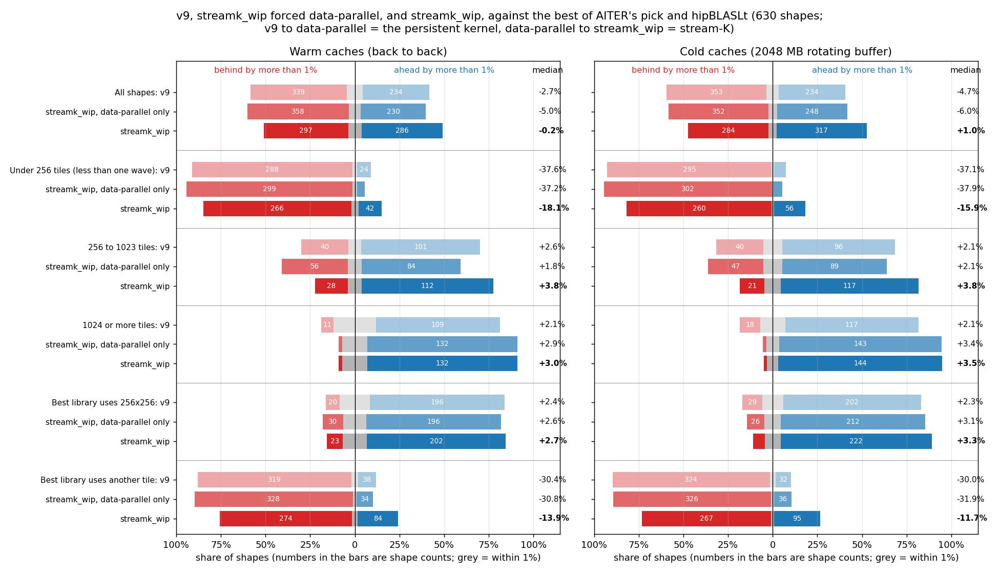
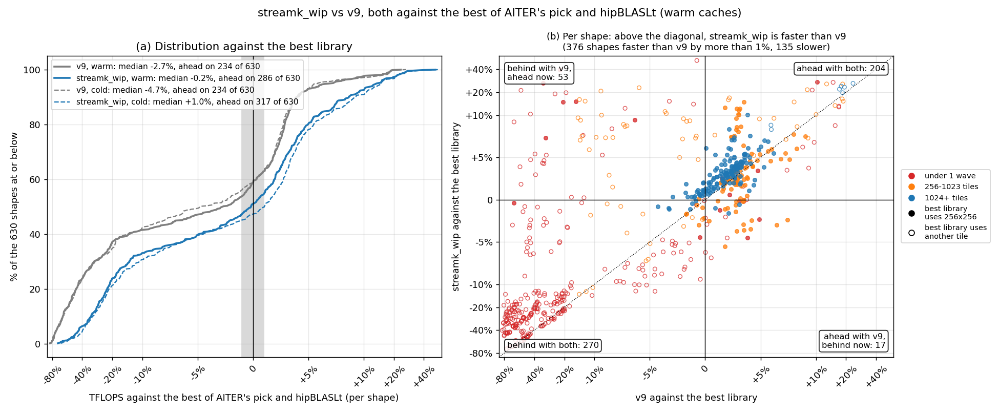
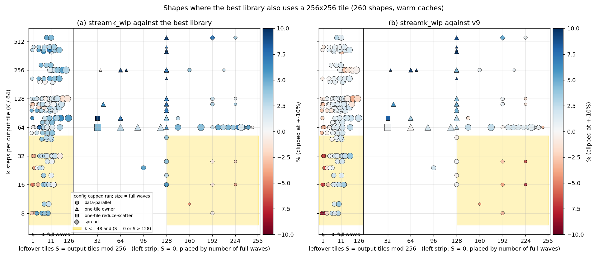
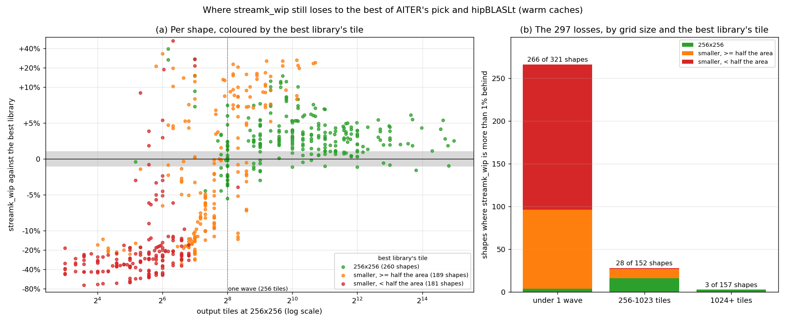
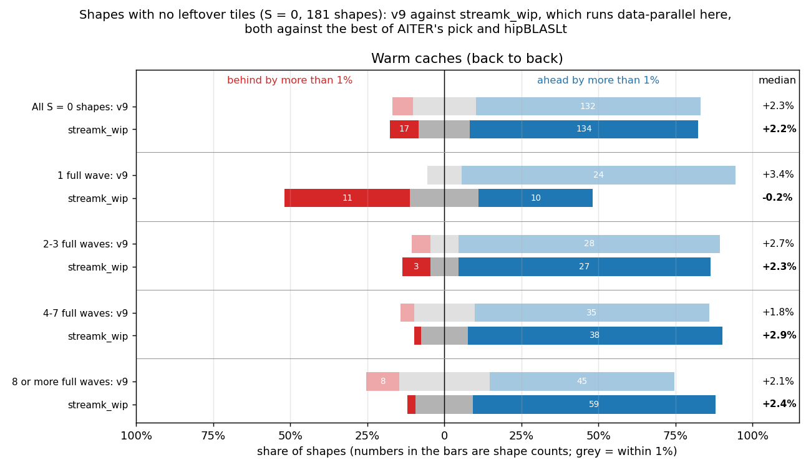
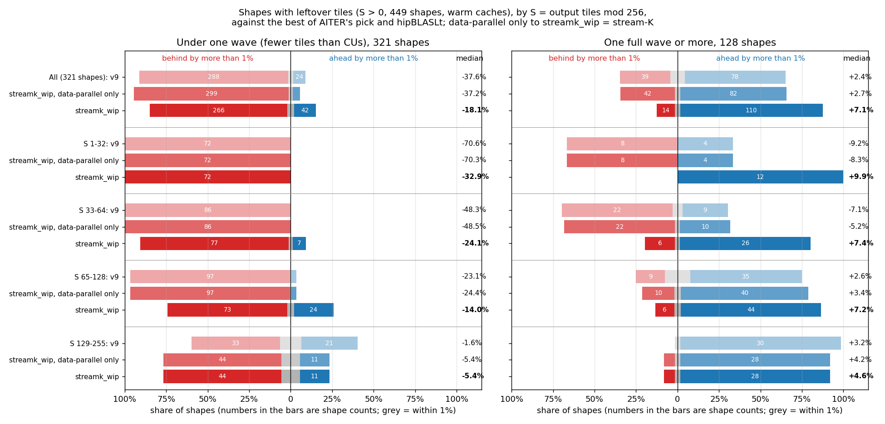
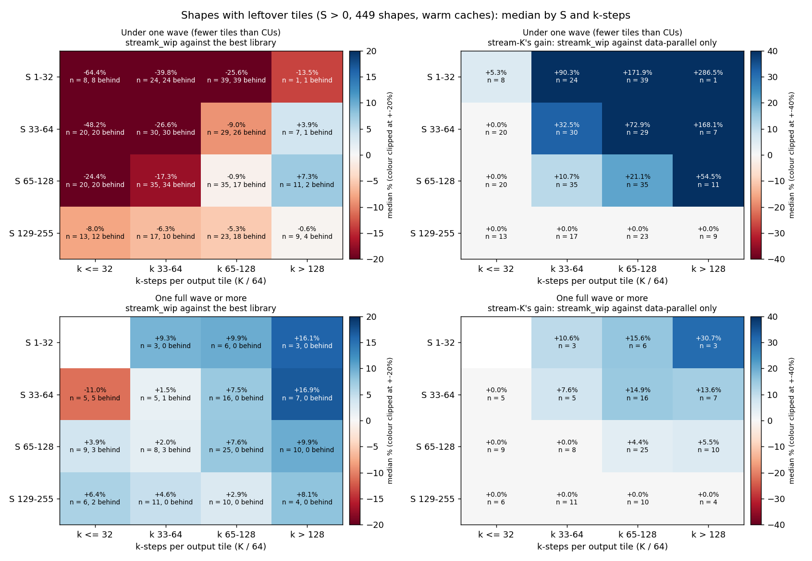

# Figures: streamk_wip (v20, capped) against the best of AITER's pick and hipBLASLt

Data: `details_capped_hbl.csv` (warm: back to back on the same buffers) and `details_capped_hbl_rot2048.csv` (cold: 2048 MB rotating buffer), 630 shapes, MI355X, torch 2.10.0+rocm7.2.4 with hipBLASLt 1.2.2, AITER `main` `a1455f1c4`, v20 snapshot `7c55c4017abfc6cc`.

The baseline on each shape is the faster of AITER's pick and hipBLASLt (the torch call AITER's `torch` libtype makes), with that kernel's tile. AITER itself dispatches the winner of its offline tuning, so this is a stricter bar than what AITER runs today. "Ahead" and "behind" mean a gap of more than 1%.

## Figure 0: summary

"Data-parallel only" is streamk_wip with `STREAMK_POLICY=dp`: the same persistent kernel without the stream-K split. v9 to data-parallel only is the persistent kernel's change; data-parallel only to streamk_wip is what stream-K adds.

| Caches | Shapes | Count | v9: faster | v9: within 1% | v9: slower | v9: median | data-parallel only: faster | data-parallel only: within 1% | data-parallel only: slower | data-parallel only: median | streamk_wip: faster | streamk_wip: within 1% | streamk_wip: slower | streamk_wip: median |
|---|---|---:|---:|---:|---:|---:|---:|---:|---:|---:|---:|---:|---:|---:|
| Warm | All shapes | 630 | 234 | 57 | 339 | -2.7% | 230 | 42 | 358 | -5.0% | 286 | 47 | 297 | -0.2% |
| Warm | Under 256 tiles (less than one wave) | 321 | 24 | 9 | 288 | -37.6% | 14 | 8 | 299 | -37.2% | 42 | 13 | 266 | -18.1% |
| Warm | 256 to 1023 tiles | 152 | 101 | 11 | 40 | +2.6% | 84 | 12 | 56 | +1.8% | 112 | 12 | 28 | +3.8% |
| Warm | 1024 or more tiles | 157 | 109 | 37 | 11 | +2.1% | 132 | 22 | 3 | +2.9% | 132 | 22 | 3 | +3.0% |
| Warm | Best library uses 256x256 | 260 | 196 | 44 | 20 | +2.4% | 196 | 34 | 30 | +2.6% | 202 | 35 | 23 | +2.7% |
| Warm | Best library uses another tile | 370 | 38 | 13 | 319 | -30.4% | 34 | 8 | 328 | -30.8% | 84 | 12 | 274 | -13.9% |
| Cold | All shapes | 630 | 234 | 43 | 353 | -4.7% | 248 | 30 | 352 | -6.0% | 317 | 29 | 284 | +1.0% |
| Cold | Under 256 tiles (less than one wave) | 321 | 21 | 5 | 295 | -37.1% | 16 | 3 | 302 | -37.9% | 56 | 5 | 260 | -15.9% |
| Cold | 256 to 1023 tiles | 152 | 96 | 16 | 40 | +2.1% | 89 | 16 | 47 | +2.1% | 117 | 14 | 21 | +3.8% |
| Cold | 1024 or more tiles | 157 | 117 | 22 | 18 | +2.1% | 143 | 11 | 3 | +3.4% | 144 | 10 | 3 | +3.5% |
| Cold | Best library uses 256x256 | 262 | 202 | 31 | 29 | +2.3% | 212 | 24 | 26 | +3.1% | 222 | 23 | 17 | +3.3% |
| Cold | Best library uses another tile | 368 | 32 | 12 | 324 | -30.0% | 36 | 6 | 326 | -31.9% | 95 | 6 | 267 | -11.7% |

## Figure 1: progress over v9

- Warm: v9 234 ahead, 57 within 1%, 339 behind, median -2.7%; streamk_wip 286 ahead, 47 within 1%, 297 behind, median -0.2%. streamk_wip improved on v9 by more than 1% on 376 shapes and fell back on 135. 53 shapes went from behind to ahead, 17 the other way. hipBLASLt is the faster library on 361 shapes; the best library uses 256x256 on 260.
- Cold: v9 234 ahead, 43 within 1%, 353 behind, median -4.7%; streamk_wip 317 ahead, 29 within 1%, 284 behind, median +1.0%. streamk_wip improved on v9 by more than 1% on 426 shapes and fell back on 114. 76 shapes went from behind to ahead, 12 the other way. hipBLASLt is the faster library on 367 shapes; the best library uses 256x256 on 262.

Cold version: `fig1_progress_cold.png` (both states are drawn in panel (a) of each).

## Figure 2: the same-tile losses, by S and k-steps

- Warm: 260 shapes where the best library uses 256x256; streamk_wip is behind on 23, 23 of them data-parallel and 15 in the shaded band (k <= 48 and S = 0 or S > 128).
  - In the band (56 shapes): against the best library 32 ahead, 9 within 1%, 15 behind, median +1.6%; against v9 24 ahead, 13 within 1%, 19 behind, median +0.5%.
  - Outside it (204 shapes): against the best library 170 ahead, 26 within 1%, 8 behind, median +3.1%; against v9 92 ahead, 81 within 1%, 31 behind, median +0.9%.
  - Worst: 4096x4096x1024 (S = 0, k = 16, data-parallel, -5.5% vs best, -7.2% vs v9); 2048x7168x1024 (S = 224, k = 16, data-parallel, -4.5% vs best, -8.0% vs v9); 2048x5120x640 (S = 160, k = 10, data-parallel, -4.5% vs best, -4.0% vs v9); 4096x4096x1536 (S = 0, k = 24, data-parallel, -3.7% vs best, -6.4% vs v9); 4096x4096x2048 (S = 0, k = 32, data-parallel, -3.6% vs best, -6.8% vs v9); 2048x8192x1024 (S = 0, k = 16, data-parallel, -3.4% vs best, -7.2% vs v9).
- Cold: 262 shapes where the best library uses 256x256; streamk_wip is behind on 17, 16 of them data-parallel and 15 in the shaded band (k <= 48 and S = 0 or S > 128).
  - In the band (56 shapes): against the best library 28 ahead, 13 within 1%, 15 behind, median +0.9%; against v9 33 ahead, 7 within 1%, 16 behind, median +1.5%.
  - Outside it (206 shapes): against the best library 194 ahead, 10 within 1%, 2 behind, median +3.8%; against v9 124 ahead, 64 within 1%, 18 behind, median +1.2%.
  - Worst: 4096x4096x1536 (S = 0, k = 24, data-parallel, -6.1% vs best, -7.9% vs v9); 4096x4096x512 (S = 0, k = 8, data-parallel, -5.2% vs best, -6.5% vs v9); 4096x4096x1024 (S = 0, k = 16, data-parallel, -5.0% vs best, -8.7% vs v9); 1024x16384x2048 (S = 0, k = 32, data-parallel, -4.2% vs best, -6.8% vs v9); 2048x7168x1024 (S = 224, k = 16, data-parallel, -4.1% vs best, -8.5% vs v9); 1024x2304x16384 (S = 36, k = 256, one-tile owner, n = 6, -3.8% vs best, +204.1% vs v9).

Cold version: `fig2_same_tile_S_k_cold.png`.

## Figure 3: where the remaining losses are

- Warm: streamk_wip is behind the best library on 297 shapes.
  - Best library tile 256x256 (260 shapes): 202 ahead, 35 within 1%, 23 behind, median +2.7%. Losses by grid size (under 1 wave / 256-1023 / 1024+): 4 / 16 / 3.
  - Best library tile smaller, >= half the area (189 shapes): 75 ahead, 11 within 1%, 103 behind, median -2.3%. Losses by grid size (under 1 wave / 256-1023 / 1024+): 92 / 11 / 0.
  - Best library tile smaller, < half the area (181 shapes): 9 ahead, 1 within 1%, 171 behind, median -27.2%. Losses by grid size (under 1 wave / 256-1023 / 1024+): 170 / 1 / 0.
- Cold: streamk_wip is behind the best library on 284 shapes.
  - Best library tile 256x256 (262 shapes): 222 ahead, 23 within 1%, 17 behind, median +3.3%. Losses by grid size (under 1 wave / 256-1023 / 1024+): 4 / 10 / 3.
  - Best library tile smaller, >= half the area (189 shapes): 84 ahead, 5 within 1%, 100 behind, median -2.4%. Losses by grid size (under 1 wave / 256-1023 / 1024+): 89 / 11 / 0.
  - Best library tile smaller, < half the area (179 shapes): 11 ahead, 1 within 1%, 167 behind, median -25.9%. Losses by grid size (under 1 wave / 256-1023 / 1024+): 167 / 0 / 0.

Cold version: `fig3_losses_cold.png`.

## Figure 4: shapes with no leftover tiles (S = 0)

With S = 0 capped always runs data-parallel, so streamk_wip here is the persistent data-parallel kernel and stream-K plays no part.

- Warm: All S = 0 shapes: v9 +2.3% (12 behind), streamk_wip +2.2% (17 behind) of 181; 1 full wave: v9 +3.4% (0 behind), streamk_wip -0.2% (11 behind) of 27; 2-3 full waves: v9 +2.7% (2 behind), streamk_wip +2.3% (3 behind) of 33; 4-7 full waves: v9 +1.8% (2 behind), streamk_wip +2.9% (1 behind) of 46; 8 or more full waves: v9 +2.1% (8 behind), streamk_wip +2.4% (2 behind) of 75.
- Cold: All S = 0 shapes: v9 +2.1% (18 behind), streamk_wip +2.9% (13 behind) of 181; 1 full wave: v9 +3.1% (0 behind), streamk_wip +1.0% (8 behind) of 27; 2-3 full waves: v9 +2.1% (1 behind), streamk_wip +2.7% (2 behind) of 33; 4-7 full waves: v9 +1.8% (9 behind), streamk_wip +3.1% (2 behind) of 46; 8 or more full waves: v9 +2.0% (8 behind), streamk_wip +3.4% (1 behind) of 75.

Cold version: `fig4_s0_by_waves_cold.png`.

## Figure 5: shapes with leftover tiles (S > 0), by S

Rows are S buckets; under one wave and one wave or more are separate panels. Data-parallel only to streamk_wip is stream-K's own effect. Cold version: `fig5_s_buckets_cold.png`.

## Figure 6: shapes with leftover tiles (S > 0), by S and k-steps

Each cell is the median over the shapes in it (n), with the number more than 1% behind the best library. Left: streamk_wip against the best library. Right: stream-K's gain, streamk_wip against the same kernel forced data-parallel; 0.0% means capped ran data-parallel on every shape in the cell. Cold version: `fig6_s_k_heatmap_cold.png`.
