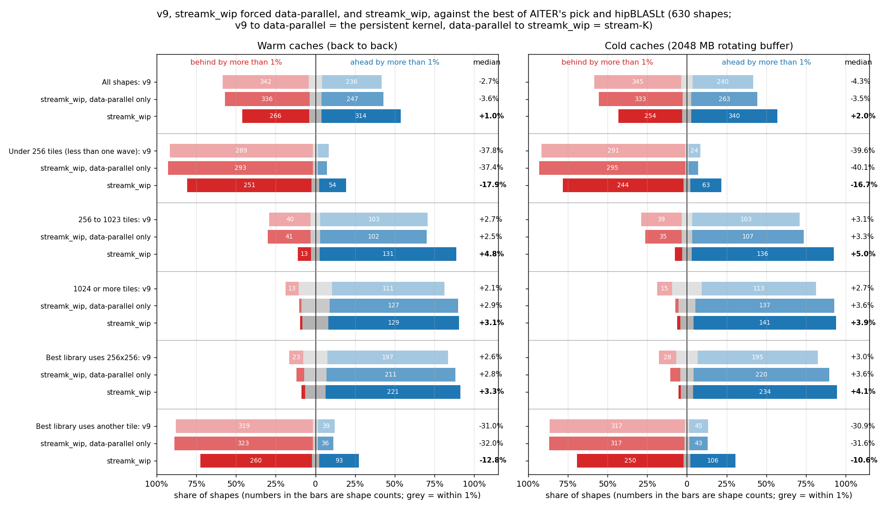
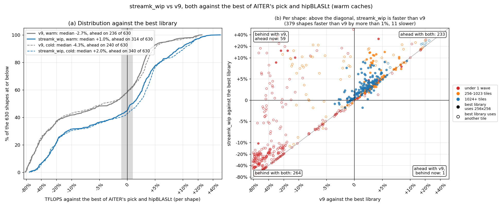
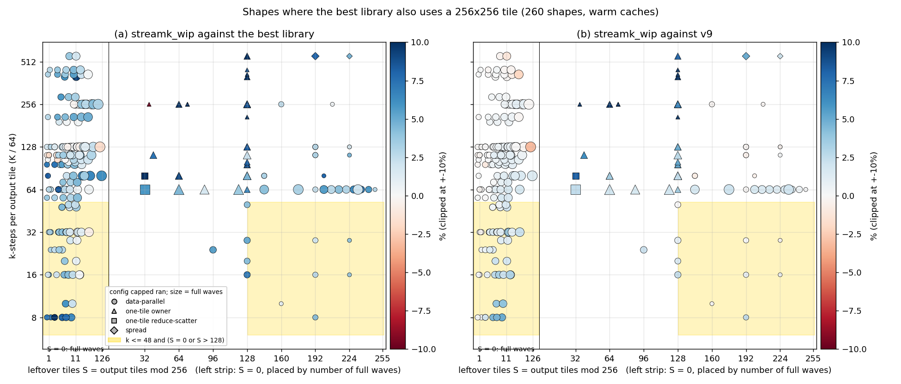
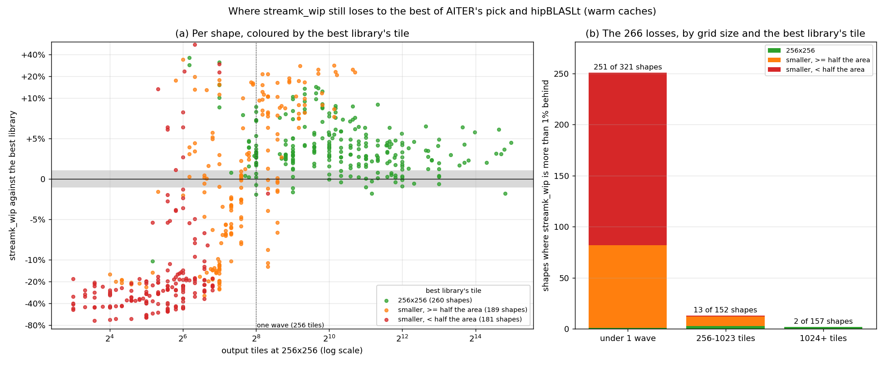
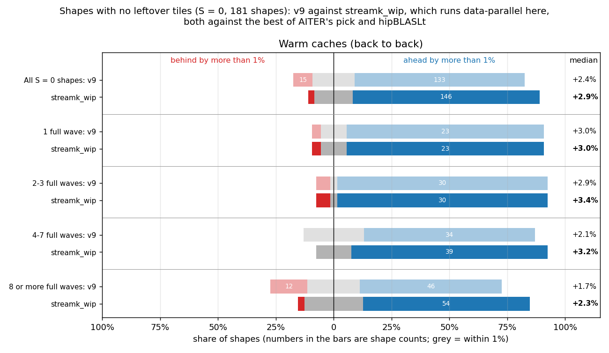
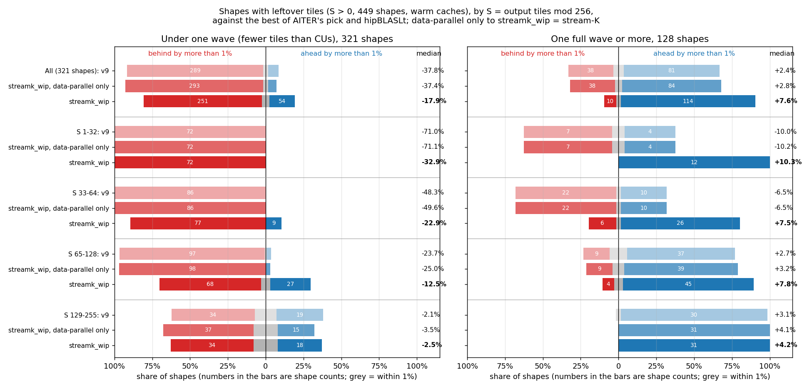
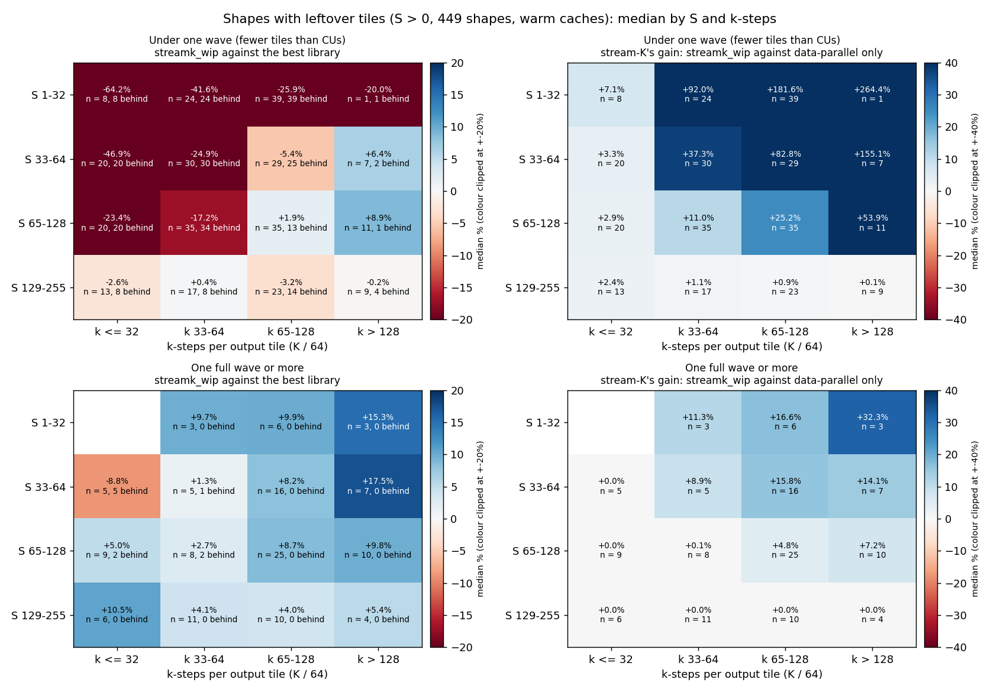

# Figures: streamk_wip (v20, capped) against the best of AITER's pick and hipBLASLt

Data: `details_aisched.csv` (warm) and `details_aisched_rot2048.csv` (cold: 2048 MB rotating buffer), 2026-10-06 overnight, 630 shapes, MI355X, torch 2.10.0+rocm7.2.4 with hipBLASLt 1.2.2, AITER `main` `a1455f1c4`; streamk_wip and its v9 compiled with AITER's llirSched copy, no amdgcnas hook; 3 rounds with fresh buffers, median.

The baseline on each shape is the faster of AITER's pick and hipBLASLt (the torch call AITER's `torch` libtype makes), with that kernel's tile. AITER itself dispatches the winner of its offline tuning, so this is a stricter bar than what AITER runs today. "Ahead" and "behind" mean a gap of more than 1%.

Layout: v9 and streamk_wip on the padded layout (each row stride that is a multiple of 512 bytes gets 256 more); AITER's pick and hipBLASLt contiguous, as AITER calls them.

## Figure 0: summary

"Data-parallel only" is streamk_wip with `STREAMK_POLICY=dp`: the same persistent kernel without the stream-K split. v9 to data-parallel only is the persistent kernel's change; data-parallel only to streamk_wip is what stream-K adds.

| Caches | Shapes | Count | v9: faster | v9: within 1% | v9: slower | v9: median | data-parallel only: faster | data-parallel only: within 1% | data-parallel only: slower | data-parallel only: median | streamk_wip: faster | streamk_wip: within 1% | streamk_wip: slower | streamk_wip: median |
|---|---|---:|---:|---:|---:|---:|---:|---:|---:|---:|---:|---:|---:|---:|
| Warm | All shapes | 630 | 236 | 52 | 342 | -2.7% | 247 | 47 | 336 | -3.6% | 314 | 50 | 266 | +1.0% |
| Warm | Under 256 tiles (less than one wave) | 321 | 22 | 10 | 289 | -37.8% | 18 | 10 | 293 | -37.4% | 54 | 16 | 251 | -17.9% |
| Warm | 256 to 1023 tiles | 152 | 103 | 9 | 40 | +2.7% | 102 | 9 | 41 | +2.5% | 131 | 8 | 13 | +4.8% |
| Warm | 1024 or more tiles | 157 | 111 | 33 | 13 | +2.1% | 127 | 28 | 2 | +2.9% | 129 | 26 | 2 | +3.1% |
| Warm | Best library uses 256x256 | 260 | 197 | 40 | 23 | +2.6% | 211 | 36 | 13 | +2.8% | 221 | 33 | 6 | +3.3% |
| Warm | Best library uses another tile | 370 | 39 | 12 | 319 | -31.0% | 36 | 11 | 323 | -32.0% | 93 | 17 | 260 | -12.8% |
| Cold | All shapes | 630 | 240 | 45 | 345 | -4.3% | 263 | 34 | 333 | -3.5% | 340 | 36 | 254 | +2.0% |
| Cold | Under 256 tiles (less than one wave) | 321 | 24 | 6 | 291 | -39.6% | 19 | 7 | 295 | -40.1% | 63 | 14 | 244 | -16.7% |
| Cold | 256 to 1023 tiles | 152 | 103 | 10 | 39 | +3.1% | 107 | 10 | 35 | +3.3% | 136 | 9 | 7 | +5.0% |
| Cold | 1024 or more tiles | 157 | 113 | 29 | 15 | +2.7% | 137 | 17 | 3 | +3.6% | 141 | 13 | 3 | +3.9% |
| Cold | Best library uses 256x256 | 258 | 195 | 35 | 28 | +3.0% | 220 | 22 | 16 | +3.6% | 234 | 20 | 4 | +4.1% |
| Cold | Best library uses another tile | 372 | 45 | 10 | 317 | -30.9% | 43 | 12 | 317 | -31.6% | 106 | 16 | 250 | -10.6% |

## Figure 1: progress over v9

- Warm: v9 236 ahead, 52 within 1%, 342 behind, median -2.7%; streamk_wip 314 ahead, 50 within 1%, 266 behind, median +1.0%. streamk_wip improved on v9 by more than 1% on 379 shapes and fell back on 11. 59 shapes went from behind to ahead, 1 the other way. hipBLASLt is the faster library on 374 shapes; the best library uses 256x256 on 260.
- Cold: v9 240 ahead, 45 within 1%, 345 behind, median -4.3%; streamk_wip 340 ahead, 36 within 1%, 254 behind, median +2.0%. streamk_wip improved on v9 by more than 1% on 392 shapes and fell back on 11. 73 shapes went from behind to ahead, 1 the other way. hipBLASLt is the faster library on 400 shapes; the best library uses 256x256 on 258.

Cold version: `fig1_progress_cold.png` (both states are drawn in panel (a) of each).

## Figure 2: the same-tile losses, by S and k-steps

- Warm: 260 shapes where the best library uses 256x256; streamk_wip is behind on 6, 5 of them data-parallel and 0 in the shaded band (k <= 48 and S = 0 or S > 128).
  - In the band (56 shapes): against the best library 48 ahead, 8 within 1%, 0 behind, median +3.4%; against v9 34 ahead, 22 within 1%, 0 behind, median +1.2%.
  - Outside it (204 shapes): against the best library 173 ahead, 25 within 1%, 6 behind, median +3.3%; against v9 73 ahead, 127 within 1%, 4 behind, median +0.6%.
  - Worst: 1024x2304x16384 (S = 36, k = 256, one-tile owner, n = 6, -10.5% vs best, +151.7% vs v9); 32768x512x7168 (S = 0, k = 112, data-parallel, -1.9% vs best, -0.3% vs v9); 16384x9216x16384 (S = 0, k = 256, data-parallel, -1.8% vs best, -0.1% vs v9); 32768x57344x8192 (S = 0, k = 128, data-parallel, -1.8% vs best, -3.2% vs v9); 2048x16384x6656 (S = 0, k = 104, data-parallel, -1.6% vs best, +0.1% vs v9); 16384x2048x7168 (S = 0, k = 112, data-parallel, -1.1% vs best, +0.1% vs v9).
- Cold: 258 shapes where the best library uses 256x256; streamk_wip is behind on 4, 3 of them data-parallel and 1 in the shaded band (k <= 48 and S = 0 or S > 128).
  - In the band (56 shapes): against the best library 45 ahead, 10 within 1%, 1 behind, median +2.7%; against v9 38 ahead, 18 within 1%, 0 behind, median +1.8%.
  - Outside it (202 shapes): against the best library 189 ahead, 10 within 1%, 3 behind, median +4.3%; against v9 80 ahead, 116 within 1%, 6 behind, median +0.7%.
  - Worst: 1024x2304x16384 (S = 36, k = 256, one-tile owner, n = 6, -21.3% vs best, +181.6% vs v9); 16384x7168x512 (S = 0, k = 8, data-parallel, -3.9% vs best, +8.1% vs v9); 16384x9216x16384 (S = 0, k = 256, data-parallel, -1.6% vs best, -0.3% vs v9); 32768x57344x8192 (S = 0, k = 128, data-parallel, -1.2% vs best, -2.5% vs v9).

Cold version: `fig2_same_tile_S_k_cold.png`.

## Figure 3: where the remaining losses are

- Warm: streamk_wip is behind the best library on 266 shapes.
  - Best library tile 256x256 (260 shapes): 221 ahead, 33 within 1%, 6 behind, median +3.3%. Losses by grid size (under 1 wave / 256-1023 / 1024+): 1 / 3 / 2.
  - Best library tile smaller, >= half the area (189 shapes): 82 ahead, 17 within 1%, 90 behind, median -0.2%. Losses by grid size (under 1 wave / 256-1023 / 1024+): 81 / 9 / 0.
  - Best library tile smaller, < half the area (181 shapes): 11 ahead, 0 within 1%, 170 behind, median -26.0%. Losses by grid size (under 1 wave / 256-1023 / 1024+): 169 / 1 / 0.
- Cold: streamk_wip is behind the best library on 254 shapes.
  - Best library tile 256x256 (258 shapes): 234 ahead, 20 within 1%, 4 behind, median +4.1%. Losses by grid size (under 1 wave / 256-1023 / 1024+): 1 / 0 / 3.
  - Best library tile smaller, >= half the area (193 shapes): 96 ahead, 15 within 1%, 82 behind, median +1.0%. Losses by grid size (under 1 wave / 256-1023 / 1024+): 75 / 7 / 0.
  - Best library tile smaller, < half the area (179 shapes): 10 ahead, 1 within 1%, 168 behind, median -27.3%. Losses by grid size (under 1 wave / 256-1023 / 1024+): 168 / 0 / 0.

Cold version: `fig3_losses_cold.png`.

## Figure 4: shapes with no leftover tiles (S = 0)

With S = 0 capped always runs data-parallel, so streamk_wip here is the persistent data-parallel kernel and stream-K plays no part.

- Warm: All S = 0 shapes: v9 +2.4% (15 behind), streamk_wip +2.9% (5 behind) of 181; 1 full wave: v9 +3.0% (1 behind), streamk_wip +3.0% (1 behind) of 27; 2-3 full waves: v9 +2.9% (2 behind), streamk_wip +3.4% (2 behind) of 33; 4-7 full waves: v9 +2.1% (0 behind), streamk_wip +3.2% (0 behind) of 46; 8 or more full waves: v9 +1.7% (12 behind), streamk_wip +2.3% (2 behind) of 75.
- Cold: All S = 0 shapes: v9 +3.1% (18 behind), streamk_wip +3.7% (3 behind) of 181; 1 full wave: v9 +4.5% (1 behind), streamk_wip +4.3% (0 behind) of 27; 2-3 full waves: v9 +3.4% (2 behind), streamk_wip +3.9% (0 behind) of 33; 4-7 full waves: v9 +2.9% (7 behind), streamk_wip +3.7% (1 behind) of 46; 8 or more full waves: v9 +2.5% (8 behind), streamk_wip +3.2% (2 behind) of 75.

Cold version: `fig4_s0_by_waves_cold.png`.

## Figure 5: shapes with leftover tiles (S > 0), by S

Rows are S buckets; under one wave and one wave or more are separate panels. Data-parallel only to streamk_wip is stream-K's own effect. Cold version: `fig5_s_buckets_cold.png`.

## Figure 6: shapes with leftover tiles (S > 0), by S and k-steps

Each cell is the median over the shapes in it (n), with the number more than 1% behind the best library. Left: streamk_wip against the best library. Right: stream-K's gain, streamk_wip against the same kernel forced data-parallel; 0.0% means capped ran data-parallel on every shape in the cell. Cold version: `fig6_s_k_heatmap_cold.png`.

## Figure 7: padding, spread between fresh-buffer rounds and padded against contiguous

Top: share of shapes (with padded x and w strides) whose spread between rounds exceeds x, per kernel; dashed contiguous, solid padded. Bottom: median padded / contiguous TFLOPS - 1 by grid size, and on the control shapes (K % 256 == 128, x and w not padded). AITER's pick leaves out, on both layouts, the shapes where its padded call copied its inputs.

- Warm: v9: median spread 0.27% contiguous, 0.28% padded; over 2%: 19 and 21 of 614; streamk_wip: median spread 0.40% contiguous, 0.34% padded; over 2%: 24 and 32 of 614; AITER's pick: median spread 0.46% contiguous, 0.35% padded; over 2%: 13 and 20 of 362; hipBLASLt: median spread 0.39% contiguous, 0.38% padded; over 2%: 52 and 68 of 614.
- Cold: v9: median spread 0.29% contiguous, 0.28% padded; over 2%: 11 and 7 of 614; streamk_wip: median spread 0.66% contiguous, 0.29% padded; over 2%: 17 and 20 of 614; AITER's pick: median spread 0.45% contiguous, 0.34% padded; over 2%: 15 and 16 of 362; hipBLASLt: median spread 0.42% contiguous, 0.41% padded; over 2%: 43 and 51 of 614.
