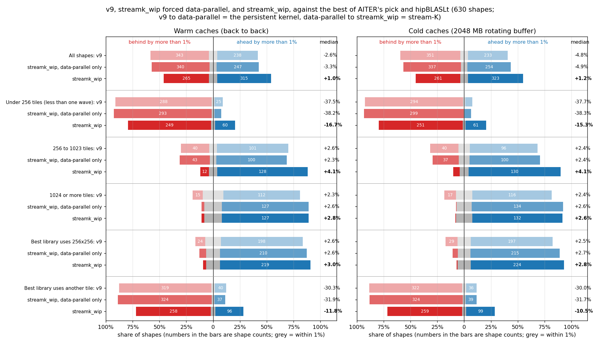
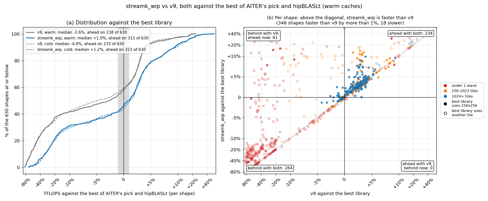
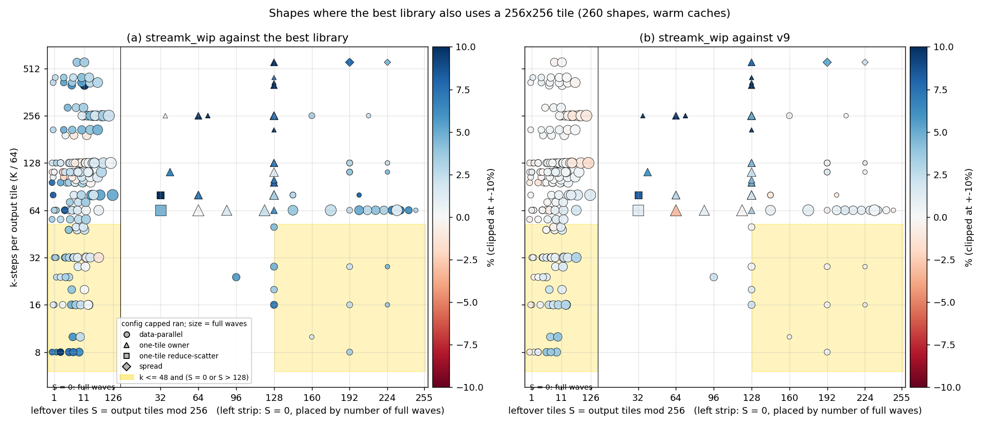
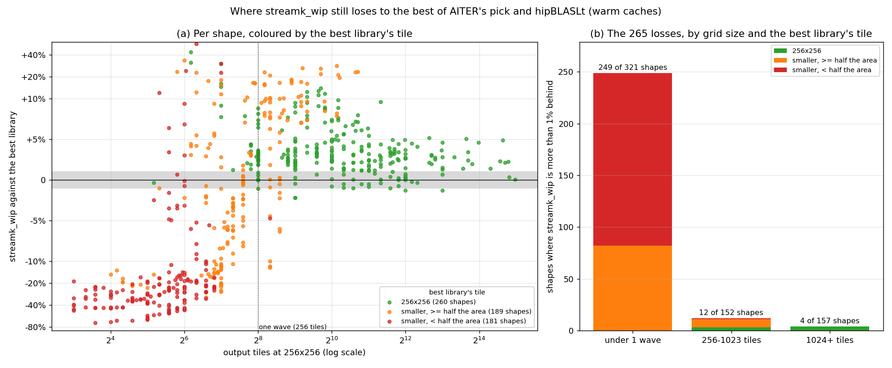
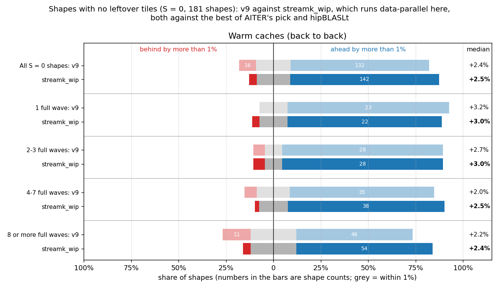
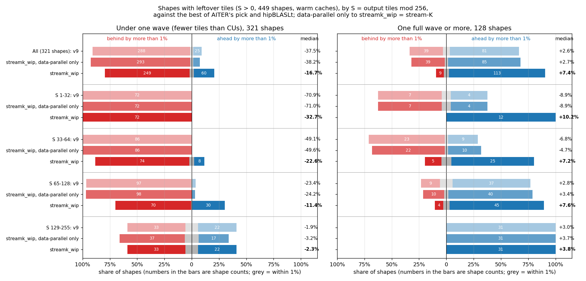
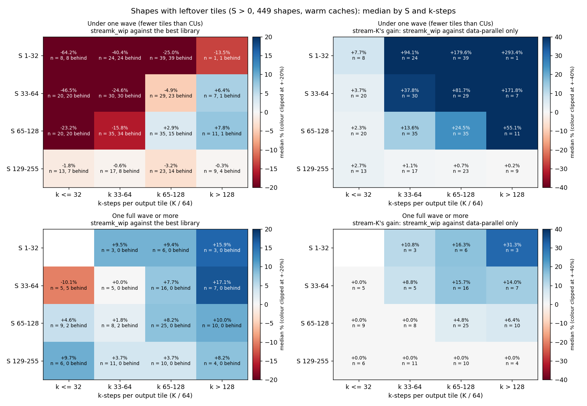
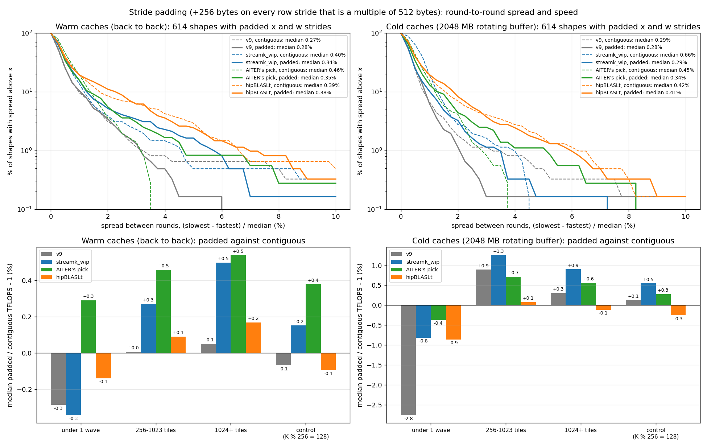

# Figures: streamk_wip (v20, capped) against the best of AITER's pick and hipBLASLt

Data: `details_aisched.csv` (warm) and `details_aisched_rot2048.csv` (cold: 2048 MB rotating buffer), 2026-10-06 overnight, 630 shapes, MI355X, torch 2.10.0+rocm7.2.4 with hipBLASLt 1.2.2, AITER `main` `a1455f1c4`; streamk_wip and its v9 compiled with AITER's llirSched copy, no amdgcnas hook; 3 rounds with fresh buffers, median.

The baseline on each shape is the faster of AITER's pick and hipBLASLt (the torch call AITER's `torch` libtype makes), with that kernel's tile. AITER itself dispatches the winner of its offline tuning, so this is a stricter bar than what AITER runs today. "Ahead" and "behind" mean a gap of more than 1%.

## Figure 0: summary

"Data-parallel only" is streamk_wip with `STREAMK_POLICY=dp`: the same persistent kernel without the stream-K split. v9 to data-parallel only is the persistent kernel's change; data-parallel only to streamk_wip is what stream-K adds.

| Caches | Shapes | Count | v9: faster | v9: within 1% | v9: slower | v9: median | data-parallel only: faster | data-parallel only: within 1% | data-parallel only: slower | data-parallel only: median | streamk_wip: faster | streamk_wip: within 1% | streamk_wip: slower | streamk_wip: median |
|---|---|---:|---:|---:|---:|---:|---:|---:|---:|---:|---:|---:|---:|---:|
| Warm | All shapes | 630 | 238 | 49 | 343 | -2.6% | 247 | 43 | 340 | -3.3% | 315 | 50 | 265 | +1.0% |
| Warm | Under 256 tiles (less than one wave) | 321 | 25 | 8 | 288 | -37.5% | 20 | 8 | 293 | -38.2% | 60 | 12 | 249 | -16.7% |
| Warm | 256 to 1023 tiles | 152 | 101 | 11 | 40 | +2.6% | 100 | 9 | 43 | +2.3% | 128 | 12 | 12 | +4.1% |
| Warm | 1024 or more tiles | 157 | 112 | 30 | 15 | +2.3% | 127 | 26 | 4 | +2.6% | 127 | 26 | 4 | +2.8% |
| Warm | Best library uses 256x256 | 260 | 198 | 38 | 24 | +2.6% | 210 | 34 | 16 | +2.6% | 219 | 34 | 7 | +3.0% |
| Warm | Best library uses another tile | 370 | 40 | 11 | 319 | -30.3% | 37 | 9 | 324 | -31.9% | 96 | 16 | 258 | -11.8% |
| Cold | All shapes | 630 | 233 | 46 | 351 | -4.8% | 254 | 39 | 337 | -4.9% | 323 | 46 | 261 | +1.2% |
| Cold | Under 256 tiles (less than one wave) | 321 | 21 | 6 | 294 | -37.7% | 20 | 2 | 299 | -38.3% | 61 | 9 | 251 | -15.3% |
| Cold | 256 to 1023 tiles | 152 | 96 | 16 | 40 | +2.4% | 100 | 15 | 37 | +2.4% | 130 | 13 | 9 | +4.1% |
| Cold | 1024 or more tiles | 157 | 116 | 24 | 17 | +2.4% | 134 | 22 | 1 | +2.6% | 132 | 24 | 1 | +2.6% |
| Cold | Best library uses 256x256 | 258 | 197 | 32 | 29 | +2.5% | 215 | 30 | 13 | +2.7% | 224 | 32 | 2 | +2.8% |
| Cold | Best library uses another tile | 372 | 36 | 14 | 322 | -30.0% | 39 | 9 | 324 | -31.7% | 99 | 14 | 259 | -10.5% |

## Figure 1: progress over v9

- Warm: v9 238 ahead, 49 within 1%, 343 behind, median -2.6%; streamk_wip 315 ahead, 50 within 1%, 265 behind, median +1.0%. streamk_wip improved on v9 by more than 1% on 346 shapes and fell back on 18. 61 shapes went from behind to ahead, 0 the other way. hipBLASLt is the faster library on 374 shapes; the best library uses 256x256 on 260.
- Cold: v9 233 ahead, 46 within 1%, 351 behind, median -4.8%; streamk_wip 323 ahead, 46 within 1%, 261 behind, median +1.2%. streamk_wip improved on v9 by more than 1% on 357 shapes and fell back on 20. 73 shapes went from behind to ahead, 0 the other way. hipBLASLt is the faster library on 400 shapes; the best library uses 256x256 on 258.

Cold version: `fig1_progress_cold.png` (both states are drawn in panel (a) of each).

## Figure 2: the same-tile losses, by S and k-steps

- Warm: 260 shapes where the best library uses 256x256; streamk_wip is behind on 7, 7 of them data-parallel and 2 in the shaded band (k <= 48 and S = 0 or S > 128).
  - In the band (56 shapes): against the best library 46 ahead, 8 within 1%, 2 behind, median +3.0%; against v9 27 ahead, 29 within 1%, 0 behind, median +0.8%.
  - Outside it (204 shapes): against the best library 173 ahead, 26 within 1%, 5 behind, median +3.0%; against v9 53 ahead, 140 within 1%, 11 behind, median +0.3%.
  - Worst: 16384x2048x7168 (S = 0, k = 112, data-parallel, -2.2% vs best, -0.0% vs v9); 2048x16384x6656 (S = 0, k = 104, data-parallel, -2.2% vs best, -0.2% vs v9); 16384x16384x2048 (S = 0, k = 32, data-parallel, -1.3% vs best, +2.0% vs v9); 32768x16384x2048 (S = 0, k = 32, data-parallel, -1.3% vs best, +3.0% vs v9); 16384x1024x7168 (S = 0, k = 112, data-parallel, -1.0% vs best, -0.5% vs v9); 32768x6144x12288 (S = 0, k = 192, data-parallel, -1.0% vs best, +0.3% vs v9).
- Cold: 258 shapes where the best library uses 256x256; streamk_wip is behind on 2, 1 of them data-parallel and 1 in the shaded band (k <= 48 and S = 0 or S > 128).
  - In the band (56 shapes): against the best library 36 ahead, 19 within 1%, 1 behind, median +1.4%; against v9 31 ahead, 23 within 1%, 2 behind, median +1.3%.
  - Outside it (202 shapes): against the best library 188 ahead, 13 within 1%, 1 behind, median +3.1%; against v9 57 ahead, 135 within 1%, 10 behind, median +0.2%.
  - Worst: 1024x2304x16384 (S = 36, k = 256, one-tile owner, n = 6, -4.1% vs best, +205.7% vs v9); 16384x7168x512 (S = 0, k = 8, data-parallel, -1.9% vs best, +7.5% vs v9).

Cold version: `fig2_same_tile_S_k_cold.png`.

## Figure 3: where the remaining losses are

- Warm: streamk_wip is behind the best library on 265 shapes.
  - Best library tile 256x256 (260 shapes): 219 ahead, 34 within 1%, 7 behind, median +3.0%. Losses by grid size (under 1 wave / 256-1023 / 1024+): 0 / 3 / 4.
  - Best library tile smaller, >= half the area (189 shapes): 86 ahead, 13 within 1%, 90 behind, median -0.4%. Losses by grid size (under 1 wave / 256-1023 / 1024+): 82 / 8 / 0.
  - Best library tile smaller, < half the area (181 shapes): 10 ahead, 3 within 1%, 168 behind, median -25.3%. Losses by grid size (under 1 wave / 256-1023 / 1024+): 167 / 1 / 0.
- Cold: streamk_wip is behind the best library on 261 shapes.
  - Best library tile 256x256 (258 shapes): 224 ahead, 32 within 1%, 2 behind, median +2.8%. Losses by grid size (under 1 wave / 256-1023 / 1024+): 1 / 0 / 1.
  - Best library tile smaller, >= half the area (193 shapes): 88 ahead, 12 within 1%, 93 behind, median -0.3%. Losses by grid size (under 1 wave / 256-1023 / 1024+): 84 / 9 / 0.
  - Best library tile smaller, < half the area (179 shapes): 11 ahead, 2 within 1%, 166 behind, median -26.1%. Losses by grid size (under 1 wave / 256-1023 / 1024+): 166 / 0 / 0.

Cold version: `fig3_losses_cold.png`.

## Figure 4: shapes with no leftover tiles (S = 0)

With S = 0 capped always runs data-parallel, so streamk_wip here is the persistent data-parallel kernel and stream-K plays no part.

- Warm: All S = 0 shapes: v9 +2.4% (16 behind), streamk_wip +2.5% (7 behind) of 181; 1 full wave: v9 +3.2% (0 behind), streamk_wip +3.0% (1 behind) of 27; 2-3 full waves: v9 +2.7% (2 behind), streamk_wip +3.0% (2 behind) of 33; 4-7 full waves: v9 +2.0% (3 behind), streamk_wip +2.5% (1 behind) of 46; 8 or more full waves: v9 +2.2% (11 behind), streamk_wip +2.4% (3 behind) of 75.
- Cold: All S = 0 shapes: v9 +2.4% (18 behind), streamk_wip +2.4% (1 behind) of 181; 1 full wave: v9 +2.9% (0 behind), streamk_wip +2.5% (0 behind) of 27; 2-3 full waves: v9 +2.1% (2 behind), streamk_wip +2.3% (0 behind) of 33; 4-7 full waves: v9 +2.0% (8 behind), streamk_wip +2.3% (1 behind) of 46; 8 or more full waves: v9 +2.5% (8 behind), streamk_wip +2.6% (0 behind) of 75.

Cold version: `fig4_s0_by_waves_cold.png`.

## Figure 5: shapes with leftover tiles (S > 0), by S

Rows are S buckets; under one wave and one wave or more are separate panels. Data-parallel only to streamk_wip is stream-K's own effect. Cold version: `fig5_s_buckets_cold.png`.

## Figure 6: shapes with leftover tiles (S > 0), by S and k-steps

Each cell is the median over the shapes in it (n), with the number more than 1% behind the best library. Left: streamk_wip against the best library. Right: stream-K's gain, streamk_wip against the same kernel forced data-parallel; 0.0% means capped ran data-parallel on every shape in the cell. Cold version: `fig6_s_k_heatmap_cold.png`.

## Figure 7: padding, spread between fresh-buffer rounds and padded against contiguous

Top: share of shapes (with padded x and w strides) whose spread between rounds exceeds x, per kernel; dashed contiguous, solid padded. Bottom: median padded / contiguous TFLOPS - 1 by grid size, and on the control shapes (K % 256 == 128, x and w not padded). AITER's pick leaves out, on both layouts, the shapes where its padded call copied its inputs.

- Warm: v9: median spread 0.27% contiguous, 0.28% padded; over 2%: 19 and 21 of 614; streamk_wip: median spread 0.40% contiguous, 0.34% padded; over 2%: 24 and 32 of 614; AITER's pick: median spread 0.46% contiguous, 0.35% padded; over 2%: 13 and 20 of 362; hipBLASLt: median spread 0.39% contiguous, 0.38% padded; over 2%: 52 and 68 of 614.
- Cold: v9: median spread 0.29% contiguous, 0.28% padded; over 2%: 11 and 7 of 614; streamk_wip: median spread 0.66% contiguous, 0.29% padded; over 2%: 17 and 20 of 614; AITER's pick: median spread 0.45% contiguous, 0.34% padded; over 2%: 15 and 16 of 362; hipBLASLt: median spread 0.42% contiguous, 0.41% padded; over 2%: 43 and 51 of 614.
