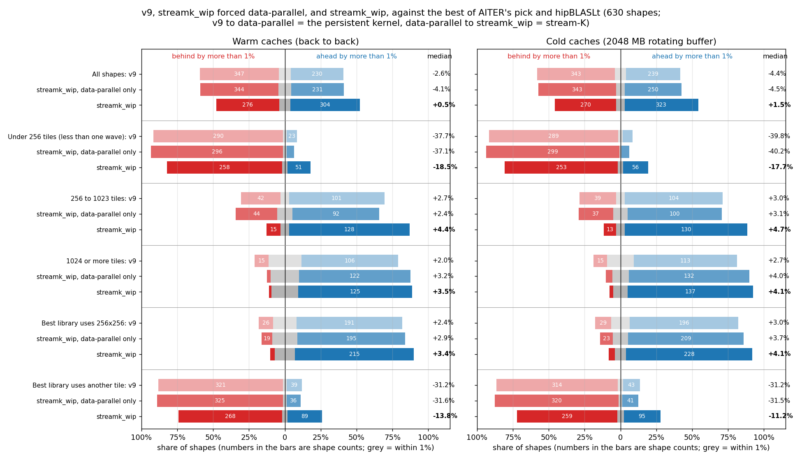
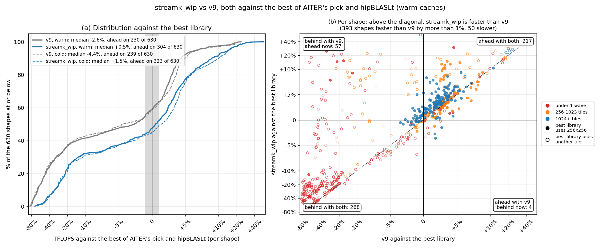
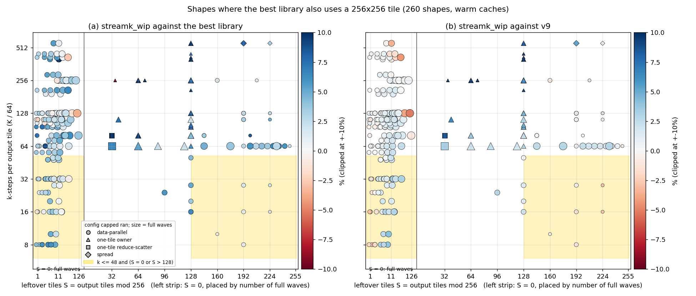
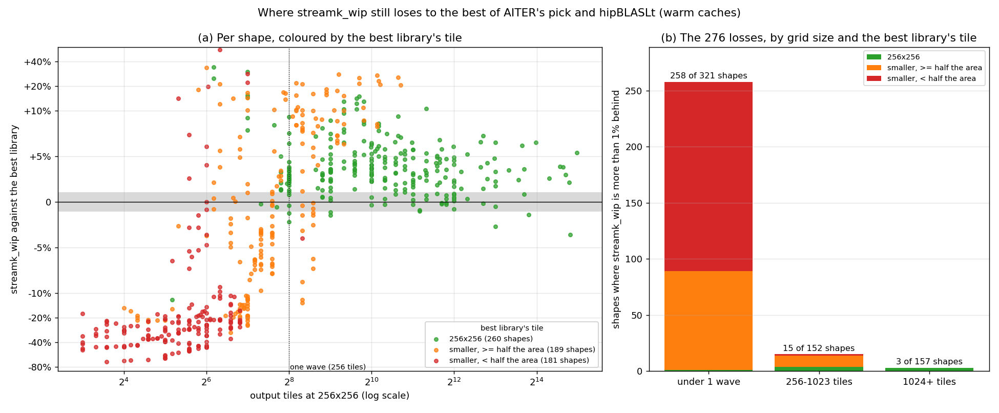
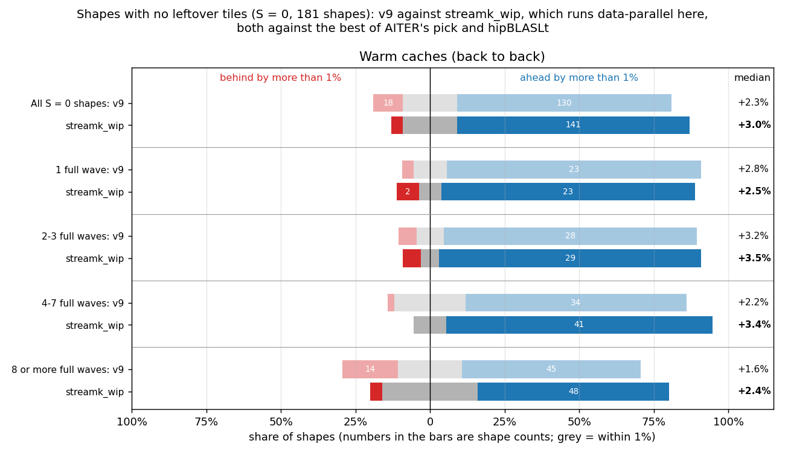
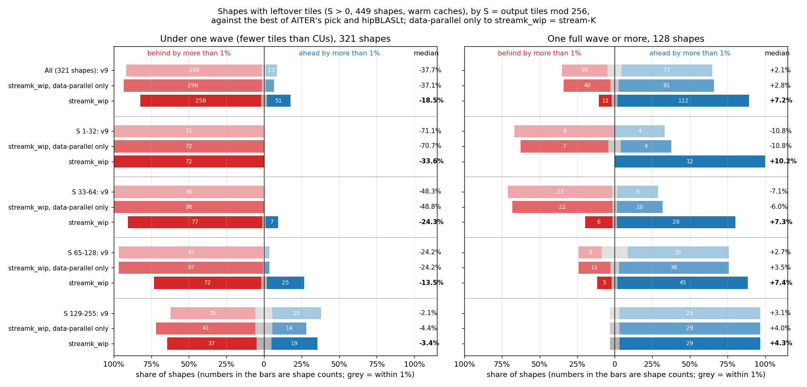
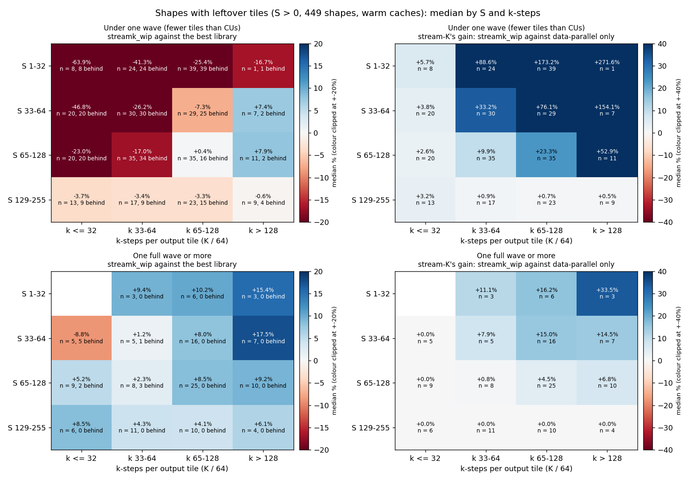
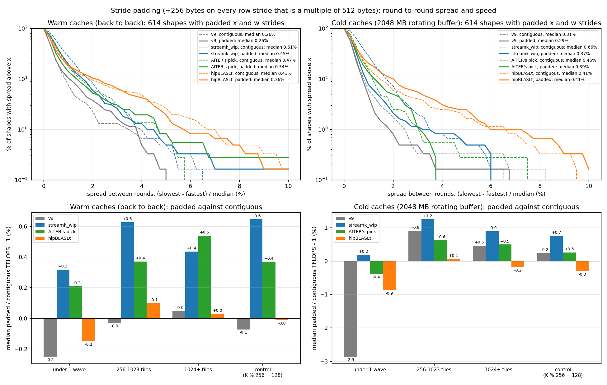

# Figures: streamk_wip (v20, capped) against the best of AITER's pick and hipBLASLt

Data: `details_v9fb_pad.csv` (warm) and `details_v9fb_pad_rot2048.csv` (cold: 2048 MB rotating buffer), Oct 6, 630 shapes, MI355X, torch 2.10.0+rocm7.2.4 with hipBLASLt 1.2.2, AITER `main` `a1455f1c4`, v20 snapshot `56e1e2af1bb77dfa` (v9 for one-wave data-parallel), 3 rounds with fresh buffers, median.

The baseline on each shape is the faster of AITER's pick and hipBLASLt (the torch call AITER's `torch` libtype makes), with that kernel's tile. AITER itself dispatches the winner of its offline tuning, so this is a stricter bar than what AITER runs today. "Ahead" and "behind" mean a gap of more than 1%.

Layout: v9 and streamk_wip on the padded layout (each row stride that is a multiple of 512 bytes gets 256 more); AITER's pick and hipBLASLt contiguous, as AITER calls them.

## Figure 0: summary

"Data-parallel only" is streamk_wip with `STREAMK_POLICY=dp`: the same persistent kernel without the stream-K split. v9 to data-parallel only is the persistent kernel's change; data-parallel only to streamk_wip is what stream-K adds.

| Caches | Shapes | Count | v9: faster | v9: within 1% | v9: slower | v9: median | data-parallel only: faster | data-parallel only: within 1% | data-parallel only: slower | data-parallel only: median | streamk_wip: faster | streamk_wip: within 1% | streamk_wip: slower | streamk_wip: median |
|---|---|---:|---:|---:|---:|---:|---:|---:|---:|---:|---:|---:|---:|---:|
| Warm | All shapes | 630 | 230 | 53 | 347 | -2.6% | 231 | 55 | 344 | -4.1% | 304 | 50 | 276 | +0.5% |
| Warm | Under 256 tiles (less than one wave) | 321 | 23 | 8 | 290 | -37.7% | 17 | 8 | 296 | -37.1% | 51 | 12 | 258 | -18.5% |
| Warm | 256 to 1023 tiles | 152 | 101 | 9 | 42 | +2.7% | 92 | 16 | 44 | +2.4% | 128 | 9 | 15 | +4.4% |
| Warm | 1024 or more tiles | 157 | 106 | 36 | 15 | +2.0% | 122 | 31 | 4 | +3.2% | 125 | 29 | 3 | +3.5% |
| Warm | Best library uses 256x256 | 260 | 191 | 43 | 26 | +2.4% | 195 | 46 | 19 | +2.9% | 215 | 37 | 8 | +3.4% |
| Warm | Best library uses another tile | 370 | 39 | 10 | 321 | -31.2% | 36 | 9 | 325 | -31.6% | 89 | 13 | 268 | -13.8% |
| Cold | All shapes | 630 | 239 | 48 | 343 | -4.4% | 250 | 37 | 343 | -4.5% | 323 | 37 | 270 | +1.5% |
| Cold | Under 256 tiles (less than one wave) | 321 | 22 | 10 | 289 | -39.8% | 18 | 4 | 299 | -40.2% | 56 | 12 | 253 | -17.7% |
| Cold | 256 to 1023 tiles | 152 | 104 | 9 | 39 | +3.0% | 100 | 15 | 37 | +3.1% | 130 | 9 | 13 | +4.7% |
| Cold | 1024 or more tiles | 157 | 113 | 29 | 15 | +2.7% | 132 | 18 | 7 | +4.0% | 137 | 16 | 4 | +4.1% |
| Cold | Best library uses 256x256 | 259 | 196 | 34 | 29 | +3.0% | 209 | 27 | 23 | +3.7% | 228 | 20 | 11 | +4.1% |
| Cold | Best library uses another tile | 371 | 43 | 14 | 314 | -31.2% | 41 | 10 | 320 | -31.5% | 95 | 17 | 259 | -11.2% |

## Figure 1: progress over v9

- Warm: v9 230 ahead, 53 within 1%, 347 behind, median -2.6%; streamk_wip 304 ahead, 50 within 1%, 276 behind, median +0.5%. streamk_wip improved on v9 by more than 1% on 393 shapes and fell back on 50. 57 shapes went from behind to ahead, 4 the other way. hipBLASLt is the faster library on 374 shapes; the best library uses 256x256 on 260.
- Cold: v9 239 ahead, 48 within 1%, 343 behind, median -4.4%; streamk_wip 323 ahead, 37 within 1%, 270 behind, median +1.5%. streamk_wip improved on v9 by more than 1% on 400 shapes and fell back on 44. 65 shapes went from behind to ahead, 3 the other way. hipBLASLt is the faster library on 395 shapes; the best library uses 256x256 on 259.

Cold version: `fig1_progress_cold.png` (both states are drawn in panel (a) of each).

## Figure 2: the same-tile losses, by S and k-steps

- Warm: 260 shapes where the best library uses 256x256; streamk_wip is behind on 8, 7 of them data-parallel and 1 in the shaded band (k <= 48 and S = 0 or S > 128).
  - In the band (56 shapes): against the best library 44 ahead, 11 within 1%, 1 behind, median +2.7%; against v9 30 ahead, 13 within 1%, 13 behind, median +1.1%.
  - Outside it (204 shapes): against the best library 171 ahead, 26 within 1%, 7 behind, median +3.5%; against v9 96 ahead, 99 within 1%, 9 behind, median +0.9%.
  - Worst: 1024x2304x16384 (S = 36, k = 256, one-tile owner, n = 6, -12.1% vs best, +147.7% vs v9); 32768x57344x8192 (S = 0, k = 128, data-parallel, -3.6% vs best, -5.3% vs v9); 32768x16384x26624 (S = 0, k = 416, data-parallel, -2.7% vs best, -4.3% vs v9); 32768x512x7168 (S = 0, k = 112, data-parallel, -2.2% vs best, -1.2% vs v9); 2048x16384x6656 (S = 0, k = 104, data-parallel, -1.5% vs best, -0.3% vs v9); 16384x57344x8192 (S = 0, k = 128, data-parallel, -1.4% vs best, -4.0% vs v9).
- Cold: 259 shapes where the best library uses 256x256; streamk_wip is behind on 11, 10 of them data-parallel and 5 in the shaded band (k <= 48 and S = 0 or S > 128).
  - In the band (56 shapes): against the best library 39 ahead, 12 within 1%, 5 behind, median +2.1%; against v9 33 ahead, 13 within 1%, 10 behind, median +1.8%.
  - Outside it (203 shapes): against the best library 189 ahead, 8 within 1%, 6 behind, median +4.4%; against v9 95 ahead, 98 within 1%, 10 behind, median +0.9%.
  - Worst: 1024x2304x16384 (S = 36, k = 256, one-tile owner, n = 6, -21.4% vs best, +182.4% vs v9); 16384x7168x512 (S = 0, k = 8, data-parallel, -5.3% vs best, +6.6% vs v9); 32768x57344x8192 (S = 0, k = 128, data-parallel, -4.6% vs best, -5.8% vs v9); 32768x16384x26624 (S = 0, k = 416, data-parallel, -3.4% vs best, -6.5% vs v9); 8192x4096x512 (S = 0, k = 8, data-parallel, -2.4% vs best, +2.3% vs v9); 8192x2048x512 (S = 0, k = 8, data-parallel, -2.3% vs best, -2.4% vs v9).

Cold version: `fig2_same_tile_S_k_cold.png`.

## Figure 3: where the remaining losses are

- Warm: streamk_wip is behind the best library on 276 shapes.
  - Best library tile 256x256 (260 shapes): 215 ahead, 37 within 1%, 8 behind, median +3.4%. Losses by grid size (under 1 wave / 256-1023 / 1024+): 1 / 4 / 3.
  - Best library tile smaller, >= half the area (189 shapes): 80 ahead, 11 within 1%, 98 behind, median -1.6%. Losses by grid size (under 1 wave / 256-1023 / 1024+): 88 / 10 / 0.
  - Best library tile smaller, < half the area (181 shapes): 9 ahead, 2 within 1%, 170 behind, median -26.7%. Losses by grid size (under 1 wave / 256-1023 / 1024+): 169 / 1 / 0.
- Cold: streamk_wip is behind the best library on 270 shapes.
  - Best library tile 256x256 (259 shapes): 228 ahead, 20 within 1%, 11 behind, median +4.1%. Losses by grid size (under 1 wave / 256-1023 / 1024+): 2 / 5 / 4.
  - Best library tile smaller, >= half the area (192 shapes): 87 ahead, 14 within 1%, 91 behind, median +0.2%. Losses by grid size (under 1 wave / 256-1023 / 1024+): 83 / 8 / 0.
  - Best library tile smaller, < half the area (179 shapes): 8 ahead, 3 within 1%, 168 behind, median -27.8%. Losses by grid size (under 1 wave / 256-1023 / 1024+): 168 / 0 / 0.

Cold version: `fig3_losses_cold.png`.

## Figure 4: shapes with no leftover tiles (S = 0)

With S = 0 capped always runs data-parallel, so streamk_wip here is the persistent data-parallel kernel and stream-K plays no part.

- Warm: All S = 0 shapes: v9 +2.3% (18 behind), streamk_wip +3.0% (7 behind) of 181; 1 full wave: v9 +2.8% (1 behind), streamk_wip +2.5% (2 behind) of 27; 2-3 full waves: v9 +3.2% (2 behind), streamk_wip +3.5% (2 behind) of 33; 4-7 full waves: v9 +2.2% (1 behind), streamk_wip +3.4% (0 behind) of 46; 8 or more full waves: v9 +1.6% (14 behind), streamk_wip +2.4% (3 behind) of 75.
- Cold: All S = 0 shapes: v9 +3.0% (17 behind), streamk_wip +3.7% (9 behind) of 181; 1 full wave: v9 +4.3% (1 behind), streamk_wip +3.3% (3 behind) of 27; 2-3 full waves: v9 +3.7% (2 behind), streamk_wip +4.0% (2 behind) of 33; 4-7 full waves: v9 +3.0% (7 behind), streamk_wip +3.9% (1 behind) of 46; 8 or more full waves: v9 +2.3% (7 behind), streamk_wip +3.4% (3 behind) of 75.

Cold version: `fig4_s0_by_waves_cold.png`.

## Figure 5: shapes with leftover tiles (S > 0), by S

Rows are S buckets; under one wave and one wave or more are separate panels. Data-parallel only to streamk_wip is stream-K's own effect. Cold version: `fig5_s_buckets_cold.png`.

## Figure 6: shapes with leftover tiles (S > 0), by S and k-steps

Each cell is the median over the shapes in it (n), with the number more than 1% behind the best library. Left: streamk_wip against the best library. Right: stream-K's gain, streamk_wip against the same kernel forced data-parallel; 0.0% means capped ran data-parallel on every shape in the cell. Cold version: `fig6_s_k_heatmap_cold.png`.

## Figure 7: padding, spread between fresh-buffer rounds and padded against contiguous

Top: share of shapes (with padded x and w strides) whose spread between rounds exceeds x, per kernel; dashed contiguous, solid padded. Bottom: median padded / contiguous TFLOPS - 1 by grid size, and on the control shapes (K % 256 == 128, x and w not padded). AITER's pick leaves out, on both layouts, the shapes where its padded call copied its inputs.

- Warm: v9: median spread 0.26% contiguous, 0.26% padded; over 2%: 14 and 23 of 614; streamk_wip: median spread 0.61% contiguous, 0.45% padded; over 2%: 51 and 36 of 614; AITER's pick: median spread 0.47% contiguous, 0.34% padded; over 2%: 22 and 19 of 362; hipBLASLt: median spread 0.43% contiguous, 0.36% padded; over 2%: 58 and 64 of 614.
- Cold: v9: median spread 0.31% contiguous, 0.29% padded; over 2%: 11 and 5 of 614; streamk_wip: median spread 0.66% contiguous, 0.37% padded; over 2%: 45 and 13 of 614; AITER's pick: median spread 0.46% contiguous, 0.39% padded; over 2%: 9 and 18 of 362; hipBLASLt: median spread 0.41% contiguous, 0.41% padded; over 2%: 36 and 62 of 614.
