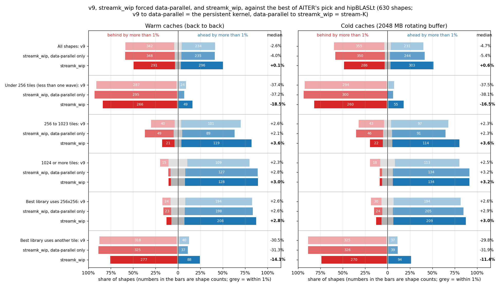
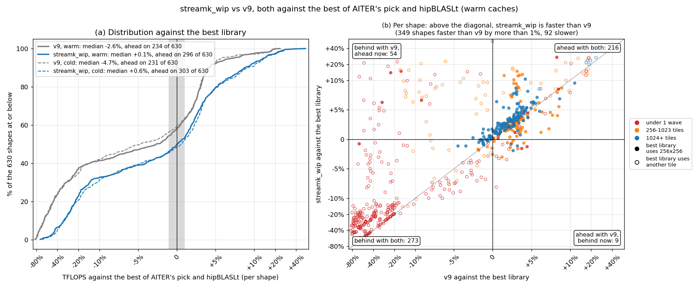
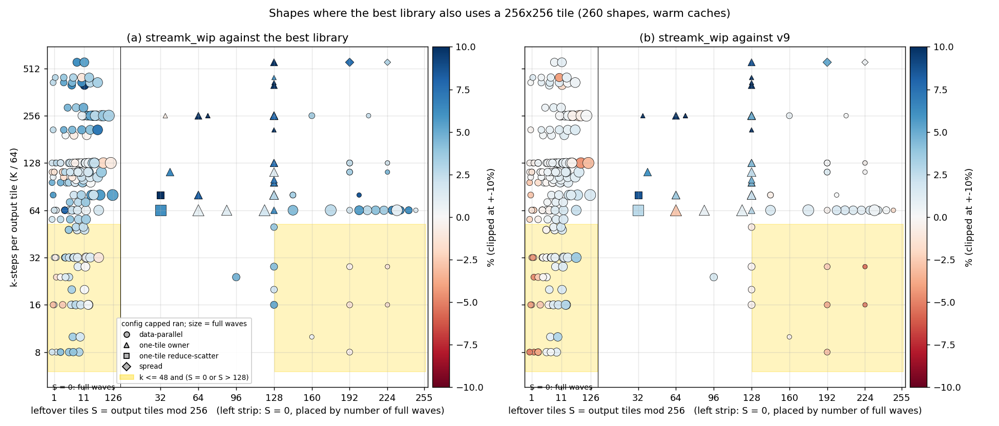
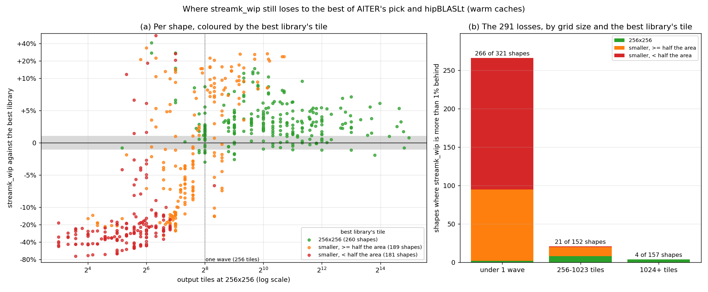
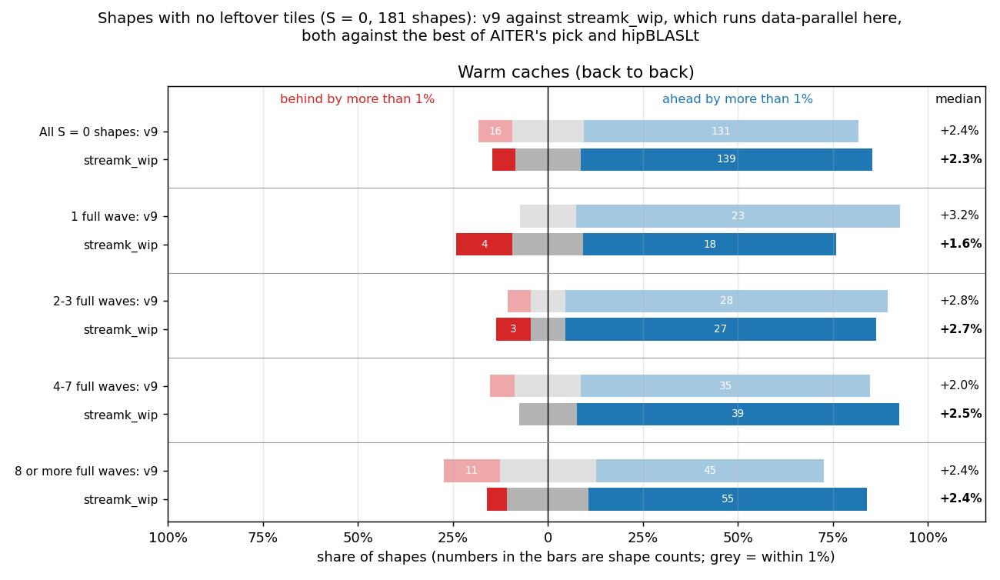
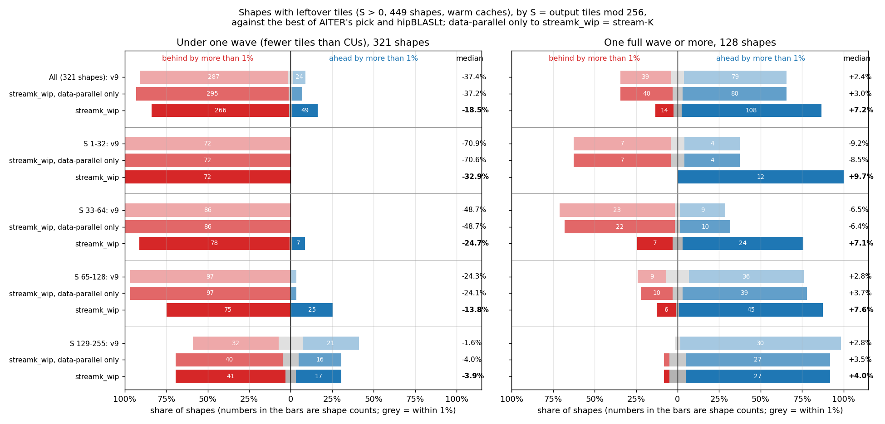
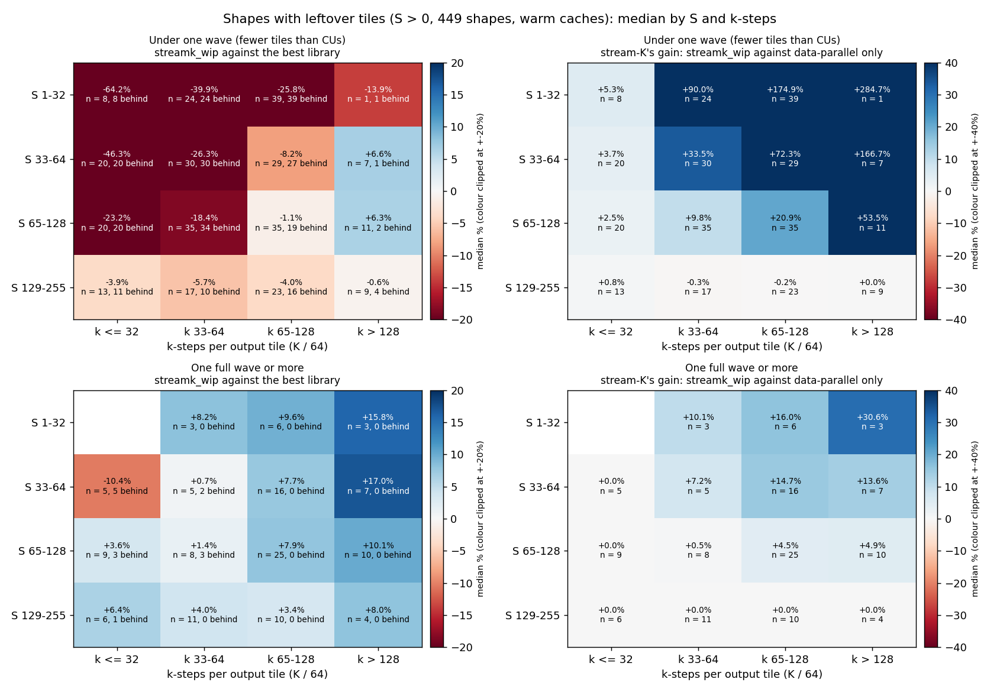

# Figures: streamk_wip (v20, capped) against the best of AITER's pick and hipBLASLt

Data: `details_v9fb_pad.csv` (warm) and `details_v9fb_pad_rot2048.csv` (cold: 2048 MB rotating buffer), Oct 6, 630 shapes, MI355X, torch 2.10.0+rocm7.2.4 with hipBLASLt 1.2.2, AITER `main` `a1455f1c4`, v20 snapshot `56e1e2af1bb77dfa` (v9 for one-wave data-parallel), 3 rounds with fresh buffers, median.

The baseline on each shape is the faster of AITER's pick and hipBLASLt (the torch call AITER's `torch` libtype makes), with that kernel's tile. AITER itself dispatches the winner of its offline tuning, so this is a stricter bar than what AITER runs today. "Ahead" and "behind" mean a gap of more than 1%.

## Figure 0: summary

"Data-parallel only" is streamk_wip with `STREAMK_POLICY=dp`: the same persistent kernel without the stream-K split. v9 to data-parallel only is the persistent kernel's change; data-parallel only to streamk_wip is what stream-K adds.

| Caches | Shapes | Count | v9: faster | v9: within 1% | v9: slower | v9: median | data-parallel only: faster | data-parallel only: within 1% | data-parallel only: slower | data-parallel only: median | streamk_wip: faster | streamk_wip: within 1% | streamk_wip: slower | streamk_wip: median |
|---|---|---:|---:|---:|---:|---:|---:|---:|---:|---:|---:|---:|---:|---:|
| Warm | All shapes | 630 | 234 | 54 | 342 | -2.6% | 235 | 47 | 348 | -4.0% | 296 | 43 | 291 | +0.1% |
| Warm | Under 256 tiles (less than one wave) | 321 | 24 | 10 | 287 | -37.4% | 19 | 7 | 295 | -37.2% | 49 | 6 | 266 | -18.5% |
| Warm | 256 to 1023 tiles | 152 | 101 | 11 | 40 | +2.6% | 89 | 14 | 49 | +2.1% | 119 | 12 | 21 | +3.6% |
| Warm | 1024 or more tiles | 157 | 109 | 33 | 15 | +2.3% | 127 | 26 | 4 | +2.8% | 128 | 25 | 4 | +3.0% |
| Warm | Best library uses 256x256 | 260 | 194 | 42 | 24 | +2.6% | 198 | 39 | 23 | +2.6% | 208 | 38 | 14 | +2.8% |
| Warm | Best library uses another tile | 370 | 40 | 12 | 318 | -30.5% | 37 | 8 | 325 | -31.3% | 88 | 5 | 277 | -14.1% |
| Cold | All shapes | 630 | 231 | 44 | 355 | -4.7% | 244 | 36 | 350 | -5.4% | 303 | 41 | 286 | +0.6% |
| Cold | Under 256 tiles (less than one wave) | 321 | 21 | 6 | 294 | -37.5% | 19 | 2 | 300 | -38.1% | 55 | 6 | 260 | -16.5% |
| Cold | 256 to 1023 tiles | 152 | 97 | 12 | 43 | +2.3% | 91 | 15 | 46 | +2.3% | 114 | 16 | 22 | +3.6% |
| Cold | 1024 or more tiles | 157 | 113 | 26 | 18 | +2.5% | 134 | 19 | 4 | +3.2% | 134 | 19 | 4 | +3.2% |
| Cold | Best library uses 256x256 | 259 | 194 | 35 | 30 | +2.6% | 205 | 30 | 24 | +2.9% | 209 | 34 | 16 | +3.0% |
| Cold | Best library uses another tile | 371 | 37 | 9 | 325 | -29.8% | 39 | 6 | 326 | -31.9% | 94 | 7 | 270 | -11.4% |

## Figure 1: progress over v9

- Warm: v9 234 ahead, 54 within 1%, 342 behind, median -2.6%; streamk_wip 296 ahead, 43 within 1%, 291 behind, median +0.1%. streamk_wip improved on v9 by more than 1% on 349 shapes and fell back on 92. 54 shapes went from behind to ahead, 9 the other way. hipBLASLt is the faster library on 374 shapes; the best library uses 256x256 on 260.
- Cold: v9 231 ahead, 44 within 1%, 355 behind, median -4.7%; streamk_wip 303 ahead, 41 within 1%, 286 behind, median +0.6%. streamk_wip improved on v9 by more than 1% on 374 shapes and fell back on 86. 67 shapes went from behind to ahead, 7 the other way. hipBLASLt is the faster library on 395 shapes; the best library uses 256x256 on 259.

Cold version: `fig1_progress_cold.png` (both states are drawn in panel (a) of each).

## Figure 2: the same-tile losses, by S and k-steps

- Warm: 260 shapes where the best library uses 256x256; streamk_wip is behind on 14, 14 of them data-parallel and 8 in the shaded band (k <= 48 and S = 0 or S > 128).
  - In the band (56 shapes): against the best library 36 ahead, 12 within 1%, 8 behind, median +1.5%; against v9 14 ahead, 24 within 1%, 18 behind, median +0.2%.
  - Outside it (204 shapes): against the best library 172 ahead, 26 within 1%, 6 behind, median +3.2%; against v9 73 ahead, 112 within 1%, 19 behind, median +0.7%.
  - Worst: 4096x4096x1024 (S = 0, k = 16, data-parallel, -3.0% vs best, -4.1% vs v9); 4096x8192x1024 (S = 0, k = 16, data-parallel, -2.6% vs best, -2.5% vs v9); 16384x57344x8192 (S = 0, k = 128, data-parallel, -1.9% vs best, -4.4% vs v9); 16384x2048x7168 (S = 0, k = 112, data-parallel, -1.8% vs best, +0.0% vs v9); 2048x16384x6656 (S = 0, k = 104, data-parallel, -1.7% vs best, +0.3% vs v9); 4096x4096x1536 (S = 0, k = 24, data-parallel, -1.6% vs best, -4.6% vs v9).
- Cold: 259 shapes where the best library uses 256x256; streamk_wip is behind on 16, 15 of them data-parallel and 13 in the shaded band (k <= 48 and S = 0 or S > 128).
  - In the band (56 shapes): against the best library 22 ahead, 21 within 1%, 13 behind, median +0.6%; against v9 29 ahead, 11 within 1%, 16 behind, median +1.0%.
  - Outside it (203 shapes): against the best library 187 ahead, 13 within 1%, 3 behind, median +3.4%; against v9 77 ahead, 106 within 1%, 20 behind, median +0.7%.
  - Worst: 1024x2304x16384 (S = 36, k = 256, one-tile owner, n = 6, -5.7% vs best, +200.2% vs v9); 4096x4096x1536 (S = 0, k = 24, data-parallel, -4.3% vs best, -6.0% vs v9); 16384x7168x512 (S = 0, k = 8, data-parallel, -3.4% vs best, +5.8% vs v9); 4096x4096x512 (S = 0, k = 8, data-parallel, -3.1% vs best, -4.1% vs v9); 4096x4096x2048 (S = 0, k = 32, data-parallel, -2.9% vs best, -4.9% vs v9); 16384x57344x8192 (S = 0, k = 128, data-parallel, -2.9% vs best, -5.5% vs v9).

Cold version: `fig2_same_tile_S_k_cold.png`.

## Figure 3: where the remaining losses are

- Warm: streamk_wip is behind the best library on 291 shapes.
  - Best library tile 256x256 (260 shapes): 208 ahead, 38 within 1%, 14 behind, median +2.8%. Losses by grid size (under 1 wave / 256-1023 / 1024+): 2 / 8 / 4.
  - Best library tile smaller, >= half the area (189 shapes): 79 ahead, 5 within 1%, 105 behind, median -2.8%. Losses by grid size (under 1 wave / 256-1023 / 1024+): 93 / 12 / 0.
  - Best library tile smaller, < half the area (181 shapes): 9 ahead, 0 within 1%, 172 behind, median -26.5%. Losses by grid size (under 1 wave / 256-1023 / 1024+): 171 / 1 / 0.
- Cold: streamk_wip is behind the best library on 286 shapes.
  - Best library tile 256x256 (259 shapes): 209 ahead, 34 within 1%, 16 behind, median +3.0%. Losses by grid size (under 1 wave / 256-1023 / 1024+): 1 / 11 / 4.
  - Best library tile smaller, >= half the area (192 shapes): 85 ahead, 6 within 1%, 101 behind, median -2.6%. Losses by grid size (under 1 wave / 256-1023 / 1024+): 90 / 11 / 0.
  - Best library tile smaller, < half the area (179 shapes): 9 ahead, 1 within 1%, 169 behind, median -25.9%. Losses by grid size (under 1 wave / 256-1023 / 1024+): 169 / 0 / 0.

Cold version: `fig3_losses_cold.png`.

## Figure 4: shapes with no leftover tiles (S = 0)

With S = 0 capped always runs data-parallel, so streamk_wip here is the persistent data-parallel kernel and stream-K plays no part.

- Warm: All S = 0 shapes: v9 +2.4% (16 behind), streamk_wip +2.3% (11 behind) of 181; 1 full wave: v9 +3.2% (0 behind), streamk_wip +1.6% (4 behind) of 27; 2-3 full waves: v9 +2.8% (2 behind), streamk_wip +2.7% (3 behind) of 33; 4-7 full waves: v9 +2.0% (3 behind), streamk_wip +2.5% (0 behind) of 46; 8 or more full waves: v9 +2.4% (11 behind), streamk_wip +2.4% (4 behind) of 75.
- Cold: All S = 0 shapes: v9 +2.4% (19 behind), streamk_wip +2.6% (15 behind) of 181; 1 full wave: v9 +2.9% (0 behind), streamk_wip +1.7% (7 behind) of 27; 2-3 full waves: v9 +2.1% (2 behind), streamk_wip +2.1% (4 behind) of 33; 4-7 full waves: v9 +1.9% (8 behind), streamk_wip +2.7% (2 behind) of 46; 8 or more full waves: v9 +2.5% (9 behind), streamk_wip +3.0% (2 behind) of 75.

Cold version: `fig4_s0_by_waves_cold.png`.

## Figure 5: shapes with leftover tiles (S > 0), by S

Rows are S buckets; under one wave and one wave or more are separate panels. Data-parallel only to streamk_wip is stream-K's own effect. Cold version: `fig5_s_buckets_cold.png`.

## Figure 6: shapes with leftover tiles (S > 0), by S and k-steps

Each cell is the median over the shapes in it (n), with the number more than 1% behind the best library. Left: streamk_wip against the best library. Right: stream-K's gain, streamk_wip against the same kernel forced data-parallel; 0.0% means capped ran data-parallel on every shape in the cell. Cold version: `fig6_s_k_heatmap_cold.png`.

## Figure 7: padding, spread between fresh-buffer rounds and padded against contiguous

Top: share of shapes (with padded x and w strides) whose spread between rounds exceeds x, per kernel; dashed contiguous, solid padded. Bottom: median padded / contiguous TFLOPS - 1 by grid size, and on the control shapes (K % 256 == 128, x and w not padded). AITER's pick leaves out shapes where its padded call copied its inputs.

- Warm: v9: median spread 0.26% contiguous, 0.26% padded; over 2%: 14 and 23 of 614; streamk_wip: median spread 0.61% contiguous, 0.45% padded; over 2%: 51 and 36 of 614; AITER's pick: median spread 0.47% contiguous, 0.34% padded; over 2%: 22 and 19 of 362; hipBLASLt: median spread 0.43% contiguous, 0.36% padded; over 2%: 58 and 64 of 614.
- Cold: v9: median spread 0.31% contiguous, 0.29% padded; over 2%: 11 and 5 of 614; streamk_wip: median spread 0.66% contiguous, 0.37% padded; over 2%: 45 and 13 of 614; AITER's pick: median spread 0.46% contiguous, 0.39% padded; over 2%: 9 and 18 of 362; hipBLASLt: median spread 0.41% contiguous, 0.41% padded; over 2%: 36 and 62 of 614.
