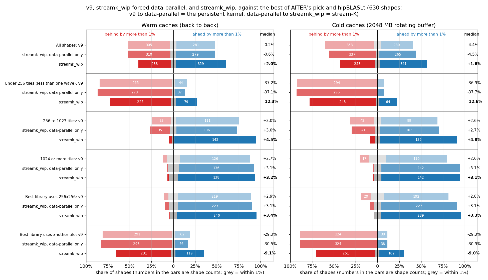
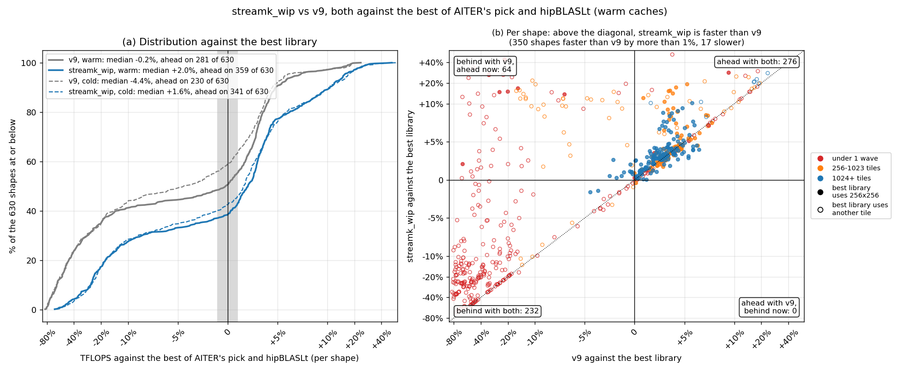
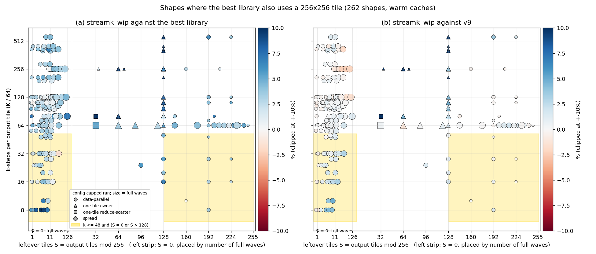
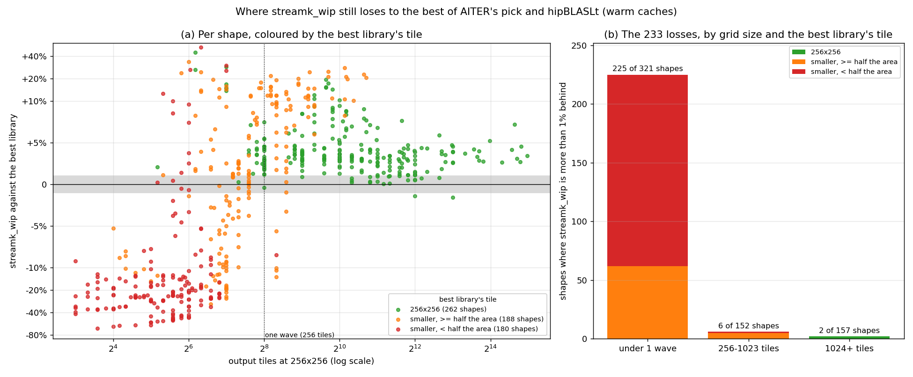
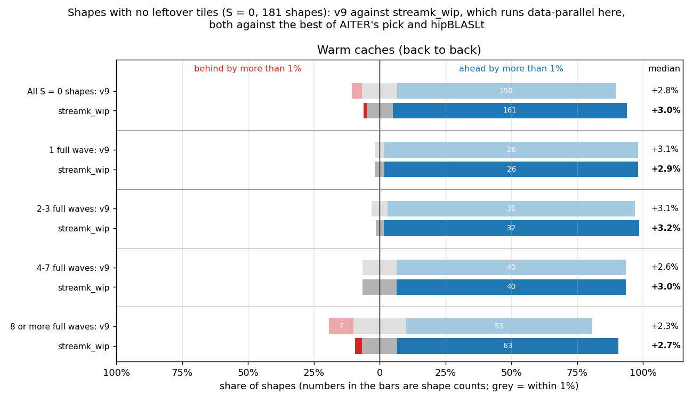
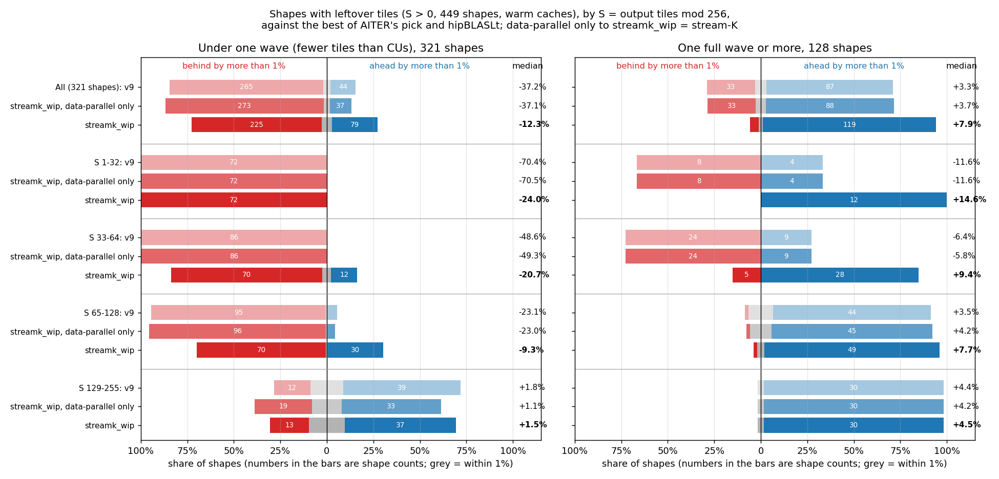
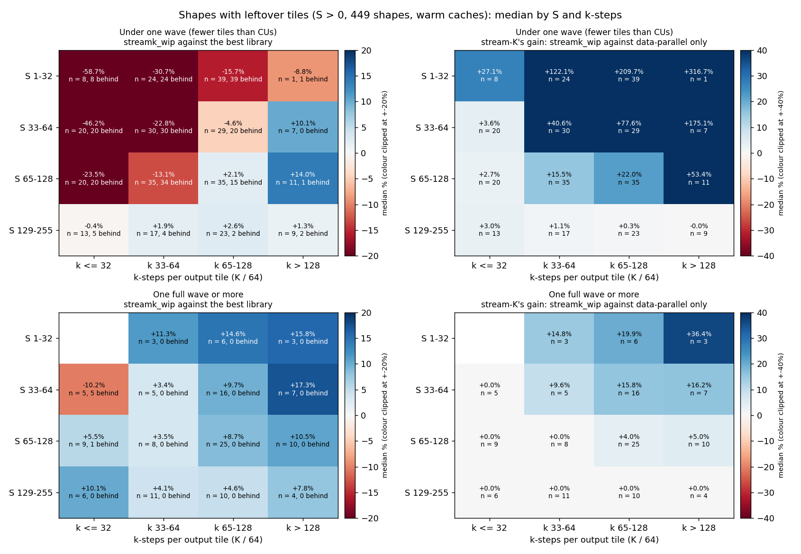

# Figures: streamk_wip (v20, capped) against the best of AITER's pick and hipBLASLt

Data: `details_v24.csv` (warm) and `details_v24_rot2048.csv` (cold, 2 GB rotating buffer), v24 capped, HIP GPU 3, everything contiguous.

The baseline on each shape is the faster of AITER's pick and hipBLASLt (the torch call AITER's `torch` libtype makes), with that kernel's tile. AITER itself dispatches the winner of its offline tuning, so this is a stricter bar than what AITER runs today. "Ahead" and "behind" mean a gap of more than 1%.

## Figure 0: summary

"Data-parallel only" is streamk_wip with `STREAMK_POLICY=dp`: the same persistent kernel without the stream-K split. v9 to data-parallel only is the persistent kernel's change; data-parallel only to streamk_wip is what stream-K adds.

| Caches | Shapes | Count | v9: faster | v9: within 1% | v9: slower | v9: median | data-parallel only: faster | data-parallel only: within 1% | data-parallel only: slower | data-parallel only: median | streamk_wip: faster | streamk_wip: within 1% | streamk_wip: slower | streamk_wip: median |
|---|---|---:|---:|---:|---:|---:|---:|---:|---:|---:|---:|---:|---:|---:|
| Warm | All shapes | 630 | 281 | 44 | 305 | -0.2% | 279 | 41 | 310 | -0.6% | 359 | 38 | 233 | +2.0% |
| Warm | Under 256 tiles (less than one wave) | 321 | 44 | 12 | 265 | -37.2% | 37 | 11 | 273 | -37.1% | 79 | 17 | 225 | -12.3% |
| Warm | 256 to 1023 tiles | 152 | 111 | 8 | 33 | +3.0% | 106 | 11 | 35 | +3.0% | 142 | 4 | 6 | +4.5% |
| Warm | 1024 or more tiles | 157 | 126 | 24 | 7 | +2.7% | 136 | 19 | 2 | +3.1% | 138 | 17 | 2 | +3.2% |
| Warm | Best library uses 256x256 | 262 | 219 | 29 | 14 | +2.9% | 223 | 27 | 12 | +3.1% | 240 | 20 | 2 | +3.4% |
| Warm | Best library uses another tile | 368 | 62 | 15 | 291 | -29.3% | 56 | 14 | 298 | -30.5% | 119 | 18 | 231 | -9.1% |
| Cold | All shapes | 630 | 230 | 47 | 353 | -4.4% | 265 | 28 | 337 | -4.5% | 341 | 36 | 253 | +1.6% |
| Cold | Under 256 tiles (less than one wave) | 321 | 21 | 6 | 294 | -36.9% | 20 | 6 | 295 | -37.7% | 64 | 14 | 243 | -12.6% |
| Cold | 256 to 1023 tiles | 152 | 99 | 11 | 42 | +2.6% | 103 | 8 | 41 | +2.7% | 135 | 8 | 9 | +4.8% |
| Cold | 1024 or more tiles | 157 | 110 | 30 | 17 | +2.6% | 142 | 14 | 1 | +3.1% | 142 | 14 | 1 | +3.1% |
| Cold | Best library uses 256x256 | 260 | 192 | 39 | 29 | +2.8% | 227 | 20 | 13 | +3.1% | 239 | 19 | 2 | +3.3% |
| Cold | Best library uses another tile | 370 | 38 | 8 | 324 | -29.3% | 38 | 8 | 324 | -30.9% | 102 | 17 | 251 | -9.0% |

## Figure 1: progress over v9

- Warm: v9 281 ahead, 44 within 1%, 305 behind, median -0.2%; streamk_wip 359 ahead, 38 within 1%, 233 behind, median +2.0%. streamk_wip improved on v9 by more than 1% on 350 shapes and fell back on 17. 64 shapes went from behind to ahead, 0 the other way. hipBLASLt is the faster library on 346 shapes; the best library uses 256x256 on 262.
- Cold: v9 230 ahead, 47 within 1%, 353 behind, median -4.4%; streamk_wip 341 ahead, 36 within 1%, 253 behind, median +1.6%. streamk_wip improved on v9 by more than 1% on 376 shapes and fell back on 15. 81 shapes went from behind to ahead, 0 the other way. hipBLASLt is the faster library on 387 shapes; the best library uses 256x256 on 260.

Cold version: `fig1_progress_cold.png` (both states are drawn in panel (a) of each).

## Figure 2: the same-tile losses, by S and k-steps

- Warm: 262 shapes where the best library uses 256x256; streamk_wip is behind on 2, 2 of them data-parallel and 2 in the shaded band (k <= 48 and S = 0 or S > 128).
  - In the band (57 shapes): against the best library 49 ahead, 6 within 1%, 2 behind, median +3.1%; against v9 27 ahead, 29 within 1%, 1 behind, median +0.9%.
  - Outside it (205 shapes): against the best library 191 ahead, 14 within 1%, 0 behind, median +3.4%; against v9 59 ahead, 132 within 1%, 14 behind, median +0.3%.
  - Worst: 32768x16384x2048 (S = 0, k = 32, data-parallel, -1.6% vs best, +3.0% vs v9); 16384x16384x2048 (S = 0, k = 32, data-parallel, -1.4% vs best, +2.4% vs v9).
- Cold: 260 shapes where the best library uses 256x256; streamk_wip is behind on 2, 1 of them data-parallel and 1 in the shaded band (k <= 48 and S = 0 or S > 128).
  - In the band (56 shapes): against the best library 40 ahead, 15 within 1%, 1 behind, median +1.7%; against v9 38 ahead, 18 within 1%, 0 behind, median +1.6%.
  - Outside it (204 shapes): against the best library 199 ahead, 4 within 1%, 1 behind, median +3.6%; against v9 66 ahead, 125 within 1%, 13 behind, median +0.5%.
  - Worst: 16384x7168x512 (S = 0, k = 8, data-parallel, -1.6% vs best, +7.6% vs v9); 1024x2304x16384 (S = 36, k = 256, one-tile owner, n = 6, -1.3% vs best, +210.9% vs v9).

Cold version: `fig2_same_tile_S_k_cold.png`.

## Figure 3: where the remaining losses are

- Warm: streamk_wip is behind the best library on 233 shapes.
  - Best library tile 256x256 (262 shapes): 240 ahead, 20 within 1%, 2 behind, median +3.4%. Losses by grid size (under 1 wave / 256-1023 / 1024+): 0 / 0 / 2.
  - Best library tile smaller, >= half the area (188 shapes): 107 ahead, 14 within 1%, 67 behind, median +1.9%. Losses by grid size (under 1 wave / 256-1023 / 1024+): 62 / 5 / 0.
  - Best library tile smaller, < half the area (180 shapes): 12 ahead, 4 within 1%, 164 behind, median -22.9%. Losses by grid size (under 1 wave / 256-1023 / 1024+): 163 / 1 / 0.
- Cold: streamk_wip is behind the best library on 253 shapes.
  - Best library tile 256x256 (260 shapes): 239 ahead, 19 within 1%, 2 behind, median +3.3%. Losses by grid size (under 1 wave / 256-1023 / 1024+): 1 / 0 / 1.
  - Best library tile smaller, >= half the area (190 shapes): 89 ahead, 17 within 1%, 84 behind, median +0.1%. Losses by grid size (under 1 wave / 256-1023 / 1024+): 75 / 9 / 0.
  - Best library tile smaller, < half the area (180 shapes): 13 ahead, 0 within 1%, 167 behind, median -21.8%. Losses by grid size (under 1 wave / 256-1023 / 1024+): 167 / 0 / 0.

Cold version: `fig3_losses_cold.png`.

## Figure 4: shapes with no leftover tiles (S = 0)

With S = 0 capped always runs data-parallel, so streamk_wip here is the persistent data-parallel kernel and stream-K plays no part.

- Warm: All S = 0 shapes: v9 +2.8% (7 behind), streamk_wip +3.0% (2 behind) of 181; 1 full wave: v9 +3.1% (0 behind), streamk_wip +2.9% (0 behind) of 27; 2-3 full waves: v9 +3.1% (0 behind), streamk_wip +3.2% (0 behind) of 33; 4-7 full waves: v9 +2.6% (0 behind), streamk_wip +3.0% (0 behind) of 46; 8 or more full waves: v9 +2.3% (7 behind), streamk_wip +2.7% (2 behind) of 75.
- Cold: All S = 0 shapes: v9 +2.5% (19 behind), streamk_wip +2.7% (1 behind) of 181; 1 full wave: v9 +3.2% (0 behind), streamk_wip +2.8% (0 behind) of 27; 2-3 full waves: v9 +2.8% (2 behind), streamk_wip +3.0% (0 behind) of 33; 4-7 full waves: v9 +1.6% (9 behind), streamk_wip +2.2% (1 behind) of 46; 8 or more full waves: v9 +2.6% (8 behind), streamk_wip +2.6% (0 behind) of 75.

Cold version: `fig4_s0_by_waves_cold.png`.

## Figure 5: shapes with leftover tiles (S > 0), by S

Rows are S buckets; under one wave and one wave or more are separate panels. Data-parallel only to streamk_wip is stream-K's own effect. Cold version: `fig5_s_buckets_cold.png`.

## Figure 6: shapes with leftover tiles (S > 0), by S and k-steps

Each cell is the median over the shapes in it (n), with the number more than 1% behind the best library. Left: streamk_wip against the best library. Right: stream-K's gain, streamk_wip against the same kernel forced data-parallel; 0.0% means capped ran data-parallel on every shape in the cell. Cold version: `fig6_s_k_heatmap_cold.png`.
