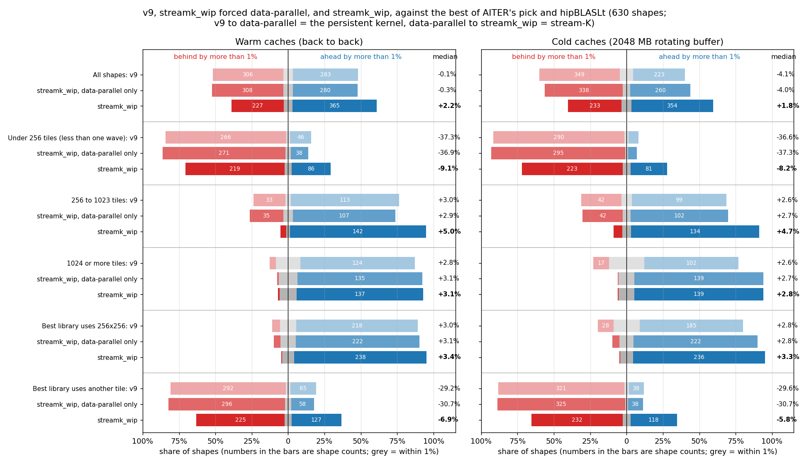
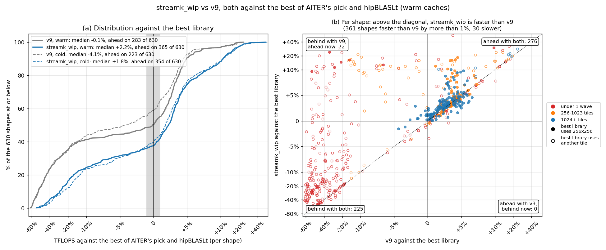
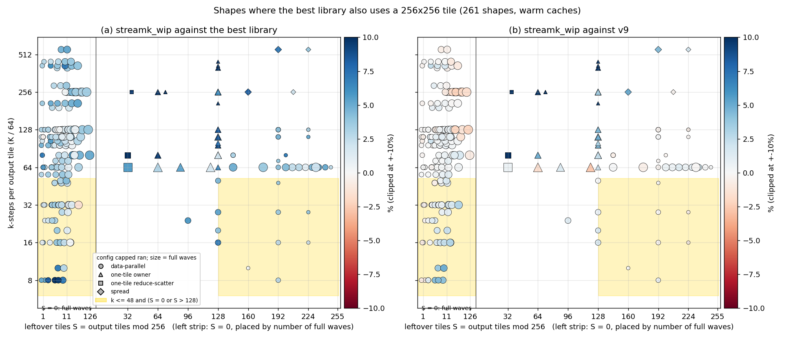
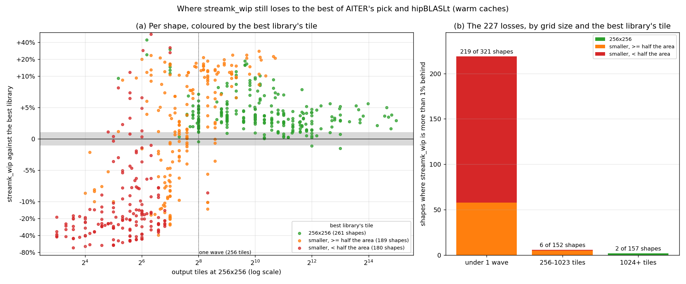
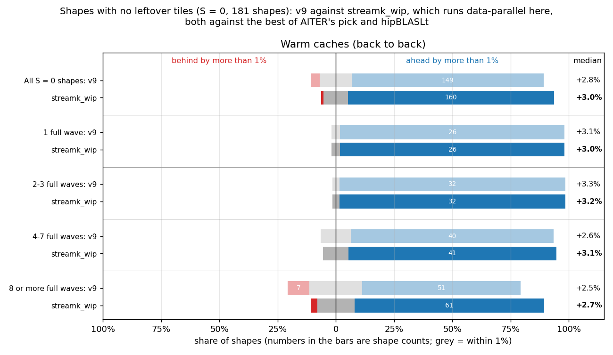
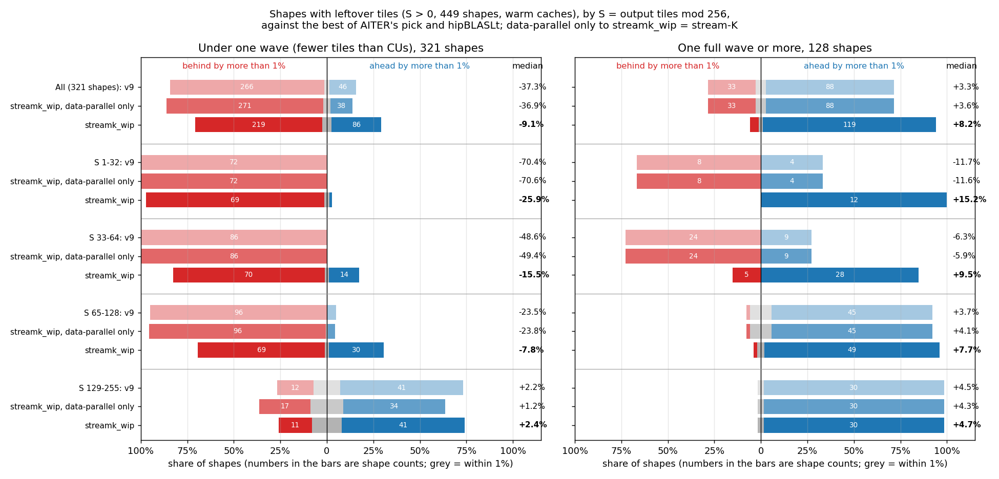
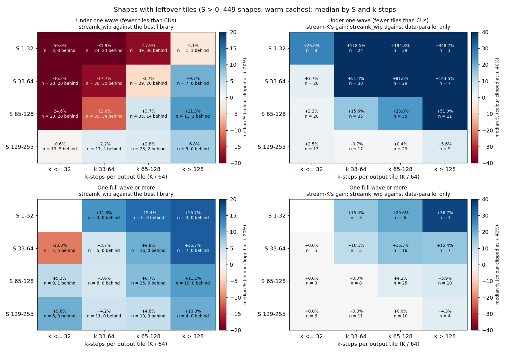

# Figures: streamk_wip (v20, capped) against the best of AITER's pick and hipBLASLt

Data: `details_v26.csv` (warm) and `details_v26_rot2048.csv` (cold, 2 GB rotating buffer), v26 capped, HIP GPU 3, everything contiguous.

The baseline on each shape is the faster of AITER's pick and hipBLASLt (the torch call AITER's `torch` libtype makes), with that kernel's tile. AITER itself dispatches the winner of its offline tuning, so this is a stricter bar than what AITER runs today. "Ahead" and "behind" mean a gap of more than 1%.

## Figure 0: summary

"Data-parallel only" is streamk_wip with `STREAMK_POLICY=dp`: the same persistent kernel without the stream-K split. v9 to data-parallel only is the persistent kernel's change; data-parallel only to streamk_wip is what stream-K adds.

| Caches | Shapes | Count | v9: faster | v9: within 1% | v9: slower | v9: median | data-parallel only: faster | data-parallel only: within 1% | data-parallel only: slower | data-parallel only: median | streamk_wip: faster | streamk_wip: within 1% | streamk_wip: slower | streamk_wip: median |
|---|---|---:|---:|---:|---:|---:|---:|---:|---:|---:|---:|---:|---:|---:|
| Warm | All shapes | 630 | 283 | 41 | 306 | -0.1% | 280 | 42 | 308 | -0.3% | 365 | 38 | 227 | +2.2% |
| Warm | Under 256 tiles (less than one wave) | 321 | 46 | 9 | 266 | -37.3% | 38 | 12 | 271 | -36.9% | 86 | 16 | 219 | -9.1% |
| Warm | 256 to 1023 tiles | 152 | 113 | 6 | 33 | +3.0% | 107 | 10 | 35 | +2.9% | 142 | 4 | 6 | +5.0% |
| Warm | 1024 or more tiles | 157 | 124 | 26 | 7 | +2.8% | 135 | 20 | 2 | +3.1% | 137 | 18 | 2 | +3.1% |
| Warm | Best library uses 256x256 | 261 | 218 | 29 | 14 | +3.0% | 222 | 27 | 12 | +3.1% | 238 | 21 | 2 | +3.4% |
| Warm | Best library uses another tile | 369 | 65 | 12 | 292 | -29.2% | 58 | 15 | 296 | -30.7% | 127 | 17 | 225 | -6.9% |
| Cold | All shapes | 630 | 223 | 58 | 349 | -4.1% | 260 | 32 | 338 | -4.0% | 354 | 43 | 233 | +1.8% |
| Cold | Under 256 tiles (less than one wave) | 321 | 22 | 9 | 290 | -36.6% | 19 | 7 | 295 | -37.3% | 81 | 17 | 223 | -8.2% |
| Cold | 256 to 1023 tiles | 152 | 99 | 11 | 42 | +2.6% | 102 | 8 | 42 | +2.7% | 134 | 9 | 9 | +4.7% |
| Cold | 1024 or more tiles | 157 | 102 | 38 | 17 | +2.6% | 139 | 17 | 1 | +2.7% | 139 | 17 | 1 | +2.8% |
| Cold | Best library uses 256x256 | 260 | 185 | 47 | 28 | +2.8% | 222 | 25 | 13 | +2.8% | 236 | 23 | 1 | +3.3% |
| Cold | Best library uses another tile | 370 | 38 | 11 | 321 | -29.6% | 38 | 7 | 325 | -30.7% | 118 | 20 | 232 | -5.8% |

## Figure 1: progress over v9

- Warm: v9 283 ahead, 41 within 1%, 306 behind, median -0.1%; streamk_wip 365 ahead, 38 within 1%, 227 behind, median +2.2%. streamk_wip improved on v9 by more than 1% on 361 shapes and fell back on 30. 72 shapes went from behind to ahead, 0 the other way. hipBLASLt is the faster library on 363 shapes; the best library uses 256x256 on 261.
- Cold: v9 223 ahead, 58 within 1%, 349 behind, median -4.1%; streamk_wip 354 ahead, 43 within 1%, 233 behind, median +1.8%. streamk_wip improved on v9 by more than 1% on 393 shapes and fell back on 26. 96 shapes went from behind to ahead, 0 the other way. hipBLASLt is the faster library on 389 shapes; the best library uses 256x256 on 260.

Cold version: `fig1_progress_cold.png` (both states are drawn in panel (a) of each).

## Figure 2: the same-tile losses, by S and k-steps

- Warm: 261 shapes where the best library uses 256x256; streamk_wip is behind on 2, 2 of them data-parallel and 2 in the shaded band (k <= 48 and S = 0 or S > 128).
  - In the band (57 shapes): against the best library 50 ahead, 5 within 1%, 2 behind, median +3.0%; against v9 25 ahead, 32 within 1%, 0 behind, median +0.8%.
  - Outside it (204 shapes): against the best library 188 ahead, 16 within 1%, 0 behind, median +3.6%; against v9 57 ahead, 133 within 1%, 14 behind, median +0.2%.
  - Worst: 32768x16384x2048 (S = 0, k = 32, data-parallel, -1.5% vs best, +3.0% vs v9); 16384x16384x2048 (S = 0, k = 32, data-parallel, -1.1% vs best, +2.3% vs v9).
- Cold: 260 shapes where the best library uses 256x256; streamk_wip is behind on 1, 1 of them data-parallel and 1 in the shaded band (k <= 48 and S = 0 or S > 128).
  - In the band (56 shapes): against the best library 40 ahead, 15 within 1%, 1 behind, median +1.6%; against v9 34 ahead, 18 within 1%, 4 behind, median +1.6%.
  - Outside it (204 shapes): against the best library 196 ahead, 8 within 1%, 0 behind, median +3.7%; against v9 65 ahead, 126 within 1%, 13 behind, median +0.4%.
  - Worst: 16384x7168x512 (S = 0, k = 8, data-parallel, -1.7% vs best, +7.4% vs v9).

Cold version: `fig2_same_tile_S_k_cold.png`.

## Figure 3: where the remaining losses are

- Warm: streamk_wip is behind the best library on 227 shapes.
  - Best library tile 256x256 (261 shapes): 238 ahead, 21 within 1%, 2 behind, median +3.4%. Losses by grid size (under 1 wave / 256-1023 / 1024+): 0 / 0 / 2.
  - Best library tile smaller, >= half the area (189 shapes): 113 ahead, 13 within 1%, 63 behind, median +3.7%. Losses by grid size (under 1 wave / 256-1023 / 1024+): 58 / 5 / 0.
  - Best library tile smaller, < half the area (180 shapes): 14 ahead, 4 within 1%, 162 behind, median -21.0%. Losses by grid size (under 1 wave / 256-1023 / 1024+): 161 / 1 / 0.
- Cold: streamk_wip is behind the best library on 233 shapes.
  - Best library tile 256x256 (260 shapes): 236 ahead, 23 within 1%, 1 behind, median +3.3%. Losses by grid size (under 1 wave / 256-1023 / 1024+): 0 / 0 / 1.
  - Best library tile smaller, >= half the area (191 shapes): 101 ahead, 15 within 1%, 75 behind, median +2.6%. Losses by grid size (under 1 wave / 256-1023 / 1024+): 66 / 9 / 0.
  - Best library tile smaller, < half the area (179 shapes): 17 ahead, 5 within 1%, 157 behind, median -16.8%. Losses by grid size (under 1 wave / 256-1023 / 1024+): 157 / 0 / 0.

Cold version: `fig3_losses_cold.png`.

## Figure 4: shapes with no leftover tiles (S = 0)

With S = 0 capped always runs data-parallel, so streamk_wip here is the persistent data-parallel kernel and stream-K plays no part.

- Warm: All S = 0 shapes: v9 +2.8% (7 behind), streamk_wip +3.0% (2 behind) of 181; 1 full wave: v9 +3.1% (0 behind), streamk_wip +3.0% (0 behind) of 27; 2-3 full waves: v9 +3.3% (0 behind), streamk_wip +3.2% (0 behind) of 33; 4-7 full waves: v9 +2.6% (0 behind), streamk_wip +3.1% (0 behind) of 46; 8 or more full waves: v9 +2.5% (7 behind), streamk_wip +2.7% (2 behind) of 75.
- Cold: All S = 0 shapes: v9 +2.5% (19 behind), streamk_wip +2.6% (1 behind) of 181; 1 full wave: v9 +3.4% (0 behind), streamk_wip +3.1% (0 behind) of 27; 2-3 full waves: v9 +2.8% (2 behind), streamk_wip +3.0% (0 behind) of 33; 4-7 full waves: v9 +1.2% (9 behind), streamk_wip +2.4% (1 behind) of 46; 8 or more full waves: v9 +2.5% (8 behind), streamk_wip +2.5% (0 behind) of 75.

Cold version: `fig4_s0_by_waves_cold.png`.

## Figure 5: shapes with leftover tiles (S > 0), by S

Rows are S buckets; under one wave and one wave or more are separate panels. Data-parallel only to streamk_wip is stream-K's own effect. Cold version: `fig5_s_buckets_cold.png`.

## Figure 6: shapes with leftover tiles (S > 0), by S and k-steps

Each cell is the median over the shapes in it (n), with the number more than 1% behind the best library. Left: streamk_wip against the best library. Right: stream-K's gain, streamk_wip against the same kernel forced data-parallel; 0.0% means capped ran data-parallel on every shape in the cell. Cold version: `fig6_s_k_heatmap_cold.png`.
