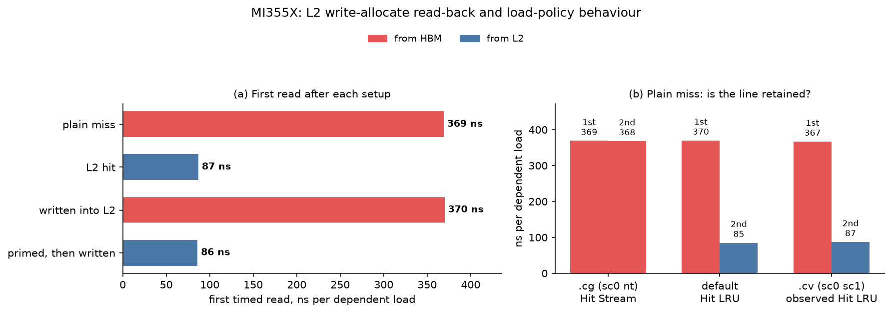

# Minimal reproducer: a line written into L2 is fetched from memory on its first read

Experiments that tried to perform the stream-K reduction in L2, by making sure all the CUs working on a tile run on the same XCD, gave no performance advantage. Using the MRE below, which tests the effect directly, the cause appears to be that **the first read of a line that was written into L2, but was not valid in L2 before the write, still fetches the whole line from memory.** The partials sit in L2, but reading them back costs as much as reading them from HBM.

Measured on an MI355X (gfx950).

## The four cases

One wave reads a 1 MiB buffer, one dependent load per 128-byte line, and the time per load shows where each line came from. Every launch starts with L2 and the last-level cache flushed, so the buffer is only in HBM. After the setup below, every case performs two timed reads (chases) of all the lines.

- **Plain miss:** no setup. The first timed read is the reference for HBM.
- **L2 hit:** an untimed prime reads every line into L2. The timed reads are the reference for L2.
- **Written into L2:** overwrite every line with ordinary stores, then perform the timed reads. This is what the stream-K partials do.
- **Primed, then written:** prime every line, overwrite it, then perform the timed reads.

## Results



### Timing, ns per dependent load

| case | first timed read | second timed read |
|---|---|---|
| plain miss | 369 | 368 |
| L2 hit | 87 | 88 |
| **written into L2** | **370** | 83 |
| **primed, then written** | **86** | 85 |

- **A written line costs a full HBM trip on its first read**, the same as a plain miss, even though L2 holds it.
- **Reading the line before the write removes the trip.**
- **One trip is enough.** The second read of a written line is an L2 hit.

### Load cache modifier

Changing the chase loads does not change the first timed reads. It changes whether lines fetched by the plain-miss read remain in L2 for the second read:

| chase load policy | plain miss, first timed read | plain miss, second timed read | observed L2 policy |
|---|---|---|---|
| `.cg` (`sc0 nt`) | 369 | 368 | Hit Stream |
| default | 370 | 85 | Hit LRU |
| `.cv` (`sc0 sc1`) | 367 | 87 | observed Hit LRU |

Default and `.cv` therefore behave the same here: their first read misses, but their second read hits the line retained in L2. `.cg` does not retain the missed line, so both reads go to HBM.

The `.cv` result is unexpected. The ISA calls `sc0 sc1` "Coherent Cache Bypass", but for this allocation it behaves like default Hit LRU rather than an unconditional L2 bypass. We do not yet fully understand what "Coherent Cache Bypass" means in this case.

### Counters, per line

Each value is a count divided by the 8192 lines, so 1.00 means once per line. "L2 hits" and "L2 misses" are requests that found or did not find their line in L2. "Memory reads" are lines L2 fetched from beyond itself, and "of which DRAM" those that went to HBM. Each case is split into what happened before the read and the read itself.

| case | phase | L2 hits | L2 misses | memory reads | of which DRAM |
|---|---|---|---|---|---|
| plain miss | read | 0.00 | 1.00 | 1.00 | 1.00 |
| L2 hit | prime | 0.00 | 1.00 | 1.00 | 1.00 |
| | read | 1.00 | 0.00 | 0.00 | 0.00 |
| **written into L2** | write | 1.00 | 1.00 | **0.00** | 0.00 |
| | read | **1.00** | 0.00 | **1.00** | **1.00** |
| **primed, then written** | prime and write | 2.00 | 1.00 | 1.00 | 1.00 |
| | read | 1.00 | 0.00 | **0.00** | 0.00 |

- **The write allocates without fetching.** Each line arrives as two 64-byte write requests: the first misses and allocates the line, the second hits it. Neither reads memory. In the primed case both requests hit, because the prime already brought the line in.
- **The read of a written line is a "hit" that reads DRAM.** Normally a hit needs no memory read; here every one makes one. So the hit rate alone hides the problem.
- **After a prime the read hits outright.** The prime is the only memory read.

<details>
<summary>How the test works</summary>

The test launches a grid of one program with one wave, so everything happens on one CU and in its XCD's L2. There are no other CUs and no synchronization between CUs.

- **The buffer** is 1 MiB, 8192 lines of 128 bytes. It fits in one XCD's 4 MiB L2 and stays under the roughly 2 MiB per XCD that the L2 keeps dirty. Element `32 l` holds the next line, `next(l) = (4949 l + 2731) mod 8192`, a single cycle through every line.
- **Two switches** give the four cases:
  - `PRIME`: read one dword of every line with default loads.
  - `WRITE`: write every byte of every line with default stores. The list values are computed in registers, so the phase reads nothing.
- **The chase** follows the list for 8192 dependent loads, `CHASES` = 0, 1 or 2 times, each time from line 1. Each step waits for its load (`s_waitcnt vmcnt(0)`), and the first such wait also drains the prime and the write, so the chase starts with nothing else in flight. Only one load is in flight on the whole GPU, so each step costs the unloaded latency of wherever the line comes from, with no bandwidth or queueing effects.
- **Before every launch** the host fills the buffer (with the list for the read-only cases, with zeros for the write cases), then reads 1 GiB to evict L2 and the 256 MB last-level cache. Starting the write cases from zeros makes the chase a correctness check: had a read returned the old copy, it would have stuck at line 0. The script asserts that every chase ends on its start line.
- **Timing** is CUDA events around the launch only. The chase dominates (about 3 ms at 370 ns per load), and subtracting kernel times removes everything else: the first read's cost per load is `(t(1 chase) - t(0 chases)) / 8192`, the second's `(t(2) - t(1)) / 8192`. The median of 10 launches after one warm-up.
- **Counters** use the same subtraction: "before the read" is the kernel without the chase, and "read" is the kernel with one chase minus that. They come from one rocprofv3 pass (four counters, the most that fit in one pass). The 1 GiB read is needed here too: rocprof's collection disturbs the cache state between kernels.

</details>

<details>
<summary>Run the MRE and interpret its output</summary>

```bash
HIP_VISIBLE_DEVICES=3 python mre.py                  # .cg / sc0 nt chase loads
HIP_VISIBLE_DEVICES=3 python mre.py --load default   # default chase loads
HIP_VISIBLE_DEVICES=3 python mre.py --load cv        # .cv / sc0 sc1 chase loads
HIP_VISIBLE_DEVICES=3 python mre.py --pmc            # counters; --load also applies here
```

Example timing output for `.cg`:

| case | kernel us, 0 / 1 / 2 chases | first chase ns per load | second chase ns per load |
|---|---|---|---|
| plain miss | 6 / 3028 / 6044 | 369 | 368 |
| L2 hit (primed, not written) | 23 / 738 / 1459 | 87 | 88 |
| written into L2 | 29 / 3064 / 3748 | 370 | 83 |
| primed, then written | 48 / 752 / 1450 | 86 | 85 |

Each chase follows 8192 dependent loads, so only one load is outstanding at a time:

- first chase = `(time with 1 chase - time with 0 chases) / 8192`;
- second chase = `(time with 2 chases - time with 1 chase) / 8192`;
- about 370 ns means the read waited for HBM;
- about 85-90 ns means the read was served from L2.

The important first-chase comparison is: plain miss 369 ns, written into L2 370 ns, L2 hit 87 ns, and primed then written 86 ns. Thus, writing a previously absent line into L2 does not make its first read behave like an ordinary L2 hit. Priming the line before writing does.

The slow second plain-miss chase is specific to `.cg`: lines brought in by `sc0 nt` misses do not remain in L2. With default or `.cv` loads, the second plain-miss chase is an L2 hit.

</details>

<details>
<summary>A side result: sc0 nt loads that miss do not keep their lines</summary>

In the plain-miss case the second `sc0 nt` read is as slow as the first (368 ns). With default loads it is 85 ns. A line brought in by an `sc0 nt` load miss does not stay in L2. This fits the documented streaming policy, which never updates a line's age, so a newly allocated streaming line is the next victim in its set. It does not affect the result above: lines that a default store or default load allocated stay, whatever loads read them.

</details>
