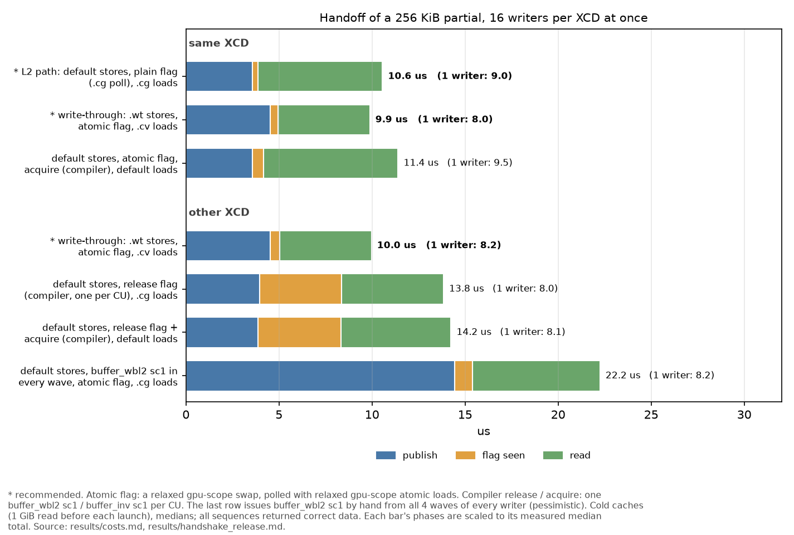
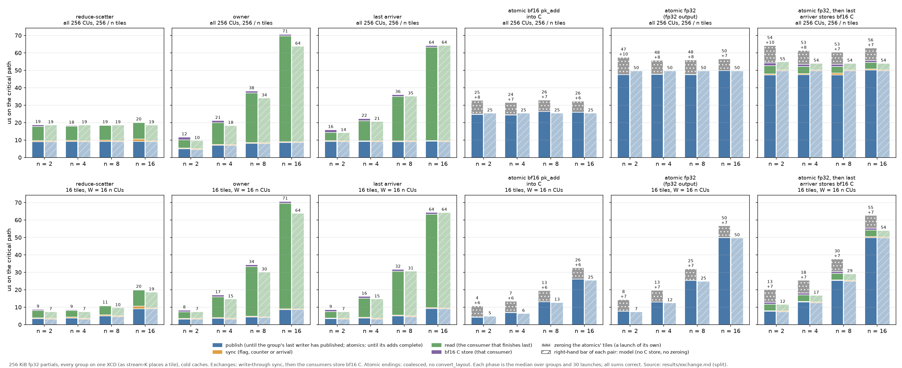

<!--
Paste everything below this comment into the issue. The two figures use paths relative to this file, so
they render in a local preview but not on GitHub. Before posting, drag images/handoff_costs.png and
images/exchange_phases.png into the GitHub editor and replace the two image paths with the links GitHub
generates.
-->

We ran a litmus and cost study on MI355X (gfx950) to answer both questions. The main result comes first, then the answers, then the evidence, then the full method in a collapsed section. Everything was measured on one MI355X in SPX / NPS1 mode with coarse-grained device memory (`torch` allocations).

## Main result

**With 256 KiB partials, synchronisation is a small part of the exchange. Reading the partials dominates.**

- **The flag or counter takes 0.3-1.3 µs at every split count from 2 to 16** (Figure 2). Reading costs the consuming CU about 3.6 µs per 256 KiB partial: the last arriver's read takes 3.8 µs at n = 2 and 54 µs at n = 16.
- **Using the compiler's agent release and acquire instead of write-through adds a roughly fixed cost: about 5-6.5 µs with all 256 CUs** (1.4-6.5 µs across all our tests). Every writer CU issues one release whatever the split count, and every consumer one acquire.
- **The read time is not fixed.** It grows by about 3.6 µs for each 256 KiB partial a consumer reads.
- **So the overhead's share depends on how much each consumer reads** (Table 2).
  - Reduce-scatter, where each consumer reads one partial's worth: 29%.
  - Owner and last arriver at n = 16, which read 15 partials: 9%.
- **Smaller partials raise the share.** Smaller tiles, or bf16 instead of fp32 partials, shrink the reads but not the fences. At 128 KiB the reads halve and the share roughly doubles: 15% for the owner and last arriver, 55% for reduce-scatter.
- **Fewer splits raise it too,** because the consumer has fewer partials to read. At n = 8 we estimate 4-20%; we compared the methods only at n = 16.

So the choice of synchronisation matters most when each consumer reads little. The cheapest correct choice is write-through in every case we measured.

## Answers

### Question 1: does an acknowledged store guarantee visibility to another workgroup?

**It depends on the store's cache bits.** An acknowledgement (`s_waitcnt vmcnt(0)`) only says where the write has got to:

- **Default store:** the line is dirty in the writer's L2. Another CU on the **same XCD** can see it, provided its load misses L1. A workgroup on **another XCD** cannot: it keeps reading its own L2 copy, 100% stale (Table 1).
- **Write-through store (`.wt` = `sc0 sc1`, or `sc1`):** the write goes past L2 to memory. Every reader on every XCD saw the new value (Table 1), even a reader that had primed a stale copy into its own L2.

**Lei's sequence was correct in every test**, for every placement including another XCD, and it is the cheapest correct sequence we measured:

```text
writer:  .wt stores; s_waitcnt vmcnt(0) in every wave; s_barrier; relaxed gpu-scope atomic arrival
reader:  the last arriver reads all partials with .cv (or .cg) loads; no acquire
```

Two details matter. The arrival counter must be `scope="gpu"`, not `cta` (see the aiter note below). Every wave must drain its own stores before the barrier, because a release or a drain covers only the wave that issues it.

That it is *guaranteed*, and not just what we observed, rests on one point we would like hardware to confirm (see "Question for hardware" below).

**Why `.wt` works: our reading of the documentation.** The explanation below is our reading of the memory-model section of LLVM's AMDGPUUsage ("Memory Model GFX942", which LLVM also applies to gfx950) and of the CDNA4 ISA cache-policy tables. Our results are consistent with it everywhere we looked. But they only show whether a read was fresh, and roughly where the data came from (from its latency). They do not show the mechanism itself.

- **What AMDGPUUsage says.** L2s are kept coherent with each other for memory that is local to the L2 and mapped MTYPE RW. A write from a CU on another L2 invalidates the local copies, through the cache probe that the page's C bit triggers. On this machine the driver's `mtype_local` parameter is 0, which in current amdgpu drivers selects MTYPE RW for local memory.
- **What we infer from it.** The probe runs when a write reaches memory. A `.wt` store sends the write to memory straight away, so the probe runs on that line straight away.
- **Why default stores fail.** A default store stays dirty in the writer's L2. We take this to mean nothing reaches memory, so there is nothing to probe, and another XCD keeps its old copy until a write-back or eviction happens.
  - The results match this. When the writer's XCD wrote 4 MiB of unrelated data after the partial, eviction turned a 0% fresh cell into 100% fresh.
  - It is also why stress tests can pass incorrect kernels.

**Why the fences cost more.** According to AMDGPUUsage, `buffer_wbl2 sc1` (the agent-scope release) writes back the L2's dirty lines. Its cost grew with the XCD's dirty data, about 0.6 µs per MiB. That is consistent with it writing back the whole L2 rather than just the partial: 0.8-3.0 µs for one CU, and 6.7-8.8 µs each when all 32 CUs of an XCD issue it at once. Paying that on every store, or from every wave, adds up quickly. Issuing it from all 4 waves instead of once per CU added 5-15 µs in our exchange tests, and 8 µs in the cross-XCD handoff (22.0 against 13.8 µs).

If you use fences, keep the partial stores as plain stores, drain every wave, and put the single release on the one arrival atomic. The compiler then emits one `buffer_wbl2 sc1` per CU, after the barrier. `.wt` avoids the write-back altogether, because only the lines that need to be visible go to memory.

### Question 2: what each modifier and fence costs and guarantees, where partials live, and the minimal correct sequences

**Where partials live and where they are read from** (Table 1, from timing single loads):

| store | where the line ends up | read by another CU on the same XCD | read by another XCD |
|---|---|---|---|
| default, `.cs` (`sc0 nt`) | dirty in the writer's L2 | fresh from the shared L2, if the load misses L1. 77 ns only if the line was valid in L2 before the store; otherwise the first read fills the line from memory (about 370 ns from HBM), although L2 holds the new data | default: stale, from the reader's own L2 copy. `.cs`: about 30% fresh, only the lines the writer's L2 happened to evict before the read |
| `.wt` (`sc0 sc1`), `sc1` | sent past L2 to memory; other L2s' copies dropped | from memory: HBM (about 430 ns) if nothing had read the line before; the LLC (about 280 ns) if an earlier default or `.cv` read had brought it there | same as on the same XCD |

- **L1 is never coherent between CUs.** A default load of a line another CU wrote is stale if the reader's L1 still holds the line, and it is served at 42 ns.
- **`.cv` and `sc1` loads are not an L2 bypass here.** They hit the reader's L2 when it holds the line, stale or not.
  - A reader therefore only needs to miss L1: `.cg`, `.cv`, `sc1`, or `buffer_inv sc1` beforehand.
  - On its own, that does not fix the case where the writer's data is still dirty in a different XCD's L2.

**Costs** (Figure 1, Table 2):

- **Store bits.** A 256 KiB partial takes 3.56 µs with default bits and 3.72 µs with `.wt` or `sc1` on one CU. With 16 CUs per XCD writing at once it is 3.9 against 4.9 µs. `sc1` alone costs the same as `.wt`.
- **Workgroup-scope fences** compile to `s_waitcnt lgkmcnt(0)` only, so they cost nothing and do nothing for global memory.
- **Agent-scope fences.**
  - `buffer_wbl2 sc1`: see above.
  - `buffer_inv sc1`: 0.5 µs for one CU, 6.4 µs each with 32 at once. On this memory it invalidated L1 only; the reader's stale L2 copy stayed.
  - Both operations affected only the issuing XCD.
- **Targeted write-through against agent fences.**
  - Handing a 256 KiB partial across XCDs, 16 writers per XCD, cold:
    - 10.0 µs with `.wt`;
    - 13.8 µs with the compiler's release, one per CU (14.2 µs with its acquire too);
    - 22 µs with `buffer_wbl2 sc1` written by hand in every wave, a pessimistic case.
  - Exchanging partials in groups of 16 over all 256 CUs (Table 2): the compiler's sequence costs about 5-6.5 µs more than `.wt` in every pattern. For a 16-way last-arriver sum of 256 KiB partials, that is 70.2 against 64.4 µs.

**Minimal correct sequences.** "Correct" means 100% fresh in every test and consistent with what the documentation promises. Where the hardware does more than the documentation promises, the table says so.

| placement | writer | reader | relies on |
|---|---|---|---|
| same workgroup | stores; `s_barrier` | any loads | documented |
| same XCD, another CU | default stores; `s_waitcnt vmcnt(0)` in every wave; `s_barrier`; relaxed `gpu` flag or counter | an L1-missing spin; `.cg` / `.cv` loads, or `buffer_inv sc1` then default loads | one shared L2. The placement must be checked: the language has no XCD scope |
| **any placement, cheapest** | **`.wt` stores; `s_waitcnt vmcnt(0)` in every wave; `s_barrier`; relaxed `gpu` flag or counter** | **relaxed `gpu` spin or arrival; `.cv` or `.cg` loads** | **the probe has finished when the store is acknowledged: observed, not documented** |
| any placement, documented | default stores; drain; **one** `sem="release"` `gpu` atomic per CU | `sem="acquire"` then default loads | fully documented |
| any placement, no acquire | as above | `.cg` loads, with a compiler fence after the spin so they are not hoisted above it | documented pieces, not a documented sequence: `sc0 nt` loads miss L1 (ISA table), and remote writes invalidate local L2 lines (AMDGPUUsage) |

**Why `.cg` loads need no acquire.** On this memory, the acquire (`buffer_inv sc1`) only drops the reader's L1, and `.cg` loads skip L1 anyway. The reader's stale L2 copy is not removed by the acquire: issued well before the read, `buffer_inv sc1` left it in place, 100% stale. It is removed by the probe when the writer's release writes the data back to memory.

Sequences that are **not** correct, although each passes some of the time:

- A reader-side acquire without a writer-side release: 100% stale in the ordering test.
- A `cta`-scope **poll** between workgroups. It compiles to `global_load ... sc0`, which keeps hitting the reader's L1. All 12,800 waits timed out, even on one XCD.
- Default or streaming stores read from another XCD. These pass only when something evicts the lines in time.
- Default loads of another CU's data without `buffer_inv sc1`.

### A note on aiter's fused split-K

[`_sum_splits_on_xcd` in `gemm_afp8wfp8.py`](https://github.com/ROCm/aiter/blob/2c56a7dbd45fe8433a737ebec542616831e4541c/aiter/ops/triton/_triton_kernels/gemm/basic/gemm_afp8wfp8.py#L323-L346) uses this last-arriver pattern, but keeps the partials in L2:

```python
tl.store(slot + split * BM * BN + local, partial)                    # default stores
tl.inline_asm_elementwise("s_waitcnt vmcnt(0)", ...)                 # drain
tl.debug_barrier()
if tl.atomic_add(counter, 1, sem="acq_rel", scope="cta") == SPLITS - 1:
    total += tl.load(..., cache_modifier=".cv")                       # last arriver sums
```

We reproduced it with 4 or 16 splits of 8 KiB and 256 KiB partials, cold and warm.
- With the splits on one XCD, as `_tile_on_xcd` places them, it was correct: 0 wrong sums in 9,600 groups.
- With the same groups spread over XCDs, **99% of the groups summed wrongly** with 8 KiB partials, at both 4 and 16 splits.

The kernel relies on three things the memory model does not promise:

- that a `cta`-scope atomic is atomic between workgroups;
- the unchecked `pid % 8` workgroup-to-XCD mapping;
- the hand-written `vmcnt(0)`, which a `cta` release does not emit.

**`acq_rel` `cta`, relaxed `cta` and relaxed `gpu` compile to the same `global_atomic_add` with no cache maintenance.** They cost the same, to within 0.1 µs. `scope="gpu"` should be used instead: `sem="relaxed", scope="gpu"`, plus a compiler-only fence after the atomic (an empty inline asm with a memory clobber) to keep the IR ordering that `acq_rel` currently provides.

Once the counter is `gpu` scope, **`.wt` partial stores are the better data path.**
- They are correct for any placement.
- They are faster when the caches are cold, which is the usual state after a GEMM main loop.
- The L2 path is faster only while the partials are still in L2, and it is correct only while the placement holds.

Avoiding the agent fences matters more here than in our 256 KiB tests. aiter's partials are small (0.5-16 KiB, with 2-8 splits), and by the main result the fence overhead's share grows as the partials shrink. The explicit drain and the barrier should stay in either case.

### Question for hardware

**Has the probe finished invalidating the other L2s' copies by the time a write-through store is acknowledged (`vmcnt` decremented)?** The cheapest cross-XCD sequence relies on it. We saw no stale line in up to 4.9 million stressed reads per sequence, but we have only observed this, not found it documented.

## What we tested and what it shows

**Method in brief.** A litmus harness in which every load and store is inline assembly with explicit `sc0` / `sc1` / `nt` bits, one bit or fence at a time.

- Before each write, the reader primes the old value into its own L1 and L2, so a load that wrongly hits a stale copy is caught.
- Writer and reader are separated only by `s_memrealtime` deadlines, or in the ordering test by a relaxed flag. There is no acquire-release barrier between them that could clean the caches.
- Three placements, verified on every launch with `HW_REG_XCC_ID` / `HW_REG_HW_ID`: two waves of one workgroup, two CUs on one XCD, and two XCDs.
- Each cell reads 0.4-4.9 million lines. One stale line fails the cell.
- The first load of each pair is timed on its own with `s_memtime` to tell where the value came from: L1 42 ns, L2 77 ns, LLC 283 ns, HBM 433 ns.
- Negative controls (default store, default load) must fail. Positive controls (a kernel boundary, or the full agent release and acquire) must pass. They did.

**Table 1. Cache bits alone, no fences.** The reader primed the old value first, with the same bits it then reads with. Each cell gives the result and, in brackets, the cache tier the timed read came from.

| store \ load | default | `.cg` (`sc0 nt`) | `sc1` | `.cv` (`sc0 sc1`) |
|---|---|---|---|---|
| **same workgroup** | | | | |
| any | fresh | fresh | fresh | fresh |
| **same XCD, another CU** | | | | |
| default, `.cs` (`sc0 nt`) | **stale (L1)** | fresh (L2) | fresh (L2) | fresh (L2) |
| `sc1`, `.wt` | **stale (L1)** | fresh (HBM, see below) | fresh (LLC) | fresh (LLC) |
| **other XCD** | | | | |
| default | **stale (L1)** | **stale (L2)** | **stale (L2)** | **stale (L2)** |
| `.cs` (`sc0 nt`) | **stale (L1)** | **30% fresh** | **32% fresh** | **33% fresh** |
| `sc1`, `.wt` | **stale (L1)** | fresh (LLC) | fresh (LLC) | fresh (LLC) |

The tiers depend on the prime. A separate check varied the prime bits on their own:
- With **no prior read**, write-through data came from HBM (429-436 ns) for every load type and placement.
- After a default or `.cv` prime, it came from the LLC (about 280 ns).
- The one HBM cell above comes from its `.cg` prime. On the writer's XCD, a `.cg` read left the line out of the LLC, and even `.cv` reads then came from HBM (413-414 ns). It does not affect correctness.

What it shows:

- **Default stores never reach another XCD on their own.** The other XCD reads its own stale L2 copy, and `.cv` does not avoid it.
- **Write-through stores reach every reader, even one whose L2 held the old line.** That fits the probe dropping the reader's copy; the read then came from beyond L2. The ISA cache-policy table predicts stale for `.cg` loads here. We measured fresh.
- **The reader only has to miss its own L1.** Every non-default load bit does that.

**Figure 1. Handing over one 256 KiB partial, per method.** 16 writers per XCD at once, each read by one CU on the same or the next XCD. Cold caches (a 1 GiB read before each launch), medians; every sequence returned correct data.



*Every cross-XCD row uses an atomic flag: a relaxed `gpu`-scope swap, polled with relaxed `gpu`-scope atomic loads. The "compiler" rows use `sem="release"` on the flag and `sem="acquire"` on one atomic load after the spin. The compiler places one `buffer_wbl2 sc1` / `buffer_inv sc1` per CU, in the block only the program's first lane executes. Its release runs just before the flag swap, so its cost shows up as "flag seen". The last row writes `buffer_wbl2 sc1` by hand in all 4 waves of every writer, which is pessimistic.*

**Figure 2. Where the time goes as the split count grows.** Critical path of the median group, split into publish, sync (the flag, counter or arrival) and read. 256 KiB partials, write-through, each group on one XCD, cold. Hatched bars are a bandwidth model.



**Table 2. Write-through against the compiler's release / acquire, by exchange pattern.** Groups of 16, all 256 CUs, each group on one XCD, cold. "Write-through" is `.wt` stores, a relaxed flag or counter, and `.cv` loads. "Compiler" is default stores, a release flag or `acq_rel` counter, and one acquire, each once per CU. The overhead's percentage is relative to the write-through time.

| pattern | partial | each consumer reads | write-through | compiler release / acquire | fence overhead |
|---|---|---|---|---|---|
| reduce-scatter | 256 KiB | one partial's worth (1/16 of each of 16) | 21.9 µs | 28.2 µs | +6.3 µs (29%) |
| owner | 256 KiB | 15 partials | 71.4 µs | 77.9 µs | +6.5 µs (9%) |
| last arriver | 256 KiB | 15 partials | 64.4 µs | 70.2 µs | +5.8 µs (9%) |
| reduce-scatter | 128 KiB | one partial's worth | 11.1 µs | 17.1 µs | +6.1 µs (55%) |
| owner | 128 KiB | 15 partials | 41.1 µs | 47.2 µs | +6.1 µs (15%) |
| last arriver | 128 KiB | 15 partials | 33.9 µs | 38.9 µs | +5.0 µs (15%) |

*128 KiB is a 128 x 256 fp32 tile, or a 256 x 256 tile with bf16 partials.*

What they show:

- **The synchronisation step is a sliver** (Figure 2, orange). The flag, counter or arrival takes 0.3-1.3 µs at every n.
- **Reads grow with the split count.** For the owner and the last arriver, each partial adds about 3.6 µs. Reduce-scatter stays at 19-22 µs with all 256 CUs, because it is bounded by the fabric.
- **The compiler's release and acquire cost about 5-6.5 µs more than write-through** in every pattern and at both partial sizes (Table 2).
- **That overhead's share follows how much each consumer reads.** It is 9% when the consumer reads 15 partials of 256 KiB, and 55% when it reads one partial's worth of 128 KiB.
- **Write-through is the cheapest correct handoff across XCDs** (Figure 1): 10.0 µs, against 13.8 µs with the compiler's release (one per CU), or 22 µs with a release in every wave. With one writer per XCD all three take 8.0-8.2 µs. The release only costs more when many CUs write back their XCD's L2 at once.
- **Keeping the partials in L2 saves nothing when cold.** In the same last-arriver test the L2 path (default stores, relaxed counter, `.cg` loads) took 74.9 µs, against 64.4 µs for write-through. The first read of a line written into L2 still fetches the line from memory. A separate reproducer shows this: one wave writing 1 MiB with default stores, then chasing it, takes 370 ns per load, the same as an HBM miss, or 86 ns if the lines were read before the write. Why the L2 path is slower than write-through, and not just no faster, we have not established.

<details>
<summary><b>Full description of the experiment</b></summary>

### The harness

- **One cache bit or fence at a time.** Every data access is inline assembly (`global_load_dword` / `global_store_dword ... off <bits>`). A `check` sweep greps the compiled code of every cell to confirm the encoding. Waves without a role run the same instructions on a private dummy region, so the code never branches on the role.
- **Placements**, checked on the hardware in every launch with `HW_REG_XCC_ID` and `HW_REG_HW_ID`. There were 0 misplaced pairs, and 0 launches with two workgroups on one CU.
  - Same workgroup: wave 0 writes, wave 1 reads (256 pairs).
  - Same XCD: another CU of the same XCD reads (128 pairs).
  - Other XCD: the next XCD reads (128 pairs).
- **Timeline.** A relaxed atomic grid barrier, then only `s_memrealtime` deadlines. An acquire-release barrier would have done exactly the cache maintenance under test.
  1. At ts the reader **primes**: it reads every line with the cell's load bits, leaving the old value wherever those bits allocate.
  2. At ts + 20 µs the writer stores the launch's epoch, applies its fence, and drains.
  3. At ts + 70 µs the reader applies its fence and reads.
  4. Nothing else touches memory in between. The host checks the stamps afterwards and discards any pair that breaks the order; none did.
- **Classification.** Every line read is fresh (the epoch), stale (the primed value) or other. A cell counts as correct only if it is 100% fresh **and** the documentation promises it.
- **Where the value came from.** The first line of each pair is read alone, inside an `s_memrealtime` + `s_memtime` bracket. The empty bracket took 44 cycles in all 268,800 samples, so single-load timing is exact to a cycle. Reference tiers, measured in the same harness: L1 42 ns, L2 77 ns, LLC 283 ns, HBM 433 ns.
- **Controls**, 0.8-1.6 million lines each:
  - default store and default load, other XCD and same XCD: 100% stale;
  - write in one launch, read in the next: 100% fresh;
  - agent release + agent acquire, as inline assembly and as the compiler emits it: 100% fresh.

### Where an old value can hide

| where the old value hides | what removes it | automatic? |
|---|---|---|
| the writer's L2 holds the new value, dirty | the writer pushes it to memory: `.wt` stores, `buffer_wbl2 sc1`, or an eviction | no |
| the reader's L2 holds an old copy | the probe sent when the new data reaches memory (AMDGPUUsage) | yes, on this memory type |
| the reader's L1 holds an old copy | an L1-missing load, or `buffer_inv sc1` | no |

On top of these, the data must be visible before the flag that announces it. That ordering comes from `s_waitcnt vmcnt(0)` in every wave, then `s_barrier`, before the flag.

### What the compiler emits for gfx950

| scope | release (before the flag) | atomic load (the poll) | acquire (after the flag) |
|---|---|---|---|
| `cta` | `s_waitcnt lgkmcnt(0)` only | `global_load ... sc0` (can hit L1) | nothing |
| `gpu` (agent) | `buffer_wbl2 sc1; s_waitcnt vmcnt(0)` | `global_load ... sc1` | `s_waitcnt vmcnt(0); buffer_inv sc1` |
| `sys` | `buffer_wbl2 sc0 sc1; s_waitcnt vmcnt(0)` | `global_load ... sc0 sc1` | `s_waitcnt vmcnt(0); buffer_inv sc0 sc1` |

The read-modify-write atomic itself is the same `global_atomic_*` at `cta` and `gpu` scope. The compiler's release on a scalar atomic waits only for its own wave's `vmcnt`.

### Stage 1: cache bits alone

This is Table 1 above: 100 launches per cell, a 1 GiB read before each. Additional observations:

- **Same workgroup: everything is fresh.** A write-through store also drops the writer's own L2 copy, so the next read goes past L2.
- **`sc1` / `.cv` loads hit the reader's stale L2 copy** after a default store on another XCD (78 ns, stale). The ISA's "Coherent Cache Bypass" does not stop them from hitting a line that is kept coherent.
- **Streaming stores across XCDs are luck.** About 30-33% of the lines are fresh: the ones the writer's L2 evicted, and so wrote back, before the read.
- **Eviction makes stale cells pass.** With default stores across XCDs and `sc1` / `.cv` loads, the writer's XCD writing other data afterwards changes the result:

  | other MiB written by the writer's XCD | 0 | 1 | 2 | 4 | 8 |
  |---|---|---|---|---|---|
  | fresh % | 0 | 0.3 | 50 | 100 | 100 |

- **Where write-through data is read from depends on earlier reads, not on the load bits.** Write-through stores, 100 launches per cell, with the prime bits varied separately from the load bits:

  | reader | no prime | `.cg` prime | default or `.cv` prime |
  |---|---|---|---|
  | same workgroup | HBM, 429 ns | HBM, 425 ns | LLC, 279 ns |
  | same XCD | HBM, 429-430 ns | HBM, 413-414 ns, also for `.cv` and `sc1` loads | LLC, 279-280 ns |
  | other XCD | HBM, 435-436 ns | LLC, 288 ns | LLC, 282-283 ns |

  Times are for `.cg` loads unless noted; with no prime, `.cv` and `sc1` loads gave the same. Every cell was 100% fresh.

### Stage 2a: fences, with the time gap kept

Default or streaming data, so the fence alone has to make it visible:

| placement, loads | writer fence needed | reader fence needed |
|---|---|---|
| same workgroup, any | none | none |
| same XCD, default loads | none | agent acquire (`buffer_inv sc1`) |
| same XCD, `.cg` loads | none | none |
| other XCD, `.cg` loads | agent release | none |
| other XCD, default loads | agent release | agent acquire |

- Inline-assembly fences and the compiler's own (from `sem="release"` / `"acquire"`) gave the same results.
- `buffer_inv sc0` did nothing anywhere. The ISA calls it a no-op outside TG-split mode.
- **Both operations act on the issuing XCD only.** A `buffer_wbl2 sc1` or `buffer_inv sc1` issued on an uninvolved XCD changed nothing.
- **A reader-side acquire alone is not a guarantee.**
  - Issued 5 µs or more before the read, it left the reader's stale L2 copy in place: 100% stale, at L2 latency.
  - Issued 0-1 µs before, reads took about 1.7 µs and were mostly fresh. This is an undocumented transient, and it still left up to 1% of lines stale (2-96% at 2 µs).

### Stage 2b: ordering with a flag instead of the time gap

The writer stores, applies its fence and sets a relaxed `gpu`-scope flag. The reader spins on the flag from its prime, about 120 polls, and reads as soon as it sees it. The writer starts after 20 µs plus 0-10 µs of jitter per pair. 300 launches per row give 2.46 million lines across CUs and 4.9 million within a workgroup.

| placement | sequence | result |
|---|---|---|
| other XCD | `.wt` stores, drain, flag, `.cv` loads | fresh |
| other XCD | the same without the drain; `sc1` instead of `sc0 sc1`; `.cg` loads | fresh |
| other XCD | default stores, agent release, flag, `.cg` loads (no acquire) | fresh |
| other XCD | default stores, agent release, flag, agent acquire, default loads | fresh |
| other XCD | default stores, drain, flag (no fences) | stale |
| other XCD | default stores, flag, agent acquire (no release) | **stale** |
| same XCD | default stores, drain, flag, `.cg` loads | fresh |
| same XCD | default loads | 73% stale |
| same XCD | default loads after an agent acquire | fresh |
| same workgroup | store, `s_barrier`, any load | fresh |

- **Queued stores.** The fresh cross-CU rows were repeated with 2 MiB of other stores per writer XCD queued ahead of the data store, and the flag immediately after it. All were still fresh.
- **The no-drain rows are a real test.** The compiled code has no wait between the last data store and the `global_atomic_swap`.
- **The drain is still needed.** Leaving it out works on this hardware, but the memory model requires it, and after write-through stores it costs little.

### Stage 2c: the flag atomic's scope

- **`cta`:** all 12,800 waits timed out, on one XCD as well as across XCDs. The writer's swap reached L2, but the reader's `sc0` atomic load kept hitting its own L1.
- **`gpu` and `sys`** behave the same.
- With default data bits, the flag's own `gpu` release and acquire are enough to publish the data.
- A `cta`-scope **read-modify-write** was atomic across XCDs (`.wt` data, spread groups, 0 wrong). This reflects the hardware performing every RMW at a device-coherent point, not a promise of the scope.

### Stage 3: costs

**Store bits.** 256 KiB per CU, `dwordx2`. One CU per XCD: 3.56 µs for default and `sc0 nt`, 3.72 µs for `sc1` and `sc0 sc1`. 16 CUs per XCD at once: 3.92, 4.36, 4.92 and 4.88 µs.

**Cache operations.** On every XCD at once, one CU or all 32 issue the operation and `s_waitcnt vmcnt(0)`, after the other 31 CUs have dirtied or read the given amount (µs):

| the XCD's L2 | `buffer_wbl2 sc1`, one CU | all 32 CUs | `buffer_inv sc1`, one CU | all 32 CUs |
|---|---|---|---|---|
| 0.1 MiB dirty | 0.8 | 6.7 | 0.5 | 6.4 |
| 1 MiB dirty | 1.7 | 7.6 | 0.5 | 6.4 |
| 2 MiB dirty | 2.1 | 7.9 | 0.5 | 6.4 |
| 4 MiB dirty | 3.0 | 8.8 | 0.5 | 6.4 |
| 0.1-4 MiB valid | 0.5 | 6.4 | 0.5 | 6.4 |

0.5 µs is the floor, because the stamps around the operation include an `s_barrier`. Neither operation slows the neighbours' re-read of valid lines (+0.04-0.2 µs for 1-4 MiB). Simultaneous operations serialise.

**Handshake.** A 256 KiB partial published by 1 or 16 CUs of every XCD at once, each consumed by one CU of the next XCD or of the same XCD. Total µs from the writer's first store to the reader's last load.
- "Cold" has a 1 GiB read before each launch.
- "Warm" runs back to back, so the previous launch's copies are still cached, including in the readers' L2s.
- Every row returned 0 wrong values.

| placement | sequence | 1 writer, cold | warm | 16 writers, cold | warm |
|---|---|---|---|---|---|
| other XCD | `.wt` stores, drain, atomic flag, `.cv` loads | 8.2 | 9.3 | **10.0** | 23.1 |
| other XCD | `.wt` stores, drain, atomic flag, `.cg` loads | 8.2 | 9.3 | 10.1 | 27.6 |
| other XCD | default stores, drain, release flag (compiler, one per CU), `.cg` loads ¹ | 8.0 | - | 13.8 | - |
| other XCD | default stores, drain, release flag + acquire (compiler), default loads ¹ | 8.1 | - | 14.2 | - |
| other XCD | default stores, `buffer_wbl2 sc1` in every wave, atomic flag, `.cg` loads | 8.2 | 8.8 | 22.3 | 37.0 |
| other XCD | the same + `buffer_inv sc1` in every wave, default loads | 8.5 | 9.2 | 22.9 | 37.3 |
| same XCD | default stores, drain, plain flag polled with `.cg`, `.cg` loads | 9.0 | **5.7** | 10.6 | **7.7** |
| same XCD | default stores, drain, atomic flag, acquire (compiler), default loads ¹ | 9.5 | - | 11.4 | - |
| same XCD | default stores, drain, atomic flag, `buffer_inv sc1` in every wave, default loads | 9.6 | 6.3 | 13.6 | 11.1 |
| same XCD | `.wt` stores, drain, atomic flag, `.cv` loads | 8.0 | 8.0 | 9.9 | 10.0 |

¹ From a separate cold run, which repeated two rows as a reference: write-through at 10.2 µs and the every-wave release at 22.0 µs (16 writers). In its compiled code there is one `buffer_wbl2 sc1` and one `buffer_inv sc1`, in the block only the program's first lane executes, so they run once per CU.

- **Issue the release once per CU.** The compiler issues one `buffer_wbl2 sc1` per CU after the barrier, which is enough because the write-back covers the whole L2. Across XCDs with 16 writers it took 13.8 µs, against 22 µs with the hand-written release in every wave. In the exchange tests the difference was 5-15 µs.
- **Write-through publishing is slower warm when another XCD still holds the line.** With 16 writers across XCDs, publishing takes 4.5 µs cold and 15 µs warm, which is consistent with paying for the probes. The release path slows down the same way. A GEMM's main loop evicts those copies before the ending, so the cold numbers are the relevant ones.
- **On one XCD the L2 path wins warm and loses cold.** Keeping the partial in L2 does not save the read when cold: the first read of a line written into L2 still fetches it from memory.

### Exchange patterns and split count

W writers each hold a 256 KiB partial (a 256 x 256 fp32 accumulator) and exchange them in groups of n, every group on one XCD, as stream-K's chiplet swizzle places a tile. Consumers keep 16 loads in flight; one CU reads at about 72 GB/s. Medians of 30 launches, cold.

- **1:1 handoff:** W other CUs each read one partial.
- **Reduce-scatter:** each of the n members reads 1/n of every partial.
- **Owner:** one member, rotating between groups, reads the other n - 1 partials.
- **Last arriver:** the last member to arrive on a counter reads the other n - 1 partials.

Figure 2 and Table 2 come from this sweep. With all 256 CUs and n = 2, the owner is fastest (10.7 µs), because it moves half the bytes. From n = 4, reduce-scatter wins, because the owner and the last arriver are bounded by one CU's read bandwidth.

### Limits

- One MI355X in SPX / NPS1, with coarse-grained `torch` memory. Fine-grained or host memory, and other partition modes, use other page types (NC, UC). For those, `buffer_inv sc1` and `sc1` loads may behave as the ISA table describes.
- "Cold" flushes the LLC too, which a GEMM does not. "Warm" leaves the previous launch's L2 copies, which a GEMM main loop evicts. A real GEMM ending sits in between.
- The synchronisation methods were compared against each other at n = 16 only. The split-count sweep (Figure 2) used write-through throughout.

</details>
