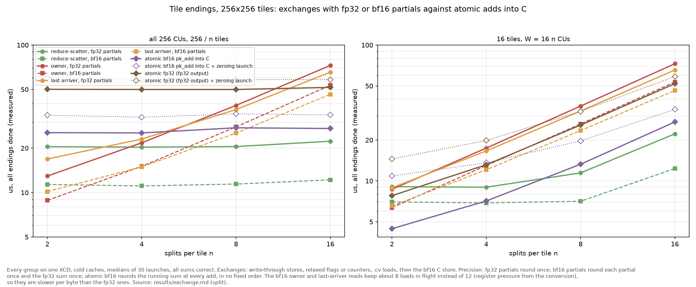

<!--
Version 2 of GITHUB_REPLY.md (the original is kept unchanged). Paste everything below this comment into the
issue. Before posting:
- The three figures use paths relative to this file, so they render in a local preview but not on GitHub.
  Drag images/handoff_costs.png, images/exchange_phases.png and images/exchange_totals.png into the GitHub
  editor and replace the three image paths with the links GitHub generates.
- The last paragraph of the collapsed section names local files; replace them with links if the
  experiment is published.
-->

We are working on the same problem, exchanging stream-K partials between workgroups inside one launch, so we have answers to the two questions in [AMD-Triton/triton-tickets#2079](https://github.com/AMD-Triton/triton-tickets/issues/2079) for MI355X (gfx950). Some answers come from experiments, some from what the documentation implies, and we say which. Everything was measured on one MI355X in SPX / NPS1 mode with coarse-grained device memory (`torch` allocations). We did not test gfx942.

<details>
<summary><b>The two questions from #2079</b></summary>

Question 1 is the open question at the end of the first item; question 2 is the second item.

> - **gfx950:** Lei's single-launch prototype, shared in Triton Compiler Scrum on 2026-10-01. Its sequence:
>   1. `.wt` store of the partial;
>   2. `s_waitcnt vmcnt(0)`;
>   3. `gl.barrier()`;
>   4. relaxed atomic arrival counter;
>   5. the last arriver reads all partials with `.cv`, in split order.
>
>   It avoids a full `buffer_wbl2` / `buffer_inv`. Open question from the same thread: does an acknowledged store guarantee visibility to another workgroup?
>
> 2. **The synchronized method needs research into the memory hierarchy.**
>    - Measure what each cache modifier (`.wt`, `.cv`, `.cg`, `sc0`/`sc1`/`nt`) and each fence scope (workgroup, cluster, agent) actually costs and guarantees, on both chips.
>    - Find out where the partials live and where they're read from: L1, L2 or MALL / HBM, on the same XCD or a different one.
>    - Measure the cost of the alternatives: agent-scope fences, which write back the whole L2, against targeted write-through.
>    - Write down the minimal sequence that is correct, so kernels stop relying on what happens to work in testing.

</details>

Three words have a specific meaning below:

- **observed**: every read was fresh in our tests, 0.4-4.9 million line reads per test. A line read is one dword of a 128-byte line, and each writer-reader pair covers 64 lines, written by one store instruction and read by one load instruction. So the 2.46 million lines of a cross-XCD test are 38,400 independent handoffs;
- **documented**: promised by the memory-model section of LLVM's AMDGPUUsage ("Memory Model GFX942", whose code sequences the compiler also uses for gfx950) or by the CDNA4 ISA cache-policy tables;
- **inferred**: our explanation of a result, consistent with the documentation but not shown directly.

## Short answers

**Question 1: does an acknowledged store guarantee visibility to another workgroup?** Not on its own: it depends on the store's cache bits. Lei's sequence, with the arrival counter at `scope="gpu"`, returned fresh data in every test, including readers on another XCD, and it was the fastest sequence we measured. That is observed. Whether it is guaranteed rests on one point we could not find documented, which we would like hardware to confirm (see "Question for hardware").

**Question 2: costs, guarantees and the minimal sequences.** With 256 KiB partials, synchronisation is a small part of the exchange; reading the partials dominates. Using the compiler's agent-scope release and acquire instead of write-through added 5-6.5 µs end to end with all 256 CUs. The minimal sequences, and which parts of each are documented, are in the table at the end of the Question 2 section.

## Question 1: acknowledged stores and visibility

An acknowledgement (`s_waitcnt vmcnt(0)`) says the store has completed at the level its cache bits send it to:

- **Default store:** the line stays dirty in the writer's L2. A CU on the same XCD sees it if its load misses L1. A reader on another XCD that already holds the line keeps reading its own L2 copy: 100% stale in our tests until a write-back or an eviction (Table 1).
- **Write-through store (`.wt` = `sc0 sc1`, or `sc1`):** the write goes past the writer's L2. Every tested reader whose load missed L1 saw the new value, on the same XCD and on another, even a reader that had primed a stale copy into its own L2.

Lei's sequence as we tested it:

```text
writer:  .wt stores; s_waitcnt vmcnt(0) in every wave; s_barrier; relaxed gpu-scope atomic arrival
reader:  the last arriver reads all partials with .cv (or .cg) loads; no acquire
```

Two details matter. The arrival counter must be `scope="gpu"`, not `cta` (see the aiter section). Every wave must drain its own stores before the barrier, because a release or a drain covers only the wave that issues it.

**Why `.wt` works.**

- *Documented:* AMDGPUUsage's ["Memory Model GFX942"](https://llvm.org/docs/AMDGPUUsage.html#memory-model-gfx942) section (the compiler uses these sequences for gfx950) says an L2 is kept coherent with other L2s for memory local to it and mapped MTYPE RW: "Any local memory cache lines will be automatically invalidated by writes from CUs associated with other L2 caches ... due to the cache probe caused by the PTE C-bit." On this machine the amdgpu `mtype_local` parameter is 0, which the driver defines as MTYPE_RW, and the driver sets the snooped (C) bit on local VRAM pages.
- *Inferred:* the documentation does not say when the probe happens. We infer that it happens when the write leaves the writer's L2 for the memory side, meaning the fabric and the MALL in front of HBM, not necessarily HBM itself: write-through data was later read at LLC latency. AMDGPUUsage requiring `buffer_wbl2` to write back dirty L2 lines for coherence between L2s fits this. A `.wt` store leaves L2 straight away. A default store stays dirty in L2, so no probe is sent and another XCD keeps its old copy until a write-back or eviction.
- *Observed, and consistent with that:* when the writer's XCD wrote 4 MiB of unrelated data after the partial, eviction turned a 0% fresh cell into 100% fresh. This is also why stress tests can pass incorrect kernels.

**Why the fences cost more.** According to AMDGPUUsage, `buffer_wbl2 sc1` (the agent-scope release) writes back the L2's dirty lines. Its cost grew with the XCD's dirty data, about 0.6 µs per MiB: 0.8-3.0 µs for one CU, and 6.7-8.8 µs each when all 32 CUs of an XCD issue it at once. That fits a write-back of the whole L2 rather than just the partial. Issuing it from all 4 waves instead of once per CU added 5-15 µs in our exchange tests, and 8 µs in the cross-XCD handoff (22.0 against 13.8 µs, same run). `.wt` avoids the write-back, because only the lines that need to be visible leave L2.

If you use fences, keep the partial stores as plain stores, drain every wave, and put the release on the one arrival atomic. The compiler then emits one `buffer_wbl2 sc1` per CU, after the barrier.

### Question for hardware

**Has the probe finished invalidating the other L2s' copies by the time a write-through store is acknowledged (`vmcnt` decremented)?** The write-through sequence relies on it. Across XCDs we saw no stale line in nine write-through or `sc1` sequences of the ordering test, 2.46 million lines (38,400 writer-reader handoffs) each. Four of them ran with 2 MiB of other stores queued ahead of the data store. In the seven with `.cv` or `sc1` loads, the reader's prime had left the old line in its own L2. But we have only observed this, not found it documented. Until it is confirmed, the fully documented alternative is the release / acquire row of the minimal-sequences table.

## Question 2: costs, guarantees, where partials live, minimal sequences

### Where partials live and where they are read from

We infer the cache tier from the latency of a single timed load: L1 42 ns, L2 77 ns, LLC (MALL) 283 ns, HBM 433 ns.

**Table 1. Cache bits alone, no fences.** Before the write, the reader primed the old value with the same bits it then reads with. Each cell gives the result and, in brackets, the tier the timed read's latency points to.

| store \ load | default | `.cg` (`sc0 nt`) | `sc1` | `.cv` (`sc0 sc1`) |
|---|---|---|---|---|
| **same workgroup** | | | | |
| any | fresh | fresh | fresh | fresh |
| **same XCD, another CU** | | | | |
| default, `.cs` (`sc0 nt`) | **stale (L1)** | fresh (L2) | fresh (L2) | fresh (L2) |
| `sc1`, `.wt` | **stale (L1)** | fresh (HBM) | fresh (LLC) | fresh (LLC) |
| **other XCD** | | | | |
| default | **stale (L1)** | **stale (L2)** | **stale (L2)** | **stale (L2)** |
| `.cs` (`sc0 nt`) | **stale (L1)** | **30% fresh** | **32% fresh** | **33% fresh** |
| `sc1`, `.wt` | **stale (L1)** | fresh (LLC) | fresh (LLC) | fresh (LLC) |

- **L1 is not coherent between CUs.** A default load of a line another CU wrote returned the reader's stale L1 copy (42 ns) in every placement and with every store type.
- **`.cv` and `sc1` loads are not an L2 bypass here.** They hit the reader's L2 when it held the line, stale or not (78 ns and stale after a default store on another XCD). The ISA table's "coherent cache bypass" did not apply to these coherently cached lines. A reader therefore only needs to miss L1: `.cg`, `.cv`, `sc1`, or `buffer_inv sc1` beforehand. That does not help while the new data is still dirty in another XCD's L2.
- **Write-through data reached a `.cg` reader on another XCD that held the old line in L2.** The ISA table predicts stale; we measured fresh, which fits the probe dropping the reader's copy.
- **Streaming (`.cs`) stores across XCDs are luck:** only the lines the writer's L2 happened to evict before the read were fresh.
- **The tier depends on earlier reads, not on correctness.** With no prior read, write-through data had HBM-like latency (429-436 ns); after a default or `.cv` prime, LLC-like latency (about 280 ns). The one HBM cell above comes from its `.cg` prime.
- **A default-store partial read by another CU of the same XCD** took 77 ns only if the line was valid in L2 before the store. Otherwise the first read took about 370 ns, HBM-like, even though L2 held the new data.

### Costs

- **Store bits.** A 256 KiB partial takes 3.56 µs with default bits and 3.72 µs with `.wt` or `sc1` on one CU; with 16 CUs per XCD writing at once, 3.9 against 4.9 µs.
- **Workgroup-scope fences** emit only `s_waitcnt lgkmcnt(0)` outside TG-split mode: no cache maintenance and no `vmcnt` wait. They cost nothing measurable, and they do not publish data to other workgroups.
- **`buffer_wbl2 sc1`:** see Question 1.
- **`buffer_inv sc1`:** 0.5 µs for one CU, 6.4 µs each with 32 at once. It did not remove the reader's stale L2 copy of this memory; its only observed effect was the L1 invalidate.
- Both cache operations affected only the issuing XCD.

**Figure 1. Handing over one 256 KiB partial, per method.** 16 writers per XCD at once, each read by one CU on the same or the next XCD. Cold caches (a 1 GiB read before each launch), medians; every sequence returned correct data.


*The cross-XCD rows use a relaxed `gpu`-scope swap as the flag, polled with relaxed `gpu`-scope atomic loads. The "compiler" rows add `sem="release"` to the swap and `sem="acquire"` to one atomic load after the spin; the compiler emits one `buffer_wbl2 sc1` / `buffer_inv sc1` per CU, and the release's cost shows up as "flag seen". The last row writes `buffer_wbl2 sc1` by hand in all 4 waves, which is pessimistic. The compiler rows come from a separate run, in which write-through took 10.2 µs and the every-wave release 22.0 µs.*

Across XCDs, write-through took 10.0 µs, the compiler's release 13.8 µs (14.2 µs with its acquire too), and the every-wave release about 22 µs. With one writer per XCD all of them took 8.0-8.2 µs: the release only costs more when many CUs write back their XCD's L2 at once.

**Figure 2. Where the time goes as the split count grows, with atomic endings for comparison.** Each group's critical path, split into publish, sync (the flag, counter or arrival), read and the consumer's bf16 C store. Each phase is the median over groups and 30 launches, taken separately, so a stack is not any one group's path. 256 KiB fp32 partials, each group on one XCD, cold. The three exchanges use write-through; the three atomic endings are described below the figure, and the grey segment on top of them is the separate launch that zeroes their tiles. Hatched bars are a bandwidth bound, not an independent prediction: each phase is the slowest of one CU's, one XCD's and the chip's rate, the per-CU rates are calibrated from our single-writer handshake (so where one CU is the limit the fit is partly built in), the sync is a constant 0.6 µs, and the C store and the zeroing are left out. Top row: all 256 CUs (256 / n groups); bottom row: 16 groups.


- **The sync step is small:** 0.4-1.5 µs at every split count from 2 to 16. For the owner pattern this is only its first wait; its later waits overlap its reads and are counted there.
- **Reads grow with the split count.** With all 256 CUs, the last arriver's read takes 4.7 µs at n = 2 and 54 µs at n = 16: about 3.5 µs per extra 256 KiB partial, and about 4 µs for the owner. Reduce-scatter stays at 20-22 µs in total, consistent with the fabric being the limit.
- **The bf16 C store adds 0.2-1.6 µs**, the least for reduce-scatter, where each member stores 1/n of the tile.

### Atomic endings instead of an exchange

Every member adds its partial into its group's tile with relaxed `gpu`-scope atomics whose results are unused, coalesced (a wave's 64 lanes on 256 contiguous bytes), into a tile the host zeroes first in a launch of its own:

- **bf16:** `buffer_atomic_pk_add_bf16` straight into C;
- **fp32:** `buffer_atomic_add_f32` into an fp32 tile (the ending for fp32 output);
- **fp32, then finalize:** the fp32 adds, a drain, a relaxed `gpu` counter, and the last arriver reads the sum with `.cv` loads and stores bf16 C.

Results:

- **They are limited by the chip's atomic rate**, about 1.3 TB/s for bf16 or fp32, against 7.4-7.5 TB/s for plain stores and loads. With all 256 CUs, bf16 takes 25-28 µs at every split count and fp32 50-51 µs, as the model predicts.
- **bf16 into C beats the best fp32-partial exchange only with few CUs:** 4.5 against 8.7-9.1 µs for 16 tiles split 2 ways, and 7.1 against 9.0 µs (reduce-scatter) split 4 ways. From 128 CUs up reduce-scatter is faster: 11.5 against 13.3 µs at 128 CUs, and 20-22 against 25-28 µs at 256. With all 256 CUs and n >= 8, bf16 still beats the owner and the last arriver (27 against 37-39 µs at n = 8).
- **fp32 atomics take twice as long as bf16.** They beat the best exchange only for 16 tiles split 2 ways (7.8 against 8.7 µs). Against the owner and the last arriver they also win at n = 16 (52 against 66-73 µs).
- **With bf16 partials, the precision-matched comparison, the exchanges win almost everywhere** (Figure 3). bf16 partials (`.wt` stores and `.cv` loads, still 16 bytes per lane, summed in fp32) round each partial once and the sum once; bf16 atomics round the running sum at every add. Reduce-scatter with bf16 partials takes 11.1-12.2 µs with all 256 CUs, against 25-28 µs for bf16 atomics, and 6.9-12.4 µs for 16 tiles split 4-16 ways, against 7.1-27 µs. The atomics win only for 16 tiles split 2 ways (4.5 against 6.4 µs for the owner with bf16 partials), and lose that too once the zeroing launch is counted.
- **The zeroing launch is not counted** in those times. It took 6-10 µs (CUDA events, mostly launch overhead), which cancels the atomic endings' advantage at 16 tiles unless the zeroing can be hidden in an earlier launch.
- **The finalize adds 5-6.5 µs** with the group on one XCD (the counter, a 256 KiB read and the C store), and up to 9 µs spread over XCDs.
- **Correctness:** every tile summed exactly, and a control that adds every partial twice was rejected in every element. In the finalize, the last arriver read the other members' atomic sums with `.cv` loads after a relaxed counter, and they were complete, with the group on one XCD and spread over XCDs. That fits device-scope atomics being performed at a point every XCD sees; we have not found it documented.
- **Not included:** the `convert_layout` through LDS that a real accumulator needs before coalesced atomics. In a standalone test it made a 128 KiB bf16 `pk_add` from one CU 4.8 µs, against 4.3 µs here without it. bf16 atomics also round n times instead of once, in no fixed order.
- **These are synthetic endings.** In our GEMM (v22 against v20) the atomic ending has the shortest tail in most shapes. The likeliest difference is that the GEMM's exchange pays costs this kernel does not: its tile barrier is an `acq_rel` / `release` / `acquire` sequence, whose `buffer_wbl2 sc1` writes back an L2 that still holds the full wave's dirty C tiles, and its slice and C store code is slower. We have not confirmed this.

**Figure 3. Measured totals of every ending against the split count.** The exchanges with fp32 partials (solid) and bf16 partials (dashed), all with their C store; the atomic endings without (solid) and with (dotted) the zeroing launch. Same runs as Figure 2.



**Table 2. Write-through against the compiler's release / acquire, by exchange pattern.** Groups of 16, all 256 CUs, each group on one XCD, cold. "Write-through" is `.wt` stores, a relaxed flag or counter, and `.cv` loads. "Compiler" is default stores, `sem="release"` flags or `sem="acq_rel"` counters, and `sem="acquire"` after each wait; the compiler emits at most one `buffer_wbl2 sc1` / `buffer_inv sc1` per atomic per CU. The difference is relative to the write-through time.

| pattern | partial | each consumer reads | write-through | compiler | difference |
|---|---|---|---|---|---|
| reduce-scatter | 256 KiB | one partial's worth | 21.9 µs | 28.2 µs | +6.3 µs (29%) |
| owner | 256 KiB | 15 partials | 71.4 µs | 77.9 µs | +6.5 µs (9%) |
| last arriver | 256 KiB | 15 partials | 64.4 µs | 70.2 µs | +5.8 µs (9%) |
| reduce-scatter | 128 KiB | one partial's worth | 11.1 µs | 17.1 µs | +6.1 µs (55%) |
| owner | 128 KiB | 15 partials | 41.1 µs | 47.2 µs | +6.1 µs (15%) |
| last arriver | 128 KiB | 15 partials | 33.9 µs | 38.9 µs | +5.0 µs (15%) |

*In reduce-scatter, each of the n members reads 1/n of every partial. The owner, one member rotating between groups, reads the other n - 1 partials after waiting on each one's flag. The last member to arrive on a counter reads the other n - 1. 128 KiB is a 128 x 256 fp32 tile, or a 256 x 256 tile with bf16 partials.*

- **The compiler sequence's extra cost is roughly fixed:** 5-6.5 µs in every pattern at both sizes (1.4-6.5 µs across all our exchange tests, the least at 128 writers). Its share depends on how much each consumer reads: 9% for 15 partials of 256 KiB, 55% for one partial's worth of 128 KiB.
- **Smaller partials raise the share**, because they shrink the reads but not the release and acquire.
- **Fewer splits raise it too.** We compared the methods only at n = 16. If the 5-6.5 µs difference held at n = 8 (not measured), it would be 13-18% for the owner and the last arriver, whose write-through totals, including the C store, are 39.0 and 36.6 µs.
- **Keeping the partials in L2 saved nothing when cold.** In the same last-arriver test, the L2 path (default stores, relaxed counter, `.cg` loads) took 74.9 µs against 64.4 µs for write-through, consistent with the 370 ns first read above. Why it is slower, and not just no faster, we have not established. Warm, on one XCD, the L2 path does win: 5.7 against 8.0 µs for one handoff.

So write-through was the fastest sequence, or within 0.2 µs of it, in every cold case we measured. The exception is a warm exchange on one XCD, where keeping the partials in L2 is faster.

### Minimal sequences

| placement | writer | reader | relies on |
|---|---|---|---|
| same workgroup | stores; `s_barrier` | any loads | documented |
| same XCD, another CU | default stores; `s_waitcnt vmcnt(0)` in every wave; `s_barrier`; relaxed `gpu` flag or counter | an L1-missing spin; `.cg` / `.cv` loads, or `buffer_inv sc1` then default loads | documented, given one shared L2. The placement must be checked: the language has no XCD scope |
| any placement, fastest observed | `.wt` stores; `s_waitcnt vmcnt(0)` in every wave; `s_barrier`; relaxed `gpu` flag or counter | relaxed `gpu` spin or arrival; `.cv` or `.cg` loads | observed only: that the probe has finished when the store is acknowledged |
| any placement, documented | default stores; drain; **one** `sem="release"` `gpu` atomic per CU | `sem="acquire"` then default loads | documented |
| any placement, no acquire | as above | `.cg` loads, with a compiler fence after the spin so they are not hoisted above it | documented pieces, not a documented sequence: `.cg` loads miss L1 (ISA table), and remote writes invalidate local L2 lines (AMDGPUUsage) |

The last row needs no acquire because, on this memory, the acquire's only observed effect was dropping the reader's L1, which `.cg` loads skip anyway. The reader's stale L2 copy is removed by the probe when the writer's release writes the data back, not by the acquire: issued well before the read, `buffer_inv sc1` left it in place, 100% stale.

Sequences that are **not** correct:

- A reader-side acquire without a writer-side release: 100% stale in the ordering test.
- A `cta`-scope **poll** between workgroups. It compiles to `global_load ... sc0`, which keeps hitting the reader's L1. All 12,800 waits timed out, even on one XCD.
- Default or streaming stores read from another XCD. These pass only when something evicts the lines in time.
- Default loads of another CU's data without `buffer_inv sc1`.

## Implication for aiter's fused split-K

[`_sum_splits_on_xcd` in `gemm_afp8wfp8.py`](https://github.com/ROCm/aiter/blob/2c56a7dbd45fe8433a737ebec542616831e4541c/aiter/ops/triton/_triton_kernels/gemm/basic/gemm_afp8wfp8.py#L323-L346) uses this last-arriver pattern, but keeps the partials in L2:

```python
tl.store(slot + split * BM * BN + local, partial)                    # default stores
tl.inline_asm_elementwise("s_waitcnt vmcnt(0)", ...)                 # drain
tl.debug_barrier()
if tl.atomic_add(counter, 1, sem="acq_rel", scope="cta") == SPLITS - 1:
    total += tl.load(..., cache_modifier=".cv")                       # last arriver sums
```

We reproduced it with 4 or 16 splits of 8 KiB and 256 KiB partials, cold and warm:

- with the splits on one XCD, as `_tile_on_xcd` places them, it was correct: 0 wrong sums in 9,600 groups;
- with the same groups spread over XCDs, **99% of the groups summed wrongly** with 8 KiB partials, at both 4 and 16 splits.

The kernel relies on three things the memory model does not promise:

- that a `cta`-scope atomic is atomic between workgroups;
- the unchecked `pid % 8` workgroup-to-XCD mapping;
- the hand-written `vmcnt(0)`, which a `cta` release does not emit.

**`acq_rel` `cta`, relaxed `cta` and relaxed `gpu` compile to the same `global_atomic_add` with no cache maintenance**, and cost the same to within 0.1 µs. We suggest `sem="relaxed", scope="gpu"`, plus a compiler-only fence after the atomic (an empty inline asm with a memory clobber) to keep the IR ordering that `acq_rel` currently provides. The explicit drain and the barrier should stay.

With a `gpu`-scope counter, we would also suggest `.wt` partial stores:

- they returned fresh data in every placement we tested, subject to the question for hardware;
- they were faster with cold caches, which we expect after a GEMM main loop (we did not measure slot residency in aiter's kernel);
- the L2 path was faster only while the partials were still in L2, and it is correct only while the one-XCD placement holds.

aiter's partials are small (0.5-16 KiB, with 2-8 splits), so the roughly fixed cost of the agent release and acquire would be a larger share than in our 256 KiB tests.

<details>
<summary><b>How we tested, and further results</b></summary>

### The harness

- **One cache bit or fence at a time.** Every data access is inline assembly (`global_load_dword` / `global_store_dword ... off <bits>`), and a check sweep greps the compiled code of every cell to confirm the encoding. Waves without a role run the same instructions on a private dummy region, so the code never branches on the role.
- **Placements**, checked on the hardware in every launch with `HW_REG_XCC_ID` and `HW_REG_HW_ID` (0 misplaced pairs, 0 launches with two workgroups on one CU): two waves of one workgroup (256 pairs), two CUs of one XCD (128 pairs), and two XCDs, writers on XCDs 0, 2, 4 and 6 and readers on the next one (128 pairs).
- **Timeline.** A relaxed atomic grid barrier, then only `s_memrealtime` deadlines. An acquire-release barrier would have done exactly the cache maintenance under test.
  1. At ts the reader **primes**: it reads every line with the cell's load bits, leaving the old value wherever those bits allocate.
  2. At ts + 20 µs the writer stores the launch's epoch, applies its fence, and drains.
  3. At ts + 70 µs the reader applies its fence and reads.
  4. Nothing else touches memory in between. The host checks the stamps afterwards and discards any pair that breaks the order; none did.
- **Classification.** Every line read is fresh (the epoch), stale (the primed value) or other. One stale line fails a cell.
- **Latency.** The first line of each pair is read alone inside an `s_memrealtime` + `s_memtime` bracket. The empty bracket took 44 cycles from the 5th to the 95th percentile of 268,800 samples (maximum 52). The tier medians are at least 36 ns apart, and each read is attributed to the nearest tier.
- **Controls**, 0.8-1.6 million lines each: default store and default load, on another XCD and on the same XCD, 100% stale; a write in one launch read in the next, 100% fresh; the full agent release and acquire, as inline assembly and as the compiler emits it, 100% fresh.

### What the compiler emits for gfx950

| scope | release (before the flag) | atomic load (the poll) | acquire (after the flag) |
|---|---|---|---|
| `cta` | `s_waitcnt lgkmcnt(0)` only | `global_load ... sc0` (can hit L1) | nothing |
| `gpu` (agent) | `buffer_wbl2 sc1; s_waitcnt vmcnt(0)` | `global_load ... sc1` | `s_waitcnt vmcnt(0); buffer_inv sc1` |
| `sys` | `buffer_wbl2 sc0 sc1; s_waitcnt vmcnt(0)` | `global_load ... sc0 sc1` | `s_waitcnt vmcnt(0); buffer_inv sc0 sc1` |

The read-modify-write atomic itself is the same `global_atomic_*` at `cta` and `gpu` scope. The compiler's release on a scalar atomic waits only for its own wave's `vmcnt`.

### Fences, with the time gap kept

Default or streaming data, so the fence alone has to make it visible:

| placement, loads | writer fence needed | reader fence needed |
|---|---|---|
| same workgroup, any | none | none |
| same XCD, default loads | none | agent acquire (`buffer_inv sc1`) |
| same XCD, `.cg` loads | none | none |
| other XCD, `.cg` loads | agent release | none |
| other XCD, default loads | agent release | agent acquire |

- Inline-assembly fences and the compiler's own (from `sem="release"` / `"acquire"`) gave the same results.
- `buffer_inv sc0` did nothing anywhere. The ISA calls it a no-op outside TG-split mode.
- A `buffer_wbl2 sc1` or `buffer_inv sc1` issued on an uninvolved XCD changed nothing.
- **A reader-side acquire alone is not a guarantee.** Issued 5 µs or more before the read, it left the reader's stale L2 copy in place: 100% stale, at L2 latency. Issued 0-1 µs before, reads took about 1.7 µs and were mostly fresh: an undocumented transient that still left up to 1% of lines stale (2-96% at 2 µs).

### Ordering with a flag instead of the time gap

The writer stores, applies its fence and sets a relaxed `gpu`-scope flag. The reader spins on the flag from its prime, about 120 polls, and reads as soon as it sees it. The writer starts after 20 µs plus 0-10 µs of jitter per pair. 300 launches per row, 64 lines per pair, give 2.46 million lines across CUs (128 pairs, so 38,400 handoffs) and 4.9 million within a workgroup (256 pairs).

| placement | sequence | result |
|---|---|---|
| other XCD | `.wt` stores, drain, flag, `.cv` loads | fresh |
| other XCD | the same without the drain; `sc1` instead of `sc0 sc1`; `.cg` loads | fresh |
| other XCD | default stores, agent release, flag, `.cg` loads (no acquire) | fresh |
| other XCD | default stores, agent release, flag, agent acquire, default loads | fresh |
| other XCD | default stores, drain, flag (no fences) | stale |
| other XCD | default stores, flag, agent acquire (no release) | **stale** |
| same XCD | default stores, drain, flag, `.cg` loads | fresh |
| same XCD | default loads | 73% stale |
| same XCD | default loads after an agent acquire | fresh |
| same workgroup | store, `s_barrier`, any load | fresh |

- The fresh cross-CU rows stayed fresh with 2 MiB of other stores per writer XCD queued ahead of the data store and the flag immediately after it.
- Leaving out the drain worked on this hardware (the compiled code has no wait between the last data store and the `global_atomic_swap`), but the memory model requires it, and after write-through stores it costs little.
- **Flag scope.** With a `cta` poll, all 12,800 waits timed out, on one XCD as well as across XCDs: the writer's swap reached L2, but the reader's `sc0` atomic load kept hitting its own L1. `gpu` and `sys` behaved the same as each other. A `cta`-scope read-modify-write was atomic across XCDs in our tests, which reflects the hardware performing every RMW at a device-coherent point, not a promise of the scope.

### Warm caches

With the previous launch's copies still in the readers' L2s, publishing 16 writers' partials across XCDs took 15 µs with write-through instead of 4.5 µs cold, consistent with paying for the probes; the release path slowed down the same way. A GEMM main loop probably evicts those copies before the ending, but a real ending sits between our cold and warm cases.

### Limits

- One MI355X in SPX / NPS1, with coarse-grained `torch` memory. Fine-grained or host memory, and other partition modes, may use other page types (CC, NC, UC), for which `buffer_inv sc1` and `sc1` loads may behave as the ISA table describes.
- Cross-XCD litmus pairs were adjacent XCDs (0 to 1, 2 to 3, 4 to 5, 6 to 7), not every pair.
- "Cold" flushes the LLC too, which a GEMM does not. "Warm" leaves the previous launch's L2 copies, which a GEMM main loop evicts.
- The synchronisation methods were compared against each other at n = 16 only. The split-count sweep (Figure 2) used write-through throughout.

The full write-up, the experiment log with every table, and the raw output are in `experiments/memory_model_litmus/` (`WRITEUP.md`, `README.md` and `results/`).

</details>
