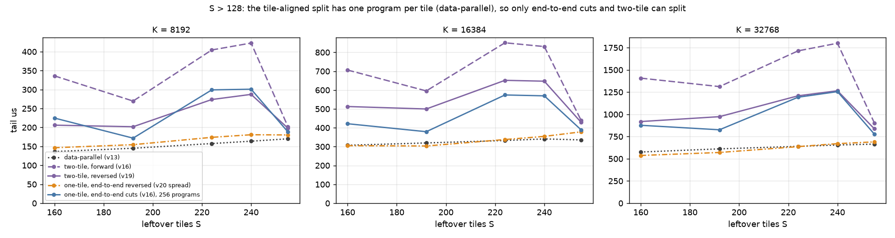

# What the gfx950 cache bits and fences actually guarantee

**For the summary, read [WRITEUP.md](WRITEUP.md)**: the findings, figures and recommendations in one
document. This README is the full experiment log.

The stream-K kernels exchange partials between workgroups inside one launch, and so far they have relied on
sequences that passed stress tests ([v21 SYNC_REVIEW.md](../../kernels/gemm/intra_wave/a16w16/v21_streamk_l2_partials/SYNC_REVIEW.md),
assumptions A1-A11). This experiment tests, one at a time, what each cache-bit combination (`sc0`, `sc1`, `nt`)
and each fence (workgroup and agent release / acquire) delivers on this chip. It checks where the data is found
when it is read (L1, L2, the last-level cache or HBM, on the same XCD or another one), and what each correct
sequence costs. It ends with the minimal sequence that is correct for each placement of writer and reader.

```bash
HIP_VISIBLE_DEVICES=1 python bench.py --sweep check refs controls stage1 pollute stage2a stage2b stage2c third acqgap
HIP_VISIBLE_DEVICES=1 python costs.py --sweep bits ops handshake arrive
HIP_VISIBLE_DEVICES=1 python costs.py --sweep handshake arrive --warm
HIP_VISIBLE_DEVICES=1 python exchange.py > results/exchange.md
HIP_VISIBLE_DEVICES=1 python exchange.py --sweep s8 > results/exchange_s8.md
HIP_VISIBLE_DEVICES=0 python exchange.py --sweep sn > results/exchange_sn.md
python make_figures.py      # images/*.png from the results files (no GPU)
# The GEMM measurements of section 7's split count (Triton v2.2 + llirSched, no amdgcnas hook, from the repo root):
HIP_VISIBLE_DEVICES=0 python experiments/streamk_split_count/check_tile_limit.py
HIP_VISIBLE_DEVICES=0 python experiments/streamk_split_count/atomic_accuracy.py > experiments/streamk_split_count/results/atomic_accuracy.md
HIP_VISIBLE_DEVICES=0 python experiments/streamk_split_count/sweep.py c     # about 3.5 h
HIP_VISIBLE_DEVICES=0 python experiments/streamk_split_count/sweep.py l2
(cd kernels/gemm/intra_wave/a16w16 && HIP_VISIBLE_DEVICES=0 python v20_streamk_reduce_scatter/fixup_timing.py \
    --tile-limit --fixups rs owner --jsonl v20_streamk_reduce_scatter/results/fixup_timing_limited.jsonl)
python split_model.py > results/split_model.md      # images/split_optimum.png (no GPU)
python tail_variants.py > results/tail_variants.md  # images/tail_variants*.png (no GPU)
```

Machine: MI355X (gfx950), SPX / NPS1, 256 CUs, GPU 1, Triton 3.8 (`gfx950-tutorial-v2.1`) + deepbind shim,
no plugins, memory from `torch` (coarse-grained device memory). The split-count GEMM runs (section 7, "The
best split count") are on GPU 0 with AITER's stack: Triton `gfx950-tutorial-v2.2` + deepbind shim +
`llirSched`, without the amdgcnas hook (a first run with the hook is kept in `*_amdgcnas.*`);
`exchange_sn.md` is on GPU 0 with v2.1. Each sweep takes 5-30 s. Raw output is in
[results/](results/): [check_refs.md](results/check_refs.md), [controls.md](results/controls.md),
[stage1.md](results/stage1.md), [pollute.md](results/pollute.md), [stage2a.md](results/stage2a.md),
[stage2b.md](results/stage2b.md), [stage2c.md](results/stage2c.md), [third.md](results/third.md),
[acqgap.md](results/acqgap.md), [costs.md](results/costs.md) (a 1 GiB read before every launch) and
[costs_warm.md](results/costs_warm.md) (back-to-back launches), [exchange.md](results/exchange.md).

## TL;DR

- **The two mechanisms that make data visible are on the writer's side.** A store reaches other XCDs only
  once it reaches memory: through a write-through store (`sc1`, or `sc0 sc1` = `.wt`), through
  `buffer_wbl2 sc1` (agent release), or by eviction. When it does, the other XCDs' L2 copies of the line
  are invalidated. LLVM's gfx942 memory model calls this the "cache probe caused by the PTE C-bit".
  Default and `sc0 nt` stores stay dirty in the writer's L2, invisible to every other XCD whatever the
  reader does.
- **`sc1` and `sc0 sc1` (`.cv`) loads are not an L2 bypass here.** They are served from the reader's own L2
  (77 ns) whenever it holds the line, stale or not. What they do guarantee is an L1 miss, and so does
  `sc0 nt` (`.cg`). On the reader's side, the only thing that matters is skipping or invalidating its L1.
- **The reader's L1 is never coherent.** A default load returns the reader's old L1 copy (42 ns) after any
  other CU writes, on the same XCD or another, with any store bits. `buffer_inv sc1` (agent acquire)
  invalidates L1 and nothing else that matters: it does not invalidate this memory's L2 lines.
  `buffer_inv sc0` is a NOP, as the ISA says.
- **A reader-side acquire without a writer-side release is wrong.** It came out 100% stale in the ordering
  test, and 100% stale with the acquire 5 us or more before the read. With the acquire 0-2 us before the
  read, the next reads take about 1.7 us and are mostly fresh, through some undocumented transient. Even
  then, up to 4,239 of 245,760 lines were stale (255-2,387 with `sc0 nt` loads at 0-1 us).
- **Ordering held everywhere it could have failed.** Every combination that was visible stayed 100% correct
  with a flag and no time gap: 2.5-4.9M line reads per row. That includes readers holding a stale L2 copy,
  no `s_waitcnt vmcnt(0)` before the flag, and 2 MiB of other stores queued ahead. Leaving out the drain
  works on this hardware, but the memory model requires it.
- **A `cta`-scope flag never arrives across CUs, even on one XCD.** Its atomic load is `sc0`, which hits
  the reader's L1. That is a hang, not wrong data. The read-modify-write instruction is identical at every
  scope.
- **Costs** (section 5; joined with the recommendations in section 6). For one 256 KiB partial and one
  publisher per XCD, every correct cross-XCD sequence takes 8-9 us end to end. Things change when 16 CUs
  per XCD publish at once, as in a stream-K tail:
  - with cold caches, write-through stores take 10 us. Default stores + `buffer_wbl2 sc1` take 22 us when
    every wave issues the release, and 13 us when one per CU does, as the compiler emits it (section 7);
  - back to back, with the previous launch's readers still holding copies in their L2s, they take 21-28 and
    37 us. Every write that reaches memory now has to invalidate a copy on another XCD, and that is the
    probe's cost. Write-through on one XCD (no remote copy) stays at 10 us;
  - 32 simultaneous `buffer_wbl2 sc1` or `buffer_inv sc1` cost 6.4-8.8 us each, against 0.5-3 us for one.

  The acquire's damage to neighbouring CUs is negligible (+0.04-0.2 us to re-read 1-4 MiB), because it
  does not invalidate their L2 lines.
- **On one XCD the cheapest option depends on the cache state.** Default stores + a flag + `.cg` loads
  (v21 `l2`) take 5.7 us warm against 8.0 for write-through, but 9.0 against 7.9 cold. The first read of a
  line written into L2 fetches its old contents from wherever they are.
- **How the partials are collected matters more than how they are synchronised** (section 7). When 256 CUs
  exchange 256 KiB partials in groups of 16 (each group on one XCD, as stream-K places a tile):
  - a reduce-scatter takes 22 us, bounded by the fabric: 67 MB each way at about 7 TB/s;
  - an owner or last arriver reading the other 15 partials takes 64-71 us, bounded by one CU;
  - with fewer splits the owner wins: at n = 2, 10.7 against 19.5 us, because reduce-scatter moves twice
    the bytes through the fabric. They cross at n = 4;
  - 128 KiB partials (a 128x256 tile, or bf16 partials) halve all of these.
- **The split count, measured in the GEMM for S = 1-255 on one matrix** (section 7, "The best split count"):
  among the endings that round once, tile-aligned reduce-scatter has the shortest tail up to S = 32
  (n = 16-64 at S <= 4, 8-16 at S = 6-16, 4-6 at S = 24-32), the owner ending from S = 38 to 128 (2-4 per
  tile), and only `spread` beats data-parallel above S = 128 (by 1-7%). v22's atomic ending (bf16 `pk_add`
  into C) is faster still in 50 of 60 cells, by a median 5-17%, at the cost of n roundings. Splitting pays
  from K = 2048 for every S up to 64. The 12.5 us "skew" of the first, S = 8-only model was an artefact of
  timing the tail from its first program's start.
- **`cta` scope buys nothing.** In a last-arriver reduction, aiter's `acq_rel` `cta` arrival, a relaxed `cta`
  one and a relaxed `gpu` one cost the same to within 0.1 us. They compile to the same code. A `gpu`-scope
  `acq_rel` arrival costs 2-4 us more (section 5).
- **Minimal correct sequences** (section 6):

  | placement | writer | reader |
  |---|---|---|
  | same workgroup | store; `s_barrier` | any load |
  | same XCD, another CU | store; `s_waitcnt vmcnt(0)`; flag | spin on the flag with an L1-missing load; then `.cg` loads, or `buffer_inv sc1` and default loads |
  | another XCD | `.wt` (`sc0 sc1`) stores; `s_waitcnt vmcnt(0)`; relaxed `gpu` flag | relaxed `gpu` spin; `.cg` or `.cv` loads |

  The default-store alternative across XCDs, with an agent release, is correct too but costs 2.2x in a burst.

## 1. What the documentation says, and what we tested

ISA Tables 49-50 (CDNA4) give each bit combination a policy per cache level. With more than one L2:

| bits (Triton `cache=`) | L1 | L2 | LLC |
|---|---|---|---|
| none (default) | load Hit LRU, store Miss LRU | Hit LRU | Hit LRU |
| `sc0 nt` (`.cg` load, `.cs` load or store) | Miss Evict | Hit Stream | Hit Evict |
| `sc1` (no Triton modifier) | Miss Evict | Coherent Cache Bypass | Hit LRU |
| `sc0 sc1` (`.cv` load, `.wt` store) | Miss Evict | Coherent Cache Bypass | Hit LRU |

LLVM's [AMDGPUUsage, "Memory Model GFX942"](../../../llvm-project/llvm/docs/AMDGPUUsage.rst) (LLVM uses the
same sequences for gfx950; the compiler emitted exactly them here) adds:
- "An L2 cache can be kept coherent with other L2 caches by using the MTYPE RW (read-write) for memory local
  to the L2 ... Any local memory cache lines will be automatically invalidated by writes from CUs associated
  with other L2 caches ... due to the cache probe caused by the PTE C-bit."
- "To ensure coherence of local memory writes of CUs in different agents a `buffer_wbl2 sc1` is required."
- "To ensure coherence of local memory reads of CUs with different L1 caches in the same agent a
  `buffer_inv sc1` is required. It ... will invalidate non-local L2 cache lines if configured to have
  multiple L2 caches."
- Agent-scope release is `buffer_wbl2 sc1; s_waitcnt vmcnt(0)`, agent-scope acquire
  `s_waitcnt vmcnt(0); buffer_inv sc1`.

So the ISA table predicts that `sc1` loads skip L2. AMDGPUUsage instead says L2s are kept coherent by probes
on writes and that the acquire's L2 invalidate touches only "non-local" lines. The measurements side with
AMDGPUUsage throughout: this memory behaves as "local" to every L2.

## 2. Method

**Kernel** ([kernel.py](kernel.py), `litmus_kernel`).
- 256 workgroups of 2 waves, one per CU: a 128 KiB LDS allocation keeps a second one off, and
  `HW_REG_HW_ID` confirms it every launch.
- Each writer/reader pair owns 64 lines of 128 bytes; lane l of the acting wave touches dword 0 of line l.
- Every data access is inline assembly (`global_load_dword` / `global_store_dword ... off <bits>`), so each
  cell's encoding is exactly the one named. The `check` sweep greps the compiled code of every cell to
  confirm it.
- Waves without a role run the same instructions on a private dummy region, so the code never branches on
  the role.

**Placements**, checked on the hardware with `HW_REG_XCC_ID` and `HW_REG_HW_ID` in every launch (0 misplaced
pairs, 0 launches with two workgroups on one CU):
- same workgroup: wave 0 writes, wave 1 of the same workgroup reads (256 pairs);
- same XCD: another CU of the same XCD reads (128 pairs);
- other XCD: the next XCD reads (128 pairs).

**Timeline.** A relaxed atomic grid barrier on its own line, then only `s_memrealtime` deadlines. The barrier
does no cache maintenance, unlike an acquire-release barrier, whose `buffer_wbl2 sc1` / `buffer_inv sc1`
would make every cell pass.
1. At ts the reader **primes**: it reads every line with the cell's load bits. This leaves the old value
   wherever those bits allocate, so the reader is set up to fail.
2. At ts + 20 us the writer stores the launch's epoch with the store bits, applies its fence, and drains.
3. At ts + 70 us the reader applies its fence and reads.
4. Nothing else touches memory in between: all stamps stay in registers until the end. The host checks the
   stamps afterwards (prime before write, write drained 5 us before the read) and discards any pair that
   breaks them; none did.

Every line read is classified fresh (the epoch), stale (the primed value) or other. One stale line makes
a cell unsafe; a cell counts as correct only if it is 100% fresh **and** the documentation promises it.

**Where the value came from.**
- The first line of every pair is read on its own, with one wave-uniform address, inside a timer bracket:
  `s_memrealtime` + `s_memtime`, the load and `s_waitcnt vmcnt(0)`, then `s_memtime` + `s_memrealtime`.
- An empty bracket is subtracted. It took 44 cycles in all 268,800 samples (maximum 52), so single-load
  timing is exact to a cycle.
- Each wave converts cycles to ns with its own clock, measured against `s_memrealtime` over the kernel
  (2.39 GHz).
- Reference tiers, measured in the same harness ([check_refs.md](results/check_refs.md)):

| tier | how | ns (p5-p95) |
|---|---|---|
| L1 | the reader read the line | 42 (38-44) |
| L2 | another CU of the XCD read the line | 77 (69-87) |
| LLC | another XCD read the line | 283 (228-357) |
| HBM | a 1 GiB read first | 433 (335-506) |

The `s_memrealtime` reading of the same bracket agrees on LLC and HBM; its 10 ns ticks cannot separate L1
from L2.

**Controls** ([controls.md](results/controls.md)), 0.8-1.6M lines each:
- default store and default load, other XCD and same XCD: 100% stale;
- write in one launch, read in the next (the kernel boundary): 100% fresh in every placement;
- agent release + agent acquire, as inline assembly and as the compiler emits it: 100% fresh.

## 3. Stage 1: cache bits alone

No fences, 100 launches per cell, a 1 GiB read before each launch ([stage1.md](results/stage1.md)).
Observed (and, where it differs, the ISA-table prediction), with the tier of the timed read:

| store \ load | none | `sc0 nt` | `sc1` | `sc0 sc1` |
|---|---|---|---|---|
| **same workgroup** | | | | |
| none, `sc0 nt` | fresh, L2 | fresh | fresh, L2 | fresh, L2 |
| `sc1`, `sc0 sc1` | fresh, LLC | fresh | fresh, LLC | fresh, LLC |
| **same XCD** | | | | |
| none, `sc0 nt` | **stale, L1** | fresh, L2 | fresh, L2 | fresh, L2 |
| `sc1`, `sc0 sc1` | **stale, L1** | fresh, HBM | fresh, LLC | fresh, LLC |
| **other XCD** | | | | |
| none | **stale, L1** | **stale, L2** | **stale, L2** | **stale, L2** |
| `sc0 nt` | **stale, L1** | **30% fresh** | **32% fresh** | **33% fresh** |
| `sc1`, `sc0 sc1` | **stale, L1** | fresh, LLC (predicted stale) | fresh, LLC | fresh, LLC |

- **Same workgroup: everything is fresh.** A store from the CU itself updates or drops its L1 copy. A
  write-through store also drops the L2 copy, so the next read comes from the LLC.
- **Default loads are stale whenever another CU wrote**, at L1 latency, with any store bits. In a first
  version, the reader's own traffic evicted half of its L1 lines, and the same cells came out about 50% fresh.
  That is the kind of luck a stress test can mistake for correctness.
- **`sc1` and `sc0 sc1` loads hit the reader's own stale L2 copy** after a default store on another XCD
  (stale at 78 ns). The ISA's "Coherent Cache Bypass" does not stop them from hitting L2. The references
  show the same: an `sc1` or `sc0 sc1` read of a line the reader holds takes 77 ns.
- **Write-through stores reach another XCD's reader even through `sc0 nt` loads of a line the reader had in
  its L2.** The table predicts stale. The C-bit probe invalidates the reader's copy, and the read then
  comes from the LLC, where write-through data lands.
- **Streaming stores (`sc0 nt`) are luck.** Part of them is written back early (as
  [l2_memsys](../l2_memsys/README.md) found), so 30-33% of the lines are fresh.

**Pollution makes stale cells pass** ([pollute.md](results/pollute.md)). With default stores across XCDs
and `sc1` or `sc0 sc1` loads, the writer XCD writing other data afterwards changes the result:

| other MiB written by the writer XCD | 0 | 1 | 2 | 4 | 8 |
|---|---|---|---|---|---|
| fresh % | 0 | 0.3 | 50 | 100 | 100 |

Eviction writes the dirty line back, and the probe drops the reader's copy. A kernel with enough other
traffic passes every stress test with default stores across XCDs and fails when that traffic is missing.

## 4. Stage 2: fences, ordering and the flag's scope

### 2a. Fences with the time gap kept ([stage2a.md](results/stage2a.md))

Default or `sc0 nt` data, so the fence alone has to make it visible.

| placement, loads | writer fence needed | reader fence needed |
|---|---|---|
| same workgroup, any | none | none |
| same XCD, default loads | none | agent acquire (`buffer_inv sc1`) |
| same XCD, `sc0 nt` loads | none | none |
| other XCD, default loads | agent release | agent acquire |
| other XCD, `sc0 nt` loads | agent release | none |

- The inline-assembly fences and the compiler's own (from an atomic with `sem=release` / `acquire`) gave the
  same results everywhere.
- `buffer_inv sc0` changed nothing in any cell.
- A writer release alone never fixes default loads: the reader's L1 copy is still there.
- A reader acquire alone, with no writer release, left 4-191 of 409,600 lines stale with `sc0 nt` data. It
  gave 100% fresh with default data. That is why "other XCD, default loads" lists the release as needed: the
  next two sweeps and the ordering test show that a reader acquire alone is not a guarantee.

### Are the operations local or device-wide? ([third.md](results/third.md))

Every program on one XCD issued the operation at 40 us, 30 us before the reads. A `buffer_wbl2 sc1` on the
writer's XCD made that XCD's pairs fresh. Neither operation issued anywhere else changed anything. Both act
on the issuing XCD's own caches only.

### When the reader's acquire is issued ([acqgap.md](results/acqgap.md))

The reader's `buffer_inv sc1` + `s_waitcnt vmcnt(0)` was issued `gap` us before its read:

| case | gap 0-1 us | gap 2 us | gap 5-30 us |
|---|---|---|---|
| `.wt` store, other XCD, default loads | fresh, about 1.7 us per read | fresh | fresh, LLC (283 ns) |
| default store, same XCD, default loads | fresh, about 0.7 us | fresh, L2 | fresh, L2 |
| default store, other XCD, default loads | 0-19 stale of 245,760, about 1.7 us | 1.7% stale | **100% stale, L2 (79 ns)** |
| default store, other XCD, `sc0 nt` loads | 0.1-1% stale | 96% stale | **100% stale, L2** |

- The acquire invalidates the reader's L1 for good (row 1).
- It does not invalidate the reader's L2 copy of this memory: 5 us later, the stale copy is served at L2
  latency (row 3). That is AMDGPUUsage's "invalidate non-local L2 cache lines", with every line local.
- For about 2 us after the acquire, reads are slow (0.7-1.7 us) and mostly return the writer's dirty data.
  Nothing documents this, it is not complete, and in the ordering test it did not happen at all.

### 2b. Ordering: a flag instead of the time gap ([stage2b.md](results/stage2b.md))

- The writer sets `flag[pair] = epoch` with a relaxed `gpu`-scope atomic.
- The reader spins on it from its prime, about 120 polls, and reads the moment it sees the flag.
- The writer starts after 20 us plus 0-10 us of per-pair jitter.
- 300 launches per row: 2.46M lines across CUs, 4.9M in the same workgroup.

| placement | sequence | result |
|---|---|---|
| other XCD | `.wt` stores, drain, flag, `.cv` loads (v21 `wt`) | fresh |
| other XCD | the same without the drain; `sc1` instead of `sc0 sc1`; `.cg` loads | fresh |
| other XCD | default stores, agent release, flag, `.cg` loads (no acquire) | fresh |
| other XCD | default stores, agent release, flag, agent acquire, default loads | fresh |
| other XCD | default stores, drain, flag (no fences) | stale |
| other XCD | default stores, flag, agent acquire (no release) | **stale** |
| same XCD | default stores, drain, flag, `.cg` loads (v21 `l2`), with or without the drain | fresh |
| same XCD | default loads | 73% stale |
| same XCD | default loads after an agent acquire | fresh |
| same workgroup | store, `s_barrier`, any load, with or without the drain | fresh |

The fresh cross-CU rows were repeated with 2 MiB per writer XCD of other stores queued ahead of the data
store and the flag immediately after it: all fresh. The compiled code has no wait between the last data
store and the `global_atomic_swap`, so the no-drain rows are a real test.

### 2c. The flag atomic's scope ([stage2c.md](results/stage2c.md))

What each `scope` / `sem` compiles to:

| | read-modify-write (flag store) | atomic load (spin) | release | acquire |
|---|---|---|---|---|
| `cta` | `global_atomic_swap` | `global_load_dword ... sc0` | nothing | nothing |
| `gpu` | `global_atomic_swap` | `global_load_dword ... sc1` | `buffer_wbl2 sc1` | `buffer_inv sc1` |
| `sys` | `global_atomic_swap ... sc1` | `global_load_dword ... sc0 sc1` | `buffer_wbl2 sc0 sc1` | `buffer_inv sc0 sc1` |

- With a `cta` flag, all 12,800 waits timed out, on the same XCD as across XCDs. The writer's swap reached
  L2, but the reader's `sc0` load kept hitting its own L1.
- `gpu` and `sys` behave the same.
- With default data bits, the flag's own `gpu` release / acquire is enough: 100% fresh in both placements.
  Relaxed is 100% stale across XCDs, and 73% stale on one XCD (the L1).

## 5. Stage 3: costs ([costs.md](results/costs.md), [costs.py](costs.py))

**Store bits.** 256 KiB per CU, inline-assembly `dwordx2`. One CU per XCD: 3.56 us for default and `sc0 nt`,
3.72 us for `sc1` and `sc0 sc1`. 16 CUs per XCD at once: 3.92, 4.36, 4.92 and 4.88 us. `sc1` alone costs the
same as `sc0 sc1`, so `.wt` loses nothing by also setting `sc0`.

**Cache operations.** On every XCD at once, one CU or all 32 issue the operation and `s_waitcnt vmcnt(0)`,
after the other 31 CUs dirtied or read the given amount (us):

| XCD's L2 | `buffer_wbl2 sc1`, one CU | all 32 CUs | `buffer_inv sc1`, one CU | all 32 CUs |
|---|---|---|---|---|
| 0.1 MiB dirty | 0.8 | 6.7 | 0.5 | 6.4 |
| 1 MiB dirty | 1.7 | 7.6 | 0.5 | 6.4 |
| 2 MiB dirty | 2.1 | 7.9 | 0.5 | 6.4 |
| 4 MiB dirty | 3.0 | 8.8 | 0.5 | 6.4 |
| 0.1-4 MiB valid | 0.5 | 6.4 | 0.5 | 6.4 |

(0.5 us is the floor: the stamps around the operation include an `s_barrier`.)
- Neither operation slows the neighbours' re-read of valid lines (+0.04-0.2 us for 1-4 MiB): the acquire does
  not invalidate their L2 lines.
- The release costs the issuing CU about 0.6 us per MiB that the whole XCD has dirty.
- Simultaneous operations serialise: 32 at once cost 6.4-8.8 us each.

**Handshake.** A 256 KiB partial in v20's lane-contiguous order, published by 1 or 16 CUs of every XCD at once
and each consumed by one CU of the next XCD or of the same XCD. The flag is either a relaxed `gpu`-scope atomic
(a swap, polled with atomic loads) or a plain store polled with an L1-missing load. Total us from the writer's
first store to the reader's last load. "Cold" has a 1 GiB read before each launch; "warm" runs back to back,
so the previous launch's copies of the partial are still in the caches, including the readers' L2s.
0 wrong values in every row.

| placement | sequence | 1 writer, cold | warm | 16 writers, cold | warm |
|---|---|---|---|---|---|
| other XCD | `.wt` stores, drain, atomic flag, `.cv` loads (v21 `wt`) | 8.2 | 9.3 | **10.0** | 23.1 |
| other XCD | `.wt` stores, drain, atomic flag, `.cg` loads | 8.2 | 9.3 | 10.1 | 27.6 |
| other XCD | `.wt` stores, drain, `.wt` flag polled with `.cv`, `.cv` loads (reference kernel) | 8.1 | 9.2 | 9.9 | **21.4** |
| other XCD | default stores, agent release, atomic flag, `.cg` loads | 8.2 | 8.8 | 22.3 | 37.0 |
| other XCD | the same + agent acquire, default loads | 8.5 | 9.2 | 22.9 | 37.3 |
| same XCD | default stores, drain, atomic flag, `.cg` loads | 9.3 | 6.0 | 10.7 | 7.8 |
| same XCD | default stores, drain, plain flag polled with `.cg`, `.cg` loads (v21 `l2`) | 9.0 | **5.7** | 10.6 | **7.7** |
| same XCD | default stores, drain, atomic flag, agent acquire, default loads | 9.6 | 6.3 | 13.6 | 11.1 |
| same XCD | `.wt` stores, drain, atomic flag, `.cv` loads | 8.0 | 8.0 | 9.9 | 10.0 |
| same XCD | `.wt` stores, drain, `.wt` flag polled with `.cv`, `.cv` loads | **7.9** | 8.0 | **9.8** | 9.9 |

- **Write-through pays for the probe when another XCD holds the line.** With 16 writers, publishing takes
  4.5 us cold and 15.2 us warm across XCDs, when the previous launch's readers still hold the lines. On the
  same XCD it takes 4.5 us either way, because the only copy is in the writer's own L2. The release path
  pays the same way (13 to 28 us): its write-backs invalidate the same remote copies.
- **These release rows issue `buffer_wbl2 sc1` from every wave** (4 per CU). The compiler issues one per CU,
  after the barrier, and that costs 5-15 us less in the same configuration (section 7). Its total is then
  2.5-5 us over write-through, instead of about 12.
- **On one XCD, the L2 path wins when warm and loses when cold.** Its reads take 3.2 us when the lines are
  still valid in L2 (warm). After the flush they take 6.5 us, because the first read of a line written into
  L2 fetches the old line from HBM ([l2_memsys](../l2_memsys/README.md)). Write-through reads come from the
  LLC either way (4.4-4.9 us).
- **A plain flag is a little cheaper than an atomic one**: the flag is seen 0.2 us after it is set on one XCD,
  against 0.5 us. A `.wt` flag polled with `.cv` against an atomic across XCDs saves about 0.1 us.
- 2 MiB of other dirty data on the writer's XCD adds about 1 us to the release rows (cold) and nothing to the
  others.

**Last-arriver reduction** (`arrive`; aiter's `_sum_splits_on_xcd`, v20's arrival count). All 256 CUs form
groups of n. Each member stores a partial, drains, meets its workgroup at `s_barrier` and adds 1 to the
group's counter; the member that sees n - 1 sums the n partials. Nobody spins, so a broken scheme shows up as
wrong sums, never a hang. Total us for 8 KiB partials (aiter's small tiles), cold / warm:

| group | sequence | status | n = 4 | n = 16 | wrong groups |
|---|---|---|---|---|---|
| one XCD | aiter: default stores, drain, `acq_rel` `cta` arrival, `.cv` sum | not guaranteed | 4.9 / 2.4 | 4.5 / 2.7 | 0 |
| one XCD | default stores, drain, relaxed `cta` arrival, `.cv` sum | not guaranteed | 4.8 / 2.4 | 4.5 / 2.7 | 0 |
| one XCD | default stores, drain, relaxed `gpu` arrival, `.cv` sum | one XCD, checked placement | 4.8 / 2.4 | 4.5 / 2.7 | 0 |
| one XCD | default stores, drain, relaxed `gpu` arrival, `.cg` sum | one XCD, checked placement | 4.8 / 2.4 | 4.5 / 2.8 | 0 |
| one XCD | `.wt` stores, drain, relaxed `gpu` arrival, `.cv` sum | any placement | 3.6 / 3.7 | 3.6 / 3.6 | 0 |
| one XCD | default stores, drain, `acq_rel` `gpu` arrival, default sum | documented | 7.0 / 6.0 | 6.9 / 6.3 | 0 |
| spread | `.wt` stores, drain, relaxed `gpu` arrival, `.cv` sum | any placement | 3.8 / 4.2 | 4.1 / 5.1 | 0 |
| spread | `.wt` stores, drain, `acq_rel` `cta` arrival, `.cv` sum | not guaranteed | 3.8 / 4.3 | 4.1 / 5.1 | 0 |
| spread | default stores, drain, `acq_rel` `gpu` arrival, default sum | documented | 7.2 / 7.4 | 7.4 / 8.6 | 0 |
| spread | aiter's sequence, group spread over XCDs | negative | 4.5 / 3.4 | 4.6 / 4.4 | **99%** |

- **`cta` scope has no performance advantage.** The `acq_rel` `cta`, relaxed `cta` and relaxed `gpu` arrivals
  are the same instruction with no fences, and they cost the same in every configuration. Relaxed `gpu` is
  the formally correct one; `cta` adds only the risk.
- **A `cta`-scope read-modify-write was atomic across XCDs** (`.wt` data, spread groups, 0 wrong). That is the
  hardware performing every read-modify-write at a device-coherent point, not a promise of the scope.
- **The compiler's `gpu` `acq_rel` arrival costs 2-4 us more** (last arrival 2.9-3.1 us against 0.7-0.9),
  for its `buffer_wbl2 sc1` and `buffer_inv sc1`.
- **Write-through is cheapest cold for small partials, the L2 path warm** (3.6 against 4.8 us cold, 3.7
  against 2.4 warm), for the same reason as in the handshake.
- **Spread over XCDs, aiter's sequence gives wrong sums** in 99% of the groups (8 KiB partials) and 12-15%
  (4 x 256 KiB). With 16 x 256 KiB it was always right: 8 MiB of partials per XCD overflows the 4 MiB L2,
  so the dirty partials are written back before they are read. It passes by luck.
- **With 256 KiB partials the sum dominates** (57-81 us for one CU to read 4-16 partials). The `gpu` `acq_rel`
  fences add 5-6 us; the other arrival schemes are within 1 us of each other. Summing L2-resident partials
  with `.cg` was 8-10 us slower than with `.cv` (cold). Full tables: [costs.md](results/costs.md),
  [costs_warm.md](results/costs_warm.md).
- **A release on a scalar atomic covers only the issuing wave.** Every row drains each wave's stores and meets
  at `s_barrier` before the arrival. The compiler's release waits only for its own wave's `vmcnt`, so without
  that, another wave's stores could still be in flight when the counter moves.

## 6. The minimal correct sequences

"Correct" here means promised by AMDGPUUsage or the ISA **and** 100% fresh in every litmus cell, with the
negative controls failing. Where the hardware does more than the documentation promises, the row says so.

**With their costs** (us, from section 5). The handshake is one 256 KiB partial per reader, with 1 or 16
writers per XCD; the arrival is a group of 16 with 8 KiB partials.

| placement | sequence | what it relies on | handshake cold, 1 / 16 writers | warm, 1 / 16 writers | arrival, cold / warm |
|---|---|---|---|---|---|
| same workgroup | store; `s_barrier`; any load | documented | not measured | not measured | - |
| same XCD | default stores, drain, plain or relaxed `gpu` flag (or counter), `.cg` / `.cv` loads | one L2; checked placement | 9.0 / 10.6 | **5.7 / 7.7** | 4.5 / **2.7** |
| same XCD | default stores, drain, flag, `buffer_inv sc1`, default loads | one L2; checked placement | 9.6 / 13.6 | 6.3 / 11.1 | - |
| any | `.wt` stores, drain, relaxed `gpu` flag (or counter), `.cv` / `.cg` loads | the probe completes before the store is acknowledged (observed) | **7.9-8.2 / 9.8-10.1** | same XCD 8.0 / 10.0, other XCD 9.2-9.3 / 21-28 | **3.6** / 3.6 (one XCD), 4.1 / 5.1 (spread) |
| other XCD | default stores, drain, agent release, flag, `.cg` loads, or agent acquire and default loads | documented | 8.2-8.5 / 22.3-22.9 with the release in every wave; about 13 with one per CU (section 7) | 8.8-9.2 / 37 | 7.4 / 8.6 (spread) |

How to choose:
- **Group known to be on one XCD:** the L2 path when the partial slots are likely still in L2 (warm, small
  footprint); write-through when they are not (cold, or a data-parallel phase in between that evicts them).
  Write-through also survives a wrong placement.
- **Across XCDs:** write-through. It is 2.2x faster than the release in a cold burst, and 1.4-1.7x warm,
  where both pay the probes.
- **Never** `cta` scope for either the flag or the counter: it costs the same as relaxed `gpu` and is not
  guaranteed.

**Same workgroup** (waves on one CU, not TG-split):
- Writer: stores, `s_barrier`. Reader: any loads.
- LLVM's workgroup-scope release outside TG-split mode is `s_waitcnt lgkmcnt(0)` only (the AMDGPUUsage
  gfx942 table): the waves share one L1, and no `vmcnt(0)` is needed. It worked without one (4.9M lines). The
  `lgkmcnt(0)` matters only if LDS operations must be ordered too.

**Same XCD, another CU** (needs verified placement):
- Writer: default stores, `s_waitcnt vmcnt(0)` in every wave, `s_barrier`, flag.
- The flag: a relaxed `gpu`-scope atomic, or a plain store polled with `sc0 nt`.
- Reader: spin with a load that misses L1 (`sc1` atomic load or `sc0 nt`), then `.cg` loads; or
  `buffer_inv sc1` and default loads.
- This is v21's `l2` path. It is correct because one L2 is the point of coherence for all its CUs, which
  AMDGPUUsage states for a single-L2 agent. But the memory model has no XCD scope: nothing in the language
  expresses it, and the placement has to be checked (v21 does, with `HW_REG_XCC_ID`). A mistake hangs or
  gives wrong data.
- Do not use default loads without the acquire, or a `cta`-scope flag.

**Another XCD**, cheapest:
- Writer: `.wt` (`sc0 sc1`) or `sc1` stores, `s_waitcnt vmcnt(0)` in every wave, `s_barrier`, relaxed
  `gpu`-scope flag.
- Reader: relaxed `gpu`-scope spin, then `.cg` or `.cv` loads, with no acquire.
- This is v21's `wt` path. It rests on the documented probe invalidation: a write that reaches memory
  invalidates other L2s' copies. Two things are observed but not documented:
  - the probe completes before the store is acknowledged (no failure in 4.9M stressed line reads);
  - the reads must miss L1.
- 10 us in a 16-writer burst.

**Another XCD**, the generic sequence:
- Writer: default stores, agent release (`buffer_wbl2 sc1; s_waitcnt vmcnt(0)`, or `sem="release"`), flag.
- Reader: `.cg` loads; or agent acquire (`sem="acquire"`) and default loads.
- Fully documented, and the compiler emits it from `sem=`. In a 16-writer burst it takes 13 us when the
  release is issued once per CU (as the compiler does), and 22 us when every wave issues it. Each release
  writes back the whole XCD's L2, and the releases serialise.

Not correct, though each sometimes passes:
- default loads of another CU's data without `buffer_inv sc1`;
- a reader-only acquire without a writer release or write-through;
- `sc0 nt` stores across XCDs;
- default stores across XCDs that only work because enough other traffic evicted them;
- `cta`-scope flags between workgroups.

## 7. How the exchange scales with bandwidth ([exchange.md](results/exchange.md), [exchange.py](exchange.py))

The sections above cost the synchronisation. This one asks what moving the partials costs when a whole
tail of CUs does it at once. W writers each hold a partial of P bytes, and groups of n exchange them in one
of four ways:
- **1:1 handoff:** W other CUs each read one partial. That is two-tile stream-K, where a tile has one peer.
- **Reduce-scatter:** all n write; after all n have arrived, each reads 1/n of every partial. Per tile it
  writes n partials and reads n partials' worth, spread over n CUs.
- **Owner:** one member keeps its partial and reads the other n - 1 in turn, spinning on each one's flag.
  Per tile it writes and reads n - 1 partials, and one CU does all the reading. The owner rotates through
  the members, so owners land on every XCD.
- **Last arriver:** all n write and arrive on a counter; the last reads the other n - 1.

The byte ratio, owner to reduce-scatter, is therefore (n - 1) / n: half at n = 2, 0.94 at n = 16. Unless
noted, every group sits on one XCD, as stream-K's chiplet swizzle places a tile's consecutive logical
pids: the groups fill an XCD's slots, then the next XCD. The synchronisation is write-through (`.wt`
stores, drain, relaxed `gpu` flag or counter, `.cv` loads), which would also be correct with any other
placement.

The model (`exchange.model_us`) counts the bytes per XCD for that placement. It bounds each phase by the
slowest of three limits:
- **one CU:** writes 85 GB/s (from the handshake); reads 72 GB/s with 16 loads in flight;
- **the XCD links:** writes 1.30 TB/s per XCD and 1.85 TB/s per XCD pair, reads 1.35 TB/s per XCD, from
  [hbm_bandwidth_xcd](../hbm_bandwidth_xcd/README.md);
- **the chip:** about 7.4 TB/s of writes and 7.5 TB/s of reads.


**How much moves, and what limits it** (W = 256, n = 16, 256 KiB partials, measured):

| pattern | MB written / read | write phase | read phase | limit | total |
|---|---|---|---|---|---|
| reduce-scatter | 67 / 67 | 8.8 us (one CU alone: 3.1) | 9.0 us | the fabric, both phases | 21.9 us |
| owner | 63 / 63 | 8.2 us | 60 us: one CU reads 15 x 256 KiB | one CU | 71.4 us |
| last arriver | 67 / 63 | 8.8 us | 54 us | one CU | 64.4 us |

- **The writes are fabric-bound from about 128 writers.** 256 CUs writing 256 KiB each take 8.8 us to
  publish, against 3.1 us for one CU alone: the XCD pairs' 1.85 TB/s write links are full. With 64 writers
  or fewer, publishing takes 3.9-4.4 us. The groups then fill only 1-4 XCDs, which share the link.
- **The reduce-scatter's reads are fabric-bound too** at W = 256 (67 MB at about 7 TB/s, the chip's MALL
  limit). Below that, each CU's own rate decides: 4.2-5.6 us for 256 KiB.
- **With n = 16, the owner and last arriver are never bandwidth-bound.** One CU reading 15 partials takes
  54-61 us (65-73 GB/s), whatever W is, and at W = 256 the chip moves only 1.8-2.0 TB/s. They are 3x slower
  than reduce-scatter at W = 256, and 5.5-7x slower at W <= 64.
- **The 1:1 handoff** costs about the same as reduce-scatter (8.9-10.7 us). It moves the same bytes, but
  needs a second CU per partial.
- **Smaller partials** (128 KiB: a 128x256 fp32 tile, or 256x256 bf16 partials):
  - halve the one-CU-bound phases: owner 37-41 against 65-71 us, last arriver 32-34 against 59-64 us;
  - halve the fabric-bound ones: reduce-scatter at W = 256 takes 11.1 against 21.9 us;
  - leave the fixed costs (about 1-2 us of flags and stamps), so the small cases do not halve.
- **Fewer CUs only help once the fabric is the limit.** Reduce-scatter on 256 KiB takes 21.9 us with 256
  writers, 12.1 with 128, and 9.3-10.9 with 16-64.
- **The model is nearly always low.** It is off by 0.5-1.5 us for the handoff, 0-2 us for the last
  arriver, 1-3.3 us for reduce-scatter (up to 40% for the small 128 KiB cases), and 6-9 us (10-26%) for the
  owner. It leaves out the flag and counter latency,
  the stamps, and the owner's check of each peer's flag. It gets the shape right: which limit binds, and
  where the curves bend.

**Two things in the reading code matter as much as the pattern:**
- **Loads in flight.** One load per loop step reads one partial at 15 GB/s, because each 4 KiB step waits
  about 270 ns for the LLC. 8 independent loads per step give 58 GB/s, 16 give 71 and 32 give 76 (4 waves
  per CU). The first version of this experiment had one load per step, and the owner took 273 us instead
  of 60.
- **A compile-time slice size.** The reduce-scatter's slice start is m x P / n. With a runtime slice size,
  the compiler cannot prove it aligned and emits `buffer_load_dword` instead of `dwordx4`. The slice read
  is then 4x slower: 14 us instead of 3.4 for 256 KiB at W = 32. A `multiple_of` hint on the loop variable
  did not fix it; a `constexpr` slice size did.

### Each pattern with each synchronisation method


The same four patterns, each group on one XCD, with three of the correct sequences from section 6:
- **write-through:** `.wt` stores, relaxed flags or counter, `.cv` loads;
- **the compiler's sequence:** default stores, `sem="release"` flags or an `acq_rel` counter, one `acquire`
  after each wait, default loads;
- **the L2 path:** default stores, relaxed sync, `.cg` loads. Correct only because the group is on one XCD.

The first two would stay correct with any placement. us, 256 KiB partials, groups of 16, cold:

| writers | pattern | write-through | compiler release / acquire | L2 path |
|---|---|---|---|---|
| 128 | 1:1 handoff | **10.7** | 13.2 | 11.2 |
| 128 | reduce-scatter | **12.1** | 14.3 | 13.4 |
| 128 | owner | **66.1** | 69.2 | 86.5 |
| 128 | last arriver | **61.0** | 62.4 | 78.3 |
| 256 | reduce-scatter | **21.9** | 28.2 | 24.9 |
| 256 | owner | **71.4** | 77.9 | 82.6 |
| 256 | last arriver | **64.4** | 70.2 | 74.9 |

- **The pattern decides the order of magnitude; the synchronisation method changes it by 0-30%.**
  Write-through is the fastest in every cell.
- **The compiler's release and acquire add 1.4-6.5 us.** (The `publish` column of the `acq_rel` rows
  stops before the flag, so it does not include the release.)
- **Issue the release once per CU, not once per wave.** The compiler emits one `buffer_wbl2 sc1` per CU,
  from the wave that executes the atomic, after the `s_barrier`. That is enough, because the write-back
  covers the whole L2. The `wave_release` rows of [exchange.md](results/exchange.md) differ only in issuing
  it from all 4 waves before the barrier, which is what section 5's burst handshake did. They cost 5-15 us
  more: handoff at 128 writers 18.6 against 13.2 us, reduce-scatter at 256 writers 37.3 against 28.2.
- **The L2 path loses with cold caches,** most for the patterns that read most: owner 87 against 66 us.
  Lines written into L2 are filled from HBM on their first read, while write-through data is read from the
  LLC. With warm slots it would do better (section 5's warm handshake), but a GEMM's main loop evicts them
  first.

### Split count, phase by phase


Each tile's partial split n ways, 256 KiB partials, write-through, each group on one XCD. Two ways to vary n:
- **all 256 CUs** (256 / n tiles), as in a GEMM tail where every CU takes part;
- **16 tiles** (W = 16 n CUs), so that larger n also means more CUs and more traffic.

Each bar is the median group's critical path:
- **publish:** until the group's last writer has published;
- **sync:** until the consumer that finishes last has passed its wait;
- **read:** that consumer's reads.

The hatched bars are the model (`exchange.model_us(..., phases=True)`). Totals in us:

| n | 2 | 4 | 8 | 16 |
|---|---|---|---|---|
| reduce-scatter, all 256 CUs | 19.5 | 19.5 | 20.3 | 21.8 |
| owner, all 256 CUs | **10.7** | 20.5 | 37.8 | 71.5 |
| last arriver, all 256 CUs | 15.2 | 21.7 | 35.5 | 64.7 |
| reduce-scatter, 16 tiles | 8.5 | 8.5 | 11.1 | 21.7 |
| owner, 16 tiles | **7.7** | 16.6 | 33.6 | 71.3 |
| last arriver, 16 tiles | 7.8 | 15.6 | 31.6 | 64.6 |

- **With all 256 CUs, reduce-scatter is almost constant and the owner grows with n,** as v20 found in the
  GEMM ([STREAMK_EXPLAINED.md](../../kernels/gemm/intra_wave/a16w16/v14_streamk/STREAMK_EXPLAINED.md),
  section 14, finding 9). Reduce-scatter always moves the same 64 MiB each way, bounded by the fabric:
  publish about 9 us, sync 0.5-1.3 us, read 8-9.4 us. The owner reads n - 1 partials on one CU, about 4 us
  each.
- **At small n the owner is faster** (10.7 against 19.5 us at n = 2), because reduce-scatter moves twice
  the bytes. With n = 2 its two members each write a partial and read two half-partials: 2 partials each
  way per tile. The owner's single peer writes one partial and the owner reads it: 1 each way. With all
  256 CUs the fabric is the limit, so half the bytes take half the time: publish 5.0 against 9.0 us, read
  4.7 against 8.0. The sync is a small part: 0.5 us for one flag, 0.5-1.3 us for a counter that all n
  members arrive at and poll.
- **The two cross at n = 4** (owner 20.5 against reduce-scatter 19.5). By then the bytes differ only by
  (n - 1) / n, and the owner's n - 1 serial reads on one CU outweigh the fabric's limit on reduce-scatter.
  With 16 tiles both are bounded by each CU's own rate at small n, and the owner leads only at n = 2.
- **Reduce-scatter could close most of the small-n gap by keeping its own slice in registers.** It would
  then write and read (n - 1) / n of a partial per CU: the owner's bytes, spread over n CUs instead of
  read by one. Not measured here.
- **The last arriver** writes like reduce-scatter (all n) and reads like the owner (n - 1 on one CU). It is
  between the two at n = 2 (15.2 us), and close to the owner from n = 4.

**Placement matters as much as bytes.** As a reference, the split sweep also ran with groups of
consecutive *hardware* pids, one member per XCD (rows "spread" in [exchange.md](results/exchange.md)).
That is not how stream-K places a tile:
- **Reduce-scatter and the owner** are 3-40% slower spread (owner 14.9 against 10.7 us at n = 2): the
  writers and readers then share fewer XCD links.
- **The last arriver** slows down most: 47.6 against 35.5 us at n = 8. Spread, it chooses its consumer by
  arrival time, and the arrivals are not random. The odd XCDs finish writing last, since each shares a
  write link with its even partner, so 119 of 160 last arrivers landed on XCD 7 and their reads piled onto
  one link.
- **On one XCD** the last arriver is always on the group's XCD, and its results match the model.
- **A fixed owner** (always member 0 of the group) would do the same: spread with n = 8, every owner was on
  XCD 0, and the exchange took 53.5 against 38.4 us. Rotating owners, as v18 found, avoids it.

### The best split count, measured on one matrix ([tail_variants_amdgcnas.md](results/tail_variants_amdgcnas.md))

**Why it was redone.** The first version of this section modelled S = 8 only, as MAC (fitted to v21) + the
synthetic exchange + a 12.5 us "skew" (the median of tail - MAC - ending in v21's stamps), against
data-parallel at a constant 0.76 us per k-step. Only its reduce-scatter points at K = 8192 were measured.
Three things were open: whether the skew was a real cost, whether v21 (an L2-placement experiment) was
the right source, and what happens at other S. This version measures every variant's whole-kernel tail
instead, with v13, v16, v19 and v20 only.

**One matrix for every S.** Real shapes cannot hold the matrix and the wave count fixed: the tile count is
`Mt * Nt = 256 + S`, 257 is prime, and fixing M moves S in steps of M / 256. So every case runs on
4096x8192xK (16 x 32 tiles) with a test-only `GEMM_TILE_LIMIT = 256 + S` (a `TILE_LIMIT` constexpr in
v13, v16, v19 and v20, off by default; the default builds' assembly is unchanged). The kernel then runs
as a GEMM of the first 256 + S tile ids, with tile positions from the full grid: the same full wave, the
same A and B, and S leftover tiles that fill whole 4-tile columns as in real shapes.
- **Tail** = kernel time - the same matrix's kernel time with 256 tiles, for every variant alike
  (rocprof, 1000 launches over rotating inputs, median). No skew term is needed.
- **Correct:** [check_tile_limit.md](../streamk_split_count/results/check_tile_limit.md): all 1,699 cases
  write exactly the first T tiles, match torch, and leave every flag and count re-armed.
- **Representative:** 33 real shapes at S = 8, 16, 38, 128 and 192 (K = 8192) run within 3% of the
  limited matrix (median 0.993), except forward two-tile, 3% and 9% slower on the matrix at S = 8 and 192.
- Stack (this first run): Triton `gfx950-tutorial-v2.2` + `llirSched` + `amdgcnas`, GPU 0, raw rows in
  [sweep_c_amdgcnas.jsonl](../streamk_split_count/results/sweep_c_amdgcnas.jsonl)
  ([sweep.py](../streamk_split_count/sweep.py) `c`). The numbers in this subsection, down to the toolchain
  note, are from it; the next subsection reruns everything without the amdgcnas hook, as AITER builds its
  kernels, and adds two variants. The conclusions did not change.

The variants, each with n programs per tile where it has one (`STREAMK_NUM_PROGRAMS = S n`):

| variant | kernel | cuts | ending |
|---|---|---|---|
| data-parallel | v13 | none: S tiles in a partial last wave | - |
| one-tile, end-to-end | v16 | the tiles' k-steps end to end, S n pieces; programs may cross tiles | owner |
| one-tile, tile-aligned | v20 `one_tile` | n chunks per tile, none crossing; default 256 // S per tile | owner or reduce-scatter |
| one-tile, end-to-end reversed | v20 `spread` | end to end over 256 programs, each runs its pieces last to first | owner |
| two-tile, forward | v16 `STREAMK_POLICY=two_tile` (new host knob) | the leftover tiles plus the full wave, end to end | owner, one peer |
| two-tile, reversed | v19 | as forward, last to first | owner, one peer |

At S = 8 with power-of-2 n, end-to-end and tile-aligned cuts fall in the same places; they differ at
n = 3, 6 and 12, and at the default split whenever S does not divide 256.


Measured tails, us, each variant at its best n (d = the default split):

| S | K | data-parallel | end-to-end (v16) | tile-aligned owner | tile-aligned rs | two-tile fwd | two-tile rev | fastest |
|---|---|---|---|---|---|---|---|---|
| 1 | 4096 | 52.2 | 35.6 (4) | 31.7 (4) | **12.2** (32) | 24.7 | 16.8 | 4.3x |
| 1 | 16384 | 231.2 | 60.7 (12) | 56.3 (12) | **11.2** (64) | 102.6 | 27.7 | 21x |
| 8 | 2048 | 28.3 | 26.7 (4) | 23.0 (3) | **17.0** (8) | 30.6 | 25.0 | 1.7x |
| 8 | 8192 | 113.9 | 47.0 (8) | 42.3 (6) | **22.1** (16) | 148.7 | 31.2 | 5.2x |
| 8 | 16384 | 248.8 | 61.6 (8) | 55.4 (12) | **32.4** (16) | 285.0 | 53.0 | 7.7x |
| 32 | 4096 | 56.2 | 39.4 (4) | 34.7 (3) | **34.3** (4) | 98.8 | 35.0 | 1.6x |
| 32 | 16384 | 236.6 | 81.4 (4) | 75.3 (6) | **74.0** (6) | 414.4 | 137.3 | 3.2x |
| 38 | 8192 | 114.5 | 57.8 (4) | **53.0** (4) | 53.4 (4) | 186.6 | 55.1 | 2.2x |
| 64 | 8192 | 115.4 | 65.5 (d) | **60.3** (3) | 67.4 (d) | 148.8 | 71.4 | 1.9x |
| 128 | 2048 | **31.2** | 40.6 (1) | 37.9 (d) | 34.8 (1) | 46.1 | 48.4 | data-parallel |
| 128 | 16384 | 284.5 | 194.6 (2) | **189.9** (d) | 211.0 (2) | 332.4 | 271.2 | 1.5x |

Every S (1, 2, 3, 4, 6, 8, 12, 16, 24, 32, 38, 48, 64, 96, 128) and K (2048-16384) is in
[tail_variants.md](results/tail_variants.md). These are tails: the kernel saves the difference, not the
ratio (S = 8, K = 8192: 286 to 195 us). What it shows:
- **Tile-aligned reduce-scatter is the fastest tail for S <= 16 at every K**, at 1.36-21x over
  data-parallel, with n = 16-64 at S <= 4 and 6-16 at S = 6-16. At S = 24-32 it is fastest (n = 4-8) in 6
  of 8 cells, and the owner ending wins the other two by under 3%. At S = 8 it matches the old model's 16
  at K >= 8192, but also splits 8-12 ways at K = 2048-4096.
- **From S = 38 to 128 the tile-aligned owner ending wins**, with 2-4 programs per tile, or the default
  split at S = 64-128 (2-4 per tile there). The exceptions: data-parallel at S = 96-128 with K = 2048, and
  v16's end-to-end cuts at S = 96, K = 16384 (154 against 158 us).
- **Splitting pays at K = 2048 for every S up to 64**: 1.09-2.5x. The S = 8 model's "data-parallel at
  K <= 2048" came from its skew term.
- **Cutting across tiles costs about 10%.** With the same owner ending, v16's end-to-end cuts take 6% longer
  than v20's tile-aligned ones where they cut identically (n dividing the tile's pairs; code differences)
  and 17% longer where they do not. At the default split with S not dividing 256 the gap is up to 1.55x
  (S = 3, K = 16384: 394 against 254 us).
- **The default split (256 // S per tile) is far from the best at small S** for the owner (S = 8, K = 8192:
  101 against 42 us at n = 6) and closer for reduce-scatter (37 against 22). It is the best only at
  S = 64-128.
- **Reversed two-tile is a strong second at S <= 32**, 1.02-2.6x behind the best split
  (S = 32, K = 4096: 35.0 against 34.3). **Forward two-tile loses badly** once K >= 8192: slower than
  data-parallel from S = 6, by up to 2.4x (S = 96).

**L2** (K = 8192, warm, `rocprof_check.l2` on the same matrix): the full wave alone hits 80.6% and reads
3.16 M lines. Over that, the tail's own memory reads are:

| S | data-parallel | tile-aligned n = 2 / 4 / 8 | default split, e2e / tile-aligned | spread | two-tile rev | two-tile fwd |
|---|---|---|---|---|---|---|
| 8 | 0.96 M (75.8%) | 0.97 / 1.01 / 1.07 M | 1.54 / 1.53 M | 1.55 M (70.0%) | 2.01 M (68.3%) | 14.19 M (8.6%) |
| 38 | 1.91 M (73.4%) | 2.06 / 2.33 M | 3.28 / 2.61 M | 3.21 M (65.2%) | 4.89 M (58.5%) | 14.17 M (16.9%) |

Capped tile-aligned splits read barely more than data-parallel. Forward two-tile reads 7-15 times as much:
its programs start at their own k offsets over a whole wave. The reversed order brings that back to
2.1-2.6 times. End-to-end cuts at S = 38's default read 26% more than tile-aligned ones.

**S > 128.** The tile-aligned split has one program per tile there (S n <= 256), so it is data-parallel.
Only `spread` beats data-parallel, by 1-7% at S = 160-192 and K >= 16384; from S = 224 nothing does.
Forward end-to-end cuts (v16) and both two-tile orders are 1.1-2.8x slower than data-parallel.



#### What the old skew term was

v20's `fixup_timing.py --tile-limit` stamps the one-tile phases on the same matrix (S = 1-128, n = 2-32,
K = 4096 and 16384, both endings; [fixup_timing_limited.md](../../kernels/gemm/intra_wave/a16w16/v20_streamk_reduce_scatter/results/fixup_timing_limited.md)).
Against the kernel-time tail of the same cases:
- **The kernel-time tail is shorter than the stamped MAC + ending** in 116 of 120 cases (S = 8, n = 8,
  K = 4096: 18.2 against 22.9 us). The split programs start as soon as their own full-wave tile is done, so
  they overlap the full wave's slowest tiles.
- **A tail timed from the first program's stream-K start overstates the kernel-time cost by a median of
  12.6 us** (10th-90th percentile 8.5-26.8 us, 120 cases): about the old 12.5 us skew constant.
- **The start spread itself is small:** a median of 6.5 us over the tail at K = 4096 (4-17 us) and 1.5 us
  at K = 16384, and at most 1 us within a tile at S >= 8.

So the skew was not a cost to add: it came from timing the split tail from its earliest program while
timing data-parallel at kernel level. It made every split look 12.5 us worse, enough to hide every gain
at K = 2048.

#### The model, refitted ([split_model.py](split_model.py), [split_model.md](results/split_model.md))

    tail(S, n, K) = MAC(ipt / n k-steps on S n CUs) + exchange(pattern, S, n),   against the measured data-parallel tail

- **MAC** is now fitted per ending to the stamped v20 K loop above (60 rows each; rms 3.2 us for
  reduce-scatter, 5.0 for owner): about 2-4 us per segment plus t(A) per k-step, 1.03-1.14 us up to 32
  CUs, 1.18-1.22 at 128 and 1.39-1.43 at 256.
- **exchange** is the synthetic exchange for every S ([exchange_sn.md](results/exchange_sn.md),
  `exchange.py --sweep sn`): n a power of 2 up to 32, others interpolated, n = 64 extrapolated.
- **No skew.** Data-parallel is the measured v13 tail.


Against the 338 measured tile-aligned tails of each ending:
- **Reduce-scatter: median residual -0.1 us** (10th-90th percentile -8.7 to +5.1). Part of that is
  cancellation: the model leaves out the C store and the GEMM's slice code (the GEMM's stamped ending is a
  median 8.4 us longer than the synthetic exchange, 0.6-24 us), and also the overlap with the full wave
  (about 10 us the other way).
  Its optimum is flat, and the model picks the measured best n in 32 of 60 (S, K) cells.
- **Owner: the model reads 11 us high** (median; -30 to -3.5). The synthetic owner reads a partial in about
  4 us, the GEMM's owner in about 2.5 (78 us for 31 peers). It picks the measured best n in 42 of 60 cells.
- **The model understates the gain at small S and large K** (S = 1, K = 16384: 8.7x against 20.7x
  measured): its n = 32-64 exchange is extrapolated, and it has no overlap term.

**A toolchain note.** `exchange.py`'s owner read loop compiles about 4x slower under Triton v2.2 than v2.1
(S = 8, n = 4: 57 against 16 us; reduce-scatter is unaffected), with or without the plugins. Every
synthetic result here, `exchange_sn.md` included, is from v2.1 as the rest of this experiment; the GEMM
measurements are from v2.2, which the kernels need.

### The split count on AITER's stack, with an atomic ending and capped spread (2026-10-07)

**Why.** The results in AITER do not use the amdgcnas post-assembly hook, only llirSched. AITER vendors this
repository's `LlirSchedPlugin.cpp` with one change, an opt-in gate (`LLIR_SCHED_REQUIRE_OPT_IN`): it
schedules only kernels launched with its `llvm_fn_attrs` attribute. Loading the repository's
`libLlirSched.so` through `LLVM_PASS_PLUGIN_PATH`, with `TRITON_AMDGCNAS_PLUGIN` unset, compiles v13 and v20
to exactly the instructions that AITER's opt-in build gives them (5,045 and 3,172 instructions, no
difference; 448 `sched_barrier`s, so the scheduler ran). Everything above was rerun that way on GPU 0, the
`TILE_LIMIT` assembly check included, and two variants were added:
- **capped `spread`:** end-to-end reversed cuts at `STREAMK_NUM_PROGRAMS = S n` (398 cases), to see
  whether reversal fixes end-to-end cuts once the split is capped;
- **v22's atomic ending** ([v22 WORKLOG](../../kernels/gemm/intra_wave/a16w16/v22_streamk_atomic_c/WORKLOG.md),
  458 cases): v20's tile-aligned split, where every program adds its partial into C with bf16 `pk_add`
  atomics (`buffer_atomic_pk_add_bf16`: two packed bf16 per lane, added in L2 and rounded back to bf16),
  chunk 0 with the bias, and no workspace, flags, barrier or reduce. The host zeroes the stream-K tiles of C
  in a launch of its own first, and the tail is timed from that launch's start
  (`rocprof_check.cold_detail`).

Checks: [check_tile_limit.md](../streamk_split_count/results/check_tile_limit.md) (2,097 cases) and
[check_tile_limit_v22.md](../streamk_split_count/results/check_tile_limit_v22.md) (458) pass; the atomic
cases are held to an fp32 reference by their mean error (at most `1 + sqrt(n)` times one bf16 rounding),
and a control that adds every partial twice is rejected at 706-713 times. Raw rows:
[sweep_c.jsonl](../streamk_split_count/results/sweep_c.jsonl) (2,588 cases), report:
[tail_variants.md](results/tail_variants.md).

**The hook changes little.** Kernel times are a median 0.1-1.0% longer without it (10th-90th percentile
-0.8 to +2%), and tails shift by a median of -1.4 to -0.1 us. Real shapes still agree with the limited
matrix (median 0.996, 0.970-1.093). Among the endings that round once, the winners are the same as above,
with one exception (end-to-end cuts at S = 48, K = 16384, by 4%): reduce-scatter up to S = 32 (except
S = 32 at K = 2048), the owner from S = 38 to 128, `spread` only above 128. The stamped tail overstates
the kernel-time cost by a median 13.9 us (9.9-28.6), and the refitted model's residuals are -0.2 us
(reduce-scatter) and -11.4 us (owner).

**Capped `spread` does not rescue end-to-end cuts.** At the same n it takes a median 0.4% less than
forward end-to-end cuts (6% less to 2% more), and 8% more than tile-aligned owner cuts (1-20%). Reversal
only fixes the start offset of programs that straddle tiles; tile-aligned cuts avoid straddling.

**The atomic ending is the fastest tail in 50 of 60 cells (S <= 128):**

| S | K | data-parallel | best single rounding | atomic | atomic / best single rounding |
|---|---|---|---|---|---|
| 1 | 16384 | 232.4 | 11.5 (rs 64) | 9.5 (64) | 0.83 |
| 8 | 8192 | 118.4 | 25.4 (rs 16) | 22.7 (16) | 0.89 |
| 16 | 16384 | 248.2 | 47.7 (rs 12) | 37.1 (12) | 0.78 |
| 32 | 8192 | 118.7 | 47.8 (rs 6) | 39.9 (6) | 0.83 |
| 38 | 8192 | 119.5 | 55.6 (owner 4) | 46.4 (4) | 0.83 |
| 64 | 8192 | 119.1 | 64.0 (owner 3) | 56.6 (4) | 0.88 |
| 128 | 2048 | 34.0 | 34.0 (data-parallel) | 44.8 (1) | 1.32 |

- A median 10% shorter than reduce-scatter at S <= 16 (0.88-1.29x), 17% at S = 24-32, and 5% shorter
  than the best single-rounding ending at S = 38-128. It loses where tails are shortest: S = 2-4 and
  S = 64-128 at K <= 4096.
- Its best n is reduce-scatter's. The zeroing launch costs 4.4-5.9 us of it.
- It reads no more memory than data-parallel: 0.96 M lines at S = 8, n = 2-8, K = 8192, against 0.96 for
  data-parallel and 0.99-1.09 for reduce-scatter.
- **Accuracy** ([atomic_accuracy.md](../streamk_split_count/results/atomic_accuracy.md), uniform inputs in
  [-0.5, 0.5)): the mean error is about `0.5 + 0.75 sqrt(n)` times one rounding's, whatever S and K
  (1.53x at n = 2, 2.6x at 8, 6.2x at 64). Outside the check tolerance (atol 0.1, rtol 0.01): none for
  n <= 8 at K <= 4096, 0.07% at n = 16, K = 8192, 2.7-6.1% at n = 64. Up to 89% of the elements differ
  bitwise from run to run.
- Capped at n = 8 it stays inside the tolerance up to K = 4096 and is still the fastest ending from S = 12
  to 48; at S = 6-8 with K >= 8192 reduce-scatter at n = 16 beats it by 7-21%.

#### Zeroing inside the GEMM, small K, and one-XCD packing (2026-10-07, 1,726 more cases)

- **`atomic_iz`** ([v22 WORKLOG entry 2](../../kernels/gemm/intra_wave/a16w16/v22_streamk_atomic_c/WORKLOG.md)):
  each of a tile's n programs zeroes 1/n of the tile with write-through stores before its K loop, drains,
  and arrives on a per-tile counter; its adds wait for n arrivals; a second count re-arms both. One launch.
  It is a median 3.2 us shorter than `atomic` at the same n (the launch cost 4.4-5.9 us, the in-kernel
  zeroing about 1), and the fastest tail in 54 of 60 cells: the best single-rounding tail is a median
  1.39x as long at S <= 16, 1.27x at S = 24-32 and 1.12x at S = 38-128.
- **Small K:** at K = 1024 `atomic_iz` is the fastest tail for S <= 32 (1.03-1.78x over data-parallel);
  reduce-scatter beats data-parallel only at S <= 8, by 1-19%. At K = 512 nothing does. The launch-zeroed
  `atomic` is host-bound at K = 512 (7-15 us between its two launches, from Python), not from K = 1024.
- **Packing** (`STREAMK_BALANCE_XCDS=0`, S = 1-8): helps the atomic endings at S = 1 and at S = 2 with
  K <= 4096, where the whole tail fits one or two XCDs (`atomic_iz` at S = 1, K = 8192: 14.8 to 8.5 us); it
  hurts everything else, up to 45% for the atomic endings and 2.1x for reduce-scatter.
- [check_tile_limit.md](../streamk_split_count/results/check_tile_limit.md) now covers all 4,281 cases, all
  passing.

#### The host rule and the model against sweep C (2026-10-08)

No new runs. [tail_variants.py](tail_variants.py) gains three report sections
([tail_variants.md](results/tail_variants.md)):
- **"v20's capped_policy against the measurements".** The rule is read from v20's source with `ast` and
  replayed on all 90 cells with S <= 128 and K = 512-16384.
  - Its kernel time is a median 1.000 of the best measured single-rounding configuration, 1.029 at the
    90th percentile, 1.070 at worst. It is more than 2% short in 16 cells.
  - S <= 4, K = 2048-8192: reduce-scatter n = 8-16 against a best of 16-64 (up to 7%).
  - K = 1024, S <= 4: data-parallel against reduce-scatter n = 8 (3-5%). This contradicts sweep B, so it
    needs confirming.
  - S = 24 and 38, K = 16384: the `128 // S` cap and the owner's sqrt rule (2.0-2.4%).
  - From S = 38 the rule's n reaches 256 // S and it falls back to the default split. Requesting S n
    would be faster (S = 96, K = 16384: 151 against 160 us).
- **"Choosing n from the model".**
  - Reduce-scatter: each measured tail is a median 2.7 us (8%) from the model, 27% at the 90th percentile.
    Taking the model's n costs nothing in the median cell, 3.0% of the kernel at the 90th percentile and
    5.9% at worst.
  - Owner: 11.4 us (25%) from the model, but nearly constant, so taking its n costs at most 2.4%.
- **"Where the default split's programs run".** When K caps n (min(256 // S, K / 128) per tile), only the
  lowest stream-K ids work, 32 to an XCD, so the default is the packed placement. Its tails match the
  packed runs, which is why the default looked fastest for the atomic ending at S = 1.

[WRITEUP.md](WRITEUP.md) section 8 now has these, plus when bf16 atomic accumulation is valid (linear
epilogues, 16-bit C, not deterministic) and the zeroing alternatives that were weighed but not built.


## 8. What this changes for the stream-K kernels

- **v21 `wt`** (write-through partials, relaxed atomics, `.cv` reads) is the cheapest correct cross-XCD
  path. `.cg` reads would do equally well (8.2 / 10.1 us): what matters is the L1 miss, not `sc1`.
- **v20 `mem`** adds `buffer_wbl2 sc1` / `buffer_inv sc1` to write-through partials. They are redundant for
  the partials. They are not free in a burst (6-9 us each when 32 CUs issue them at once), which fits v20's
  3.6-16 us barrier in [streamk_l2_partials](../streamk_l2_partials/README.md).
- **v21 `l2`** is correct given its placement check. On the same XCD, write-through partials are as fast or
  faster after a flush (8.1 against 9.4 us), because their reads come from the LLC instead of filling the
  written L2 lines from HBM.
- **Owner flags.** A relaxed `gpu`-scope spin followed by L1-missing reads needs no acquire at all; a
  default-load owner needs exactly one `buffer_inv sc1` after the spin.
- **v21 `l2` against `wt` on one XCD depends on whether the partial slots are still in L2** at the ending: the
  L2 path is 2.3 us faster warm (5.7 against 8.0 us), and write-through is 1.1 us faster cold. In the GEMM,
  the data-parallel phase usually evicts the slots, which is the cold case, and v21 measured the `l2` slice
  as no faster.

### aiter's `_sum_splits_on_xcd` (a `cta`-scope arrival)

[aiter's afp8wfp8 GEMM](../../../aiter/aiter/ops/triton/_triton_kernels/gemm/basic/gemm_afp8wfp8.py) fuses its
K splits in one launch:
1. each split stores its fp32 partial with default bits;
2. it drains with an explicit `s_waitcnt vmcnt(0)` and meets its workgroup at `debug_barrier()`;
3. it adds 1 to the tile's counter with `tl.atomic_add(..., sem="acq_rel", scope="cta")`;
4. the last arriver sums the splits with `.cv` loads and resets the counter.

`_tile_on_xcd` places every split of a tile on one XCD.

It is correct on this hardware, and the `arrive` sweep reproduces it (0 wrong in 9,600 groups, cold and warm,
8 and 256 KiB partials). But it rests
on three things the memory model does not promise:
- **Atomicity between workgroups at `cta` scope.** The language promises atomicity only within the
  workgroup. It works because the read-modify-write instruction is the same at every scope and is
  performed in L2.
- **The XCD placement.** It relies on the `pid % 8` dispatch mapping, which nothing in the kernel checks.
  With the same groups spread over XCDs the sums are wrong in 99% of the groups. With large enough
  partials it can pass anyway, because the dirty partials get evicted.
- **The explicit drain.** A `cta`-scope `acq_rel` emits no `vmcnt(0)` outside TG-split mode, so without the
  inline-asm wait, the counter could move before the partials are in L2.

A `cta`-scope atomic *poll* would not work: its `sc0` load hits the reader's L1, and in the litmus tests it
never saw the flag. The `cta` arrival works because nobody spins.

The `cta` scope has no performance benefit: relaxed `gpu` costs the same, to within 0.1 us. The formally
correct equivalent is `sem="relaxed", scope="gpu"`, plus a compiler fence after the atomic (an inline asm
with a memory clobber) to replace the IR ordering that `acq_rel` gives. Keep the drain and the `.cv` loads.
For independence from placement, store the partials with `.wt`. That costs 3.6 against 4.5 us cold and 3.6
against 2.7 us warm for 16 splits of 8 KiB.

## Limits

- One machine in SPX / NPS1, `torch` allocations (coarse-grained device memory, which behaves as "local"
  to every L2 here). Fine-grained or host memory, or other partition modes, may differ: AMDGPUUsage
  describes MTYPE NC and UC paths that were not tested.
- The data is one dword per 128-byte line. Whole-line patterns were covered for the costs, not for the
  visibility cells; [l2_memsys](../l2_memsys/README.md) found partial and full lines behave the same.
- The ~2 us window after `buffer_inv sc1`, during which reads find dirty data on another XCD, is not
  explained. It is excluded from every correct sequence above.
- "Warm" is back-to-back launches of the same kernel, so the previous launch's copies are still in L2.
  A real GEMM has its data-parallel phase in between, which puts it somewhere between warm and cold. The
  ending's own costs should be re-measured inside the kernel before choosing between the L2 path and
  write-through on one XCD.
