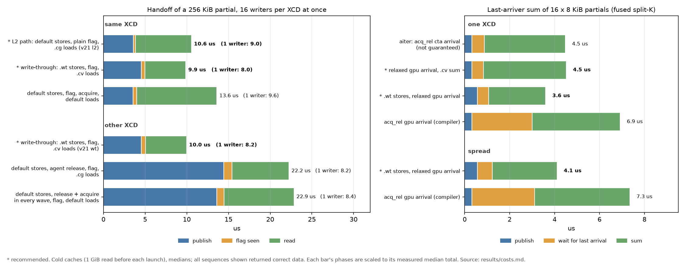
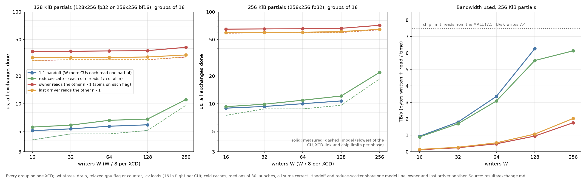
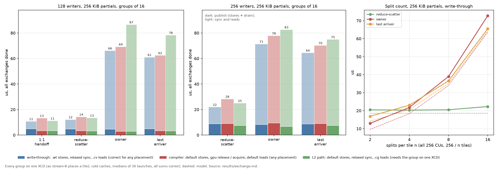
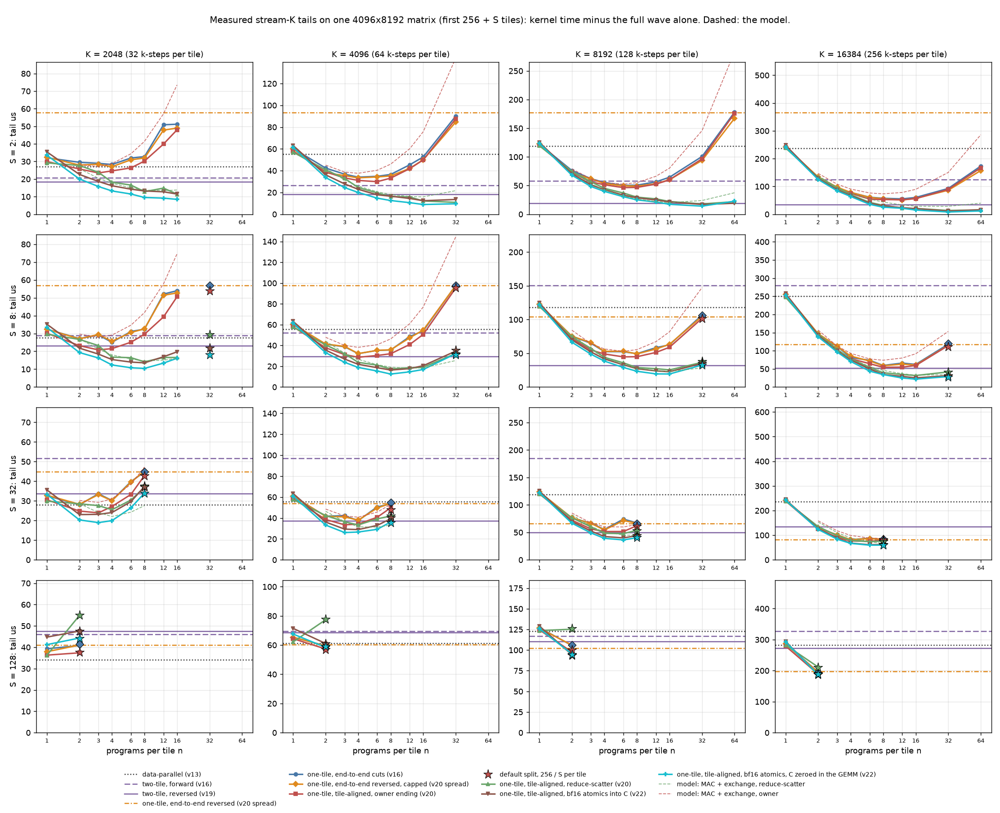
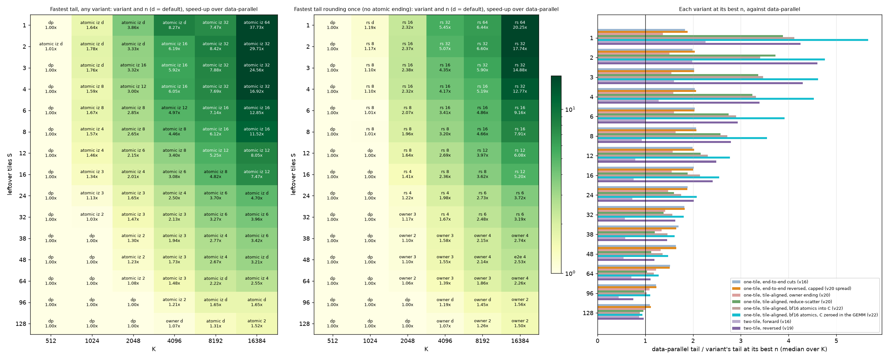
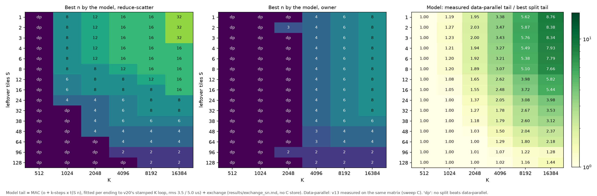

# Synchronising stream-K partials on MI355X: what is correct, what it costs, how far to split

Stream-K splits a GEMM's leftover tiles over several workgroups, which must then combine their partial
sums inside one launch. This note answers three questions for gfx950 (MI355X):
1. Which cache bits, fences and atomics make one workgroup's writes visible to another?
2. What does each correct method cost?
3. Given those costs, how many ways should a tile be split?

Every number below was measured on the hardware, except the model in section 8, which is labelled as one.
The detailed log, with every table, is in [README.md](README.md); raw output is in [results/](results/).

## Contents

1. [Summary](#1-summary)
2. [How the experiment works](#2-how-the-experiment-works)
3. [How data becomes visible on this chip](#3-how-data-becomes-visible-on-this-chip)
4. [The correctness results](#4-the-correctness-results)
5. [The minimal correct sequences](#5-the-minimal-correct-sequences)
6. [What the synchronisation methods cost](#6-what-the-synchronisation-methods-cost)
7. [How the exchange scales: patterns, phases and bandwidth](#7-how-the-exchange-scales-patterns-phases-and-bandwidth)
8. [Choosing the split count](#8-choosing-the-split-count)
9. [Recommendations for the kernels](#9-recommendations-for-the-kernels)
10. [Other findings worth knowing](#10-other-findings-worth-knowing)
11. [Limits and open questions](#11-limits-and-open-questions)
12. [Reproducing](#12-reproducing)

## 1. Summary

**Correctness**
- **Data reaches another XCD only when the writer pushes it to memory.** That means a write-through store
  (`.wt`, bits `sc0 sc1`, or `sc1`), an agent release (`buffer_wbl2 sc1`), or an eviction. When it arrives,
  the hardware invalidates the copies in other XCDs' L2s: LLVM's gfx942 memory model calls this the "C-bit
  probe". Default and streaming stores stay dirty in the writer's L2.
- **The reader only has to avoid its own L1, which is never kept coherent.** Any L1-missing load (`.cg`,
  `.cv`, `sc1`) or an agent acquire (`buffer_inv sc1`) does that. `.cv` and `sc1` loads are not an L2
  bypass: they hit the reader's L2 when it holds the line.
- **A reader-side acquire without a writer-side release is wrong** (100% stale in the ordering test).
- **A `cta`-scope flag poll never sees another CU's update, even on one XCD**, so it hangs. A `cta`-scope
  read-modify-write happens to work, but costs the same as `gpu` scope.

**Cost**
- **Write-through is the fastest correct method in every case measured**, and it is correct for any
  placement.
- **The compiler's agent release/acquire adds 1.4-6.5 us.**
- **A release issued from every wave instead of once per CU adds another 5-15 us.**

**Exchange pattern and split count**
- **How the partials are collected matters more than how they are synchronised.** With 256 CUs and 256 KiB
  partials, reduce-scatter takes 22 us, bounded by the fabric. An owner reading 15 partials takes 71 us,
  bounded by one CU.
- **At small split counts the owner wins:** it moves half the bytes at n = 2 (10.7 against 19.5 us).
- **Measured in the GEMM for S = 1-255 leftover tiles on one matrix** (AITER's stack: llirSched, no
  amdgcnas hook), the shortest tail that rounds C once comes from:
  - tile-aligned reduce-scatter for S <= 32 (except S = 32 at K = 2048), 1.2-20x shorter than
    data-parallel, with n = 16-64 at S <= 4, 8-16 at S = 6-16 and 4-6 at S = 24-32;
  - the tile-aligned owner ending with 2-4 programs per tile from S = 38 to 128;
  - above S = 128, data-parallel, or `spread` by 1-7% at S = 160-192 with K >= 16384.
- **An atomic ending (v22: every program adds its partial into C with bf16 `pk_add`) is faster still.**
  With C zeroed inside the GEMM it has the shortest tail in 54 of 60 cells, and the best single-rounding
  tail is a median 1.12-1.39x as long. It also makes splitting pay at K = 1024 for S <= 32 (1.03-1.78x).
  But it rounds C n times (mean error 2.6x a single rounding at n = 8) and is not bitwise reproducible.
- **Splitting pays from K = 2048 for every S up to 64.** Reversing end-to-end cuts gains about nothing
  once the split is capped. Reversed two-tile is a close second for S <= 32; forward two-tile is slower than
  data-parallel from S = 6 at K >= 8192.
- **The earlier model's 12.5 us "skew" was not a cost.** It came from timing the split tail from its first
  program's start; at kernel level the split programs overlap the end of the full wave.

## 2. How the experiment works

The litmus harness ([kernel.py](kernel.py), [bench.py](bench.py)) is designed so that a sequence can only
pass if the hardware really makes the data visible.

- **One cache bit or fence at a time.** Each cell uses inline-assembly loads and stores with explicit
  `sc0` / `sc1` / `nt` bits; the compiled code is checked to confirm the encoding.
- **Readers set up to fail.** Before the write, the reader loads the old value, so a stale copy sits in its
  L1 and L2 wherever its load bits allocate. A load that wrongly hits that copy is caught.
- **No synchronisation between writer and reader that could clean the caches.** Writer and reader are
  separated by time:
  - a relaxed atomic grid barrier at the start;
  - then only `s_memrealtime` deadlines (write at +20 us, read at +70 us);
  - nothing else touches memory in between.

  An acquire-release barrier would have performed exactly the cache maintenance under test.
- **Three placements, checked on the hardware every launch** with `HW_REG_XCC_ID` and `HW_REG_HW_ID`
  (one workgroup per CU): two waves of one workgroup, two CUs of one XCD, and two XCDs.
- **Controls that must fail and must pass.**
  - Must fail: default stores read with default loads, 100% stale.
  - Must pass: a write in one kernel read in the next, and the full agent release/acquire, 100% fresh.
- **Many samples.** 0.4-4.9 million line reads per cell. A single stale line rejects a cell. A cell counts
  as correct only if it is 100% fresh *and* the documentation promises it.
- **Where each value came from.** Each pair's first line is timed on its own with `s_memtime`, a 44-cycle
  bracket with zero spread. That tells apart an L1 hit (42 ns), L2 (77 ns), the LLC (283 ns) and HBM
  (433 ns).

## 3. How data becomes visible on this chip

An old value can hide in three places. Each needs its own fix:

| where the old value hides | what removes it | automatic? |
|---|---|---|
| the writer's L2 holds the new value, dirty | the writer pushes it to memory: `.wt` stores, `buffer_wbl2 sc1`, or an eviction | no |
| the reader's L2 holds an old copy | the probe sent when the new data reaches memory | yes (`torch` memory) |
| the reader's L1 holds an old copy | an L1-missing load, or `buffer_inv sc1` | no |

On top of these, the data must be visible before the flag that announces it. That ordering comes from
`s_waitcnt vmcnt(0)` in every wave, then `s_barrier`, before the flag.

How the experiment relates to the documentation:
- **AMDGPUUsage** describes the second row for "local memory": L2s are kept coherent by probes on writes.
  Its `buffer_inv sc1` invalidates L1 and "non-coherently cached" L2 lines. On `torch` (coarse-grained)
  memory, no L2 line counted as non-coherent, so `buffer_inv sc1` acted as an L1 invalidate.
- **The ISA cache-policy table** calls `sc1` loads "Coherent Cache Bypass". In practice that means: don't
  trust an L2 line that is *not* kept coherent. These lines are, so `sc1` loads hit them.
- **The compiler's sequences** for gfx942/950:

| scope | release (before the flag) | atomic load (the poll) | acquire (after the flag) |
|---|---|---|---|
| `cta` | `s_waitcnt lgkmcnt(0)` only | `global_load ... sc0` (can hit L1) | nothing |
| `gpu` (agent) | `buffer_wbl2 sc1; s_waitcnt vmcnt(0)` | `global_load ... sc1` | `s_waitcnt vmcnt(0); buffer_inv sc1` |
| `sys` | `buffer_wbl2 sc0 sc1; s_waitcnt vmcnt(0)` | `global_load ... sc0 sc1` | `s_waitcnt vmcnt(0); buffer_inv sc0 sc1` |

The read-modify-write atomic itself is the same `global_atomic_*` at `cta` and `gpu` scope.

## 4. The correctness results

### Cache bits alone

No fences; old values primed in the reader's caches ([stage1.md](results/stage1.md)):

| store \ load | default | `sc0 nt` (`.cg`) | `sc1` | `sc0 sc1` (`.cv`) |
|---|---|---|---|---|
| **same workgroup** | | | | |
| any | fresh | fresh | fresh | fresh |
| **same XCD, another CU** | | | | |
| default, `sc0 nt` | **stale (L1)** | fresh (L2) | fresh (L2) | fresh (L2) |
| `sc1`, `sc0 sc1` | **stale (L1)** | fresh | fresh (LLC) | fresh (LLC) |
| **other XCD** | | | | |
| default | **stale** | **stale (L2)** | **stale (L2)** | **stale (L2)** |
| `sc0 nt` | **stale** | **30-33% fresh** | **32% fresh** | **33% fresh** |
| `sc1`, `sc0 sc1` | **stale (L1)** | fresh (LLC) | fresh (LLC) | fresh (LLC) |

- **Default loads are stale whenever another CU wrote the line.** They hit the reader's L1.
- **Write-through stores reach another XCD even through `sc0 nt` loads of a line the reader had in L2.**
  The probe dropped the reader's copy.
- **Streaming stores across XCDs are luck:** part of them is written back early.
- **Eviction turns stale cells into passes** ([pollute.md](results/pollute.md)). When the writer XCD writes
  1, 2 and 4 MiB of other data afterwards, default stores read with `.cv` across XCDs go from 0% to 0.3%,
  50% and 100% fresh. A stress test with enough other traffic passes an incorrect kernel.

### Fences, with the time gap kept

Default or streaming data, so the fence alone has to make it visible ([stage2a.md](results/stage2a.md)):

| placement, loads | writer fence needed | reader fence needed |
|---|---|---|
| same workgroup | none | none |
| same XCD, default loads | none | agent acquire |
| same XCD, `sc0 nt` loads | none | none |
| other XCD, `sc0 nt` loads | agent release | none |
| other XCD, default loads | agent release | agent acquire |

- **`buffer_inv sc0` did nothing anywhere.** The ISA calls it a no-op outside TG-split mode.
- **Both operations act on the issuing XCD only.** A `buffer_wbl2 sc1` or `buffer_inv sc1` issued on an
  uninvolved XCD changed nothing ([third.md](results/third.md)).
- **A reader-side acquire alone is not a guarantee**
  ([acqgap.md](results/acqgap.md)):
  - issued 5 us or more before the read, it left the reader's stale L2 copy in place: 100% stale;
  - issued 0-1 us before the read, the next reads took about 1.7 us and were mostly fresh, through an
    undocumented transient that still left up to 1% of lines stale (2-96% at 2 us);
  - in the ordering test below it gave 100% stale.

### Ordering: a flag instead of the time gap

The writer stores, applies its fence, and sets a relaxed `gpu`-scope flag. The reader spins from its prime,
about 120 polls, and reads the moment it sees the flag. Each row is 2.5 million line reads, or 4.9 million
for the same workgroup ([stage2b.md](results/stage2b.md)):
- **Every sequence that is visible stayed 100% correct.** This includes readers holding a stale L2 copy, no
  `s_waitcnt vmcnt(0)` before the flag, and 2 MiB of other stores queued ahead of the data.
- **Leaving out the drain works on this hardware, but the memory model requires it**, and it costs little
  after write-through stores.
- **Default stores with an acquire only: 100% stale. Default loads on another CU: 73% stale.**

### The flag atomic's scope

([stage2c.md](results/stage2c.md))
- **`cta` scope:** all 12,800 waits timed out, on one XCD as well as across XCDs. The poll compiles to
  `global_load ... sc0`, which keeps hitting the reader's L1.
- **`gpu` and `sys` scope behave the same.**
- **The flag's own `gpu` release/acquire is enough** to publish default-bit data.

## 5. The minimal correct sequences

"Correct" means promised by the documentation and 100% fresh in every cell.

| placement | writer | reader | relies on |
|---|---|---|---|
| same workgroup | stores; `s_barrier` | any loads | documented (LLVM's workgroup release outside TG-split is `lgkmcnt(0)` only) |
| same XCD, another CU | default stores; `s_waitcnt vmcnt(0)` in every wave; `s_barrier`; flag (plain store or relaxed `gpu` atomic) | spin with an L1-missing load; `.cg` loads, or `buffer_inv sc1` then default loads | one shared L2; the placement must be checked (no XCD scope exists) |
| any placement (cheapest) | `.wt` stores; `s_waitcnt vmcnt(0)` in every wave; `s_barrier`; relaxed `gpu` flag or counter | relaxed `gpu` spin; `.cv` or `.cg` loads | the probe completes before the store is acknowledged: observed, not documented |
| any placement (generic) | default stores; drain; `sem="release"` flag (agent release) | `sem="acquire"` and default loads, or `.cg` loads | fully documented |

Not correct, though each sometimes passes:
- default loads of another CU's data without `buffer_inv sc1`;
- a reader-only acquire;
- streaming stores across XCDs;
- default stores across XCDs that happen to be evicted;
- `cta`-scope polls between workgroups.

## 6. What the synchronisation methods cost

The basic operations ([costs.md](results/costs.md)):
- **Stores.** A 256 KiB partial takes 3.56 us for one CU with default bits and 3.72 us with `sc1` or
  `sc0 sc1`. With 16 CUs per XCD writing at once: 3.9 against 4.9 us. `sc1` alone costs the same as
  `sc0 sc1`.
- **`buffer_wbl2 sc1` grows with the XCD's dirty data:** 0.8 us with 0.1 MiB dirty, 3.0 us with 4 MiB.
  Issued by all 32 CUs at once, it costs 6.7-8.8 us each.
- **`buffer_inv sc1` costs 0.5 us, or 6.4 us each when 32 CUs issue it at once.** Its damage to
  neighbouring CUs is negligible (+0.04-0.2 us to re-read 1-4 MiB), because it does not invalidate their L2
  lines.



*Left: one 256 KiB partial handed from each of 16 writers per XCD to a reader on the next or the same XCD,
cold caches. Right: a last-arriver sum of 16 x 8 KiB partials (aiter's fused split-K). The release rows on
the left issue `buffer_wbl2 sc1` from every wave; issued once per CU, as the compiler does, they cost about
13 us instead of 22 (section 7).*

- **Write-through is the cheapest correct handoff across XCDs:** 10 us with 16 writers per XCD.
- **On one XCD, the L2 path (default stores, `.cg` loads) ties or wins only when the slots are still in
  L2.** Warm, it takes 5.7 against 8.0 us; cold, 9.0 against 7.9.
- **`cta` scope has no performance advantage.** aiter's `acq_rel` `cta` arrival, a relaxed `cta` one and a
  relaxed `gpu` one are the same instruction and cost the same to within 0.1 us.
- **The compiler's `gpu` `acq_rel` arrival costs 2-4 us more.**
- **With warm caches, write-through pays for the probe:** a 16-writer publish across XCDs takes 15 instead
  of 4.5 us when the previous launch's readers still hold the lines. A GEMM's main loop evicts those copies
  first, so the cold numbers are the relevant ones.

## 7. How the exchange scales: patterns, phases and bandwidth

The previous section costs the synchronisation. This one asks what moving the partials costs when a whole
tail of CUs does it at once ([exchange.py](exchange.py), [exchange.md](results/exchange.md)). W writers
each hold a partial of P bytes (256 KiB for a 256x256 fp32 accumulator). Groups of n exchange them in one
of four ways:

| pattern | who reads | bytes per tile |
|---|---|---|
| 1:1 handoff | W other CUs, one partial each (two-tile stream-K) | P written, P read per pair |
| reduce-scatter | all n, 1/n of every partial | n P written, n P read |
| owner | one member (rotating), the other n - 1 partials in turn | (n - 1) P written and read, all reads on one CU |
| last arriver | the last to arrive on a counter, the other n - 1 | n P written, (n - 1) P read on one CU |

Every group sits on one XCD, as stream-K's chiplet swizzle places a tile's consecutive logical pids. The
model (`exchange.model_us`) counts the bytes per XCD for that placement. It bounds each phase by the
slowest of three limits:
- **one CU:** 85 GB/s for writes, 72 GB/s for reads with 16 loads in flight;
- **the XCD links:** 1.30 TB/s per XCD and 1.85 TB/s per XCD pair for writes, 1.35 TB/s per XCD for reads;
- **the chip:** about 7.5 TB/s.



*Groups of 16, write-through. Solid lines: measured; dashed: model.*

- **The writes become fabric-bound from about 128 writers.** 256 CUs writing 256 KiB each take 8.8 us,
  against 3.1 us for one CU alone.
- **Reduce-scatter's reads are fabric-bound too at W = 256:** 67 MB at about 7 TB/s, 21.9 us in total.
- **With n = 16, the owner and last arriver are never bandwidth-bound.** One CU reads 15 partials in 54-61
  us at 65-73 GB/s, whatever W is, and the chip moves only 1.8-2.0 TB/s. They are 3x slower than
  reduce-scatter at W = 256 and 5.5-7x slower at W <= 64.
- **128 KiB partials (a 128x256 tile, or bf16 partials) halve every bandwidth- or CU-bound phase.**
- **The model gets the shape right but always reads low:** by 0.5-1.5 us for the handoff and 6-9 us for
  the owner, because it leaves out the flag latency and the owner's per-peer flag check.

### Each pattern with each synchronisation method



us, 256 KiB partials, groups of 16, each group on one XCD, cold:

| writers | pattern | write-through | compiler release / acquire | L2 path |
|---|---|---|---|---|
| 128 | 1:1 handoff | **10.7** | 13.2 | 11.2 |
| 128 | reduce-scatter | **12.1** | 14.3 | 13.4 |
| 128 | owner | **66.1** | 69.2 | 86.5 |
| 128 | last arriver | **61.0** | 62.4 | 78.3 |
| 256 | reduce-scatter | **21.9** | 28.2 | 24.9 |
| 256 | owner | **71.4** | 77.9 | 82.6 |
| 256 | last arriver | **64.4** | 70.2 | 74.9 |

- **The pattern sets the order of magnitude; the method changes it by 0-30%.** Write-through is the fastest
  in every cell.
- **Issue the release once per CU, after the barrier.** The compiler emits one `buffer_wbl2 sc1` per CU, in
  the wave that executes the atomic, and that is enough because the write-back covers the whole L2. Issuing
  it from all 4 waves costs 5-15 us more: handoff at 128 writers 18.6 against 13.2 us, reduce-scatter at 256
  writers 37.3 against 28.2.
- **The L2 path loses with cold caches,** most where the most is read: owner 87 against 66 us. A line
  written into L2 is filled from HBM on its first read, while write-through data is read from the LLC.

### Split count, phase by phase


*Each bar is the median group's critical path:*
- *publish: until the group's last writer has published;*
- *sync: until the consumer that finishes last has passed its wait;*
- *read: that consumer's reads.*

*Hatched bars: model. Top row: all 256 CUs (256 / n tiles), as in a GEMM tail. Bottom row: 16 tiles.*

Totals with all 256 CUs, us:

| n | 2 | 4 | 8 | 16 |
|---|---|---|---|---|
| reduce-scatter | 19.5 | 19.5 | 20.3 | 21.8 |
| owner | **10.7** | 20.5 | 37.8 | 71.5 |
| last arriver | 15.2 | 21.7 | 35.5 | 64.7 |

- **Reduce-scatter is almost constant.** It always moves 64 MiB each way, bounded by the fabric:
  - publish about 9 us;
  - sync 0.5-1.3 us, growing slowly as more members arrive at and poll one counter;
  - read 8-9.4 us.
- **The owner grows by about 4 us per partial it reads.** Its publish is shorter, because the owner keeps its
  own partial.
- **At n = 2 the owner is nearly twice as fast.** Reduce-scatter writes and reads 2 partials per tile, the
  owner 1, and with the fabric as the limit half the bytes take about half the time: publish 5.0 against
  9.0 us, read 4.7 against 8.0. In general the byte ratio is (n - 1) / n, so the two cross at n = 4.
- **The sync is a small part:** about 0.5 us for one flag, 0.5-1.3 us for a counter.
- **Reduce-scatter could close most of the small-n gap** by keeping its own slice in registers. That would
  give it the owner's bytes spread over n CUs. Not measured.

**Placement matters as much as bytes.** With groups of consecutive *hardware* pids, one member per XCD,
which is not how stream-K places a tile:
- **The owner** was 38% slower at n = 2: its writers and readers then share fewer XCD links.
- **The last arriver** was 34% slower at n = 8, because the last arrivals are not random. The odd XCDs
  finish writing last, since each shares a write link with its even partner. 119 of 160 last arrivers
  landed on XCD 7, and their reads piled onto one link.
- **A fixed owner** (always member 0) put every owner on XCD 0 at n = 8 or 16: 53.5 against 38.4 us.
  Rotating owners avoids this, as v18 found in the GEMM.

## 8. Choosing the split count

Splitting a leftover tile n ways shortens each program's K loop, but adds the exchange. This section
measures the trade in the GEMM itself, for S = 1-255 leftover tiles, every way of splitting them and
K = 2048-32768. The full log is in [README.md](README.md) (section 7, "The best split count"), and every
number in [tail_variants.md](results/tail_variants.md).

### How it was measured

- **One matrix for every S.** Real shapes cannot keep the matrix and the wave count the same: the tile count
  is `Mt * Nt = 256 + S`, and 257 is prime. So every case runs on 4096x8192xK (16 x 32 tiles) with a
  test-only `GEMM_TILE_LIMIT = 256 + S`. The kernels (v13, v16, v19, v20) then compute only the first
  256 + S tiles, as a GEMM of that many tiles, with the same full wave, A and B for every S. The setting
  is off by default and leaves the default builds' assembly unchanged.
- **Checked.** All 4,281 cases (2,651 single-rounding, 1,630 atomic) write exactly the right tiles, with
  every flag and counter re-armed. The single-rounding cases match torch; the atomic ones are held to an
  fp32 reference by their mean error, because they round once per program
  ([check_tile_limit.md](../streamk_split_count/results/check_tile_limit.md)). On 33 real shapes
  (S = 8, 16, 38, 128 and 192) the kernel times agree with the limited matrix to within 3%, except
  forward two-tile (3% and 9%).
- **Tail** = kernel time - the same matrix's kernel time with 256 tiles (the full wave alone), for every
  variant alike. rocprof, 1000 launches over rotating inputs, GPU 0.
- **The stack is AITER's:** Triton v2.2 with the llirSched plugin and **without** the repository's
  amdgcnas post-assembly hook. Loaded this way, the plugin compiles v13 and v20 to exactly the
  instructions of AITER's opt-in llirSched build. An earlier run of the same sweep with the hook gave
  kernel times a median 0.1-1% shorter and the same conclusions ([tail_variants.md](results/tail_variants.md)).
- **No v21.** Its partials-in-L2 mode is a placement experiment; the variants come from v13, v16, v19,
  v20 and v22.

| variant | kernel | how the leftover tiles are split |
|---|---|---|
| data-parallel | v13 | not at all: a partial last wave |
| one-tile, end-to-end | v16 | k-steps laid end to end and cut into S n pieces; a program may cross tiles |
| one-tile, end-to-end reversed | v20 `spread` | the same cuts, each program's pieces processed last to first; all 256 programs or capped at S n |
| one-tile, tile-aligned | v20 `one_tile` | n chunks per tile, none crossing; default 256 // S per tile; owner or reduce-scatter ending |
| one-tile, tile-aligned, atomic | v22 `STREAMK_FIXUP=atomic` | as above, but every program adds its partial into C with bf16 `pk_add` atomics (below); C zeroed by a launch of its own |
| one-tile, tile-aligned, atomic, zeroed in the GEMM | v22 `STREAMK_FIXUP=atomic_iz` | the same adds; each program first zeroes 1/n of its tile and counts itself on a per-tile counter, which the adds wait for |
| two-tile, forward / reversed | v16 (new `two_tile` host knob) / v19 | the leftover tiles plus the full wave, end to end, one peer per tile |

The split count n is set with `STREAMK_NUM_PROGRAMS = S n`, so every one-tile variant can use fewer than
all 256 CUs. Giving each tile a fixed number of programs, none of which crosses into another tile, is the
tile-aligned split. At the default program count it is the point n = 256 // S of that curve (the stars
below).

**The atomic ending (v22).** `pk_add` is `buffer_atomic_pk_add_bf16`: one lane atomically adds two packed
bf16 values to C in L2, and the sum is rounded back to bf16. Each of a tile's n programs adds its whole
partial this way, after a `convert_layout` that gives a wave's 64 lanes one 256-byte row; chunk 0 adds
the bias. There is no partial workspace, flag, barrier or reduce step. C must be zero first:
- `atomic`: the host zeroes the S stream-K tiles in a launch of its own, counted in the tail (4.4-5.9 us);
- `atomic_iz`: each of a tile's n programs zeroes 1/n of the tile with write-through stores before its
  K loop, drains, and counts itself on a per-tile counter; its adds wait for the count to reach n, which
  the K loop has almost always covered. One launch, and about 1 us instead of 4.4-5.9.

Either way C is rounded n times instead of once, and the order of the adds is not fixed.



*Measured tails against n. Solid: the one-tile splits; stars: the default split; horizontal: data-parallel,
the two two-tile orders and `spread` with all 256 programs; dashed: the model below.*



### What it shows

| S | K | data-parallel | end-to-end | spread | tile-aligned owner | tile-aligned rs | atomic | atomic, zeroed in the GEMM | two-tile fwd | two-tile rev |
|---|---|---|---|---|---|---|---|---|---|---|
| 1 | 4096 | 51.9 | 34.5 (4) | 33.4 (4) | 31.4 (4) | 9.5 (32) | 9.3 (d) | **6.3** (d) | 23.9 | 15.4 |
| 1 | 16384 | 232.4 | 57.8 (12) | 56.5 (12) | 55.3 (12) | 11.5 (64) | 9.5 (64) | **6.2** (64) | 99.2 | 21.2 |
| 8 | 2048 | 27.6 | 25.1 (4) | 25.6 (4) | 20.8 (3) | 14.1 (8) | 13.6 (8) | **10.4** (8) | 29.0 | 23.2 |
| 8 | 8192 | 118.4 | 49.5 (8) | 49.2 (8) | 44.7 (6) | 25.4 (16) | 22.7 (16) | **19.4** (16) | 150.5 | 32.2 |
| 32 | 4096 | 55.7 | 37.5 (4) | 37.9 (4) | 33.5 (3) | 33.4 (4) | 28.9 (4) | **26.1** (3) | 97.0 | 37.2 |
| 38 | 8192 | 119.5 | 58.5 (4) | 60.8 (4) | 55.6 (4) | 57.0 (4) | 46.4 (4) | **43.2** (4) | 187.4 | 56.9 |
| 64 | 8192 | 119.1 | 67.5 (4) | 68.5 (4) | 64.0 (3) | 71.2 (4) | 56.6 (4) | **53.6** (d) | 152.0 | 71.5 |
| 128 | 2048 | **34.0** | 39.3 (1) | 37.9 (1) | 36.3 (1) | 36.2 (1) | 44.8 (1) | 41.2 (1) | 46.0 | 47.6 |
| 128 | 16384 | 282.6 | 193.7 (d) | 194.4 (2) | 188.8 (2) | 210.3 (d) | **186.4** (2) | 187.0 (2) | 327.4 | 271.9 |

*Tail us, each variant at its best n (in brackets; d = the default split; `spread` is the best of its
capped and all-256 runs). The kernel saves the difference, not the ratio: at S = 8, K = 8192 the best
single-rounding split takes the kernel from 290 to 197 us, the atomic ones to 194 and 191.*

Among the endings that round once (v13, v16, v19, v20):
- **Tile-aligned reduce-scatter has the shortest tail for S <= 24 at every K, and at S = 32 except
  K = 2048**, 1.22-20x shorter than data-parallel. Its best n is 16-64 at S <= 4, 8-16 at S = 6-16 and
  4-6 at S = 24-32.
- **From S = 38 to 128, the tile-aligned owner ending is fastest**, with 2-4 programs per tile (at
  S = 96-128 often the default split, 2-3 per tile). One exception: end-to-end cuts at S = 48,
  K = 16384 (94 against 98 us).
- **Splitting pays from K = 2048 for every S up to 64**, by 1.06-2.4x. Only S = 96-128 at K = 2048 stay
  data-parallel.
- **Cutting across tiles costs about 10%.** With the same owner ending, end-to-end cuts take 6% longer where
  they cut a tile in the same places as tile-aligned ones (a code difference) and 17% longer where they
  do not. At the default split, when S does not divide 256, the gap reaches 1.58x.
- **Reversing the end-to-end order recovers almost nothing once the split is capped.** Capped `spread`
  takes a median 0.4% less than forward end-to-end cuts at the same n (6% less to 2% more), and 8% more
  than tile-aligned owner cuts (1-20%).
- **The default split is far too fine at small S** for the owner (S = 8, K = 8192: 101 against 45 us at
  n = 6), less so for reduce-scatter (38 against 25).
- **Reversed two-tile is a strong second for S <= 32**, 1.05-2.6x behind the best split. **Forward
  two-tile is slower than data-parallel from S = 6 at K >= 8192**, by up to 2.4x (S = 96).
- **Above S = 128** the tile-aligned split has one program per tile. Only `spread` beats data-parallel, by
  1-7% at S = 160-192 and K >= 16384 ([figure](images/tail_variants_high_s.png)).

**The atomic ending is faster still, at a cost in accuracy:**
- **With C zeroed inside the GEMM (`atomic_iz`) it has the shortest tail in 54 of the 60 cells with
  S <= 128.** The best single-rounding tail is a median 1.39x as long at S <= 16 (1.16-1.86x), 1.27x at
  S = 24-32 and 1.12x at S = 38-128. It loses only at S = 96-128 with K <= 4096.
- **With a zeroing launch (`atomic`) it is a median 3.2 us slower** at the same n (1.7-4.1 us): the launch
  costs 4.4-5.9 us, the in-kernel zeroing about 1. That version wins 50 of the 60 cells.
- **Its best n is reduce-scatter's**, and it reads no more memory than data-parallel (L2, below).
- **It rounds C once per program** ([atomic_accuracy.md](../streamk_split_count/results/atomic_accuracy.md)):
  the mean error is about `0.5 + 0.75 sqrt(n)` times that of one rounding (2.6x at n = 8, 6.2x at
  n = 64). The share of elements outside the repository's check tolerance (atol 0.1, rtol 0.01) is 0 for
  n <= 8 at K <= 4096, 0.07% at n = 16 and K = 8192, and 2.7-6.1% at n = 64. Run to run, up to 89% of
  the elements differ bitwise.
- **Capped at n = 8** it stays within that tolerance up to K = 4096 and is still the fastest ending from
  S = 12 to 48. At S = 6-8 with K >= 8192, where the best split is 16, reduce-scatter at n = 16 is
  7-21% faster than the launch-zeroed version.

**When bf16 atomic accumulation is valid.** Nothing is lost or added twice: writers on different XCDs sum
exactly, and a doubled partial is rejected at about 700 times the error. But the ending changes what the
GEMM computes, so it suits only some callers:
- **Only linear epilogues.** The bias is added once, by chunk 0; a scale alpha applies to every partial;
  beta C works by initialising the tile to beta C instead of zero. An activation, a clamp or quantising
  the output (to fp8, say) cannot be applied to partial sums and would need a second pass.
- **16-bit C only.** An fp32 C would need fp32 atomics, which are slower than storing the partials and
  reading them back (experiments/streamk_atomics).
- **Not deterministic.** The order of the adds changes from run to run, so it does not suit training
  reproducibility, golden-output tests or debugging. It suits inference that tolerates bf16-level error.

**Zeroing C: the alternatives.** The adds need the tile at zero first. The in-kernel zeroing behind a
per-tile counter was chosen because its only wait falls before the K loop, where it is hidden. The others
were weighed and not built:
- chunk 0 stores its partial and raises a flag, and the others add after it: no zeroing, but the others'
  wait comes at the end, exposed;
- the first program to arrive on a counter stores, the rest add after its store: a counter round trip
  plus the same exposed wait;
- the caller guarantees a zeroed C, for example by fusing a memset into an earlier kernel: free in the
  GEMM, but a contract pushed onto the caller;
- an fp32 workspace that cleans itself, where the last arriver converts the tile to C and re-zeroes it:
  one rounding, but fp32 atomics cost 4x a store and it needs a counter.

### Small K

At K = 512 and 1024 (n <= K / 128, so at most 4 and 8 per tile; [tail_variants.md](results/tail_variants.md)):
- **K = 1024: the in-kernel atomic ending is the fastest tail for S <= 32**, 1.03-1.78x shorter than
  data-parallel (S = 1: 8.4 against 13.7 us). Among the single-rounding endings, reduce-scatter beats
  data-parallel only at S <= 8, and by 1-19%; the owner never does.
- **K = 512: nothing beats data-parallel** (7.4-12.9 us). The in-kernel atomic ending ties it within 1-6%
  at S <= 8.
- **Two launches are host-bound at K = 512:** the launch-zeroed atomic ending waits 7-15 us between its
  zeroing and the GEMM, because the Python launcher cannot issue both in the 30 us the GEMM takes. From
  K = 1024 the gap is 0. A graph or C++ launcher would remove it; one launch does not have it.

### Packing a tile's programs onto one XCD

By default the S n active programs are spread evenly over the 8 XCDs, so for S < 8 a tile's programs span
several. `STREAMK_BALANCE_XCDS=0` packs them into the first S n stream-K ids instead: a tile shares an XCD,
and the tail runs on ceil(S n / 32) XCDs (S = 1-8, K = 2048-16384):
- **It helps the atomic endings only when the whole tail fits one or two XCDs:** at S = 1 (the in-kernel
  version from 7.9 to 6.5 us at K = 2048, 14.8 to 8.5 at K = 8192) and S = 2 at K <= 4096 (8-10%), since
  all of a tile's adds then go to one L2.
- **It hurts everything else:** from S = 3 the atomic endings are up to 45% slower packed, and
  reduce-scatter is slower at every S but one cell (up to 2.1x), because the K loop and the partial
  traffic run on fewer XCDs. Spreading stays the right default.

**The default split is the packed placement when n is capped by K.** With `STREAMK_NUM_PROGRAMS` unset, a
tile gets min(256 // S, K / 128) programs, at most one per pair of k-steps. Where K sets that limit, only
the lowest stream-K ids get work, and the ids run 32 to an XCD, so the active programs sit on the first
XCDs. At S = 1, K = 2048, for instance, 16 of the 256 programs work, all on XCD 0. Its tails then match
the packed runs (the in-kernel atomic ending: 6.6 us by default, 6.5 packed, 7.9 spread), which is why
the default looked fastest for the atomic ending at S = 1. Reduce-scatter loses the same way it does when
packed (13.4 against 11.0 us spread). The table is in [tail_variants.md](results/tail_variants.md),
"Where the default split's programs run".

### L2: what "poor reuse" costs

K = 8192, warm counters on the same matrix. The full wave alone hits 80.6% of its L2 reads. The tail's own
memory reads, above the full wave's:

| S | data-parallel | tile-aligned owner, n = 2 / 4 / 8 | atomic, n = 2 / 4 / 8 | default split, end-to-end / tile-aligned owner / atomic | spread | two-tile rev | two-tile fwd |
|---|---|---|---|---|---|---|---|
| 8 | 0.96 M | 0.97 / 1.01 / 1.07 M | 0.96 / 0.96 / 0.96 M | 1.55 / 1.53 / 1.03 M | 1.54 M | 2.08 M | 14.17 M (8.7% hits) |
| 38 | 1.91 M | 2.06 / 2.33 M | 1.98 / 2.09 M | 3.29 / 2.61 / 2.15 M | 3.22 M | 4.86 M | 14.15 M (17.0% hits) |

- **Capped tile-aligned splits read barely more than data-parallel**, and the atomic ending no more at all.
- **Forward two-tile reads 7-15 times as much**, because its programs start a whole wave at their own k
  offsets. The reversed order brings this down to 2.2-2.5 times.
- **End-to-end cuts read 26% more than tile-aligned ones** at S = 38's default split. At S = 8 with
  power-of-2 n they cut in the same places and read the same.

### The skew in the earlier model was not a cost

The first version of this section modelled S = 8 only, and added a 12.5 us "skew" to every split: the
median of `tail - MAC - ending` in v21's stamps, where the tail runs from the first program's stream-K
start to the last program's end. Stamping v20 on the same matrix (120 cases) shows what that was:
- **Timing the tail from the first program's start overstates the kernel-time cost by a median of 13.9 us**
  (10th-90th percentile 9.9-28.6 us), about the same as the skew constant.
- **The real kernel-time tail is shorter than MAC + ending in 116 of 120 cases** (S = 8, n = 8,
  K = 4096: 17.4 against 23.4 us), because the split programs start as soon as their own full-wave tile is
  done, alongside the full wave's slowest tiles.
- **The programs' start times are close together:** 6.8 us over the whole tail at K = 4096, 3.7 us at
  K = 16384 (medians), and at most 2 us within a tile from S = 8.

So the skew came from measuring the split tail from its first program but data-parallel at kernel
level. It is not an L2 effect: reuse sits in the per-k-step cost. It made every split look 12.5 us worse,
which is what turned K = 2048 into "data-parallel".

### A model for any S



    tail(S, n, K) = MAC(ipt / n k-steps on S n CUs) + exchange(pattern, S, n),   against the measured data-parallel tail

([split_model.py](split_model.py), [split_model.md](results/split_model.md)), where ipt = K / 64:
- **MAC** is fitted per ending to v20's stamped K loop on the same matrix: about 2-4 us per segment plus
  1.00-1.14 us per k-step with up to 32 CUs in the tail, 1.2 with 128 and 1.4 with 256. A split program
  reads its own k-slices, so the tail's K loop becomes bandwidth-bound as more CUs run it.
- **exchange** is the synthetic exchange for every S ([exchange_sn.md](results/exchange_sn.md)).
- **No skew term.** It covers the owner and reduce-scatter endings; the atomic one is not modelled.

Against the 338 measured tile-aligned tails of each ending:
- **Reduce-scatter: a median residual of -0.2 us** (10th-90th percentile -9.3 to +5.2). Two omissions
  cancel: the GEMM's ending is a median 8.5 us longer than the synthetic exchange (the C store and the
  slice code), and the overlap with the full wave saves about 10 us. The optimum is flat, and the model
  picks the measured best n in 33 of 60 cells.
- **Owner: the model reads 11 us high**, because the synthetic owner reads a partial in about 4 us and the
  GEMM's in about 2.5. It picks the measured best n in 44 of 60 cells.
- **It understates the largest gains** (S = 1, K = 16384: 8.8x against 20x), where its n = 32-64 exchange
  is extrapolated and the overlap matters most.

**Choosing n from the model** ([tail_variants.md](results/tail_variants.md), "Choosing n from the model"):
- Each measured tail is a median 2.7 us from the model for reduce-scatter, 8% of the tail (27% at the
  90th percentile). For the owner the gap is 11.4 us, 25% (52%), but nearly constant, so it hardly moves
  the optimum.
- Taking the n the model ranks first costs nothing in the median cell. In kernel time it costs 3.0% at
  the 90th percentile and 5.9% at worst for reduce-scatter, and 0.5% and 2.4% for the owner.

Use the measurements to choose n; the model explains them, is fine for a rough n, and is a fair guide for
S and K in between.

### The v20 host rule against these measurements

v20's default host rule, `capped_policy` (`STREAMK_POLICY=capped`), was replayed on every cell with
S <= 128 and K = 512-16384, taken from the kernel's own source. Its choice was compared, by measured tail,
with the fastest measured configuration that rounds C once ([tail_variants.md](results/tail_variants.md),
"v20's capped_policy against the measurements"):
- **In most cells it is within 2% of the best kernel time:** a median of 1.000 over 90 cells,
  1.029 at the 90th percentile.
- **It splits too little at S <= 4, K = 2048-8192: 1-7% short.** Its reduce-scatter n,
  min(128 // S, max(8, k / 8)), gives 8 at K <= 4096 and 16 at 8192. The measured best is about one pair
  of k-steps per program, up to 64 per tile: 16 at K = 2048, 16-32 at 4096, 32-64 at 8192. The worst
  cell is S = 1, K = 4096: 16.8 against 9.5 us of tail, 7% of the kernel.
- **It stays data-parallel at K = 1024, where reduce-scatter wins at S <= 4: 3-5% short.** Its threshold
  (256 - S) k < 20 x 256 rules out every split at k = 16. Sweep B measured a 4% loss at S = 4, K = 1024
  on a real shape, so this needs confirming on real shapes before the threshold moves.
- **Small misses at S = 24-38, K = 8192-16384: 1-2.4%.** The 128 // S cap gives reduce-scatter n = 5
  where 6 is best, and the owner's sqrt rule gives 6 where 4 is best (S = 38, K = 16384).
- **At S = 38-128 the rule's n reaches 256 // S, so it leaves `STREAMK_NUM_PROGRAMS` unset.** That gives
  the default split, which puts 3 programs on some tiles. Asking for S n explicitly would be faster: at
  S = 96, K = 16384, 151 instead of 160 us.
- **The direction of a fix:** reduce-scatter n = min(k / 2, max(4, P / S)), at most 64, with P about 64
  at K <= 4096 and 128 at K >= 8192. That fits most measured optima here, but it was fitted to one
  matrix and should be validated on real shapes (the `streamk_split_count` and `aiter_lixun_shapes`
  sets) first.

Any new coefficients should be fitted to measured tails, as v20's were, and not to the model above: picking
n from the model alone costs up to 6%.

## 9. Recommendations for the kernels

1. **Exchange partials with write-through:** `.wt` stores, `s_waitcnt vmcnt(0)` in every wave, `s_barrier`,
   then a relaxed `gpu`-scope flag or counter. Read with `.cv` or `.cg`; no acquire is needed. This is
   v21's `wt` path. It is the fastest in every measured case and correct for any placement.
2. **If you use the compiler's release/acquire, let it issue the release once per CU.** Avoid a hand-written
   `buffer_wbl2 sc1` in every wave.
3. **Use the L2 path (default stores, `.cg` loads) only with a checked one-XCD placement, and only if the
   slots are likely to still be in L2.** In the cold case, which is the usual one after a GEMM main loop,
   it is slower.
4. **Never use `cta` scope between workgroups:** it is not faster, and a `cta` poll hangs.
5. **Choose the split by S, from the measured tails (section 8):**
   - split tile-aligned, never end to end (reversed or not), and cap the split rather than using all 256
     programs;
   - S <= 32: reduce-scatter, n = 16-64 for S <= 4 (more as K grows), 8-16 for S = 6-16, 4-6 for S = 24-32;
   - S = 38-128: the owner ending with 2-4 programs per tile;
   - S > 128: data-parallel, or `spread` at K >= 16384 for S <= 192;
   - split from K = 2048 for every S up to 64; prefer reversed two-tile to forward when using two-tile at all;
   - where n bf16 roundings and non-reproducible results are acceptable, use v22's atomic ending with C
     zeroed inside the GEMM (`STREAMK_FIXUP=atomic_iz`) at reduce-scatter's n: the best single-rounding
     tail is a median 1.12-1.39x as long, and it pays from K = 1024 for S <= 32. At n <= 8 it stays inside
     the repository's check tolerance up to K = 4096;
   - keep the active programs spread over the XCDs (the default); packing them helps only the atomic
     ending at S <= 2;
   - v20's `capped_policy` is within 2% almost everywhere, but splits too little at S <= 4 (up to 7%) and
     should request S n programs explicitly at S >= 38. Its K = 1024 threshold may be too conservative
     (section 8, "The v20 host rule against these measurements"); check both on real shapes before
     changing it.
6. **Spread consumers over the XCDs:** rotate the owner, and keep each tile's programs together on one XCD.
7. **In the consumer's read loop, keep 16 or more loads in flight, and make the reduce-scatter slice size a
   compile-time constant** (section 10).

## 10. Other findings worth knowing

**aiter's `_sum_splits_on_xcd`** (afp8wfp8 fused split-K) uses a `cta`-scope `acq_rel` arrival counter,
default-bit partials, an explicit drain and `.cv` sums, with every split of a tile on one XCD. It is correct
on this hardware (0 wrong sums in 9,600 groups), but rests on three things the memory model does not
promise:
- atomicity between workgroups at `cta` scope;
- the unchecked `pid % 8` dispatch placement: spread over XCDs, 99% of its groups summed wrongly;
- the explicit `vmcnt(0)`, which a `cta` release does not emit.

`sem="relaxed", scope="gpu"` plus a compiler fence costs the same and is formally atomic across
workgroups. It works because it is a read-modify-write, not a poll.

**Reading code matters as much as the pattern:**
- **Loads in flight.** With one load per loop step, a CU reads a partial at 15 GB/s, because each step waits
  about 270 ns for the LLC. 8 independent loads give 58 GB/s, 16 give 71 and 32 give 76 (4 waves per CU).
  A first version of the experiment had one per step, and the owner took 273 instead of 60 us.
- **Vectorisation.** A runtime slice size made the compiler emit `buffer_load_dword` instead of `dwordx4`,
  and the slice read was 4x slower. A `multiple_of` hint did not fix it; a `constexpr` slice size did.

**A release covers only the wave that issues it.** The compiler's release on a scalar atomic waits only for
its own wave's `vmcnt`. Every wave must drain its stores and meet the others at `s_barrier` first.

**Stress tests can pass incorrect kernels:**
- in an early version, the reader's own traffic evicted its L1 lines and made default loads look 50%
  correct;
- enough other traffic evicts dirty lines in time;
- the transient after `buffer_inv sc1` returns mostly fresh data.

The litmus design (primed readers, no cache maintenance in the synchronisation, negative controls) exists
to rule these out.

**Cache tiers and costs reused across the repository:**
- latency: L1 42 ns, L2 77 ns, LLC 283 ns, HBM 433 ns;
- one CU: 85 GB/s write-through, about 72 GB/s reads with 16 loads in flight;
- `buffer_wbl2 sc1`: about 0.6 us per MiB of the XCD's dirty data;
- 32 simultaneous cache operations: 6.4-8.8 us each.

## 11. Limits and open questions

**Limits**
- **One configuration:** one MI355X in SPX / NPS1, coarse-grained `torch` memory. Fine-grained or host
  memory, and other partition modes, use other page types (NC, UC) for which `buffer_inv sc1` and `sc1`
  loads may behave as the ISA table says.
- **Cache state:** "cold" flushes the LLC too, which a GEMM does not. "Warm" leaves the previous launch's L2
  copies, which a GEMM main loop evicts. A GEMM ending sits in between: L2 cold, LLC possibly warm.
- **Synthetic exchanges:** they omit the C store, bias and the GEMM's own slice loop; the GEMM's
  reduce-scatter ending is a median 8.5 us longer. Their owner read loop is about 1.6x slower per partial
  than the GEMM's. And under Triton v2.2 it compiles about 4x slower than under v2.1 (reduce-scatter is
  unaffected), so every synthetic result here is from v2.1.
- **The split-count measurements use one matrix.** 4096x8192xK, computing its first 256 + S tiles. Real
  shapes agree within 3% except forward two-tile (up to 9%), but other aspect ratios, several full waves
  before the tail, bias and other tile sizes were not swept. K = 32768 was run only for S > 128.
- **The atomic ending supports only linear epilogues** (bias, alpha, beta C) and 16-bit C, and is not
  deterministic.
- **Host launch cost is outside the GPU timings.** It matters only for `atomic`, which launches twice: with
  launches from Python it is host-bound at K = 512. `atomic_iz` and every other variant launch once.
- **The atomic ending's accuracy** was measured on uniform random inputs in [-0.5, 0.5) only; inputs with
  a wider dynamic range, or cancellation between partials, would round differently. It needs 16-bit C.
- **The model is a guide, not a substitute:** it picks the measured best n in about half (reduce-scatter)
  to two thirds (owner) of the cells, though its optimum is flat.

**Open questions for a hardware review**
1. Is the probe invalidation of other L2s' copies complete when a write-through store is acknowledged
   (`vmcnt`)? The cheapest cross-XCD sequence relies on it; no failure was seen in 4.9 million stressed
   reads.
2. What is the roughly 2 us window after `buffer_inv sc1` in which reads find another XCD's dirty data?
3. Is the `pid % 8` workgroup-to-XCD mapping guaranteed in SPX mode?
4. Is there a store or line state that lets a fully written L2 line be read without a fill from memory?

## 12. Reproducing

```bash
cd experiments/memory_model_litmus
HIP_VISIBLE_DEVICES=1 python bench.py --sweep check refs controls stage1 pollute stage2a stage2b stage2c third acqgap
HIP_VISIBLE_DEVICES=1 python costs.py --sweep bits ops handshake arrive
HIP_VISIBLE_DEVICES=1 python costs.py --sweep handshake arrive --warm
HIP_VISIBLE_DEVICES=1 python exchange.py > results/exchange.md
HIP_VISIBLE_DEVICES=1 python exchange.py --sweep s8 > results/exchange_s8.md
HIP_VISIBLE_DEVICES=0 python exchange.py --sweep sn > results/exchange_sn.md
python make_figures.py                                # images/*.png (no GPU)
```

Section 8's GEMM measurements use AITER's stack: Triton `gfx950-tutorial-v2.2`, the deepbind shim and
`LLVM_PASS_PLUGIN_PATH=plugins/llir_scheduler/libLlirSched.so`, with `TRITON_AMDGCNAS_PLUGIN` **unset**.
From the repo root:

```bash
HIP_VISIBLE_DEVICES=0 python experiments/streamk_split_count/check_tile_limit.py   # correctness, ~7 min
HIP_VISIBLE_DEVICES=0 python experiments/streamk_split_count/atomic_accuracy.py > \
    experiments/streamk_split_count/results/atomic_accuracy.md                     # v22's rounding
HIP_VISIBLE_DEVICES=0 python experiments/streamk_split_count/sweep.py c           # 4,314 rocprof runs, ~6 h
HIP_VISIBLE_DEVICES=0 python experiments/streamk_split_count/sweep.py l2          # L2 counters
(cd kernels/gemm/intra_wave/a16w16 && HIP_VISIBLE_DEVICES=0 python v20_streamk_reduce_scatter/fixup_timing.py \
    --tile-limit --fixups rs owner --jsonl v20_streamk_reduce_scatter/results/fixup_timing_limited.jsonl)
cd experiments/memory_model_litmus
python split_model.py > results/split_model.md        # images/split_optimum.png (no GPU)
python tail_variants.py > results/tail_variants.md    # images/tail_variants*.png (no GPU)
```

| file | what it is |
|---|---|
| [kernel.py](kernel.py), [bench.py](bench.py) | the litmus harness and its sweeps (sections 2-5) |
| [costs.py](costs.py) | store, cache-operation, handshake and arrival costs (section 6) |
| [exchange.py](exchange.py) | the four exchange patterns, synchronisation methods, placements, phases and the bandwidth model (section 7) |
| [tail_variants.py](tail_variants.py) | the measured tails of every variant, their figures and tables (section 8) |
| [split_model.py](split_model.py) | the split-count model for any S (section 8) |
| [../streamk_split_count/sweep.py](../streamk_split_count/sweep.py), [check_tile_limit.py](../streamk_split_count/check_tile_limit.py), [atomic_accuracy.py](../streamk_split_count/atomic_accuracy.py) | sweep C (the GEMM on one matrix), its correctness check and the atomic ending's accuracy |
| [v22_streamk_atomic_c](../../kernels/gemm/intra_wave/a16w16/v22_streamk_atomic_c/WORKLOG.md) | the atomic ending (v20 + `STREAMK_FIXUP=atomic`) |
| [make_figures.py](make_figures.py) | every figure, from the results files |
| [README.md](README.md) | the full experiment log, with every table |
