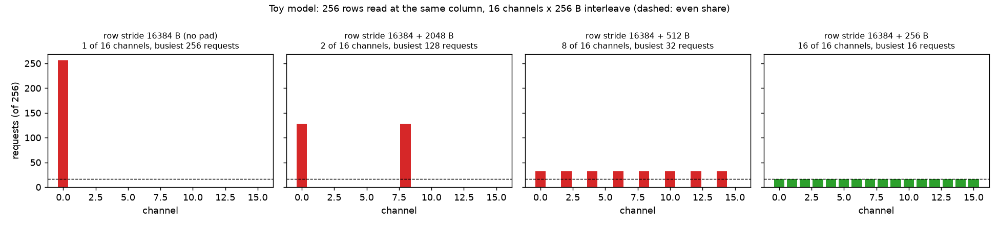
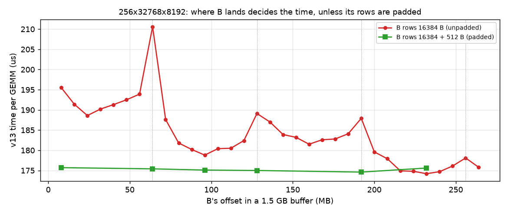
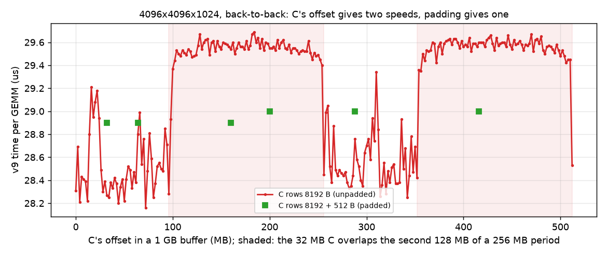
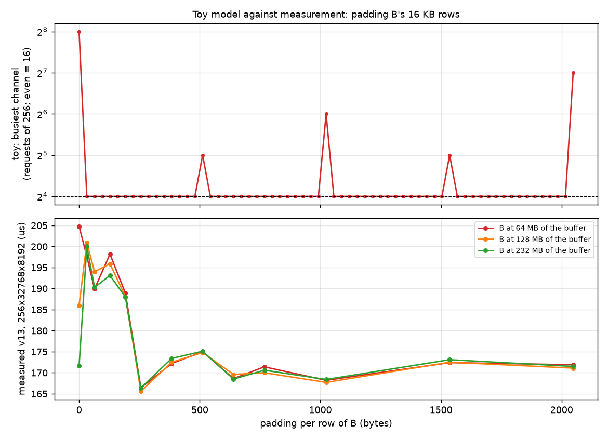

# Partition camping, power-of-two strides and padding

Why the same GEMM runs at different speeds depending on where its buffers land, why padding
the rows fixes it, and what that means for benchmarking. The measurements are in this
directory ([README](README.md), [results/](results/)); the figures come from
[make_figures.py](make_figures.py).

## 1. What partition camping is

Memory is split into channels (NVIDIA's 2009 term was partitions). Consecutive blocks of the
address space are dealt to the channels in turn, so a stream of consecutive addresses keeps all
of them busy. The term comes from Ruetsch and Micikevicius, *Optimizing Matrix Transpose in
CUDA* (NVIDIA, 2009):

> To use global memory effectively, concurrent accesses to global memory by all active warps
> should be divided evenly amongst partitions. The term partition camping is used to describe
> the case when global memory accesses are directed through a subset of partitions, causing
> requests to queue up at some partitions while other partitions go unused.

A GEMM kernel reads and writes matrices row by row, with many workgroups in flight at once.
At any moment the requests in flight are often the same column of many different rows: they
are one row stride apart. If that stride is a multiple of (number of channels x interleave
size), every one of those requests maps to the same channel.

## 2. A numerical example

A toy memory: 16 channels, 256-byte interleave, `channel = (address // 256) % 16`. B on the
skinny shape is (32768, 8192) bf16, so a row is 16384 bytes. Take 256 rows read at the same
column, as 256 workgroups would on the same k-step:

- Row r starts at `r * 16384`. `16384 / 256 = 64` interleave blocks, and `64 % 16 = 0`, so
  every row starts on channel 0. All 256 requests queue on one channel while 15 sit idle: the
  read runs at 1/16 of the memory bandwidth.
- Pad each row by 256 bytes: the stride is 16640 bytes = 65 blocks, and 65 is odd, so row r
  lands on channel `65 r % 16 = r % 16`. 16 requests per channel, the even split.

In general, for a stride of s interleave blocks the rows use `16 / gcd(s, 16)` channels:

| row stride (bytes) | interleave blocks s | gcd(s, 16) | channels used | busiest channel (of 256 requests) | bandwidth |
|---|---|---|---|---|---|
| 16384 | 64 | 16 | 1 | 256 | 1/16 |
| 16384 + 2048 | 72 | 8 | 2 | 128 | 1/8 |
| 16384 + 512 | 66 | 2 | 8 | 32 | 1/2 |
| 16384 + 256 | 65 | 1 | 16 | 16 | full |

The base address does not appear: adding a constant to every address rotates which channel
is busy but not how many there are. **In the toy model the starting offset never matters, only
the stride.** A row stride that is a large power of two is the worst case, because it is a
multiple of every smaller power of two, including (channels x interleave).

## 3. What changes on real hardware: the hash

GPUs stopped using plain modulo interleaving because of this. The NVIDIA paper notes that
partition camping in its transpose "only occurs in architectures with compute capabilities
less than 2.0": later GPUs hash higher address bits into the channel choice, so one large
power-of-two stride no longer collapses onto one channel. AMD's MI300 and MI350 tuning guide
still lists the effect for GEMMs:

> On MI300, if the matrix stride in GEMM is a multiple of 512 bytes, it can lead to Tagram
> channel hotspotting issues, causing a significant performance drop, especially for TN
> transpose cases. This can increase the latency of VMEM instructions and cause a notable
> performance drop. To avoid this, use stride padding to ensure the stride is not a multiple
> of 512 bytes (for instance, for TN F16 GEMM, set `lda = ldb = K + 128` when `K % 256 ==
> 0`).
>
> -- [AMD Instinct MI300 Series / MI350 Series workload optimization](https://rocm.docs.amd.com/en/docs-7.2.4/how-to/rocm-for-ai/inference-optimization/workload.html), "GEMM stride issues"

With a hash, the channel of an address depends on its high bits as well as its low ones. The
requests from a power-of-two-strided stream differ only in their high bits, so how evenly the
hash spreads them depends on what those high bits are, that is, **on where the buffer sits in
physical memory**. That is the part the toy model cannot show: on the real machine the
starting offset matters. The hash is not published, so the rest of this section is measured.

### Measured: B on 256x32768x8192 (v13)

B's offset inside one 1.5 GB buffer moves the GEMM between 174 and 211 us (650-789 TFLOPS).
The same offset gives the same time in new processes, so it is the address, not the run. With
512 bytes of padding per row it is 174.6-175.7 us at every offset.

### Measured: C on 4096x4096x1024 (v9, back-to-back)

C's offset gives two speeds with a 256 MB period: about 28.3 us while the 32 MB of C stays in
the first 128 MB of a period, about 29.5 us as soon as any of it overlaps the second 128 MB.
Padded rows give 28.9-29.0 us everywhere: better than the slow placements, worse than the
fast ones.

### Measured: how much padding

v13 on the skinny shape with B at its worst (64 MB), a middle (128 MB) and its best (232 MB)
unpadded offset, against the toy model's busiest channel:

| padding per row (bytes) | 0 | 32 | 64 | 128 | 192 | 256 | 384 | 512 | 640 | 768 | 1024 | 1536 | 2048 |
|---|---|---|---|---|---|---|---|---|---|---|---|---|---|
| B at 64 MB (us) | 204.8 | 197.7 | 189.9 | 198.2 | 188.9 | 166.4 | 172.2 | 175.0 | 168.6 | 171.4 | 168.2 | 172.4 | 171.9 |
| B at 128 MB | 186.0 | 200.9 | 194.0 | 195.9 | 188.1 | 165.6 | 172.5 | 174.8 | 169.6 | 170.0 | 167.7 | 172.5 | 171.1 |
| B at 232 MB | 171.6 | 200.0 | 190.3 | 193.1 | 188.0 | 166.4 | 173.4 | 175.1 | 168.5 | 170.6 | 168.4 | 173.1 | 171.5 |

- **Pads below 256 bytes are worse than no padding at a good offset** (188-201 us). The toy
  model says they spread perfectly; the measurement says the real interleave or hash unit is
  at least 256 bytes, so rows that move by less still share channels.
- **From 256 bytes up, the offset stops mattering** and every pad is within 166-175 us, as
  fast as the best unpadded offsets (171.6-175 us) and far from the worst (205-211 us). 256
  bytes (128 bf16 elements, AMD's `K + 128`) was the fastest here, 165.6-166.4 us (826-830
  TFLOPS), faster than any unpadded offset.
- **The toy model's bad pads (512, 1024, 1536, 2048 bytes) are not bad on the real machine.**
  The hash breaks those smaller power-of-two patterns; only the large one (16 KB, and its
  placement-dependent outcome) survives.
- Pads must keep the alignment the kernel was compiled for: an 8-element (16-byte) pad fails
  to compile in v13 (Triton specialises on stride divisibility).

### So why does padding help when the offsets are already powers of two?

The offset is not the problem; the stride is. A power-of-two offset only shifts every
address by the same amount. Padding changes the distance between the rows that are in flight
together, so their low address bits differ and the channel interleave spreads them on its own,
without depending on the high bits and therefore without depending on where the buffer
landed.

### Is the LLC not interleaved over every XCD?

It is, and these results fit that. There are two separate interleavings:
- **Inside each XCD,** its private L2 has 16 channels. The counters show C's writes spread
  perfectly evenly over them, fast placement or slow (E4).
- **Behind the L2s,** the MALL (the last-level cache, 256 MB) is attached to the memory side:
  each slice caches the HBM channels behind it, and every XCD reaches every slice over the
  fabric. So each XCD's traffic is spread over the whole LLC.

What the experiments show is that the address-to-slice/channel/bank mapping behind the L2 has
structure. For C at 4096x4096x1024 one address bit (the 128 MB halves of every 256 MB) decides
fast against slow, and for B on the skinny shape the bad offsets sit at multiples of 64 MB.
AMD's guide calls the MI300 version "Tagram channel hotspotting", which reads as the tag RAM
of a memory-side cache channel; the guide does not say more. Our counters stop at the L2, so
we cannot see which slices or channels camp.

## 4. Libraries that pad leading dimensions

| library or source | what it does |
|---|---|
| Intel oneMKL, [Developer Guide: Coding Techniques](https://www.intel.com/content/www/us/en/docs/onemkl/developer-guide-linux/2026-0/coding-techniques.html) | Recommendation 1: leading dimensions a multiple of 64 bytes (a cache line). Recommendation 2: "leading dimensions must not be a multiple of a large power of 2 (for example, 4096 bytes). Increasing the leading dimension slightly (for example, from 4096 bytes to 4096+64 bytes) can improve performance in some cases." On CPUs the conflict is in cache sets rather than memory channels, but the cause is the same. |
| AMD ROCm, [MI300 / MI350 workload optimization](https://rocm.docs.amd.com/en/docs-7.2.4/how-to/rocm-for-ai/inference-optimization/workload.html), "GEMM stride issues" | Strides that are multiples of 512 bytes cause Tagram channel hotspotting; pad, for example `lda = ldb = K + 128` for f16 when `K % 256 == 0`. |
| vLLM on ROCm (`VLLM_ROCM_FP8_PADDING` and `VLLM_ROCM_MOE_PADDING`, both on by default) | `_maybe_pad_fp8_weight` in `vllm/model_executor/layers/quantization/utils/fp8_utils.py` and `_maybe_pad_weight` in `vllm/model_executor/layers/fused_moe/unquantized_fused_moe_method.py`: if a weight's row stride in bytes is a multiple of 512, allocate it with 256 extra bytes per row and use a view (`F.pad(weight, (0, 256 // element_size))[..., :-num_pad]`). The comment: "This is an optimization on ROCm platform, which can benefit from tensors located far enough from one another in memory." The same 256 bytes was the best pad here. |
| NVIDIA, Ruetsch and Micikevicius, *Optimizing Matrix Transpose in CUDA* (2009, CUDA samples `transpose`) | Diagnoses partition camping in the transpose; "Adding an additional 64 columns (one partition width) to odata will cause rows of a tile to map sequentially to different partitions", then prefers a diagonal reordering of the blocks, which needs no extra memory. |
| PyTorch Inductor (`comprehensive_padding`, `padding_alignment_bytes = 128`, `padding_stride_threshold = 1024` in `torch/_inductor/config.py`; `shape_padding` and `fx_passes/pad_mm.py`) | Related but aimed at alignment: pads strides of 1024 bytes or more up to a multiple of 128 bytes, and pads matmul shapes for tensor cores when a benchmark says it is faster. It does not try to avoid power-of-two strides, and rounding up to 128 bytes can produce them. |

The common rule: keep each row aligned to the memory access size, and keep the row stride
away from multiples of a large power of two. On this machine, pad by 256 bytes or more.

## 5. What to benchmark with

Earlier the suggestion was one process with one large buffer and a few fixed layouts for
rankings, and a padded-stride variant for absolute numbers. The padded variant is the simpler
and better default for comparing kernels:

- **It is easy.** Allocate (rows, cols + pad) and pass the `[:, :cols]` view; the kernels take
  strides already. `place.py layout --b-pad --c-pad` does it, and every version v9-v21 gives
  correct results with 128-element padding on B and C (`results/padded_all_versions.txt`).
- **It is deterministic.** The time no longer depends on the allocator, the process or the
  physical placement, so one run per version is enough and runs in different processes compare.
- **It keeps the ranking.** At 4096x4096x1024 with padded C, v13 trails v9 by 0.5-0.7 us,
  against 0.7-1.0 us unpadded (`results/pad_4096_split.txt`); at 4352x4096x8192 padding
  changes neither v13 (278.5 us) nor v20 (200.7 us).

What it costs:

- **It measures a padded input.** Frameworks pass contiguous tensors unless something pads
  them. vLLM on ROCm pads weights by default, so for weight operands the padded number is the
  deployed one; activations and outputs are usually contiguous, and for them the padded number
  is not what a user gets. At 4096x4096x1024 padded C (29.0 us) sits between the two
  contiguous placements (28.3 and 29.5 us).
- **It hides a real difference if one kernel is more sensitive to placement than another.**
  We have not seen one (v9, v13 and v20 moved together), but a kernel with a different access
  order could.
- **The pad has to suit the hardware and the kernel.** Below 256 bytes it is worse than no
  padding, and a pad that breaks the alignment the kernel specialises on may not compile.
- **Memory.** 256 bytes per row is 1.6% at 16 KB rows and 12.5% at 2 KB rows.

So: use padded strides (256 bytes or more, for every streamed operand) as the default for
rankings and headline numbers. Keep a contiguous check on a few fixed layouts in one process
when the number should describe what contiguous tensors get, or when a new kernel changes the
access pattern.

**Adopted.** `kernels/gemm/intra_wave/a16w16/bench.py` now pads B and C this way by default
(`kernels/gemm/utils/row_padding.py`; `--no-pad` to turn it off), and so does `rocprof_check.py`.
A stays contiguous because the kernels require it. A cold check at 4096x4096x1024 (1000
launches over 10 rotating copies, rocprof) shows what padding buys there: unpadded v9 took
30.4 us with `bench.py`'s allocation order and 30.96 us with another, v13 30.5 against 31.8 -
32.4 us; padded, both orders agree within 0.1 - 0.5 us (v9 30.5 - 30.6, v13 31.2 - 31.8, v20
31.4 - 31.6). Padding C does most of it; padding B changes little at this shape.
