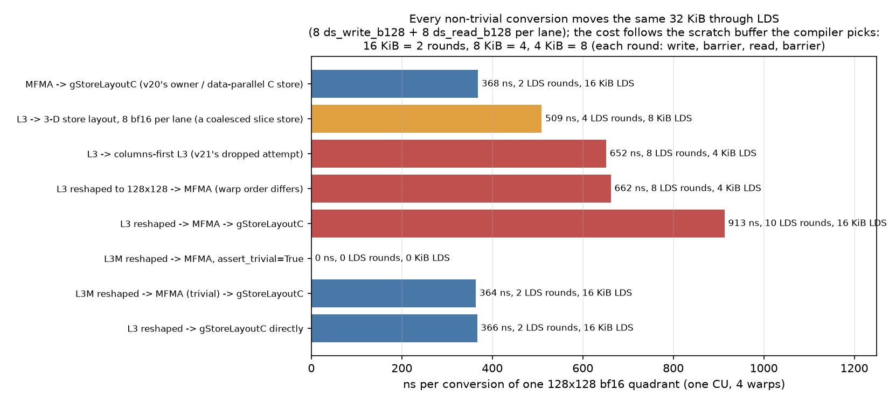
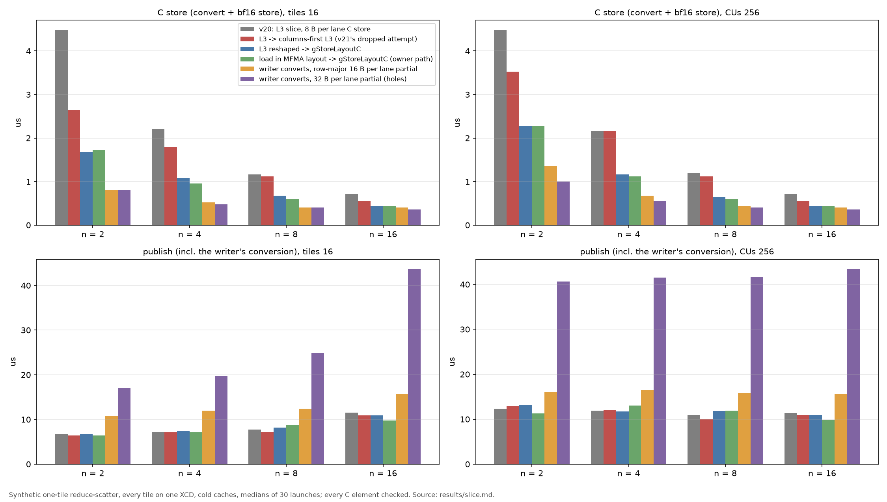
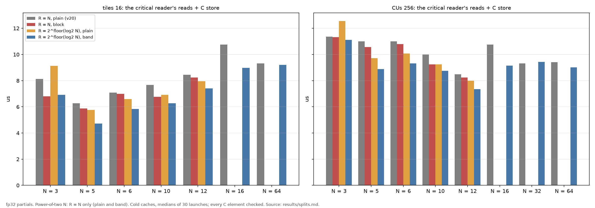
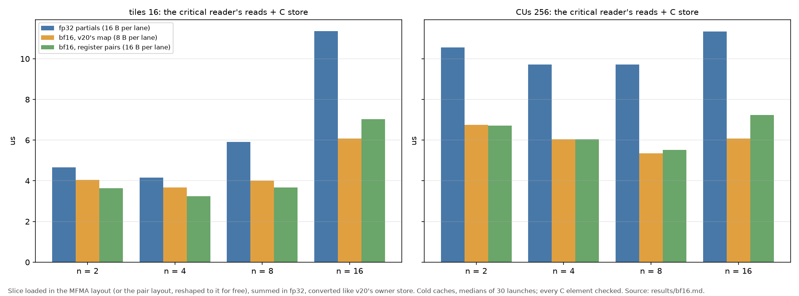

# The reduce-scatter slice's C store: layouts and conversions on MI355X

v20's reduce-scatter reads its slice contiguously but stores C with 8 bytes per lane, 4 neighbouring
lanes on 4 C rows. v21 tried a `convert_layout` before the store and dropped it as slower. Two
questions:

1. Is the MFMA -> store-layout conversion (v20's owner and data-parallel C store) specially optimised,
   and is that why the slice's conversion was slow?
2. If the slice's layout is converted to the MFMA layout first, does the compiler see they are the same,
   so the slice then gets the MFMA -> store conversion?

```bash
HIP_VISIBLE_DEVICES=1 TRITON_ALWAYS_COMPILE=1 python show_layouts.py   # results/layouts.txt
HIP_VISIBLE_DEVICES=1 python bench.py --sweep probe > results/probe.md  # about 5 s
HIP_VISIBLE_DEVICES=1 python bench.py --sweep slice > results/slice.md  # about 15 s
HIP_VISIBLE_DEVICES=1 python bench.py --sweep splits > results/splits.md  # about 15 s
HIP_VISIBLE_DEVICES=1 python bench.py --sweep bf16 > results/bf16.md  # about 10 s
python make_figures.py                                                   # images/
python diagrams.py   # images/writer_cvt_widths.png, register_pairs.png, store_patterns.png (explanatory)
```

Two later questions are answered further down: split counts that do not divide 64 (reduce with all N
programs, or with the largest power of two of them?), and bf16 partials.

MI355X (gfx950), GPU 1, Triton 3.8 Gluon, no LLIR or amdgcnas plugins.

## Answers

- **The MFMA -> store conversion is not special.** Every non-trivial conversion of a 128x128 bf16
  quadrant compiles to the same LDS traffic, 8 `ds_write_b128` and 8 `ds_read_b128` per lane. What
  differs is the LDS scratch buffer the compiler picks for the pair of layouts: 16 KiB (2 rounds), 8 KiB
  (4) or 4 KiB (8). Each round is a write, a barrier, a read and a barrier, so the cost follows the
  rounds: 370 ns for 2, 510 for 4, 650-660 for 8. v20's slice layout converted straight to the store
  layout, after a reshape to the 2-D band, gets the 2-round buffer too: 366 ns, the same as MFMA.
- **The compiler does see equal layouts, but v20's slice layout is not equal to MFMA.** Reshaped to
  128x128, `L3` has exactly the MFMA layout's register and lane bases; only the two warp bases are in the
  other order (rows then columns, against columns then rows). A `BlockedLayout` cannot fix that (one
  `order` for lanes and warps), so `L3` -> MFMA is an 8-round conversion (662 ns). Written as a
  `DistributedLinearLayout` with MFMA's warp order (`L3M`), the same loads give a tensor whose
  conversion to MFMA passes `assert_trivial=True` and compiles to nothing; MFMA -> store then costs
  the owner's 364 ns. Going through MFMA is not needed, though: `L3` reshaped -> store layout costs
  the same.
- **In a synthetic reduce-scatter, converting before the C store halves the store** (2.2 -> 1.1 us at
  n = 4, 4.5 -> 1.7-2.3 at n = 2, 1.2 -> 0.6 at n = 8), with the reads unchanged. v21's dropped
  attempt, a conversion to the columns-first `L3`, is the 8-round kind and gets only part of that.
- **Moving the conversion to the writer does not pay.** The C store gets cheaper still (0.4-1.4 us),
  but publishing costs 3-6 us more and the reads get slower. With 32 bytes per lane the writer's `.wt`
  stores leave 16-byte holes in each 4-lane group, and publishing takes 10-32 us longer.
- **For N that does not divide 64, reduce with the largest power of two of the N programs** and the
  band store: 0.5-1.7 us faster than the best way to reduce with all N (a tie at N = 3). The others only
  publish. If all N must read, convert each block group to 8 bf16 per lane along its rows (`block`).
- **bf16 partials cut the reads and C store by 36-46% with all 256 CUs.** v20's map gives 8-byte lanes;
  pairing a lane's registers of two blocks 32 columns apart gives 16-byte lanes and `dwordx4`, which
  helps only when few CUs share the bandwidth.

## The layouts

From `show_layouts.py` ([results/layouts.txt](results/layouts.txt)); bases are (row, col) offsets in
the quadrant, and for `L3` (block, row, col):

| | registers | lanes | warps |
|---|---|---|---|
| MFMA, 128x128 | col 1, 2, 32, 64; row 32, 64 | row 1, 2, 4, 8; col 4, 8 | **col 16, row 16** |
| `L3`, (16, 32, 32) | col 1, 2; block 1, 2, 4, 8 | row 1, 2, 4, 8; col 4, 8 | row 16, col 16 |
| `L3` reshaped to 128x128 | col 1, 2, 32, 64; row 32, 64 | row 1, 2, 4, 8; col 4, 8 | **row 16, col 16** |
| `L3M` reshaped to 128x128 | the same | the same | col 16, row 16 (= MFMA) |

The reshape maps the block index's bits to col 32, col 64, row 32, row 64, v20's block map.

## Conversions in isolation



[results/probe.md](results/probe.md): one quadrant of bf16 values converted 1000 times in a loop on one
CU (4 warps), minus the same loop without the conversion; every case checked element by element.

| conversion | LDS rounds | LDS scratch | ns |
|---|---|---|---|
| MFMA -> `gStoreLayoutC` (v20's owner / data-parallel store) | 2 | 16 KiB | 368 |
| `L3` reshaped -> `gStoreLayoutC` | 2 | 16 KiB | 366 |
| `L3` -> `S3_ROW` (`gStoreLayoutC`'s mapping as a 3-D layout, no reshape) | 2 | 16 KiB | 381 |
| `L3M` reshaped -> MFMA (`assert_trivial`) -> `gStoreLayoutC` | 0 + 2 | 16 KiB | 364 |
| `L3` -> 3-D store layout, 8 bf16 per lane | 4 | 8 KiB | 509 |
| `L3` -> columns-first `L3` (v21's attempt) | 8 | 4 KiB | 652 |
| `L3` reshaped -> MFMA | 8 | 4 KiB | 662 |
| `L3` reshaped -> MFMA -> `gStoreLayoutC` | 10 | 16 KiB | 913 |

No case spills.

**Why the rounds differ** ([images/layout_bits.png](images/layout_bits.png), `python diagrams.py`): Triton's
`buildReps` (lib/Tools/GenericSwizzling.cpp) turns every bit of the element index that is a register bit in
both the source and the destination into a separate LDS round, beyond the bits kept for the 16-byte
vector. All five conversions above fit rounds = 2^(shared register bits - 3): `L3` shares 6 register bits
with MFMA and with the columns-first `L3` (8 rounds), 5 with `S3` (4), 4 with `gStoreLayoutC` (2). The
band works because `gStoreLayoutC`'s lanes span all 128 columns, putting col 4 and row 16 in registers
instead of col 32 and col 64. The 2-D reshape is a convenience, not a requirement: the same mapping
written as a 3-D layout over the blocks, `S3_ROW = BlockedLayout([1, 1, 8], [4, 4, 4], [1, 4, 1], [2, 0, 1])`
(lanes along a block row, then across blocks 0-3), also converts in 2 rounds (381 ns, `l3_to_s3row`).
`S3` and the columns-first `L3` keep their lanes inside one 32-column block.

## The slice in a synthetic reduce-scatter



[slice_kernel.py](slice_kernel.py): W programs, n per 256x256 tile, every tile on one XCD; each program
holds a synthetic fp32 accumulator in the MFMA layout, publishes it with `.wt` stores, drains, adds 1
to the tile's relaxed `gpu` counter and spins until n have arrived; then it reads slice j of the n
partials with `.cv` loads (all of a slice's blocks in one pass), sums in fp32 and stores bf16 C. Cold
caches, medians of 30 launches and of every group's critical path, every C element checked
([results/slice.md](results/slice.md)).

C store, us (convert + store), 16 tiles / all 256 CUs:

| variant | n = 2 | n = 4 | n = 8 | n = 16 |
|---|---|---|---|---|
| v20: `L3`, 8 B per lane | 4.48 / 4.48 | 2.20 / 2.16 | 1.16 / 1.20 | 0.72 / 0.72 |
| `L3` -> columns-first `L3` (v21's attempt) | 2.64 / 3.52 | 1.80 / 2.16 | 1.12 / 1.12 | 0.56 / 0.56 |
| `L3` reshaped -> `gStoreLayoutC` | 1.68 / 2.28 | 1.08 / 1.16 | 0.68 / 0.64 | 0.44 / 0.44 |
| loaded in MFMA -> `gStoreLayoutC` | 1.72 / 2.28 | 0.96 / 1.12 | 0.60 / 0.60 | 0.44 / 0.44 |
| writer converts, 16 B per lane | 0.80 / 1.36 | 0.52 / 0.68 | 0.40 / 0.44 | 0.40 / 0.40 |
| writer converts, 32 B per lane | 0.80 / 1.00 | 0.48 / 0.56 | 0.40 / 0.40 | 0.36 / 0.36 |

- **The reader-side conversion is worth 0.3-2.8 us of C store per tile ending**, most at small n, where
  each program stores the most C. The two ways to get it (`L3` reshaped, or loading in the MFMA
  layout) compile to the same instructions and cost the same.
- **The reads do not change**: 2.6-10.2 us in every reader-side variant, the same loads. One exception:
  the v20 variant's reads at 16 tiles, n = 4 (5.4 against 3.0-3.1 us). Its compiled loop waits after 18
  of its 64 loads and lets the count in flight fall to about 8; the others issue about 26 first. That is
  register allocation in this kernel (94 VGPRs against 126), not the layout.
- **The writer-side conversion costs more than it saves.** Publishing takes 3-6 us longer (four fp32
  quadrant conversions, 64 `ds_write_b128` per lane), and the reads of a row-major partial with 8 fp32
  per lane get slower (each load instruction leaves 16-byte gaps between lanes). Totals: 17.7-31.1 us
  against 12.8-25.0 for the reader-side conversion.
- **Write-through stores with holes are expensive.** When the writer stores 32 bytes per lane, each
  16-byte `.wt` store instruction writes 4 pieces 32 bytes apart. Publishing takes 17-44 us instead of
  11-16 (all 256 CUs: 40-43 against 16). Each write-through half-line then arrives in two partial
  requests; we have not measured what the memory side does with them.

## Split counts that do not divide 64, and n = 32, 64



[split_kernel.py](split_kernel.py), [results/splits.md](results/splits.md). N programs per tile publish
fp32 partials; the first R read: reader j sums blocks [64 j / R, 64 (j + 1) / R) of all N partials in
groups of G = min(16, next_pow2(ceil(64 / R))) blocks, masked past the slice's end, as v20's
`reduce_scatter_slice` does. Each partial's loads are issued four partials at a time before their adds
(v20's `U` per trip). Stores: `plain` (v20's, from `L3`), `block` (each group converted to 8 bf16 per
lane along a block row: works for any slice), `band` (the 2-D band conversion; aligned groups only, so R
a power of two). R = N is v20; R = 2^floor(log2 N) leaves N - R programs that only publish.

The critical reader's reads + C store, us, 16 tiles / all 256 CUs (240 or 192 for N = 3-12):

| N | R = N, plain (v20) | R = N, block | R = 2^k, plain | R = 2^k, band |
|---|---|---|---|---|
| 3 (R = 2) | 8.12 / 11.36 | 6.80 / 11.32 | 9.12 / 12.56 | 6.92 / 11.12 |
| 5 (R = 4) | 6.28 / 11.00 | 5.88 / 10.56 | 5.76 / 9.72 | **4.72 / 8.88** |
| 6 (R = 4) | 7.08 / 11.00 | 7.00 / 10.80 | 6.60 / 10.08 | **5.84 / 9.32** |
| 10 (R = 8) | 7.68 / 10.00 | 6.76 / 9.24 | 6.92 / 9.24 | **6.28 / 8.76** |
| 12 (R = 8) | 8.44 / 8.48 | 8.24 / 8.24 | 7.96 / 8.00 | **7.40 / 7.36** |

- **Reducing with the largest power of two <= N, and the band store, is the fastest in every case but
  N = 3, where it ties** (0.5-1.7 us faster than the best R = N store). It reads more per reader (N
  partials over 64 / R blocks), and is still faster.
- **Why fewer readers can be faster:** with R = N the slice is not a power of two of blocks, so the group
  is rounded up and masked: at N = 5 a reader's 12-13 blocks run as one 16-block group, at N = 3 its 21-22
  blocks as two. The masked loads and adds are still issued, so a reader of an uneven slice does about
  the work of a full power-of-two one, and its C store cannot use the band conversion.
- **`block` is the store to use when R must equal N**: 0-1.3 us faster than `plain`, from the 4-round
  conversion (509 ns per quadrant in the probe).
- **n = 32 and 64** (32x64 and 32x32 slices, converted to 8 lanes x 16 B and 8 lanes x 8 B per row):
  `band` and `plain` take 9.0-9.4 us. Each reader stores only 4 or 2 KiB of C, so the store pattern no
  longer matters. At n = 16, `band` saves 1.6-1.8 us here (8.98 / 9.14 against 10.76).

## bf16 partials



[results/bf16.md](results/bf16.md): power-of-two n, the slice loaded in the MFMA layout and stored like
v20's owner.
- `fp32`: v20's map, 16 B per lane.
- `bf16`: the same map with bf16 values: 4 values = 8 B per lane, `buffer_load_dwordx2` /
  `buffer_store_dwordx2`, 512 contiguous bytes per wave instruction.
- `bf16_pairs`: a lane's first 8 registers (columns c .. c + 3 of two blocks 32 columns apart: the MFMA
  layout's register bits are col 1, 2, 32, 64, row 32, 64) as 16 contiguous bytes. A reshape and
  permute of the MFMA tensor to (rows, col 64, col 4-16, col 1-2-32) makes those 8 registers the last
  dimension (`assert_trivial`), the map gives each lane 16 contiguous bytes, and the compiler emits
  `buffer_store_dwordx4` / `buffer_load_dwordx4`: half as many instructions as `bf16`. The reader
  reshapes back to the MFMA layout for free.

The critical reader's reads + C store, us, n = 2 / 4 / 8 / 16:

| partials | 16 tiles | all 256 CUs |
|---|---|---|
| fp32 | 4.66 / 4.16 / 5.92 / 11.36 | 10.56 / 9.72 / 9.72 / 11.34 |
| bf16, 8 B per lane | 4.04 / 3.68 / 4.00 / 6.08 | 6.76 / 6.04 / 5.36 / 6.08 |
| bf16 pairs, 16 B per lane | 3.64 / 3.24 / 3.68 / 7.04 | 6.72 / 6.04 / 5.52 / 7.24 |

- **bf16 partials cut the reads and C store by 36-46% with all 256 CUs** (5.4-6.8 against 9.7-11.3 us),
  as half the bytes would predict when the chip's bandwidth is the limit. Totals: 16.8-19.8 against
  22.8-27.0 us.
- **16 bytes per lane helps only when few CUs share the bandwidth**: the pairs are 0.3-0.4 us faster at
  16 tiles for n = 2-8, level or 0.2-1.2 us slower with all 256 CUs and at n = 16. 8-byte lanes that are
  contiguous across the wave cost little here, unlike the 32-byte lanes with holes above.
- Precision: bf16 partials round each partial once and the fp32 sum once; v22's atomic ending rounds the
  running sum at every add.
- **Publish does not halve** (fp32 11.3-13.2 us, bf16 9.7-11.2 with all 256 CUs): the synthetic writer
  spends about 3-4 us generating its values before it stores (6.6 us at 32 CUs for a 3-us store).

## In the GEMM: v23

[v23_streamk_rs_band](../../kernels/gemm/intra_wave/a16w16/v23_streamk_rs_band/WORKLOG.md) applies the
findings below to v20: the band C store, power-of-two readers, and opt-in bf16 partials (both maps)
for both endings. Results:
- **Kernel tails** on seven cells (S = 1-64): 0.5-4.4 us (2-8%) shorter than v20. The C store falls
  from 0.4-3.6 us to 0.4-1.0, and power-of-two readers save 1.6-4.4 us where n is not a power of two.
- **bf16 partials** shorten the tails a further 12-19%. Like for like, the bf16 reduce-scatter ending is
  as fast as v22's bf16 atomic ending or faster on all seven cells, with about 1.6 times one rounding's
  error against `0.5 + 0.75 sqrt(n)`. The atomic ending's earlier lead came from comparing bf16 adds with
  fp32 partials.
- **Per phase**, the GEMM's slice reads and C store match this experiment's split sweep at the same CU
  count to within 0.8 us, so the GEMM adds no slice cost of its own; publishing is shorter than here,
  where the writers also generate their values.

## What this means for v20 (not changed here)

- The one-line change is in `reduce_scatter_slice`: reshape the summed `(NB, 32, 32)` blocks to their
  2-D band and `convert_layout` to `gStoreLayoutC` before the bias and C store (the `_to_band` helper in
  [slice_kernel.py](slice_kernel.py)), instead of storing from `L3` or converting to the columns-first
  `L3` as v21 tried. v20's slice loops over groups of `NB` blocks, so the band is the group's.
- Expected gain from this experiment: 0.3-2.8 us per tile ending, most at n = 2-4. It has to be
  measured in v20: the GEMM runs near 512 VGPRs, and in the synthetic kernel the conversion adds about
  20-30 VGPRs at n = 4-16, which could spill there
  (v21 saw bias + C rise to 2.4-10.5 us with its conversion; here the same conversion was not slower than
  no conversion, so that rise was probably not the conversion's own cost).
- Keep the partials lane-contiguous from the MFMA layout; do not convert on the writer.
- For a split count n that is not a power of two (v20's default `256 // S` often is not), let only the
  largest power of two of a tile's programs reduce: the slices become aligned bands, the band store
  applies, and the masked work of uneven groups disappears. The remaining n - 2^k programs publish and
  finish. This is a host-side and slice-assignment change (who reads, `blk_lo` / `blk_hi`), not a layout
  one.
- bf16 partials would need v20's partial store and slice reads in bf16 (and accept the extra rounding);
  `split_kernel.py`'s `_pairs` / `_pair_off` show the 16-byte map, `PART 1` the 8-byte one.

## Limits

- Synthetic: the accumulator is generated, not computed; no bias; 69-267 VGPRs instead of v20's ~512.
  Publish includes 3-4 us of value generation.
- slice_kernel.py reads a slice in one pass; split_kernel.py, like v20, in groups of at most 16 blocks,
  four partials' loads at a time.
- The compiler's load scheduling moves these timings by up to about 1.5 us: before split_kernel issued
  its loads four partials at a time, the band variant at n = 16 waited for every load (12.9 us against
  9.4 for `plain`); after, 9.0 against 10.8. Differences below that are not robust.
- One GPU, one run of each sweep; cold caches only.
