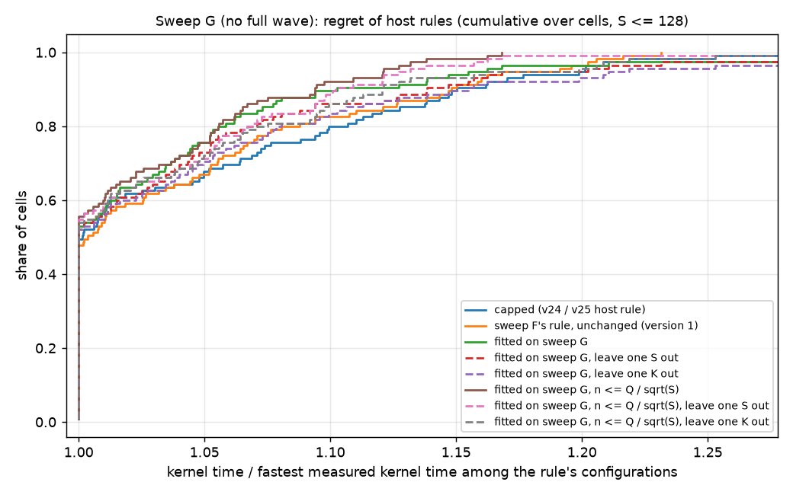

# Split count and small K for the stream-K tail

Two questions about the one-tile stream-K tail (v15-v20 in
[kernels/gemm/intra_wave/a16w16](../../kernels/gemm/intra_wave/a16w16)):

1. **How many ways should each leftover tile be split?** With S leftover tiles the versions use
   all 256 programs, so each tile is split about `256 / S` ways. For S = 38 that is 6-7. Fewer
   splits mean longer chunks but fewer partials to collect. Section 9 of
   [STREAMK_EXPLAINED.md](../../kernels/gemm/intra_wave/a16w16/v14_streamk/STREAMK_EXPLAINED.md)
   calls this option (b) and models the best split as `n = sqrt(iters_per_tile / c)` for a serial
   owner, where `c` is the cost of one partial read in k-steps.
2. **When is K too small to split at all?**

```bash
# from the repo root, with the published v10+ stack (see the a16w16 WORKLOGs)
HIP_VISIBLE_DEVICES=3 python experiments/streamk_split_count/check_all.py   # correctness, all versions
HIP_VISIBLE_DEVICES=2 python experiments/streamk_split_count/sweep.py a     # split count at K = 8192
HIP_VISIBLE_DEVICES=0 python experiments/streamk_split_count/sweep.py b     # K = 512-8192
python experiments/streamk_split_count/sweep.py report                      # results/sweeps.md
```

## The knob

Every stream-K version (v15-v20) took a `STREAMK_NUM_PROGRAMS` constexpr marked "not used yet".
It now works in all of them. The host reads the environment variable `STREAMK_NUM_PROGRAMS`
(default 256, all programs), and only that many programs take part in the stream-K phase.

- **Tile-aligned split** (v17, v18, v20 `one_tile`): `n = STREAMK_NUM_PROGRAMS // S` programs per
  tile, so `STREAMK_NUM_PROGRAMS = S * n` gives exactly n.
- **End-to-end split** (v15, v16, v19/v20 two-tile, v20 `spread`): the ranges are cut into
  `STREAMK_NUM_PROGRAMS` pieces. With `S * n` programs, each program gets exactly 1/n of a tile.
- **Which programs idle** (`streamk_compact_pid`): each XCD keeps the same number of active
  programs, numbered contiguously, so the tail still runs on all eight L2s.
  `STREAMK_BALANCE_XCDS=0` instead idles the last spids, which leaves whole XCDs empty.

Correctness ([results/check_all.md](results/check_all.md)):
- Each version's own `check_streamk.py` (10 rotating launches) was run on S = 4, 16, 38 and 64:
  - at n = 1, n = 2 and the default;
  - in v20, with every policy and ending, the unbalanced mapping, and K = 512 / 1024.

  All 258 configurations are correct with every flag and count re-armed.
- v20's `check_partition.py` covers the compacted ids for every count from 1 to 256, and the
  end-to-end partition with `S * n` programs.

All times below are rocprof kernel times: 1000 back-to-back launches over a rotating 512 MB of
inputs, median. Small-K kernels take 30-150 us, and CUDA-event timings would include Python
launch gaps. Full tables are in [results/sweeps.md](results/sweeps.md), raw rows in
`results/sweep_a.jsonl` and `results/sweep_b.jsonl`.

## 1. Split count (K = 8192, all versions)

Best n per version against the default split, in us (v13, data-parallel, is 279-294):

| S | v13 | v15 | v16 | v17 | v18 | v20 owner | v20 rs | v20 spread |
|---|---|---|---|---|---|---|---|---|
| 4 | 278.6 | 627 -> 233 (n 4) | 346 -> 211 (n 8) | 341 -> 207 (n 8) | 351 -> 209 (n 6) | 342 -> 208 (n 8) | 209 -> **195** (n 16) | 339 -> 210 (n 8) |
| 16 | 278.7 | 318 -> 234 (n 4) | 243 -> 218 (n 8) | 237 -> 216 (n 4-6) | 245 -> 215 (n 6) | 237 -> 214 (n 4) | 216 -> **210** (n 8) | 244 -> 217 (n 4) |
| 38 | 280.2 | 285 -> 240 (n 4) | 251 -> 228 (n 4) | 236 -> 226 (n 4) | 230 -> **225** (n 4) | 235 -> 226 (n 4) | 236 -> 228 (n 4) | 249 -> 228 (n 4) |
| 64 | 282.5 | 252 -> 251 (n 2) | 239 (d) | 238 -> **237.6** (n 4) | 240 -> 239 (n 3) | 238 (n 3 / d) | 244 (n 4) | 240 (n 4) |
| 128 | 294.5 | 281 (d) | 276 (d) | **271.9** (d = n 2) | 272 (d) | 272 (d) | 290 (d) | 273 (d) |

What the numbers say:
1. **Capping the split is a large win when every tile is split many ways.** For the serial
   owner ending (v17, v18, v20 owner) at S = 4 it cuts the kernel time by 39% (342 to 208 us).
   At S = 16 the gain is 10%, at S = 38 4%, and none at S = 64-128, where the default is
   already 2-4 ways.
2. **The serial owner's best n matches section 9's model.** `sqrt(128 / c)` with `c` = 2.2 k-steps
   per read gives 7.6, and the measured best at S = 4 is n = 8. With more leftover tiles the best n
   falls (6 at S = 16, 4 at S = 38, 3 at S = 64): more programs publish at once, so each read
   costs more. `c = max(2.2, S / 5)` fits every measured S and K within 2% (sweep B).
3. **Reduce-scatter wants more splits than the owner** (n = 16 at S = 4, 8 at S = 16), because
   its ending costs about the same at any n. It is the best ending wherever tiles can be split at
   least 8 ways (S <= 32), and the owner's is best from S = 38.
4. **Every version gains in the same way.** v15's row-major partials make its fixup about twice as
   expensive, so it gains the most from capping (627 to 233 us at S = 4) and is still the slowest.
5. **XCD balance matters**: at S = 38, n = 2, leaving the idle programs on the last XCDs costs
   11% (owner, 236 to 262 us) and 15% (rs, 243 to 280 us).
6. **Two-tile with fewer programs only gets slower**: 213 to 315 us at S = 16 as the programs go
   from 256 to 128, and the same at S = 38. Every tile already has at most one peer, so fewer
   programs remove no fixups and only lengthen each range.

**Against two-tile.** With the split capped, one-tile is level with v19's two-tile or ahead of it.
- In rocprof (sweep B, K = 8192):
  - S = 4: rs at n 16 takes 194.6 us against two-tile's 203.3;
  - S = 16: rs at n 8 takes 210.2 us against 215.3;
  - S = 38: owner at n 4 takes 227.4 us against 233.9.
- With clean caches ([results/between_launches_k8192.md](results/between_launches_k8192.md),
  read 256 MB between launches):
  - S = 4: rs n 16 at 183.6 us against v19 at 185.0;
  - S = 16: 201.6 against 200.3;
  - S = 38: owner n 4 at 213.4 against 218.6.

  v19 is up to 4% ahead when the GPU idles between launches.

v20 entry 2 chose two-tile for short lags because v20's one-tile ending at the default split
lost to it by 3-15%. Most of that gap was the split count.

## 2. Small K

v20, S = 4-192, K = 512-8192. Gain is the best stream-K configuration against data-parallel (the
faster of v13 and v20 `dp`):

| S | K = 512 | 1024 | 2048 | 4096 | 8192 |
|---|---|---|---|---|---|
| 4 | -5.8% | -4.0% | **+17.0%** (rs n 16) | **+34.6%** (rs n 16) | **+47.5%** (rs n 16) |
| 16 | -5.9% | -3.9% | **+8.3%** (owner n 3) | **+24.9%** (rs n 8) | **+36.6%** (rs n 8) |
| 38 | -4.6% | -3.6% | **+4.6%** (owner n 3) | **+16.9%** (owner n 3) | **+26.7%** (owner n 4) |
| 64 | -3.1% | -0.5% | **+3.1%** (owner n 2) | **+14.3%** (owner n 3) | **+21.5%** (owner, d) |
| 128 | -4.0% | -1.8% | -1.2% | **+5.5%** (owner, d) | **+7.7%** (owner n 2) |
| 192 | -4.0% | -2.3% | -1.0% | -0.9% | -1.1% |

- **K <= 1024 (16 k-steps or fewer per tile): never split.** The best "stream-K" configuration is
  n = 1, the stream-K machinery with no split, and it still loses 1-6%. The default splits lose
  30-80% (for example S = 16, K = 512: 49-56 us against 32).
  - The data-parallel last wave is short: 16 k-steps run on mostly idle CUs in about 12 us.
  - A split pays at least a pipeline restart (1-3 k-steps) plus its fixup (owner: 10 or more
    k-steps; reduce-scatter: about 25; two-tile: one read).
- **K = 2048 (32 k-steps): split only small S, and only a few ways.** The best n is 2-3 for the
  owner ending, and only reduce-scatter at S = 4 wants 16. The default splits lose here (S = 16:
  owner default 109 us against data-parallel's 80). So the split cap decides whether stream-K
  helps at all.
- **Two-tile is the worst choice at small K**: 11-68% behind data-parallel at K <= 1024, and
  behind or level with the capped one-tile split at every K here.
- **S = 192** is level with data-parallel at every K up to 8192, as in v20 entry 3. Its gain
  needs K >= 32768 and the end-to-end `spread` split.

**Threshold.** A tile-aligned split pays when the idle share of the data-parallel last wave,
`(256 - S) / 256 * iters_per_tile`, is at least about 20 k-steps. That separates every measured
point except S = 192 (where the tile-aligned split cannot help and `spread` needs about 128):
- wins at 24 or more (S = 64, K = 2048: 24; S = 128, K = 4096: 32);
- loses at 16 or less (S = 128, K = 2048: 16; S = 4, K = 1024: 15.75).

## Proposed host rule (not applied)

For v20's `streamk_policy`, with `ipt = iters_per_tile` and S leftover tiles:
1. **Data-parallel** if `(256 - S) * ipt < 20 * 256`. In practice that means K <= 1024 always;
   K = 2048 for S > 96; and S > 128, unless entry 3's spread rule applies (K >= 32768).
2. **One-tile with a capped split**, otherwise:
   - **reduce-scatter** if `256 // S >= 8`, with `n = min(256 // S, max(4, ipt / 8))`. That is
     n = 16 at K = 8192, 8 at 4096 and 4 at 2048. It is within 4% of the best measured n, except
     S = 4 at K = 2048, where n = 16 is 7% faster than the rule's 4;
   - **otherwise the owner's ending**, with `n = min(256 // S, round(sqrt(ipt / c)))` and
     `c = max(2.2, S / 5)` k-steps per partial read. It is within 2% of the best measured n.
     A fixed `c = 2.2` misses by up to 6% at S = 38-64, K = 2048, where reads cost more because
     more programs publish at once.
3. **Two-tile is no longer needed.** It ties the capped one-tile split at best. This reverses
   v20 entry 2's two-tile branch. Keep it only for shapes measured to favour it.

Points not covered: S between the measured values (an S = 24 or S = 96 shape would test the
thresholds), K = 16384 with capped splits, and bias. The trends are smooth, but the coefficients
(2.2, 1/8, 20) are fits to these shapes.

## 3. Sweep C: every S on one matrix

Sweeps A and B change the shape to change S, and real shapes cannot give every S one full wave (257
tiles is prime). Sweep C runs everything on 4096x8192xK (16 x 32 tiles) and computes only its first
256 + S tile ids, through a test-only `GEMM_TILE_LIMIT` (a `TILE_LIMIT` constexpr in v13, v16, v19 and
v20, 0 = off; the default builds' assembly is unchanged). The tail is the kernel time minus the same
matrix's with 256 tiles. It also adds forward two-tile to v16 (`STREAMK_POLICY=two_tile`, host only).

```bash
# AITER's stack: Triton v2.2 + deepbind shim + LLVM_PASS_PLUGIN_PATH=plugins/llir_scheduler/libLlirSched.so,
# TRITON_AMDGCNAS_PLUGIN unset
HIP_VISIBLE_DEVICES=0 python experiments/streamk_split_count/check_tile_limit.py   # results/check_tile_limit.md
HIP_VISIBLE_DEVICES=0 python experiments/streamk_split_count/check_tile_limit.py --versions 22 \
    > experiments/streamk_split_count/results/check_tile_limit_v22.md
HIP_VISIBLE_DEVICES=0 python experiments/streamk_split_count/atomic_accuracy.py > experiments/streamk_split_count/results/atomic_accuracy.md
HIP_VISIBLE_DEVICES=0 python experiments/streamk_split_count/sweep.py c           # results/sweep_c.jsonl
HIP_VISIBLE_DEVICES=0 python experiments/streamk_split_count/sweep.py l2          # results/l2_c.jsonl
```

- S = 1, 2, 3, 4, 6, 8, 12, 16, 24, 32, 38, 48, 64, 96, 128 at K = 2048-16384, n = 1-64 (`S * n <= 256`) and
  the default, for v13, v16 (end-to-end), v20 `spread` (end-to-end reversed, all 256 programs and capped),
  v20 `one_tile` owner and rs (tile-aligned), v22 `one_tile` atomic and atomic_iz (tile-aligned, bf16
  `pk_add` into C, zeroed by a launch or inside the GEMM), v16 forward two-tile and v19; S = 160-255 at
  K = 8192-32768 without the tile-aligned split; K = 512 and 1024 for v13, owner, rs and both atomic modes;
  rs and both atomic modes packed onto few XCDs (`STREAMK_BALANCE_XCDS=0`) at S = 1-8. 4,314 cases.
- v22's call is timed from its zeroing launch's start to the GEMM's end (`rocprof_check.cold_detail`, which
  pairs the dispatches); the GEMM and the zeroing are also recorded separately (`gemm_us`, `pre_us`).
- [check_tile_limit.md](results/check_tile_limit.md) (all 4,281 cases; the first v22 run alone is in
  [check_tile_limit_v22.md](results/check_tile_limit_v22.md)): every case writes exactly the first T
  tiles, matches torch and re-arms every flag and count. v22's stream-K tiles round once per program, so
  they are held to an fp32 reference by their mean error instead (at most `1 + sqrt(n)` times one bf16
  rounding; `streamk_tiles` finds them as the kernels do).
- [atomic_accuracy.md](results/atomic_accuracy.md): v22's errors against an fp32 reference, by S, K and n.
- Real shapes at S = 8, 16, 38, 128 and 192 run within 3% of the limited matrix, except forward two-tile.
- A first run with the amdgcnas hook, before v22 and capped `spread`, is kept as `*_amdgcnas.*`; kernel
  times without the hook are a median 0.1-1% longer, and no conclusion changed.

The results, figures and the refitted split model are in
[memory_model_litmus WRITEUP.md, section 8](../memory_model_litmus/WRITEUP.md#8-choosing-the-split-count)
and [tail_variants.md](../memory_model_litmus/results/tail_variants.md). That report also replays the
rule as v20 implements it (`capped_policy`, `STREAMK_POLICY=capped`) on every cell with S <= 128 and
K = 512-16384, against the fastest measured configuration that rounds once
([WRITEUP section 8, "The v20 host rule against these measurements"](../memory_model_litmus/WRITEUP.md#the-v20-host-rule-against-these-measurements)):
- **Within 2% in most cells:** the median kernel ratio is 1.000 over 90 cells, 1.029 at the 90th percentile,
  1.070 at worst.
- **Reduce-scatter splits too little at S <= 4, K = 2048-8192 (1-7% of the kernel).** `max(8, ipt / 8)`
  gives 8-16 where the measured best is about one pair per program, up to 64 per tile (16 at K = 2048,
  16-32 at 4096, 32-64 at 8192).
- **K = 1024 stays data-parallel, where reduce-scatter wins at S <= 4 (3-5%).** That contradicts sweep B
  above (-4% at S = 4, K = 1024 on a real shape), so it needs confirming before the 20 k-step threshold
  moves.
- **Small misses at S = 24-38, K >= 8192 (1-2.4%)**, from the `128 // S` cap and the owner's sqrt rule.
- **From S = 38 the rule's n reaches 256 // S, so it leaves STREAMK_NUM_PROGRAMS unset** and some tiles get 3
  programs. Requesting S n would be faster (S = 96, K = 16384: 151 against 160 us).
- **K = 2048 pays for every S up to 64** with the capped tile-aligned split (1.06-2.4x shorter tails).
- **The owner ending wins from S = 38 to 128** at 2-4 programs per tile, as the rule has it.
- **A possible fix** is reduce-scatter n = min(k / 2, max(4, P / S)), at most 64, with P about 64 at
  K <= 4096 and 128 at K >= 8192. It is fitted to one matrix: validate it on this README's real shapes
  first. Fit to measured tails, not to the litmus split model, whose choice of n costs up to 6%.
- **Capped `spread` is no better than forward end-to-end cuts** (median 0.4% faster at the same n) and
  8% slower than tile-aligned ones.
- **v22's atomic ending** is the fastest tail in 50 of 60 cells, at reduce-scatter's n, by a median 5-17%,
  at the cost of n bf16 roundings and bitwise reproducibility. With C zeroed inside the GEMM
  (`atomic_iz`) it wins 54 of 60, and makes splitting pay at K = 1024 for S <= 32 (1.03-1.78x), where
  sweep B found no single-rounding split pays (here reduce-scatter gains 1-19% at S <= 8 only).
- **Packing the active programs onto few XCDs** (`STREAMK_BALANCE_XCDS=0`) helps only the atomic ending at
  S <= 2; spreading them stays the right default.

**Default behaviour is unchanged.** With `STREAMK_NUM_PROGRAMS` unset, `regress.py` on 4352x4096x8192 and
4352x4352x8192 gives every version's earlier TFLOPS within noise. Register counts and spills are the
same as before. For example v17 is at 1203 TFLOPS against 1213 earlier, with 492 VGPRs and no
spills; v15 is at 941 against 932.

## 4. Sweep E1: v23 against v20 and the atomic ending

`sweep.py e1` (report: `sweep.py e1_report`, [results/e1_tails.md](results/e1_tails.md)): seven cells of
sweep C's matrix where the atomic ending had won (S = 1-64, K = 4096-16384), each at the grid's best n
and its neighbours. Configurations: v20's reduce-scatter and owner endings, v23's reduce-scatter
(power-of-two or all readers; fp32, bf16 or bf16 pair partials) and owner with bf16 pairs, and v22's
two atomic endings. Two interleaved rounds on one GPU; every case first passes
`check_tile_limit.py --sweep e1`. `atomic_accuracy.py --v23`
([results/atomic_accuracy_v23.md](results/atomic_accuracy_v23.md)) adds v23's bf16 partials to the
accuracy table. Findings in [v23's WORKLOG](../../kernels/gemm/intra_wave/a16w16/v23_streamk_rs_band/WORKLOG.md):
like for like, reduce-scatter with bf16 partials is as fast as the bf16 atomic ending or faster, at
about 1.6 times one rounding's error whatever n.

## 5. Sweep F: every ending, placement and partial type (v24)

```bash
# AITER's stack, as sweep C; GPU 0 in HIP numbering (rocm-smi GPU 3 in this container)
python experiments/streamk_split_count/check_tile_limit.py --sweep f --versions 24 --jobs 3   # results/check_tile_limit_f.md
experiments/streamk_split_count/run_f.sh start f noise aiter   # detached: sweep F, its second round, the AITER test
python experiments/streamk_split_count/figures_f.py            # images/sweep_f_*.png
python experiments/streamk_split_count/rules_f.py --freeze     # results/rules_f.md, rules_frozen.json
```

Sweep C's matrix and grid (S = 1-128 at K = 512-16384, every n, the default split; S = 160-255 at
K = 8192-32768) with [v24](../../kernels/gemm/intra_wave/a16w16/v24_streamk_combined/WORKLOG.md), which has every
ending, placement and partial type behind host switches: owner and reduce-scatter (fp32, tile- and chunk-major),
reduce-scatter through one XCD's L2, both endings with bf16-pair partials, and the atomic ending (tile- and
chunk-major); plus v13, v24's two-tile and spread, and v20's reduce-scatter as the link to sweep C. 6,434 cases.
`run_f.sh` waits for the GPU to be idle before every 100 cases (another job held every GPU for a few hours).

- [results/sweep_f.md](results/sweep_f.md): tails at each configuration's best n, the fastest per cell, and the
  comparisons; findings in v24's WORKLOG entry 2. Figures: `images/sweep_f_winners.png` (fastest per cell, single
  and any rounding), `sweep_f_ratios.png` (one map per comparison), `sweep_f_tail_vs_n_endings.png` and
  `sweep_f_tail_vs_n_placement.png` (tail against n, the n within 2% of the best shaded).
- `results/sweep_f_round2.jsonl`: the 501 most competitive choices timed again; kernel times repeat to 0.3%
  (median) and 1.05% (90th percentile).
- [results/rules_f.md](results/rules_f.md), `images/sweep_f_regret.png`: v24's `capped` rule and a small fitted
  rule, by kernel-time regret, with leave-one-S-out and leave-one-K-out cross-validation.
  [results/rules_frozen.json](results/rules_frozen.json) holds the fitted rule for held-out tests, with checksums of
  what it was fitted on. The held-out test is [experiments/streamk_aiter_test](../streamk_aiter_test/README.md).

## 6. Sweep G: no full wave (v25, v9_ragged)

```bash
# AITER's stack, as sweep C; HIP numbering: device 0 = rocm-smi GPU 3 (timing), device 1 = rocm-smi GPU 0 (checks)
HIP_VISIBLE_DEVICES=0 python experiments/streamk_split_count/spot_v25.py   # results/spot_v25.md: v25 times as v24
HIP_VISIBLE_DEVICES=1 python experiments/streamk_split_count/check_tile_limit.py --sweep g --versions 9r 25 13 --jobs 3
experiments/streamk_split_count/run_f.sh start g               # detached timing, then sweep.py g_report
python experiments/streamk_split_count/rules_f.py --freeze     # results/rules_f.md, rules_frozen.json version 2
```

The AITER test showed the rules losing up to 16% (90th percentile) on shapes with fewer tiles than programs, a
regime sweep F never measured (every tail there follows a full wave). Sweep G measures it on sweep C's matrix with
`GEMM_TILE_LIMIT = S`, so all S tiles are leftover: S = 1-128 (dense at 32-64) at K = 512-16384 (and 32768 at
S = 128), with data-parallel on [v9_ragged](../../kernels/gemm/intra_wave/a16w16/v9_ragged/WORKLOG.md) (one program
per tile; given the same `TILE_LIMIT` hook as v13), v13 for reference, v25 as deployed, and v25's one-tile
reduce-scatter and owner (fp32, tile-major) at every n and the default; S = 160-255 with v9_ragged, v13, v25 spread
and v25 as deployed; and v9_ragged with a full wave on sweep F's 15 cells above 128. 2,003 cases, all first passing
the tile-limit check ([results/check_tile_limit_g.md](results/check_tile_limit_g.md)), timed in 2 h 50 min.
[v25](../../kernels/gemm/intra_wave/a16w16/v25_streamk_ragged_mn/WORKLOG.md) is v24's code on aligned shapes (edge
flags off; `STREAMK_FORCE_EDGE` and `V9_FORCE_EDGE` are in every `ENV_KEYS`), and re-timing 20 stored sweep F and
AITER cases gave v25 / v24 a median of 0.999 (0.996-1.012), so v24's rows and v25's share one comparison.

Results ([results/sweep_g.md](results/sweep_g.md)):
- **Reduce-scatter beats owner up to S = 48-56** (at K >= 2048; 0.4-0.65 times the owner's kernel time at S <= 8),
  owner wins from about S = 56-64. `capped` switches to owner at S = 33 (fewer than 8 programs per tile) and loses
  4-24% at S = 36-48 (11-24% at S = 36-40).
- **The best reduce-scatter n falls as about 32 / sqrt(S)**: 32 at S = 1-2, 16 at S = 4-8, 8 at S = 12-24, 6 at
  S = 28-40, 4 at S = 56. `capped`'s `max(8, k // 8)` gives 8 at K = 4096, 12-18% slower than 16 for S <= 6.
- **K = 512: data-parallel everywhere. K = 1024: reduce-scatter up to S = 24** (0.71-0.95 of data-parallel), which
  `capped` misses: its idle-share test sends every K = 1024 shape to data-parallel (up to 40% slower at S = 1).
- **v13 and v9_ragged tie without a full wave** (v13 / v9_ragged median 1.000, 10th-90th percentile 0.992-1.015) and
  **with one** (v9_ragged / v13 median 1.002 on sweep F's cells), so data-parallel above one wave stays on v13.
- **Spread below one wave pays only at S = 160-192 with K >= 16384** (0.89-0.94 of data-parallel). At S = 240-255 it
  loses even at K = 32768, where `capped` picks it (1-3%).

**Fitting** ([results/rules_f.md](results/rules_f.md), sweep G sections; regret = kernel time / the fastest of
data-parallel, reduce-scatter and owner at any measured n):



| rule, sweep G's 115 cells with S <= 128 | median | 90th percentile | worst |
|---|---|---|---|
| capped (v24 / v25) | 1.002 | 1.150 | 1.404 |
| sweep F's rule, version 1 constants | 1.003 | 1.148 | 1.231 |
| the same family fitted on sweep G (`one`) | 1.000 | 1.103 (1.139 / 1.155 leaving out an S / a K) | 1.484 |
| with reduce-scatter n <= Q / sqrt(S) (`one_sqrt`) | 1.000 | 1.094 (1.102 / 1.121) | 1.168 |

`one`: T = 14, E = 4, m = 4, P = 192, c0 = 1.5 (reduce-scatter up to S = 64, n = min(192 // S, k / 4)).
`one_sqrt`: T = 14, E = 5, m = 4, Q = 32, c0 = 3.0 (reduce-scatter up to S = 51, n = min(32 / sqrt(S), k / 4)). The
spread threshold fits to k >= 512 in both regimes, `capped`'s own: no single k separates S = 192 (spread pays from
k = 256) from S = 240-255 (it never pays below one wave). Version 2 of
[results/rules_frozen.json](results/rules_frozen.json) holds both variants for less than one wave and version 1's
constants for one wave or more (version 1 is kept as [results/rules_frozen_v1.json](results/rules_frozen_v1.json)),
frozen before the AITER test's re-score; its result is in [experiments/streamk_aiter_test](../streamk_aiter_test/README.md).

## 7. Sweep H: S > 128 on v26, and two-tile re-timed

```bash
# HIP device 1: checks; HIP device 0: timing
python experiments/streamk_split_count/check_tile_limit.py --sweep h --versions 9r 13 25 26 --jobs 3   # results/check_tile_limit_h.md
python experiments/streamk_split_count/check_tile_limit.py --sweep f2t --versions 26 --jobs 3          # results/check_tile_limit_f2t.md
experiments/streamk_split_count/run_f.sh start h f2t aiter     # sweep H (2 rounds), two-tile, the AITER re-score
python experiments/streamk_split_count/rules_f.py --freeze-v3  # rules_frozen.json version 3 (version 2 kept)
```

Above S = 128 a tile-aligned split has one program per tile, so the choice is data-parallel or spread (end-to-end
reversed cuts over all programs). Version 2 spread from k >= 512 (`capped`'s test), and still lost up to 18% on
AITER's shapes there. [v26](../../kernels/gemm/intra_wave/a16w16/v26_streamk_ragged_k/WORKLOG.md) entry 3 removed
most of the end-to-end loop's spills, so spread was re-timed on v26 on a finer grid: S = 132-255 (13 values, dense
above 128, where sweep G had nothing below 160), K = 2048-32768 including 3072, 6144, 12288 and 24576, below one wave
(`GEMM_TILE_LIMIT = S`, data-parallel on v9_ragged) and with one (256 + S, data-parallel on v13), v25's spread again
at the 40 cells sweeps F and G had, two interleaved rounds: 1,016 cases, all first passing the tile-limit check.
The rounds agree to 0.26% (median; 0.84% at the 90th percentile).

Results ([results/sweep_h.md](results/sweep_h.md)):
- **v26's spread is 1.1% faster than v25's** (median of 40 cells, same session; up to 6.9% at small K below one wave).
- **Whether spread pays follows (256 - S) k**, the k-steps the data-parallel last wave leaves idle, not k alone.
  Below about 8,192 spread loses in every cell of both regimes; above about 12,288 it wins in most. At S = 132 it
  pays from K = 6144, at S = 240-255 never below one wave.
- **Fit** ([results/rules_f.md](results/rules_f.md), last section): "spread if (256 - S) k >= C" gives C = 10,493 in
  both regimes. Regret, with a full wave / below one wave (90th percentile / worst): `capped`'s k >= 512 1.034 / 1.066
  and 1.063 / 1.164; k alone refitted 1.009 / 1.054 and 1.021 / 1.078; (256 - S) k >= 10,493 1.000 / 1.019 and
  1.000 / 1.039, unchanged leaving out an S or a K. Version 3 of [results/rules_frozen.json](results/rules_frozen.json)
  is version 2 with this test (spread on v26); version 2 is kept as
  [results/rules_frozen_v2.json](results/rules_frozen_v2.json).

**Two-tile on v26** ([results/sweep_f2t.md](results/sweep_f2t.md)): sweep F's 105 two-tile cells, v26 and v24 timed
together. v26 is 3.2% faster (median; 0.855-0.998), but still slower than the best choice the rules can make (sweep
F's fastest of data-parallel, reduce-scatter and owner) in 104 of 105 cells, by a median 6.2%. Against `capped`'s own
choice it wins by more than 2% in 9 of 90 cells (S <= 6, mostly K = 1024, where `capped` picks badly) and loses by a
median 3.5%. Two-tile stays out of the rules on this matrix.

## 8. Ragged shapes (open)

`ragged_spread.py` ([results/ragged_spread.md](results/ragged_spread.md); check:
[results/ragged_spread_check.md](results/ragged_spread_check.md)) times spread against data-parallel (as deployed) on
real shapes with S = 136-248 tiles below one wave or 256 + S, K = 4096-32768, aligned and with M / N, K or all three
ragged, with and without bias (640 cases on v26). Every sweep above, and every AITER shape, is aligned, so the host
rule may need a different form for ragged shapes. Findings so far (v26 WORKLOG entry 5): with M / N ragged the same
spread test works without a bias and wants a higher threshold with one (that build spills most); with K ragged spread
should run far more often, but bench.py leaves A's rows unpadded, which misaligns them when K is not a multiple of 64
and slows data-parallel most, so that needs re-timing with padded A. The S <= 128 rule has not been looked at on
ragged shapes at all.

**Parked (2026-10-12).** A full ragged sweep and rule are not started. The edge builds' spills with a bias
(spread: 127 VGPRs at 3000x3000x16384 against 35 without a bias and 5 aligned) are the first thing to look at: if
they go, ragged shapes may follow the aligned rule. The plan, its prerequisites (a held-out ragged set built from
AITER's (N, K) with ragged M, and A-row padding in bench.py for ragged K) and the spill table are in v26's WORKLOG
entry 5.
