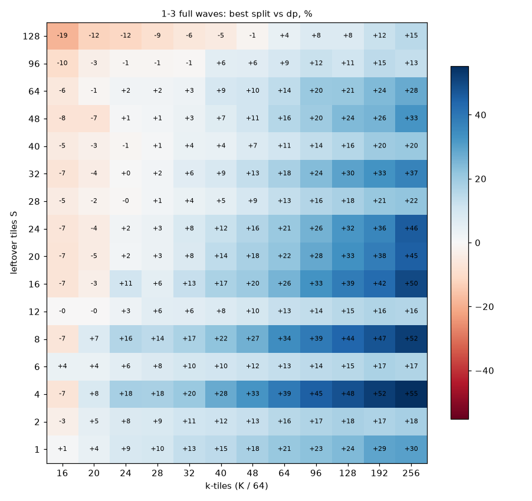
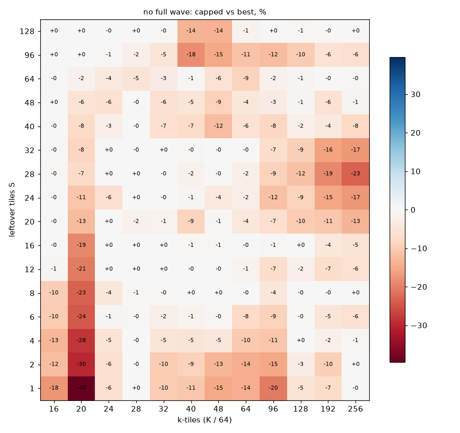
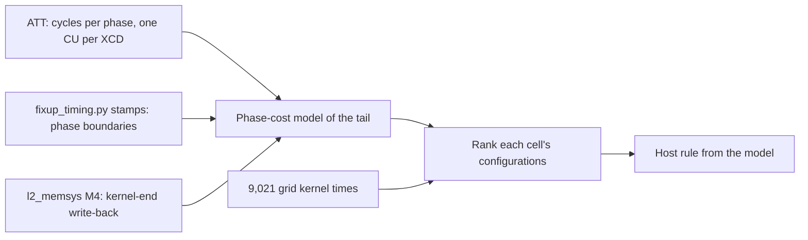

# Split-rule sweep: v20's stream-K tail over S, k-tiles and full waves

Can a systematic grid tell v20's host which tail configuration to run? The grid covers every
configuration over S (leftover tiles), k-tiles and full waves. This experiment times them all, fits
a rule to the winners, and tests that rule unchanged on shapes it has not seen
([v20 WORKLOG entry 9](../../kernels/gemm/intra_wave/a16w16/v20_streamk_reduce_scatter/WORKLOG.md)).

**Outcome: `capped` stays the default.**
- The best fitted rule is a lookup table of the grid's winners, refit after the reduce-scatter
  slice change (below).
- On the grid, cross-validated, it is -1.22% against the best configuration; capped is -2.49%.
- Off-grid shapes timed the same way (cold): it beats capped, -1.17% against -1.72%.
- On the 630 real-model GEMMs timed back to back: it loses, -0.58% against -0.33%. Its short-K
  splits lose to capped's data-parallel there.
- The bar was to beat capped on both validation sets.
- The table stays selectable as `STREAMK_POLICY=split_rule`.

```bash
experiments/streamk_split_rule/run.sh start            # main, repeat, maps, fit (about 20 h on GPU 0)
experiments/streamk_split_rule/run.sh start validate   # off-grid and real-model validation (about 1 h 10 min)
experiments/streamk_split_rule/run.sh start retime2    # what was rerun after the slice change (see below)
experiments/streamk_split_rule/run.sh status           # progress, ETA, last log lines
experiments/streamk_split_rule/run.sh stop
```

`run.sh` sets the published stack (`PYTHONPATH`, both plugins, `HIP_VISIBLE_DEVICES=0`). It
detaches with `setsid nohup`, so a run survives SSH and editor disconnects (these survived
several). A `flock` keeps it to one run at a time. Every stage skips finished cases, so `start`
after a stop or a container restart resumes.

## Method

**Grid** (`sweep.py`, 576 shapes, 9,021 cases):
- **S:** 1, 2, 4, 6, 8, 12, 16, 20, 24, 28, 32, 40, 48, 64, 96, 128.
- **k-tiles:** 16, 20, 24, 28, 32, 40, 48, 64, 96, 128, 192, 256.
- **Three wave classes:**
  - No full wave: M = 512, N = 128 * S (256 x 256 for S = 1), the skinny real-model kind.
  - 1-3 waves and 4-7 waves: within a class, the first wave count whose `256 * waves + S` tiles
    factor into an aspect ratio of at most 2.5. So a prime-ish 257 tiles never becomes 256 x 65792.
- **Per shape:**
  - `dp`;
  - `two_tile` (with a full wave);
  - one-tile reduce-scatter at n in {2, 3, 4, 5, 6, 8, 12, 16, 24, 32};
  - the owner ending at n in {2, 3, 4, 5, 6, 8}, with `S * n <= 256` and `n <= k / 2`;
  - `capped`, `auto`, and the default (policy unset, which is `capped`).

**Timing:**
- Cold rocprof: median kernel time of 1000 launches over a 2048 MB rotating buffer, HIP device 0
  only, with an idle check on GPU 0 before every case (it waited on 18 of the first 9,217 cases).
- Each shape's top 3 configurations, plus capped and auto, were rerun in 2 more processes and the
  median taken. 6 of the 2,401 such rows have fewer than 3 runs, because the ranking moved after
  the last repeat.
- Noise: `default` runs the same kernel as `capped`, and over the 576 shapes they differ by a median
  of 0.17% (p90 0.81%) in the first pass.

**Fitting** (`analysis.py`, [results/fit.md](results/fit.md)). A rule's time on a shape is the
measured time of its pick. Three families were fitted:
- a lookup table of each cell's winner, used through the nearest lower grid cell in S and k;
- the same table, smoothed over neighbouring cells;
- capped's formula with every constant refit.

Each was cross-validated by leaving out one value of S, or one of k, and predicting those shapes.
The best mean cross-validated geomean chose the table.

**Validation**, with the rule written into the kernel's host code (`split_rule_policy`,
`SPLIT_RULE_TABLE`, by `sweep.py install`):
- **49 off-grid shapes:** S = 3, 10, 14, 18, 36, 56, 80; k-tiles = 18, 22, 36, 80, 160; other
  aspect ratios. Timed the same way, every configuration as the median of 3
  ([results/validate.md](results/validate.md)).
- **The 630 real-model shapes,** via `run_v20_vs_aiter.py sweep --v20-only --rule-policy split_rule`,
  timed back to back with `do_bench_cudagraph` ([results/realmodel.md](results/realmodel.md);
  tag `split_rule_v2`).

## The kernel changed under the run, so the reduce-scatter rows were retimed

At about 14:50 UTC on Oct 4, during the first repeat stage, v20's `reduce_scatter_slice` changed to
read in lane order (v20 WORKLOG entry 8). Only the reduce-scatter ending runs that code. The main
pass used the old slice, so the affected rows were timed again on the current kernel:
- **`retime`:** the 2,169 reduce-scatter rows (rs, and capped or auto where they pick it) within 5%
  of their shape's best. The selection assumed the change was worth 1-3%.
- **That held with full waves** (median gain 0.5-3%), **but not without one** (median 7-12%, up to
  18%: on a 20-40 us kernel the slice is a large part of the time). So:
- **`retime2`:** every remaining reduce-scatter row without a full wave, plus 11 rows elsewhere that
  their shape's largest gain could put in reach of its best. 1,111 rows.
- **Then:** the repeats again, the maps and the fit; the refit table installed in the kernel; and
  both validation sets timed again for the new table.
- The old data are in `results/*.pre_lane_order.*`, and the first retime's fit is in
  `results/*.retime1.*`.

The rows left alone are reduce-scatter rows with full waves that are more than 5% behind their
shape's best. They keep old-slice times, at most about 3% pessimistic, and none can take a cell.

## What the grid shows

[results/maps.md](results/maps.md) has every map, with the heatmaps `results/*.png`.



1. **Splitting pays from about 16-24 k-tiles.**
   - With no full wave: from 16 k-tiles for S <= 12, from 20 for S = 16-64, from 28 at S = 96 and
     from 40 at S = 128.
   - With 1-3 waves: from 20-24 k-tiles for small S, 28-32 for S = 28-48, 40 at S = 96 and 64 at
     S = 128.
   - The gain grows with K, to +55% at 1-3 waves.
2. **Reduce-scatter's best n grows with K and falls with S.**
   - S <= 2: 8 at short K, 16 at 32-64 k-tiles, 32 from 96.
   - S = 20-32: 4-5 at short K, 8 at long K.
   - Capped's cap `n <= 128 // S` is too tight at long K: 13-23% behind the best at S = 20-32 with
     no full wave and 128-256 k-tiles.
3. **With no full wave, the owner ending wins only from S = 48** (and at S = 28-40 at 20 k-tiles),
   at n = 2-4. Everywhere else reduce-scatter wins.
4. **Two-tile wins only at S = 1-2 with a full wave and short K, by 1-6%.** It also has a few
   near-ties at larger S. Everywhere else it is behind the best one-tile split, by up to 24%.
5. **Capped is 2.5% behind the best on the grid** (geomean), and 5.9% behind with no full wave.
   Its largest misses are all without a full wave:
   - 16-20 k-tiles, where its minimum-K cut runs dp but a split is 10-40% faster (S <= 32);
   - S <= 6 at 32-96 k-tiles (10-20%);
   - the reduce-scatter cap above;
   - S = 96 at 40-128 k-tiles, where its n = 1 rule runs dp and an owner split at n = 2 is
     10-18% faster.



## Fitting and validation

| rule | grid, cross-validated geomean | off-grid: within 1.5% | geomean | real-model: within 1.5% | geomean |
|---|---:|---:|---:|---:|---:|
| capped | -2.49% (measured) | 38 of 49 | -1.72% | 581 of 630 | -0.33% |
| auto | -10.11% (measured) | 7 | -14.48% | 435 | -5.59% |
| capped's formula, refit | -1.78% | - | - | - | - |
| table (`split_rule`) | -1.22% | 41 | -1.17% | 567 | -0.58% |
| the first table, on the old slice | -1.16% | 35 | -1.94% | 552 | -0.73% |

The gaps are against the best configuration measured in each set. So capped's off-grid and
real-model numbers moved when the new table was timed; capped itself did not change.

- **Cold timing: the table wins off-grid overall.** Against capped it is -2.08% to -3.39% with no
  full wave and -0.03% to -0.44% with 4-7 waves, but slightly behind with 1-3 waves (-0.63% to
  -0.46%).
- **Back to back: the table loses, and the loss is in its short-K splits.**
  - Against capped, the table is ahead by more than 1.5% on 45 real-model shapes, 40 of them at
    64 k-tiles or more.
  - It is behind on 60. Of those, 18 are at 32 k-tiles or fewer, and 15 split where capped runs dp.
  - The worst: 80-112 leftover tiles at 20-28 k-tiles, where an owner split is 9-25% behind dp.
  - The cold grid says those splits win. Back to back they lose, as finding 9 found for two-tile.
- **Cross-validation is consistent with that.** The table scores -0.10% in sample, -0.79% leaving
  out one S and -1.65% leaving out one k. Its weakest prediction is across k, and the short-K edge
  is where the cache state matters most.
- **The real-model timing has fully warm caches.**
  - `do_bench_cudagraph` replays a graph of the same call on the same tensors, with no cache flush,
    so small shapes stay resident in L2 and the 256 MB LLC from one launch to the next.
  - In inference the weights are rarely cache-resident, so this is optimistic, and its verdict
    (the table behind capped) does not describe realistic conditions.
  - Before trusting it, time the same shapes with a rotating buffer, or with `between_launches.py`'s
    modes (a 256 MB read or zero between launches).

## What this leaves open

### Re-check the rules: reduce-scatter has changed

Every constant in the host rules was fitted to a reduce-scatter ending that no longer exists:
- **The crossover between the endings,** `F = 8` (reduce-scatter when `256 // S >= 8`).
  - It came from a flat reduce-scatter ending of about 25 k-steps, against about 10 + 2.2 (n - 1)
    for the owner (v20 entry 1).
  - Entry 8's lane-order slice cut the slice read from about 8 to 4.5-5 us. It made the
    reduce-scatter runs 0.5-3% faster with full waves, and 7-16% faster on small shapes without one.
  - After the retime, reduce-scatter wins almost everywhere below S = 48 with no full wave.
- **The split counts:** `n <= 128 // S` and `n >= max(8, k // 8)` for reduce-scatter, and
  `round(sqrt(k / max(2.2, S / 5)))` for the owner.
- **The minimum-K cut of 20 idle k-steps,** which stands for a split's fixed cost.
- **More is coming:**
  - v21's `l2` and `wt` exchanges cut the barrier from 3-9 us to about 1 us;
  - the slice is still 8-11 us in v21, and its own code (bias, bf16 C stores, dependent adds) is
    the next target.

Refit the rules once the endings stop changing, and validate under more than one cache state.

### Next: a cost model from measured phase costs

Rather than refitting rule constants to a 20-hour grid after every change, measure what each phase
of an ending costs, build the tail time from those costs, and check the result against the kernel
times the grid already holds.



1. **ATT** (`scripts/run_att.py`, `att_target_cu`) on the real kernel, one CU per XCD. Use shapes
   covering reduce-scatter at several n, the owner ending, and short and long K. From the trace,
   per phase:
   - the partial store: issue of the `buffer_store ... sc0 sc1` stream to the `s_waitcnt vmcnt(0)`
     drain;
   - the drain and workgroup barrier;
   - the arrival or flag: `buffer_wbl2`, the atomic and its return;
   - the barrier poll, then `buffer_inv`;
   - the slice: the `.cv` loads and their `vmcnt` waits;
   - the dependent `v_add` chain;
   - the C store.
2. **`fixup_timing.py` stamps** on the same shapes: they cross-check the phase boundaries, and show
   how much the stamps themselves (a barrier and a drain each) inflate the times.
3. **The model:**
   - predicted tail = MAC + store drain + barrier wait + slice + C store, on each tile's slowest
     program;
   - plus the kernel-end write-back of the dirty L2 lines, 1-3 us after the last instruction
     ([experiments/l2_memsys](../l2_memsys/README.md), M4).
4. **Validation against the grid:** 9,021 kernel times, with 3,280 of the reduce-scatter rows on the
   current slice.
   - Does the model rank each cell's configurations the way the measured times do?
   - Where it does not, the gap measures overlap or contention that per-wave cycles miss.
5. **Limits:**
   - **Not additive.** A wave's cycles don't add up to kernel time: other waves overlap its stalls,
     and the barrier waits for the tile's slowest program, which may be on another CU.
   - **Clocks.** ATT counts shader clocks, which vary under the 1.4 kW power cap. Convert with the
     measured clock, or check against `s_memrealtime` (a constant 100 MHz).
   - **Write-back.** The write-back after `s_endpgm` is invisible to ATT, so it comes from kernel
     timing.
   - **The payoff:** when an ending changes, re-measure that phase rather than rerun the grid.

### Other open points

- **A rule tuned on one cache state does not transfer to another.** The off-grid and real-model
  sets disagree mainly at short K. A grid run with `do_bench_cudagraph` would give the
  back-to-back maps; it runs in-process, about 10x faster once compiled.
- **The data point to a combination:** the table's long-K splits (they win under both timings) and
  capped's dp at short K. It would need its own validation, on new shapes, because these validation
  sets suggested it.
- **Capped's constants are not optimal on the grid.** The refit formula cross-validates at -1.78%
  against capped's -2.49% ([results/fit.md](results/fit.md)) and has not been validated.
- **Two-tile is worth a branch only at S <= 2 with a full wave and short K.**

## Files

- `sweep.py`: the grid, the cases, cold timing, repeats, the two retime passes, status.
- `analysis.py`: maps, fitting, `install`, validation.
- `run.sh`: the detached driver.
- `results/main.jsonl`: 9,021 grid rows, 3,280 of them retimed on the current slice
  (`retimed`, `us_old`).
- `results/validate.jsonl`: 196 off-grid rows.
- `results/rule.json`: the fitted table, installed as `SPLIT_RULE_TABLE`.
- `results/check_streamk_{1,2,3}.md`: correctness of the first table, 52 configurations. The second
  table runs the same code paths; its 49 off-grid and 630 real-model runs are all correct, with
  flags re-armed.
- The real-model runs: `experiments/aiter_lixun_shapes/results/details_split_rule_v2.csv` (current
  table) and `details_split_rule.csv` (first table).
