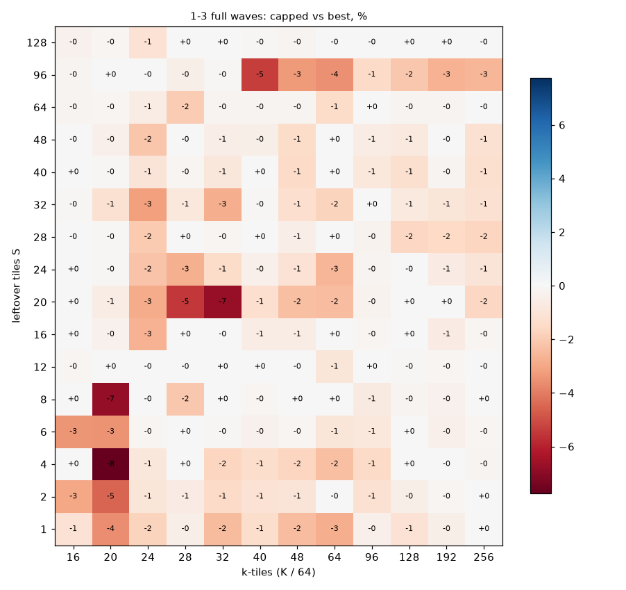
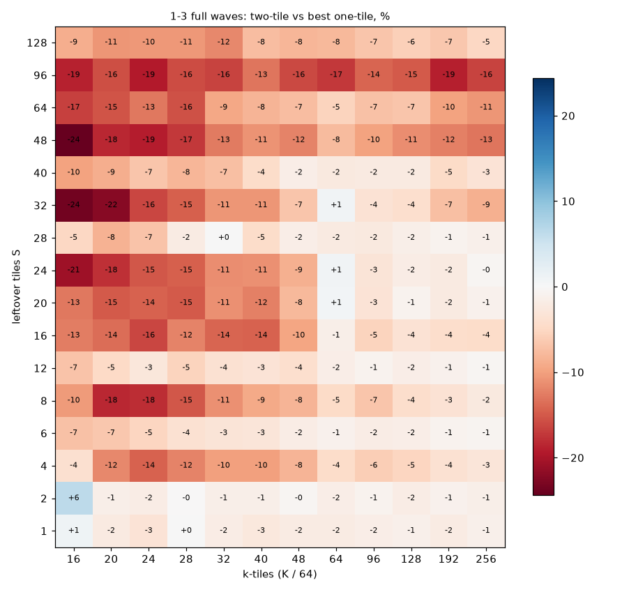
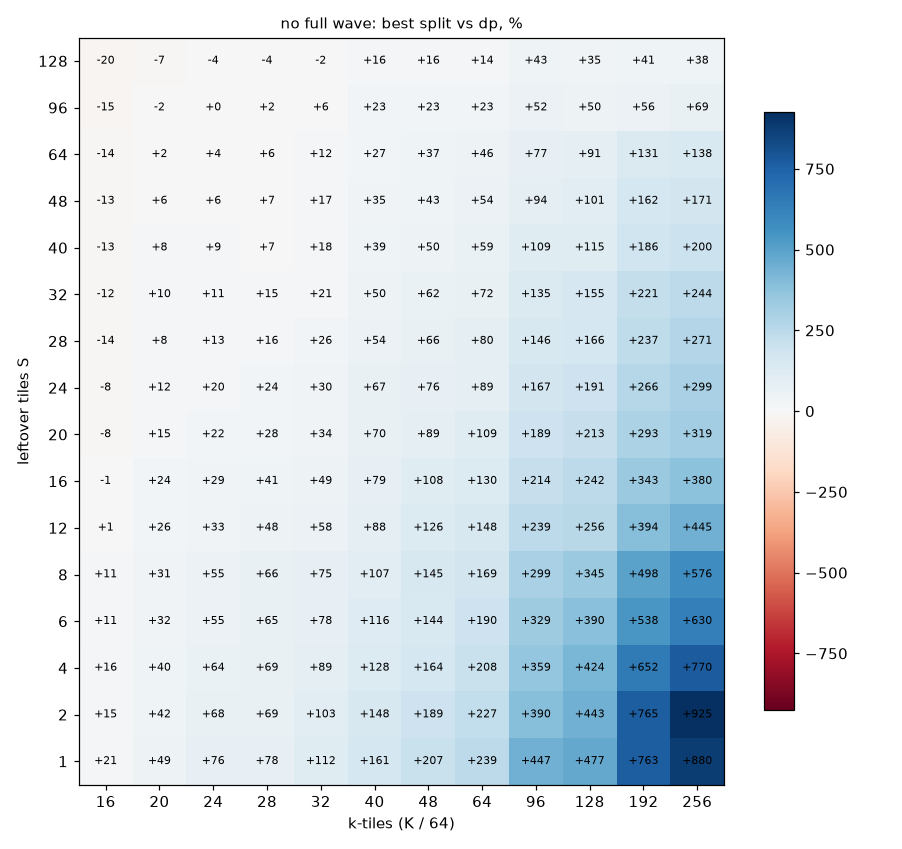
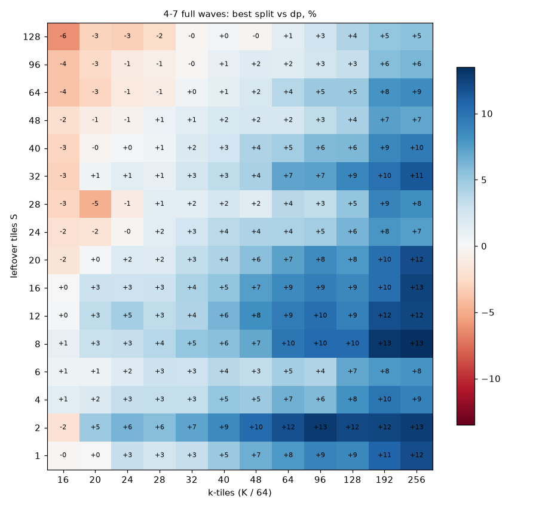
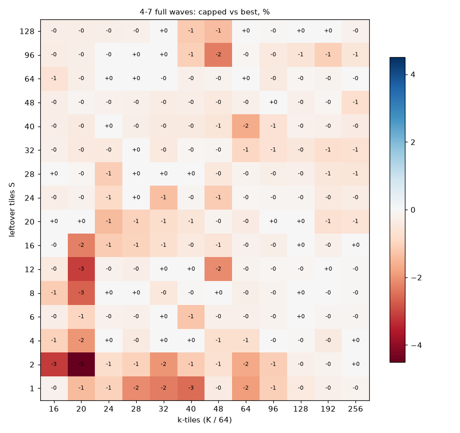
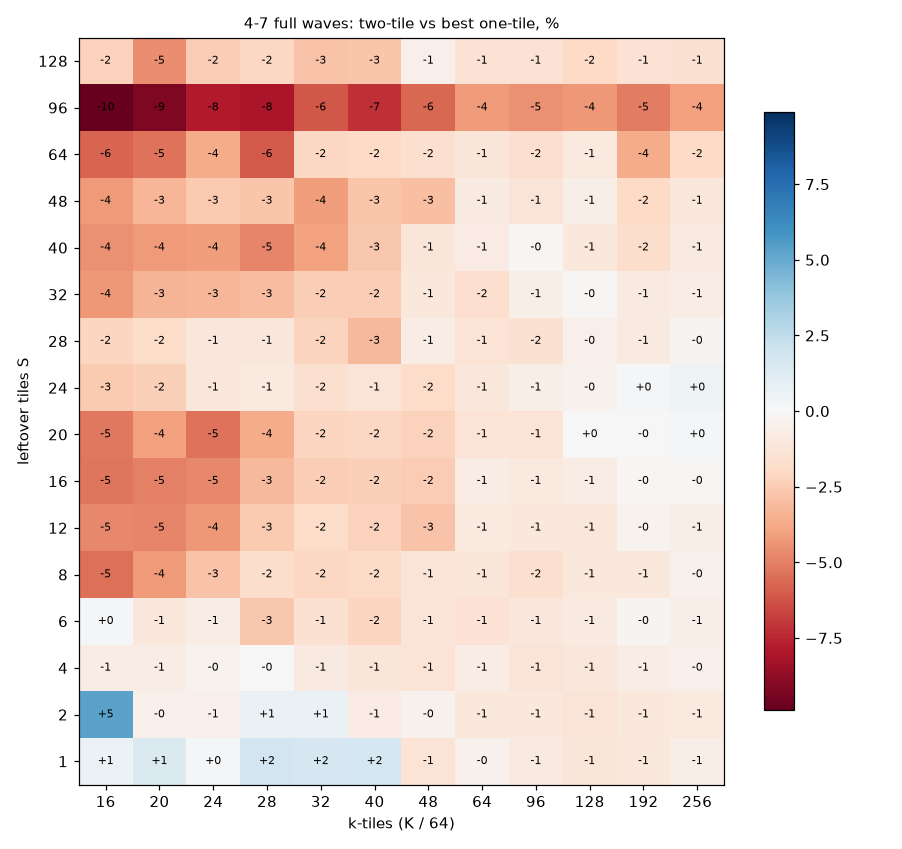

# Split-rule sweep: maps

Generated by `sweep.py maps` from `results/main.jsonl`. v20, bf16, no bias, v9 tile order, HIP device 0, cold rocprof (median kernel time of 1000 launches over a 2048 MB rotating buffer); where a configuration was repeated (each shape's top 3, capped and auto), the median of 3 processes. Configurations: `dp`, `2T` (two-tile), `rsN` (one-tile reduce-scatter on N programs per leftover tile), `owN` (one-tile, owner ending).

## 1-3 full waves

#### Winner (fastest grid configuration)

| S \ k-tiles | 16 | 20 | 24 | 28 | 32 | 40 | 48 | 64 | 96 | 128 | 192 | 256 |
|---|---:|---:|---:|---:|---:|---:|---:|---:|---:|---:|---:|---:|
| 1 | 2T | rs8 | rs12 | 2T | rs16 | rs16 | rs24 | rs32 | rs12 | rs32 | rs32 | rs32 |
| 2 | 2T | rs8 | rs12 | rs12 | rs16 | rs16 | rs16 | rs32 | rs32 | rs32 | rs32 | rs32 |
| 4 | dp | rs8 | rs12 | rs8 | rs16 | rs16 | rs16 | rs16 | rs16 | rs12 | rs32 | rs32 |
| 6 | rs8 | rs8 | rs12 | rs8 | rs16 | rs8 | rs8 | rs16 | rs6 | rs16 | rs16 | rs12 |
| 8 | dp | rs8 | rs8 | rs8 | rs8 | rs8 | rs8 | rs8 | rs8 | rs8 | rs8 | rs16 |
| 12 | dp | dp | rs8 | rs8 | rs8 | rs6 | rs8 | rs5 | rs8 | rs8 | rs12 | rs12 |
| 16 | dp | dp | rs4 | rs5 | rs4 | rs5 | rs6 | rs6 | rs6 | rs8 | rs6 | rs8 |
| 20 | dp | dp | rs4 | ow3 | rs4 | rs4 | rs4 | 2T | rs8 | rs6 | rs6 | rs8 |
| 24 | dp | dp | ow3 | rs4 | rs4 | rs4 | rs4 | 2T | rs4 | rs5 | rs6 | rs8 |
| 28 | dp | dp | dp | ow2 | 2T | rs4 | rs4 | rs4 | rs5 | ow4 | rs6 | rs8 |
| 32 | dp | dp | ow3 | rs4 | ow3 | ow3 | rs4 | 2T | rs4 | rs5 | ow5 | rs8 |
| 40 | dp | dp | dp | ow2 | ow3 | ow2 | ow3 | ow3 | rs4 | ow3 | rs6 | rs6 |
| 48 | dp | dp | ow2 | ow2 | ow2 | ow3 | ow3 | ow3 | ow4 | ow4 | ow4 | ow5 |
| 64 | dp | dp | ow2 | ow2 | ow3 | ow2 | ow3 | ow3 | ow3 | ow3 | ow4 | ow4 |
| 96 | dp | dp | dp | dp | dp | ow2 | ow2 | ow2 | ow2 | ow2 | ow2 | ow2 |
| 128 | dp | dp | dp | dp | dp | dp | dp | ow2 | ow2 | ow2 | ow2 | ow2 |

#### Best one-tile split against dp, %

Positive: splitting pays. The boundary of the positive region is k_min(S).

| S \ k-tiles | 16 | 20 | 24 | 28 | 32 | 40 | 48 | 64 | 96 | 128 | 192 | 256 |
|---|---:|---:|---:|---:|---:|---:|---:|---:|---:|---:|---:|---:|
| 1 | +0.8 | +4.0 | +8.7 | +9.6 | +13.2 | +14.6 | +17.9 | +21.1 | +22.5 | +24.5 | +28.9 | +29.9 |
| 2 | -3.3 | +4.8 | +7.8 | +8.6 | +11.1 | +11.6 | +12.7 | +15.5 | +16.7 | +17.9 | +17.2 | +18.3 |
| 4 | -7.3 | +8.5 | +18.2 | +17.9 | +20.5 | +27.8 | +32.8 | +38.9 | +45.0 | +48.3 | +51.8 | +55.2 |
| 6 | +3.8 | +3.6 | +6.0 | +8.0 | +9.6 | +10.5 | +11.9 | +12.9 | +14.4 | +15.3 | +17.3 | +16.5 |
| 8 | -6.5 | +7.5 | +16.0 | +14.4 | +17.3 | +22.0 | +26.6 | +34.4 | +39.0 | +43.9 | +47.5 | +52.0 |
| 12 | -0.3 | -0.3 | +2.7 | +5.7 | +6.3 | +7.7 | +9.6 | +12.6 | +13.5 | +15.4 | +16.5 | +16.3 |
| 16 | -7.1 | -3.4 | +10.6 | +5.6 | +12.7 | +17.5 | +19.9 | +25.5 | +32.8 | +38.6 | +42.4 | +49.8 |
| 20 | -7.0 | -4.7 | +1.6 | +3.1 | +8.1 | +13.9 | +18.0 | +21.8 | +28.1 | +33.4 | +38.0 | +44.9 |
| 24 | -6.8 | -4.3 | +1.9 | +3.2 | +8.4 | +12.4 | +16.3 | +20.6 | +26.1 | +32.2 | +36.0 | +45.7 |
| 28 | -4.6 | -2.1 | -0.5 | +1.3 | +3.5 | +5.3 | +9.4 | +13.1 | +16.4 | +17.8 | +20.8 | +22.0 |
| 32 | -7.1 | -4.2 | +0.0 | +1.6 | +6.3 | +8.7 | +13.2 | +17.9 | +23.7 | +29.5 | +33.0 | +37.0 |
| 40 | -4.8 | -2.9 | -0.9 | +0.7 | +3.8 | +4.1 | +7.4 | +10.7 | +13.8 | +15.8 | +19.6 | +20.4 |
| 48 | -7.6 | -7.4 | +0.8 | +1.3 | +3.4 | +6.9 | +10.5 | +15.8 | +19.5 | +24.2 | +25.7 | +32.7 |
| 64 | -5.8 | -1.2 | +1.8 | +2.0 | +3.0 | +9.3 | +10.5 | +14.0 | +20.4 | +20.8 | +24.5 | +27.8 |
| 96 | -9.6 | -3.2 | -1.0 | -1.2 | -0.8 | +5.9 | +6.1 | +9.3 | +12.5 | +10.9 | +14.6 | +13.4 |
| 128 | -18.8 | -12.1 | -11.5 | -8.8 | -6.4 | -5.0 | -1.4 | +4.2 | +7.6 | +7.7 | +12.3 | +14.8 |

#### Best reduce-scatter n

| S \ k-tiles | 16 | 20 | 24 | 28 | 32 | 40 | 48 | 64 | 96 | 128 | 192 | 256 |
|---|---:|---:|---:|---:|---:|---:|---:|---:|---:|---:|---:|---:|
| 1 | 4 | 8 | 12 | 12 | 16 | 16 | 24 | 32 | 12 | 32 | 32 | 32 |
| 2 | 4 | 8 | 12 | 12 | 16 | 16 | 16 | 32 | 32 | 32 | 32 | 32 |
| 4 | 8 | 8 | 12 | 8 | 16 | 16 | 16 | 16 | 16 | 12 | 32 | 32 |
| 6 | 8 | 8 | 12 | 8 | 16 | 8 | 8 | 16 | 6 | 16 | 16 | 12 |
| 8 | 4 | 8 | 8 | 8 | 8 | 8 | 8 | 8 | 8 | 8 | 8 | 16 |
| 12 | 8 | 5 | 8 | 8 | 8 | 6 | 8 | 5 | 8 | 8 | 12 | 12 |
| 16 | 4 | 4 | 4 | 5 | 4 | 5 | 6 | 6 | 6 | 8 | 6 | 8 |
| 20 | 4 | 5 | 4 | 4 | 4 | 4 | 4 | 4 | 8 | 6 | 6 | 8 |
| 24 | 4 | 4 | 4 | 4 | 4 | 4 | 4 | 4 | 4 | 5 | 6 | 8 |
| 28 | 4 | 4 | 4 | 4 | 4 | 4 | 4 | 4 | 5 | 6 | 6 | 8 |
| 32 | 4 | 4 | 4 | 4 | 4 | 4 | 4 | 5 | 4 | 5 | 4 | 8 |
| 40 | 2 | 2 | 4 | 4 | 4 | 4 | 4 | 4 | 4 | 3 | 6 | 6 |
| 48 | 2 | 2 | 2 | 4 | 2 | 4 | 4 | 4 | 4 | 4 | 5 | 5 |
| 64 | 2 | 2 | 2 | 2 | 2 | 4 | 4 | 4 | 4 | 4 | 4 | 4 |
| 96 | 2 | 2 | 2 | 2 | 2 | 2 | 2 | 2 | 2 | 2 | 2 | 2 |
| 128 | 2 | 2 | 2 | 2 | 2 | 2 | 2 | 2 | 2 | 2 | 2 | 2 |

#### Best owner n

| S \ k-tiles | 16 | 20 | 24 | 28 | 32 | 40 | 48 | 64 | 96 | 128 | 192 | 256 |
|---|---:|---:|---:|---:|---:|---:|---:|---:|---:|---:|---:|---:|
| 1 | 2 | 3 | 3 | 3 | 3 | 5 | 4 | 4 | 6 | 5 | 5 | 8 |
| 2 | 2 | 3 | 3 | 3 | 3 | 5 | 5 | 5 | 5 | 4 | 8 | 8 |
| 4 | 3 | 3 | 3 | 3 | 5 | 4 | 4 | 5 | 5 | 6 | 8 | 8 |
| 6 | 2 | 3 | 3 | 3 | 3 | 4 | 3 | 4 | 4 | 8 | 8 | 6 |
| 8 | 2 | 3 | 3 | 3 | 3 | 4 | 4 | 4 | 6 | 6 | 8 | 8 |
| 12 | 2 | 3 | 3 | 3 | 3 | 4 | 4 | 4 | 6 | 6 | 8 | 8 |
| 16 | 2 | 3 | 4 | 3 | 3 | 4 | 4 | 4 | 6 | 6 | 6 | 6 |
| 20 | 2 | 2 | 3 | 3 | 3 | 3 | 3 | 4 | 4 | 5 | 5 | 6 |
| 24 | 2 | 2 | 3 | 2 | 3 | 3 | 3 | 4 | 4 | 5 | 5 | 5 |
| 28 | 2 | 2 | 2 | 2 | 3 | 3 | 3 | 4 | 4 | 4 | 5 | 6 |
| 32 | 2 | 3 | 3 | 2 | 3 | 3 | 3 | 3 | 4 | 4 | 5 | 6 |
| 40 | 2 | 2 | 2 | 2 | 3 | 2 | 3 | 3 | 4 | 3 | 5 | 5 |
| 48 | 2 | 2 | 2 | 2 | 2 | 3 | 3 | 3 | 4 | 4 | 4 | 5 |
| 64 | 2 | 2 | 2 | 2 | 3 | 2 | 3 | 3 | 3 | 3 | 4 | 4 |
| 96 | 2 | 2 | 2 | 2 | 2 | 2 | 2 | 2 | 2 | 2 | 2 | 2 |
| 128 | 2 | 2 | 2 | 2 | 2 | 2 | 2 | 2 | 2 | 2 | 2 | 2 |

#### Best reduce-scatter against best owner, %

| S \ k-tiles | 16 | 20 | 24 | 28 | 32 | 40 | 48 | 64 | 96 | 128 | 192 | 256 |
|---|---:|---:|---:|---:|---:|---:|---:|---:|---:|---:|---:|---:|
| 1 | +8.7 | +8.0 | +11.5 | +11.1 | +12.1 | +9.7 | +11.4 | +11.6 | +7.9 | +7.5 | +5.6 | +5.0 |
| 2 | +1.0 | +6.7 | +8.0 | +7.9 | +8.1 | +6.7 | +6.2 | +5.4 | +3.5 | +4.7 | +3.8 | +3.4 |
| 4 | +1.5 | +13.0 | +19.2 | +18.1 | +15.9 | +15.1 | +14.8 | +14.0 | +12.9 | +11.9 | +8.7 | +7.1 |
| 6 | +6.5 | +3.9 | +4.7 | +5.5 | +4.9 | +4.9 | +4.3 | +3.0 | +2.1 | +3.4 | +3.3 | +2.7 |
| 8 | -0.6 | +9.0 | +12.7 | +10.9 | +6.4 | +9.9 | +9.3 | +10.0 | +8.5 | +8.2 | +5.1 | +4.8 |
| 12 | +2.7 | +1.8 | +2.7 | +3.6 | +2.6 | +2.6 | +2.7 | +2.3 | +0.7 | +2.7 | +2.2 | +2.0 |
| 16 | -1.8 | -4.6 | +8.7 | +1.5 | +3.3 | +6.4 | +4.3 | +4.1 | +5.0 | +4.8 | +2.2 | +1.8 |
| 20 | -6.0 | -4.3 | +2.4 | -0.0 | +1.0 | +4.3 | +4.1 | +3.4 | +2.4 | +2.6 | +2.3 | +1.8 |
| 24 | -7.7 | -7.3 | -5.4 | +1.1 | +1.7 | +3.1 | +3.2 | +2.1 | +1.1 | +1.8 | +0.9 | +1.8 |
| 28 | -5.4 | -6.3 | -0.6 | -0.2 | -0.1 | +0.3 | +1.6 | +1.5 | +1.2 | -1.0 | +1.4 | +1.2 |
| 32 | -10.0 | -10.0 | -0.5 | +0.2 | -5.9 | -0.3 | +0.8 | +0.3 | +0.4 | +1.0 | -0.5 | +1.4 |
| 40 | -7.4 | -7.6 | -5.8 | -1.7 | -1.7 | -1.5 | -1.1 | -0.2 | +0.4 | -1.2 | +0.3 | +0.4 |
| 48 | -14.8 | -10.3 | -10.2 | -8.8 | -8.9 | -7.6 | -6.6 | -3.2 | -1.2 | -0.9 | -0.1 | -1.5 |
| 64 | -16.8 | -12.6 | -13.1 | -11.4 | -10.6 | -8.8 | -7.1 | -6.2 | -3.2 | -1.6 | -1.2 | -0.1 |
| 96 | -18.5 | -16.0 | -16.1 | -14.1 | -13.7 | -13.0 | -10.6 | -10.0 | -5.6 | -3.9 | -3.7 | -2.0 |
| 128 | -18.9 | -20.3 | -19.2 | -17.3 | -17.5 | -13.5 | -13.5 | -11.3 | -6.6 | -3.9 | -5.0 | -3.8 |

#### Two-tile against the best one-tile split, %

| S \ k-tiles | 16 | 20 | 24 | 28 | 32 | 40 | 48 | 64 | 96 | 128 | 192 | 256 |
|---|---:|---:|---:|---:|---:|---:|---:|---:|---:|---:|---:|---:|
| 1 | +1.0 | -2.2 | -3.3 | +0.0 | -1.8 | -2.7 | -2.0 | -1.9 | -1.7 | -1.2 | -1.9 | -1.1 |
| 2 | +6.4 | -1.5 | -1.9 | -0.0 | -1.5 | -1.4 | -0.5 | -1.6 | -0.9 | -1.9 | -1.1 | -1.4 |
| 4 | -3.9 | -11.7 | -14.3 | -12.0 | -10.1 | -9.9 | -8.3 | -4.5 | -6.0 | -5.2 | -3.7 | -3.0 |
| 6 | -7.0 | -6.6 | -5.3 | -3.8 | -3.1 | -2.9 | -1.9 | -1.1 | -1.9 | -1.5 | -0.8 | -0.6 |
| 8 | -10.5 | -18.3 | -18.1 | -15.1 | -11.2 | -9.3 | -8.3 | -4.6 | -6.8 | -4.2 | -3.5 | -2.4 |
| 12 | -6.9 | -4.9 | -2.7 | -5.4 | -3.7 | -3.3 | -4.2 | -1.6 | -0.9 | -1.7 | -1.0 | -0.5 |
| 16 | -12.5 | -13.7 | -16.3 | -12.0 | -14.2 | -14.4 | -9.6 | -1.5 | -5.4 | -3.5 | -4.2 | -4.5 |
| 20 | -12.8 | -14.9 | -14.5 | -14.9 | -11.1 | -12.3 | -8.0 | +0.7 | -3.3 | -0.8 | -2.1 | -1.0 |
| 24 | -20.7 | -17.9 | -15.2 | -14.6 | -11.3 | -11.0 | -8.7 | +0.8 | -3.2 | -1.8 | -2.2 | -0.4 |
| 28 | -5.0 | -8.5 | -6.9 | -1.9 | +0.1 | -4.5 | -1.6 | -2.2 | -2.4 | -1.5 | -0.9 | -1.2 |
| 32 | -23.5 | -22.3 | -16.2 | -14.7 | -10.8 | -10.7 | -6.8 | +0.9 | -3.6 | -4.1 | -7.4 | -8.7 |
| 40 | -9.9 | -8.8 | -6.7 | -8.1 | -7.2 | -4.4 | -1.5 | -2.4 | -2.1 | -2.1 | -4.6 | -3.3 |
| 48 | -24.4 | -18.4 | -19.1 | -17.3 | -12.6 | -11.0 | -12.2 | -7.8 | -9.9 | -11.3 | -12.3 | -13.1 |
| 64 | -16.7 | -15.4 | -12.9 | -15.6 | -9.4 | -8.3 | -7.5 | -5.3 | -7.2 | -6.7 | -9.8 | -10.8 |
| 96 | -18.8 | -15.7 | -19.4 | -15.9 | -16.4 | -13.0 | -16.1 | -17.2 | -14.1 | -15.0 | -18.9 | -16.4 |
| 128 | -8.8 | -10.7 | -10.5 | -10.6 | -11.6 | -7.5 | -8.0 | -7.9 | -6.8 | -5.9 | -6.6 | -5.1 |

#### capped against the best configuration, %

| S \ k-tiles | 16 | 20 | 24 | 28 | 32 | 40 | 48 | 64 | 96 | 128 | 192 | 256 |
|---|---:|---:|---:|---:|---:|---:|---:|---:|---:|---:|---:|---:|
| 1 | -1.1 | -3.6 | -1.7 | -0.5 | -2.4 | -1.4 | -2.4 | -2.8 | -0.4 | -1.1 | -0.5 | +0.0 |
| 2 | -3.0 | -4.5 | -0.9 | -0.6 | -1.5 | -1.1 | -1.0 | -0.0 | -1.2 | -0.5 | -0.2 | +0.0 |
| 4 | +0.0 | -7.7 | -0.9 | +0.0 | -1.7 | -1.4 | -1.7 | -2.4 | -1.5 | +0.0 | -0.0 | -0.2 |
| 6 | -3.4 | -3.5 | -0.1 | +0.0 | -0.1 | -0.3 | -0.2 | -0.9 | -0.8 | +0.0 | -0.4 | -0.2 |
| 8 | +0.0 | -6.8 | -0.0 | -2.1 | +0.0 | -0.1 | +0.0 | +0.0 | -0.7 | -0.2 | -0.4 | +0.0 |
| 12 | -0.1 | +0.0 | -0.0 | -0.0 | +0.0 | +0.0 | -0.0 | -0.9 | +0.0 | -0.1 | -0.2 | -0.0 |
| 16 | +0.0 | -0.3 | -2.7 | +0.0 | -0.1 | -0.6 | -0.6 | +0.0 | -0.1 | +0.0 | -0.6 | -0.1 |
| 20 | +0.0 | -0.6 | -2.9 | -5.5 | -6.7 | -1.3 | -2.3 | -2.4 | -0.3 | +0.0 | +0.0 | -1.6 |
| 24 | +0.0 | -0.1 | -2.2 | -2.7 | -1.4 | -0.4 | -1.1 | -2.6 | -0.2 | -0.0 | -0.6 | -1.0 |
| 28 | -0.1 | -0.1 | -2.0 | +0.0 | -0.2 | +0.0 | -0.5 | +0.0 | -0.3 | -1.6 | -1.6 | -1.7 |
| 32 | -0.1 | -1.2 | -3.2 | -0.8 | -2.8 | -0.1 | -1.3 | -1.7 | +0.0 | -0.8 | -0.9 | -1.2 |
| 40 | +0.0 | -0.1 | -1.0 | -0.2 | -0.9 | +0.0 | -1.5 | +0.0 | -0.8 | -1.2 | -0.2 | -1.2 |
| 48 | -0.0 | -0.4 | -2.1 | -0.1 | -0.5 | -0.4 | -1.4 | +0.0 | -0.6 | -0.7 | -0.1 | -1.2 |
| 64 | -0.2 | -0.1 | -0.6 | -2.0 | -0.2 | -0.2 | -0.2 | -1.4 | +0.0 | -0.2 | -0.2 | -0.0 |
| 96 | -0.2 | +0.0 | -0.1 | -0.5 | -0.1 | -5.3 | -3.3 | -3.5 | -1.5 | -2.1 | -2.7 | -2.6 |
| 128 | -0.3 | -0.1 | -1.1 | +0.0 | +0.0 | -0.1 | -0.2 | -0.0 | -0.0 | +0.0 | +0.0 | -0.0 |

#### auto against the best configuration, %

| S \ k-tiles | 16 | 20 | 24 | 28 | 32 | 40 | 48 | 64 | 96 | 128 | 192 | 256 |
|---|---:|---:|---:|---:|---:|---:|---:|---:|---:|---:|---:|---:|
| 1 | +0.0 | -2.2 | -3.4 | -0.4 | -1.5 | -2.6 | -1.9 | -1.3 | -1.3 | -0.9 | -1.7 | -1.4 |
| 2 | +0.0 | -1.7 | -2.1 | -0.1 | -1.7 | -1.5 | -0.5 | -1.5 | -0.6 | -1.7 | -0.7 | -1.3 |
| 4 | -11.2 | -13.4 | -14.8 | -13.1 | -9.7 | -9.9 | -8.1 | -4.2 | -5.9 | -6.2 | -3.7 | -3.3 |
| 6 | -7.1 | -6.3 | -5.3 | -3.5 | -3.1 | -3.1 | -2.3 | -1.3 | -2.0 | -1.8 | -0.9 | -0.2 |
| 8 | -16.3 | -18.3 | -17.6 | -14.8 | -11.6 | -9.2 | -8.5 | -4.9 | -7.0 | -4.3 | -3.5 | -1.7 |
| 12 | -7.3 | -5.1 | -2.8 | -4.1 | -3.4 | -3.1 | -4.3 | -1.8 | -0.9 | -1.6 | -0.6 | -0.5 |
| 16 | -18.8 | -16.2 | -16.4 | -12.3 | -14.5 | -14.3 | -9.2 | -1.8 | -5.4 | -4.6 | -3.7 | -4.3 |
| 20 | -18.9 | -18.9 | -14.1 | -15.1 | -10.6 | -12.2 | -7.6 | -0.1 | -3.1 | -1.2 | -2.4 | -2.2 |
| 24 | -23.5 | -21.7 | -15.4 | -14.8 | -11.6 | -11.4 | -8.8 | +0.0 | -3.4 | -2.1 | -1.8 | -1.4 |
| 28 | -9.7 | -10.5 | -7.3 | -2.4 | -0.1 | -4.7 | -1.6 | -2.4 | -2.4 | -1.6 | -1.6 | -1.1 |
| 32 | -29.0 | -25.6 | -16.2 | -14.7 | -10.9 | -10.7 | -6.5 | +0.0 | -3.9 | -3.5 | -2.0 | -0.0 |
| 40 | -23.1 | -19.4 | -15.1 | -11.8 | -11.3 | -8.2 | -7.5 | -5.7 | -2.9 | -3.1 | -1.5 | -1.2 |
| 48 | -31.0 | -23.2 | -18.0 | -15.7 | -15.8 | -11.1 | -11.6 | -9.3 | -3.6 | -2.6 | -2.1 | -1.0 |
| 64 | -19.6 | -9.5 | -8.3 | -6.7 | -5.5 | -3.5 | -1.8 | -2.7 | -0.5 | -1.1 | +0.0 | -0.6 |
| 96 | -15.0 | -5.3 | -4.1 | -4.5 | -4.5 | -1.7 | -3.4 | -4.1 | -1.5 | -1.8 | -2.8 | -2.8 |
| 128 | -15.1 | -11.4 | -11.5 | -7.8 | -6.5 | -4.1 | -1.0 | -0.6 | -0.2 | -0.1 | -0.1 | -0.3 |

#### Process-to-process spread, %

Median over the repeated configurations of slowest/fastest - 1.

| S \ k-tiles | 16 | 20 | 24 | 28 | 32 | 40 | 48 | 64 | 96 | 128 | 192 | 256 |
|---|---:|---:|---:|---:|---:|---:|---:|---:|---:|---:|---:|---:|
| 1 | 0.8 | 0.2 | 0.2 | 0.6 | 0.3 | 0.2 | 0.2 | 1.0 | 0.5 | 0.1 | 0.2 | 0.5 |
| 2 | 0.3 | 0.3 | 0.5 | 0.6 | 0.3 | 0.4 | 0.2 | 0.2 | 0.3 | 0.1 | 0.3 | 0.4 |
| 4 | 0.3 | 0.5 | 0.7 | 2.4 | 2.0 | 0.4 | 0.9 | 0.3 | 0.2 | 0.5 | 0.3 | 0.2 |
| 6 | 0.4 | 0.3 | 0.8 | 0.6 | 0.4 | 0.5 | 0.5 | 0.2 | 0.2 | 0.2 | 0.3 | 0.8 |
| 8 | 0.1 | 0.8 | 1.2 | 1.6 | 1.3 | 0.6 | 0.3 | 0.8 | 0.4 | 0.7 | 0.3 | 0.2 |
| 12 | 0.3 | 0.5 | 0.7 | 0.7 | 0.5 | 0.2 | 0.3 | 0.6 | 0.2 | 0.2 | 0.2 | 0.2 |
| 16 | 0.3 | 0.8 | 1.7 | 0.6 | 1.8 | 0.6 | 0.8 | 1.1 | 0.6 | 0.3 | 0.4 | 4.8 |
| 20 | 0.2 | 0.9 | 1.2 | 0.9 | 1.2 | 1.1 | 1.3 | 0.5 | 0.8 | 0.8 | 0.9 | 0.4 |
| 24 | 0.2 | 0.2 | 0.9 | 1.2 | 0.3 | 0.5 | 0.4 | 0.6 | 0.7 | 0.5 | 0.4 | 0.3 |
| 28 | 0.4 | 0.1 | 0.6 | 0.6 | 0.2 | 0.8 | 0.3 | 0.2 | 0.2 | 0.8 | 0.2 | 0.4 |
| 32 | 0.3 | 0.6 | 1.3 | 0.6 | 0.4 | 0.6 | 0.6 | 0.2 | 0.3 | 0.6 | 0.4 | 0.2 |
| 40 | 0.3 | 0.2 | 0.5 | 0.8 | 0.5 | 0.2 | 0.1 | 0.4 | 0.3 | 0.2 | 0.1 | 0.2 |
| 48 | 0.4 | 1.7 | 3.1 | 0.3 | 0.6 | 0.2 | 0.2 | 0.6 | 0.4 | 1.9 | 0.4 | 0.4 |
| 64 | 0.3 | 0.3 | 0.7 | 0.2 | 0.5 | 0.3 | 0.5 | 0.5 | 0.6 | 1.5 | 0.2 | 0.8 |
| 96 | 0.6 | 0.4 | 0.5 | 0.9 | 0.2 | 0.4 | 0.9 | 0.8 | 0.3 | 0.6 | 1.1 | 0.6 |
| 128 | 0.5 | 1.6 | 1.4 | 0.4 | 0.3 | 0.3 | 0.6 | 1.5 | 0.3 | 0.3 | 0.2 | 0.7 |

## no full wave

#### Winner (fastest grid configuration)

| S \ k-tiles | 16 | 20 | 24 | 28 | 32 | 40 | 48 | 64 | 96 | 128 | 192 | 256 |
|---|---:|---:|---:|---:|---:|---:|---:|---:|---:|---:|---:|---:|
| 1 | rs8 | rs8 | rs12 | rs8 | rs16 | rs16 | rs24 | rs16 | rs32 | rs32 | rs32 | rs32 |
| 2 | rs8 | rs8 | rs12 | rs8 | rs16 | rs16 | rs24 | rs16 | rs32 | rs32 | rs32 | rs32 |
| 4 | rs8 | rs8 | rs12 | rs8 | rs16 | rs12 | rs24 | rs16 | rs16 | rs16 | rs32 | rs32 |
| 6 | rs8 | rs5 | rs12 | rs8 | rs16 | rs12 | rs8 | rs16 | rs16 | rs16 | rs16 | rs16 |
| 8 | rs8 | rs6 | rs12 | rs8 | rs8 | rs8 | rs8 | rs16 | rs16 | rs16 | rs16 | rs16 |
| 12 | rs8 | rs5 | rs8 | rs8 | rs8 | rs8 | rs8 | rs8 | rs12 | rs8 | rs12 | rs16 |
| 16 | dp | rs5 | rs6 | rs8 | rs8 | rs5 | rs8 | rs8 | rs8 | rs8 | rs12 | rs12 |
| 20 | dp | rs5 | rs6 | rs5 | rs5 | rs5 | rs8 | rs8 | rs8 | rs8 | rs8 | rs8 |
| 24 | dp | rs5 | rs4 | rs5 | rs4 | rs5 | rs6 | rs8 | rs8 | rs8 | rs8 | rs8 |
| 28 | dp | ow3 | rs4 | rs5 | rs4 | rs5 | rs4 | rs5 | rs8 | rs8 | rs8 | rs8 |
| 32 | dp | ow3 | rs4 | rs4 | rs4 | rs5 | rs4 | rs5 | rs6 | rs6 | rs8 | rs8 |
| 40 | dp | ow3 | ow3 | ow2 | ow3 | rs4 | rs4 | ow4 | rs6 | rs5 | rs6 | rs6 |
| 48 | dp | ow3 | ow3 | ow2 | ow3 | ow4 | ow4 | ow4 | ow4 | ow4 | ow5 | ow5 |
| 64 | dp | ow3 | ow2 | ow2 | ow3 | ow2 | ow3 | ow3 | ow3 | ow4 | ow4 | ow4 |
| 96 | dp | dp | ow2 | ow2 | ow2 | ow2 | ow2 | ow2 | ow2 | ow2 | ow2 | ow2 |
| 128 | dp | dp | dp | dp | dp | ow2 | ow2 | ow2 | ow2 | ow2 | ow2 | ow2 |

#### Best one-tile split against dp, %

Positive: splitting pays. The boundary of the positive region is k_min(S).

| S \ k-tiles | 16 | 20 | 24 | 28 | 32 | 40 | 48 | 64 | 96 | 128 | 192 | 256 |
|---|---:|---:|---:|---:|---:|---:|---:|---:|---:|---:|---:|---:|
| 1 | +20.8 | +49.3 | +76.4 | +78.2 | +112.4 | +161.4 | +206.9 | +238.6 | +447.0 | +476.6 | +762.8 | +880.2 |
| 2 | +14.9 | +42.4 | +68.1 | +69.0 | +103.0 | +148.2 | +188.6 | +227.3 | +390.4 | +442.9 | +764.8 | +925.0 |
| 4 | +15.5 | +39.5 | +64.4 | +68.5 | +89.4 | +127.5 | +163.7 | +207.8 | +359.3 | +423.8 | +651.5 | +769.9 |
| 6 | +11.2 | +32.2 | +55.1 | +65.1 | +78.0 | +115.7 | +144.1 | +190.3 | +328.8 | +389.7 | +538.2 | +630.5 |
| 8 | +10.9 | +31.1 | +55.2 | +65.6 | +74.5 | +106.7 | +144.6 | +168.8 | +298.8 | +344.9 | +497.9 | +575.8 |
| 12 | +1.0 | +25.8 | +32.7 | +47.9 | +57.5 | +87.7 | +125.7 | +148.0 | +239.5 | +256.5 | +393.8 | +444.6 |
| 16 | -1.5 | +23.7 | +29.1 | +40.5 | +49.1 | +78.6 | +108.5 | +129.7 | +214.1 | +241.8 | +343.4 | +379.9 |
| 20 | -7.5 | +14.6 | +21.9 | +28.2 | +33.7 | +70.2 | +89.3 | +108.8 | +188.9 | +213.0 | +293.2 | +318.8 |
| 24 | -8.0 | +12.5 | +20.0 | +24.4 | +29.8 | +66.8 | +76.3 | +89.5 | +167.3 | +190.6 | +266.2 | +299.5 |
| 28 | -14.0 | +8.4 | +12.8 | +15.8 | +26.0 | +54.3 | +65.8 | +79.8 | +145.6 | +165.5 | +236.6 | +270.6 |
| 32 | -12.4 | +9.6 | +10.9 | +14.6 | +21.1 | +49.7 | +61.7 | +71.6 | +135.0 | +155.2 | +220.5 | +244.3 |
| 40 | -13.0 | +8.3 | +8.9 | +7.0 | +18.4 | +39.1 | +49.7 | +59.3 | +109.2 | +115.4 | +186.3 | +200.4 |
| 48 | -13.4 | +5.8 | +6.4 | +7.0 | +16.7 | +35.0 | +43.2 | +53.9 | +93.8 | +100.9 | +162.0 | +170.9 |
| 64 | -13.9 | +2.0 | +4.3 | +5.6 | +12.1 | +27.4 | +36.8 | +45.6 | +77.4 | +90.7 | +131.5 | +138.4 |
| 96 | -15.5 | -2.3 | +0.4 | +1.9 | +5.7 | +22.8 | +22.6 | +23.3 | +52.5 | +50.4 | +56.3 | +69.5 |
| 128 | -19.9 | -7.2 | -4.2 | -3.9 | -2.0 | +15.9 | +16.3 | +13.5 | +43.0 | +35.0 | +41.3 | +37.6 |

#### Best reduce-scatter n

| S \ k-tiles | 16 | 20 | 24 | 28 | 32 | 40 | 48 | 64 | 96 | 128 | 192 | 256 |
|---|---:|---:|---:|---:|---:|---:|---:|---:|---:|---:|---:|---:|
| 1 | 8 | 8 | 12 | 8 | 16 | 16 | 24 | 16 | 32 | 32 | 32 | 32 |
| 2 | 8 | 8 | 12 | 8 | 16 | 16 | 24 | 16 | 32 | 32 | 32 | 32 |
| 4 | 8 | 8 | 12 | 8 | 16 | 12 | 24 | 16 | 16 | 16 | 32 | 32 |
| 6 | 8 | 5 | 12 | 8 | 16 | 12 | 8 | 16 | 16 | 16 | 16 | 16 |
| 8 | 8 | 6 | 12 | 8 | 8 | 8 | 8 | 16 | 16 | 16 | 16 | 16 |
| 12 | 8 | 5 | 8 | 8 | 8 | 8 | 8 | 8 | 12 | 8 | 12 | 16 |
| 16 | 4 | 5 | 6 | 8 | 8 | 5 | 8 | 8 | 8 | 8 | 12 | 12 |
| 20 | 4 | 5 | 6 | 5 | 5 | 5 | 8 | 8 | 8 | 8 | 8 | 8 |
| 24 | 4 | 5 | 4 | 5 | 4 | 5 | 6 | 8 | 8 | 8 | 8 | 8 |
| 28 | 4 | 5 | 4 | 5 | 4 | 5 | 4 | 5 | 8 | 8 | 8 | 8 |
| 32 | 4 | 4 | 4 | 4 | 4 | 5 | 4 | 5 | 6 | 6 | 8 | 8 |
| 40 | 4 | 4 | 4 | 4 | 4 | 4 | 4 | 5 | 6 | 5 | 6 | 6 |
| 48 | 2 | 4 | 4 | 4 | 4 | 4 | 4 | 4 | 4 | 4 | 5 | 5 |
| 64 | 2 | 2 | 2 | 2 | 2 | 4 | 4 | 3 | 4 | 4 | 4 | 4 |
| 96 | 2 | 2 | 2 | 2 | 2 | 2 | 2 | 2 | 2 | 2 | 2 | 2 |
| 128 | 2 | 2 | 2 | 2 | 2 | 2 | 2 | 2 | 2 | 2 | 2 | 2 |

#### Best owner n

| S \ k-tiles | 16 | 20 | 24 | 28 | 32 | 40 | 48 | 64 | 96 | 128 | 192 | 256 |
|---|---:|---:|---:|---:|---:|---:|---:|---:|---:|---:|---:|---:|
| 1 | 2 | 3 | 4 | 4 | 3 | 5 | 4 | 6 | 6 | 8 | 8 | 8 |
| 2 | 2 | 3 | 3 | 3 | 3 | 5 | 6 | 5 | 6 | 8 | 8 | 8 |
| 4 | 2 | 3 | 3 | 4 | 3 | 4 | 5 | 4 | 6 | 8 | 8 | 8 |
| 6 | 2 | 3 | 3 | 4 | 3 | 5 | 4 | 6 | 6 | 8 | 8 | 8 |
| 8 | 2 | 3 | 3 | 3 | 3 | 5 | 4 | 4 | 6 | 8 | 8 | 8 |
| 12 | 2 | 3 | 3 | 4 | 3 | 4 | 4 | 4 | 6 | 8 | 8 | 8 |
| 16 | 2 | 3 | 3 | 3 | 3 | 4 | 4 | 4 | 6 | 8 | 8 | 8 |
| 20 | 2 | 3 | 3 | 3 | 3 | 4 | 4 | 4 | 6 | 8 | 8 | 8 |
| 24 | 2 | 3 | 3 | 3 | 3 | 4 | 4 | 4 | 6 | 5 | 8 | 8 |
| 28 | 2 | 3 | 3 | 3 | 3 | 4 | 4 | 4 | 6 | 6 | 8 | 8 |
| 32 | 2 | 3 | 3 | 3 | 3 | 4 | 4 | 4 | 6 | 6 | 8 | 8 |
| 40 | 2 | 3 | 3 | 2 | 3 | 4 | 4 | 4 | 4 | 4 | 5 | 6 |
| 48 | 2 | 3 | 3 | 2 | 3 | 4 | 4 | 4 | 4 | 4 | 5 | 5 |
| 64 | 2 | 3 | 2 | 2 | 3 | 2 | 3 | 3 | 3 | 4 | 4 | 4 |
| 96 | 2 | 2 | 2 | 2 | 2 | 2 | 2 | 2 | 2 | 2 | 2 | 2 |
| 128 | 2 | 2 | 2 | 2 | 2 | 2 | 2 | 2 | 2 | 2 | 2 | 2 |

#### Best reduce-scatter against best owner, %

| S \ k-tiles | 16 | 20 | 24 | 28 | 32 | 40 | 48 | 64 | 96 | 128 | 192 | 256 |
|---|---:|---:|---:|---:|---:|---:|---:|---:|---:|---:|---:|---:|
| 1 | +37.0 | +30.1 | +49.3 | +50.1 | +64.3 | +64.9 | +79.7 | +82.1 | +109.5 | +106.9 | +140.4 | +149.1 |
| 2 | +32.2 | +26.4 | +45.4 | +43.5 | +57.6 | +55.6 | +72.5 | +76.2 | +92.1 | +99.5 | +146.1 | +159.6 |
| 4 | +33.9 | +22.9 | +41.3 | +43.1 | +50.3 | +47.5 | +58.4 | +72.2 | +85.0 | +92.1 | +112.9 | +121.4 |
| 6 | +27.4 | +19.0 | +36.7 | +44.6 | +42.7 | +42.8 | +49.4 | +64.1 | +75.4 | +80.6 | +79.3 | +85.1 |
| 8 | +25.2 | +14.9 | +34.4 | +42.4 | +38.2 | +35.3 | +47.2 | +52.3 | +63.9 | +65.0 | +72.3 | +72.7 |
| 12 | +18.4 | +14.4 | +19.6 | +29.5 | +28.8 | +24.9 | +39.3 | +42.6 | +43.8 | +38.0 | +45.4 | +43.1 |
| 16 | +12.7 | +9.4 | +13.8 | +24.7 | +20.1 | +20.0 | +28.9 | +32.1 | +34.2 | +33.7 | +32.4 | +29.3 |
| 20 | +8.1 | +4.7 | +10.0 | +14.5 | +8.3 | +16.3 | +18.8 | +21.5 | +27.2 | +28.0 | +22.1 | +18.7 |
| 24 | +6.6 | +1.3 | +7.9 | +11.3 | +6.0 | +14.9 | +12.2 | +12.0 | +18.7 | +20.4 | +16.7 | +16.1 |
| 28 | +1.3 | -3.7 | +2.3 | +6.5 | +4.1 | +8.0 | +7.6 | +8.1 | +11.7 | +13.9 | +11.2 | +13.2 |
| 32 | -4.0 | -6.9 | +1.1 | +6.5 | +0.2 | +6.3 | +5.4 | +4.1 | +9.3 | +9.5 | +9.7 | +8.4 |
| 40 | -11.4 | -12.8 | -6.5 | -0.8 | -6.2 | +1.2 | +0.4 | -0.4 | +2.7 | +1.9 | +4.2 | +3.6 |
| 48 | -17.2 | -17.1 | -12.2 | -9.6 | -13.0 | -3.9 | -3.7 | -4.9 | -1.3 | -3.8 | -0.8 | -0.6 |
| 64 | -20.3 | -19.3 | -16.4 | -15.2 | -18.0 | -12.9 | -12.3 | -15.4 | -5.6 | -6.3 | -5.8 | -3.5 |
| 96 | -28.8 | -24.5 | -23.1 | -23.8 | -24.4 | -23.8 | -24.4 | -19.0 | -15.0 | -14.3 | -9.4 | -6.5 |
| 128 | -34.7 | -30.2 | -30.9 | -33.4 | -33.2 | -33.5 | -25.3 | -20.5 | -17.3 | -16.5 | -9.6 | -8.1 |

#### capped against the best configuration, %

| S \ k-tiles | 16 | 20 | 24 | 28 | 32 | 40 | 48 | 64 | 96 | 128 | 192 | 256 |
|---|---:|---:|---:|---:|---:|---:|---:|---:|---:|---:|---:|---:|
| 1 | -17.5 | -39.6 | -6.3 | +0.0 | -10.2 | -10.7 | -14.9 | -14.2 | -20.4 | -5.5 | -7.3 | -0.1 |
| 2 | -12.4 | -29.9 | -6.2 | -0.2 | -10.2 | -9.2 | -13.3 | -14.2 | -15.4 | -2.9 | -9.5 | +0.0 |
| 4 | -13.3 | -28.4 | -5.3 | -0.2 | -4.8 | -5.1 | -4.5 | -10.2 | -11.0 | +0.0 | -1.9 | -0.7 |
| 6 | -10.1 | -24.3 | -1.0 | -0.3 | -2.3 | -1.3 | -0.5 | -8.0 | -9.1 | -0.4 | -4.8 | -5.9 |
| 8 | -9.9 | -23.4 | -4.4 | -0.9 | -0.3 | +0.0 | +0.0 | -0.2 | -4.4 | -0.3 | -0.1 | +0.0 |
| 12 | -1.2 | -20.6 | +0.0 | +0.0 | +0.0 | -0.3 | -0.1 | -1.4 | -7.1 | -2.0 | -6.9 | -6.2 |
| 16 | -0.2 | -19.1 | +0.0 | +0.0 | +0.0 | -0.6 | -0.6 | -0.1 | -0.5 | +0.0 | -4.1 | -5.3 |
| 20 | -0.2 | -12.5 | +0.0 | -1.8 | -1.4 | -8.8 | -0.8 | -4.1 | -6.8 | -10.2 | -10.8 | -13.4 |
| 24 | -0.2 | -11.1 | -6.2 | +0.0 | -0.1 | -1.0 | -3.9 | -2.3 | -11.5 | -9.2 | -15.4 | -17.2 |
| 28 | -0.3 | -7.5 | +0.0 | +0.0 | -0.3 | -1.7 | -0.2 | -2.3 | -9.2 | -11.7 | -19.1 | -23.2 |
| 32 | -0.2 | -8.4 | +0.0 | -0.1 | +0.0 | -0.5 | -0.3 | -0.3 | -7.1 | -9.4 | -16.0 | -17.1 |
| 40 | -0.2 | -7.5 | -2.8 | -0.1 | -6.7 | -7.2 | -12.3 | -5.7 | -8.1 | -2.2 | -3.8 | -7.8 |
| 48 | +0.0 | -5.6 | -6.0 | -0.1 | -6.1 | -4.7 | -9.0 | -4.3 | -3.1 | -1.2 | -5.6 | -1.2 |
| 64 | -0.3 | -1.6 | -3.8 | -5.0 | -3.1 | -0.6 | -5.7 | -8.9 | -1.8 | -1.2 | -0.2 | -0.4 |
| 96 | +0.0 | +0.0 | -0.5 | -1.9 | -4.8 | -18.5 | -15.0 | -11.3 | -12.2 | -10.2 | -5.6 | -6.5 |
| 128 | +0.0 | +0.0 | -0.1 | +0.0 | -0.4 | -13.5 | -13.8 | -1.3 | +0.0 | -0.9 | -0.4 | +0.0 |

#### auto against the best configuration, %

| S \ k-tiles | 16 | 20 | 24 | 28 | 32 | 40 | 48 | 64 | 96 | 128 | 192 | 256 |
|---|---:|---:|---:|---:|---:|---:|---:|---:|---:|---:|---:|---:|
| 1 | +0.0 | +0.0 | -2.7 | -1.1 | -10.8 | -11.9 | -23.2 | -35.9 | -28.0 | -35.1 | -30.9 | -35.3 |
| 2 | -11.8 | -10.6 | -26.1 | -26.8 | -39.7 | -30.7 | -32.8 | -36.5 | -26.8 | -36.1 | -37.8 | -42.6 |
| 4 | -39.7 | -29.6 | -37.0 | -32.9 | -37.5 | -27.2 | -29.7 | -37.7 | -33.8 | -38.5 | -31.2 | -29.8 |
| 6 | -37.7 | -21.5 | -35.7 | -28.9 | -34.8 | -25.5 | -28.6 | -35.2 | -34.3 | -36.3 | -27.0 | -24.2 |
| 8 | -35.4 | -22.3 | -31.2 | -29.8 | -36.2 | -22.2 | -29.2 | -32.3 | -28.3 | -29.3 | -24.1 | -21.1 |
| 12 | -34.0 | -25.8 | -24.7 | -32.2 | -32.0 | -18.9 | -28.8 | -28.6 | -22.6 | -16.6 | -16.9 | -13.6 |
| 16 | -35.0 | -23.0 | -26.5 | -26.2 | -29.0 | -20.0 | -22.6 | -23.6 | -14.0 | -13.2 | -7.2 | -3.8 |
| 20 | -34.8 | -20.8 | -22.2 | -23.8 | -24.1 | -19.9 | -17.2 | -19.8 | -15.3 | -14.1 | -14.5 | -11.8 |
| 24 | -35.4 | -20.9 | -22.5 | -21.3 | -19.5 | -17.2 | -14.5 | -13.1 | -12.4 | -17.5 | -12.2 | -8.5 |
| 28 | -35.6 | -19.7 | -19.3 | -17.1 | -19.4 | -14.3 | -13.0 | -10.2 | -7.4 | -16.0 | -11.2 | -11.1 |
| 32 | -35.3 | -23.2 | -18.6 | -15.4 | -18.5 | -13.8 | -10.7 | -13.4 | -3.3 | -7.0 | -0.8 | -0.1 |
| 40 | -41.1 | -33.0 | -23.5 | -20.9 | -22.6 | -19.7 | -19.4 | -15.6 | -12.5 | -10.6 | -9.7 | -8.2 |
| 48 | -38.7 | -24.5 | -21.1 | -17.7 | -19.2 | -15.8 | -10.1 | -11.2 | -8.2 | -6.6 | -7.2 | -1.7 |
| 64 | -29.5 | -15.4 | -12.3 | -10.5 | -12.0 | -1.6 | -2.0 | -4.2 | +0.0 | -0.4 | +0.0 | +0.0 |
| 96 | -27.9 | -20.7 | -15.6 | -18.6 | -18.4 | -15.1 | -15.7 | -11.6 | -12.3 | -10.1 | -6.0 | -6.4 |
| 128 | -20.3 | -7.6 | -4.7 | -4.1 | -1.5 | -0.1 | -0.8 | -0.9 | -0.5 | -1.1 | +0.0 | -0.3 |

#### Process-to-process spread, %

Median over the repeated configurations of slowest/fastest - 1.

| S \ k-tiles | 16 | 20 | 24 | 28 | 32 | 40 | 48 | 64 | 96 | 128 | 192 | 256 |
|---|---:|---:|---:|---:|---:|---:|---:|---:|---:|---:|---:|---:|
| 1 | 0.6 | 0.5 | 0.5 | 0.4 | 0.4 | 1.0 | 1.9 | 1.4 | 1.4 | 0.9 | 0.9 | 0.8 |
| 2 | 0.7 | 1.1 | 0.8 | 0.9 | 1.5 | 1.5 | 1.6 | 0.5 | 1.0 | 1.5 | 1.5 | 1.2 |
| 4 | 0.5 | 0.6 | 2.1 | 1.6 | 1.3 | 1.6 | 0.9 | 1.2 | 1.6 | 1.1 | 0.7 | 1.2 |
| 6 | 0.3 | 1.4 | 1.5 | 1.3 | 1.2 | 0.9 | 1.3 | 1.2 | 1.6 | 1.3 | 0.9 | 0.6 |
| 8 | 0.3 | 1.9 | 1.3 | 1.4 | 1.8 | 1.3 | 0.8 | 1.4 | 1.4 | 0.9 | 1.0 | 0.6 |
| 12 | 0.7 | 1.0 | 1.8 | 3.2 | 1.9 | 1.8 | 2.1 | 1.5 | 1.3 | 0.5 | 0.5 | 0.7 |
| 16 | 0.5 | 0.7 | 1.1 | 2.7 | 1.4 | 0.8 | 1.6 | 0.6 | 0.4 | 1.0 | 0.3 | 2.7 |
| 20 | 0.1 | 0.7 | 0.9 | 1.1 | 0.9 | 0.4 | 1.3 | 0.7 | 1.2 | 1.0 | 1.6 | 1.5 |
| 24 | 0.3 | 0.5 | 0.9 | 0.8 | 0.8 | 1.7 | 1.4 | 0.8 | 0.3 | 1.0 | 1.2 | 0.5 |
| 28 | 0.2 | 0.8 | 0.8 | 0.7 | 0.7 | 0.6 | 1.3 | 0.8 | 0.8 | 0.9 | 0.7 | 0.5 |
| 32 | 0.3 | 0.4 | 1.2 | 0.5 | 1.2 | 1.0 | 0.4 | 1.2 | 0.5 | 3.0 | 1.1 | 0.8 |
| 40 | 0.2 | 0.2 | 0.7 | 0.7 | 0.8 | 0.9 | 0.9 | 0.3 | 1.2 | 1.4 | 0.8 | 1.0 |
| 48 | 0.3 | 0.5 | 1.2 | 0.8 | 1.2 | 0.6 | 1.0 | 0.4 | 1.3 | 1.3 | 0.7 | 0.5 |
| 64 | 0.6 | 0.8 | 0.7 | 0.9 | 1.6 | 0.7 | 0.4 | 1.1 | 1.6 | 0.9 | 0.5 | 1.7 |
| 96 | 0.5 | 0.2 | 0.6 | 0.5 | 0.2 | 0.9 | 3.3 | 1.2 | 2.7 | 1.5 | 1.9 | 1.7 |
| 128 | 1.0 | 0.4 | 0.7 | 0.5 | 0.9 | 0.7 | 0.9 | 6.1 | 0.3 | 0.4 | 1.1 | 0.3 |

## 4-7 full waves

#### Winner (fastest grid configuration)

| S \ k-tiles | 16 | 20 | 24 | 28 | 32 | 40 | 48 | 64 | 96 | 128 | 192 | 256 |
|---|---:|---:|---:|---:|---:|---:|---:|---:|---:|---:|---:|---:|
| 1 | 2T | 2T | 2T | 2T | 2T | 2T | rs8 | rs32 | rs32 | rs32 | rs32 | rs32 |
| 2 | 2T | rs8 | rs12 | 2T | 2T | rs16 | rs24 | rs32 | rs32 | rs32 | rs32 | rs32 |
| 4 | rs8 | rs8 | rs12 | rs12 | rs8 | rs8 | rs5 | rs16 | rs16 | rs16 | rs32 | rs32 |
| 6 | 2T | rs6 | rs12 | rs8 | rs5 | rs5 | rs16 | rs16 | rs16 | rs16 | rs16 | rs24 |
| 8 | rs8 | rs8 | rs8 | rs8 | rs8 | rs8 | rs16 | rs16 | rs16 | rs16 | rs16 | rs16 |
| 12 | rs8 | rs8 | rs8 | rs8 | rs6 | rs8 | rs8 | rs4 | rs8 | rs8 | rs12 | rs8 |
| 16 | rs4 | rs8 | rs4 | rs5 | rs4 | rs4 | rs6 | rs8 | rs8 | rs8 | rs8 | rs8 |
| 20 | dp | rs4 | rs4 | rs4 | rs4 | rs4 | rs4 | ow4 | rs8 | 2T | rs8 | 2T |
| 24 | dp | dp | dp | rs5 | rs5 | rs5 | rs4 | rs8 | rs8 | rs8 | 2T | 2T |
| 28 | dp | dp | dp | rs4 | ow3 | rs5 | ow6 | rs5 | rs6 | rs6 | rs8 | rs6 |
| 32 | dp | ow3 | rs4 | rs4 | ow3 | rs4 | rs4 | ow4 | ow3 | rs6 | rs6 | rs6 |
| 40 | dp | dp | ow3 | ow2 | ow3 | ow3 | ow3 | rs4 | ow4 | rs5 | rs5 | rs5 |
| 48 | dp | dp | dp | ow3 | ow3 | ow3 | ow4 | rs4 | ow4 | rs4 | rs4 | rs5 |
| 64 | dp | dp | dp | dp | ow2 | ow2 | ow2 | ow2 | ow2 | ow3 | ow4 | rs4 |
| 96 | dp | dp | dp | dp | dp | ow2 | ow2 | ow2 | ow2 | ow2 | ow2 | ow2 |
| 128 | dp | dp | dp | dp | dp | ow2 | dp | ow2 | ow2 | ow2 | ow2 | ow2 |

#### Best one-tile split against dp, %

Positive: splitting pays. The boundary of the positive region is k_min(S).

| S \ k-tiles | 16 | 20 | 24 | 28 | 32 | 40 | 48 | 64 | 96 | 128 | 192 | 256 |
|---|---:|---:|---:|---:|---:|---:|---:|---:|---:|---:|---:|---:|
| 1 | -0.1 | +0.0 | +3.1 | +2.5 | +3.1 | +5.0 | +6.6 | +7.7 | +9.0 | +8.7 | +10.8 | +12.0 |
| 2 | -1.9 | +4.9 | +6.2 | +5.7 | +7.1 | +8.6 | +10.4 | +11.9 | +12.9 | +12.2 | +12.3 | +12.7 |
| 4 | +1.5 | +1.9 | +3.1 | +3.3 | +3.2 | +5.2 | +4.9 | +6.5 | +6.0 | +8.2 | +9.8 | +9.1 |
| 6 | +0.7 | +0.7 | +1.7 | +2.9 | +2.8 | +3.8 | +3.4 | +4.6 | +4.1 | +7.0 | +7.7 | +8.0 |
| 8 | +1.1 | +3.0 | +3.1 | +3.8 | +5.2 | +5.6 | +6.9 | +9.7 | +10.5 | +10.4 | +13.0 | +13.5 |
| 12 | +0.2 | +3.4 | +4.6 | +3.5 | +4.1 | +6.3 | +8.3 | +9.4 | +10.2 | +9.1 | +11.9 | +12.3 |
| 16 | +0.0 | +2.9 | +2.8 | +2.9 | +4.2 | +5.4 | +7.4 | +8.6 | +9.4 | +8.7 | +10.2 | +12.5 |
| 20 | -1.7 | +0.2 | +1.9 | +1.7 | +3.4 | +4.1 | +5.7 | +7.2 | +8.5 | +7.8 | +10.2 | +12.0 |
| 24 | -2.1 | -1.9 | -0.4 | +1.6 | +2.6 | +3.6 | +4.2 | +4.3 | +4.7 | +6.2 | +7.9 | +7.4 |
| 28 | -2.9 | -4.8 | -1.1 | +1.4 | +1.6 | +2.2 | +1.6 | +3.7 | +3.4 | +5.3 | +9.0 | +8.3 |
| 32 | -3.1 | +0.6 | +1.5 | +1.1 | +2.5 | +3.4 | +4.3 | +7.1 | +7.2 | +8.8 | +10.1 | +11.4 |
| 40 | -2.9 | -0.4 | +0.3 | +0.5 | +2.0 | +2.6 | +4.1 | +4.7 | +6.0 | +6.1 | +8.7 | +9.6 |
| 48 | -2.1 | -1.0 | -0.6 | +0.8 | +1.4 | +2.1 | +2.3 | +2.3 | +3.4 | +4.4 | +7.3 | +7.0 |
| 64 | -3.9 | -3.0 | -1.3 | -1.0 | +0.5 | +1.2 | +2.2 | +3.9 | +5.0 | +5.0 | +8.0 | +8.5 |
| 96 | -3.9 | -2.6 | -1.2 | -0.8 | -0.1 | +1.1 | +1.7 | +1.6 | +2.5 | +3.1 | +5.8 | +6.2 |
| 128 | -6.1 | -3.0 | -3.2 | -2.5 | -0.2 | +0.4 | -0.4 | +1.4 | +2.7 | +4.1 | +5.2 | +5.5 |

#### Best reduce-scatter n

| S \ k-tiles | 16 | 20 | 24 | 28 | 32 | 40 | 48 | 64 | 96 | 128 | 192 | 256 |
|---|---:|---:|---:|---:|---:|---:|---:|---:|---:|---:|---:|---:|
| 1 | 8 | 8 | 12 | 12 | 16 | 16 | 8 | 32 | 32 | 32 | 32 | 32 |
| 2 | 4 | 8 | 12 | 8 | 16 | 16 | 24 | 32 | 32 | 32 | 32 | 32 |
| 4 | 8 | 8 | 12 | 12 | 8 | 8 | 5 | 16 | 16 | 16 | 32 | 32 |
| 6 | 4 | 6 | 12 | 8 | 5 | 5 | 16 | 16 | 16 | 16 | 16 | 24 |
| 8 | 8 | 8 | 8 | 8 | 8 | 8 | 16 | 16 | 16 | 16 | 16 | 16 |
| 12 | 8 | 8 | 8 | 8 | 6 | 8 | 8 | 4 | 8 | 8 | 12 | 8 |
| 16 | 4 | 8 | 4 | 5 | 4 | 4 | 6 | 8 | 8 | 8 | 8 | 8 |
| 20 | 4 | 4 | 4 | 4 | 4 | 4 | 4 | 6 | 8 | 8 | 8 | 12 |
| 24 | 4 | 5 | 4 | 5 | 5 | 5 | 4 | 8 | 8 | 8 | 8 | 8 |
| 28 | 2 | 4 | 4 | 4 | 4 | 5 | 5 | 5 | 6 | 6 | 8 | 6 |
| 32 | 4 | 5 | 4 | 4 | 4 | 4 | 4 | 3 | 5 | 6 | 6 | 6 |
| 40 | 4 | 4 | 3 | 4 | 4 | 4 | 4 | 4 | 4 | 5 | 5 | 5 |
| 48 | 2 | 4 | 3 | 3 | 3 | 4 | 3 | 4 | 4 | 4 | 4 | 5 |
| 64 | 2 | 2 | 2 | 2 | 2 | 2 | 3 | 2 | 3 | 4 | 4 | 4 |
| 96 | 2 | 2 | 2 | 2 | 2 | 2 | 2 | 2 | 2 | 2 | 2 | 2 |
| 128 | 2 | 2 | 2 | 2 | 2 | 2 | 2 | 2 | 2 | 2 | 2 | 2 |

#### Best owner n

| S \ k-tiles | 16 | 20 | 24 | 28 | 32 | 40 | 48 | 64 | 96 | 128 | 192 | 256 |
|---|---:|---:|---:|---:|---:|---:|---:|---:|---:|---:|---:|---:|
| 1 | 2 | 3 | 3 | 3 | 3 | 4 | 4 | 4 | 5 | 6 | 8 | 6 |
| 2 | 2 | 3 | 3 | 3 | 5 | 5 | 5 | 5 | 6 | 8 | 8 | 8 |
| 4 | 3 | 3 | 3 | 4 | 3 | 3 | 5 | 6 | 5 | 8 | 8 | 8 |
| 6 | 3 | 3 | 2 | 4 | 3 | 4 | 3 | 4 | 6 | 6 | 8 | 8 |
| 8 | 2 | 3 | 3 | 3 | 3 | 3 | 3 | 5 | 6 | 8 | 8 | 8 |
| 12 | 2 | 3 | 3 | 3 | 3 | 4 | 4 | 5 | 8 | 8 | 8 | 8 |
| 16 | 2 | 3 | 3 | 3 | 3 | 4 | 4 | 3 | 3 | 8 | 8 | 6 |
| 20 | 2 | 3 | 3 | 3 | 3 | 3 | 4 | 4 | 6 | 6 | 8 | 8 |
| 24 | 2 | 2 | 2 | 5 | 4 | 4 | 5 | 2 | 4 | 6 | 5 | 6 |
| 28 | 2 | 2 | 3 | 3 | 3 | 4 | 6 | 5 | 5 | 6 | 8 | 8 |
| 32 | 2 | 3 | 3 | 3 | 3 | 3 | 3 | 4 | 3 | 5 | 5 | 6 |
| 40 | 2 | 3 | 3 | 2 | 3 | 3 | 3 | 4 | 4 | 5 | 5 | 6 |
| 48 | 2 | 2 | 3 | 3 | 3 | 3 | 4 | 4 | 4 | 4 | 5 | 5 |
| 64 | 2 | 2 | 2 | 2 | 2 | 2 | 2 | 2 | 2 | 3 | 4 | 4 |
| 96 | 2 | 2 | 2 | 2 | 2 | 2 | 2 | 2 | 2 | 2 | 2 | 2 |
| 128 | 2 | 2 | 2 | 2 | 2 | 2 | 2 | 2 | 2 | 2 | 2 | 2 |

#### Best reduce-scatter against best owner, %

| S \ k-tiles | 16 | 20 | 24 | 28 | 32 | 40 | 48 | 64 | 96 | 128 | 192 | 256 |
|---|---:|---:|---:|---:|---:|---:|---:|---:|---:|---:|---:|---:|
| 1 | +6.8 | +4.4 | +5.9 | +5.0 | +4.5 | +4.6 | +4.4 | +3.9 | +2.3 | +3.4 | +2.9 | +2.3 |
| 2 | +1.3 | +5.9 | +6.5 | +5.4 | +4.9 | +5.2 | +4.9 | +3.3 | +2.5 | +3.3 | +2.8 | +2.4 |
| 4 | +3.1 | +2.1 | +2.5 | +2.5 | +1.5 | +2.5 | +0.9 | +2.6 | +1.8 | +1.8 | +1.8 | +1.6 |
| 6 | +0.9 | +1.2 | +1.3 | +2.2 | +1.6 | +1.6 | +0.7 | +2.1 | +1.3 | +1.5 | +1.5 | +1.1 |
| 8 | +5.5 | +3.3 | +2.1 | +2.1 | +2.1 | +1.9 | +1.6 | +1.7 | +1.6 | +2.2 | +2.5 | +1.6 |
| 12 | +2.7 | +3.3 | +3.5 | +1.8 | +1.3 | +2.3 | +2.8 | +1.4 | +1.2 | +1.7 | +1.8 | +1.5 |
| 16 | +2.3 | +2.7 | +1.7 | +1.6 | +1.5 | +1.6 | +1.9 | +0.9 | +0.8 | +1.4 | +1.1 | +0.9 |
| 20 | +0.6 | +0.8 | +1.1 | +1.3 | +0.9 | +1.0 | +1.1 | -0.2 | +1.2 | +1.0 | +1.1 | +0.9 |
| 24 | -0.4 | -0.5 | +0.4 | +1.3 | +1.0 | +1.4 | +1.0 | +1.1 | +0.6 | +0.6 | +0.6 | -0.1 |
| 28 | -3.1 | -0.6 | +0.0 | +0.5 | -0.0 | +0.4 | -0.2 | +0.8 | +0.5 | +0.6 | +0.7 | +0.6 |
| 32 | -3.2 | -0.6 | +0.5 | +0.3 | -0.5 | +0.4 | +0.4 | -0.6 | -0.4 | +0.5 | +0.6 | +0.5 |
| 40 | -4.4 | -1.1 | -1.7 | -2.0 | -1.3 | -0.2 | -0.0 | +0.3 | -0.4 | +0.2 | +0.3 | +0.0 |
| 48 | -1.8 | -2.4 | -1.3 | -1.3 | -1.1 | -1.1 | -0.7 | +0.0 | -0.5 | +0.1 | +0.3 | +0.3 |
| 64 | -7.9 | -5.4 | -5.5 | -4.2 | -3.0 | -2.5 | -1.9 | -1.3 | -1.7 | -0.7 | -0.3 | +0.2 |
| 96 | -10.0 | -7.6 | -5.7 | -5.4 | -3.9 | -3.5 | -2.9 | -1.6 | -2.1 | -1.3 | -0.5 | -1.3 |
| 128 | -11.9 | -10.5 | -7.7 | -7.1 | -6.2 | -5.7 | -2.9 | -3.6 | -2.7 | -1.7 | -1.1 | -0.7 |

#### Two-tile against the best one-tile split, %

| S \ k-tiles | 16 | 20 | 24 | 28 | 32 | 40 | 48 | 64 | 96 | 128 | 192 | 256 |
|---|---:|---:|---:|---:|---:|---:|---:|---:|---:|---:|---:|---:|
| 1 | +0.6 | +1.5 | +0.1 | +1.9 | +1.7 | +1.8 | -1.3 | -0.4 | -0.9 | -1.2 | -1.0 | -0.7 |
| 2 | +5.3 | -0.5 | -0.5 | +0.7 | +0.6 | -0.8 | -0.4 | -1.0 | -1.0 | -1.2 | -1.0 | -1.0 |
| 4 | -0.7 | -0.8 | -0.4 | -0.0 | -0.9 | -1.2 | -1.4 | -0.7 | -1.2 | -1.1 | -0.7 | -0.5 |
| 6 | +0.2 | -1.1 | -0.7 | -2.7 | -1.5 | -2.1 | -1.3 | -1.4 | -1.1 | -0.9 | -0.3 | -0.7 |
| 8 | -5.4 | -4.2 | -2.8 | -1.7 | -2.1 | -1.9 | -1.3 | -1.2 | -1.6 | -1.1 | -1.1 | -0.4 |
| 12 | -4.7 | -4.9 | -4.3 | -2.6 | -1.8 | -2.3 | -2.8 | -1.0 | -1.0 | -1.1 | -0.3 | -0.7 |
| 16 | -5.3 | -5.0 | -4.7 | -3.2 | -2.4 | -2.4 | -2.5 | -0.7 | -1.0 | -0.7 | -0.2 | -0.1 |
| 20 | -5.2 | -4.0 | -5.4 | -3.7 | -2.2 | -2.0 | -2.3 | -1.4 | -1.3 | +0.0 | -0.0 | +0.2 |
| 24 | -2.6 | -2.4 | -1.1 | -1.0 | -1.6 | -1.2 | -1.8 | -1.2 | -0.6 | -0.4 | +0.1 | +0.5 |
| 28 | -2.1 | -1.8 | -1.2 | -1.1 | -2.2 | -3.2 | -0.8 | -1.4 | -1.5 | -0.5 | -0.9 | -0.3 |
| 32 | -4.3 | -3.4 | -3.3 | -3.0 | -2.4 | -2.4 | -1.0 | -1.7 | -0.6 | -0.1 | -0.9 | -0.7 |
| 40 | -4.5 | -4.2 | -4.1 | -4.8 | -4.0 | -2.6 | -1.2 | -0.8 | -0.2 | -1.0 | -1.7 | -0.9 |
| 48 | -4.2 | -3.3 | -2.6 | -2.7 | -4.2 | -2.7 | -3.0 | -0.9 | -1.3 | -0.6 | -2.0 | -1.1 |
| 64 | -5.7 | -5.4 | -3.7 | -6.1 | -2.0 | -2.0 | -1.6 | -1.2 | -1.6 | -1.0 | -3.7 | -2.0 |
| 96 | -9.9 | -9.2 | -7.9 | -8.1 | -6.2 | -7.2 | -5.7 | -4.2 | -4.5 | -4.3 | -5.0 | -4.0 |
| 128 | -2.3 | -4.6 | -2.4 | -2.0 | -2.8 | -2.7 | -0.5 | -1.4 | -1.4 | -2.0 | -1.4 | -1.5 |

#### capped against the best configuration, %

| S \ k-tiles | 16 | 20 | 24 | 28 | 32 | 40 | 48 | 64 | 96 | 128 | 192 | 256 |
|---|---:|---:|---:|---:|---:|---:|---:|---:|---:|---:|---:|---:|
| 1 | -0.2 | -1.4 | -1.0 | -2.1 | -2.3 | -2.5 | -0.4 | -1.9 | -1.1 | -0.4 | -0.2 | -0.2 |
| 2 | -3.2 | -4.5 | -0.8 | -1.0 | -2.0 | -1.1 | -0.7 | -1.7 | -1.1 | -0.2 | -0.1 | +0.0 |
| 4 | -1.0 | -2.0 | +0.0 | -0.4 | +0.0 | +0.0 | -0.7 | -0.7 | -0.0 | -0.1 | -0.4 | +0.0 |
| 6 | -0.3 | -1.0 | -0.2 | -0.2 | +0.0 | -1.3 | -0.2 | -0.2 | -0.2 | +0.0 | -0.1 | -0.1 |
| 8 | -1.2 | -2.7 | +0.0 | +0.0 | -0.5 | -0.0 | +0.0 | -0.3 | -0.2 | +0.0 | -0.0 | -0.1 |
| 12 | -0.4 | -3.1 | -0.2 | -0.3 | +0.0 | +0.0 | -2.1 | -0.1 | -0.1 | -0.1 | +0.0 | -0.0 |
| 16 | -0.0 | -2.3 | -1.1 | -1.0 | -0.7 | -0.4 | -0.6 | -0.2 | -0.3 | +0.0 | -0.2 | +0.0 |
| 20 | +0.0 | +0.0 | -1.4 | -1.0 | -0.8 | -0.5 | -0.2 | -0.4 | +0.0 | +0.0 | -0.7 | -0.6 |
| 24 | -0.3 | -0.2 | -0.9 | +0.0 | -1.4 | -0.1 | -1.1 | -0.1 | -0.1 | -0.1 | -0.4 | -0.3 |
| 28 | +0.0 | -0.1 | -1.1 | +0.0 | +0.0 | +0.0 | -0.5 | -0.2 | -0.3 | -0.2 | -0.5 | -0.5 |
| 32 | -0.2 | -0.4 | -0.4 | +0.0 | -0.5 | -0.1 | -0.1 | -0.9 | -0.6 | -0.5 | -0.8 | -0.7 |
| 40 | -0.3 | -0.4 | +0.0 | -0.3 | -0.4 | -0.4 | -0.6 | -1.7 | -0.6 | -0.2 | -0.2 | -0.4 |
| 48 | -0.3 | -0.1 | -0.2 | -0.2 | -0.3 | -0.3 | -0.4 | -0.2 | +0.0 | -0.2 | -0.1 | -0.8 |
| 64 | -0.6 | -0.3 | +0.0 | +0.0 | -0.0 | -0.2 | -0.2 | +0.0 | -0.4 | -0.1 | -0.1 | -0.0 |
| 96 | -0.3 | -0.3 | -0.0 | +0.0 | +0.0 | -1.1 | -2.3 | -0.1 | -0.4 | -0.6 | -1.1 | -0.6 |
| 128 | -0.3 | -0.3 | -0.3 | -0.2 | +0.0 | -1.2 | -1.4 | +0.0 | -0.0 | +0.0 | +0.0 | -0.2 |

#### auto against the best configuration, %

| S \ k-tiles | 16 | 20 | 24 | 28 | 32 | 40 | 48 | 64 | 96 | 128 | 192 | 256 |
|---|---:|---:|---:|---:|---:|---:|---:|---:|---:|---:|---:|---:|
| 1 | -0.7 | +0.0 | +0.0 | +0.0 | -0.0 | -0.1 | -0.8 | -0.4 | -0.8 | -1.1 | -0.9 | -0.5 |
| 2 | -0.4 | -0.6 | -0.5 | +0.0 | +0.0 | -0.9 | -0.4 | -1.0 | -1.1 | -1.2 | -0.8 | -1.0 |
| 4 | -0.5 | -0.7 | -0.5 | +0.0 | -1.4 | -1.4 | -1.3 | -0.7 | -1.3 | -1.2 | -1.2 | -0.7 |
| 6 | -0.1 | -1.2 | -0.6 | -1.1 | -1.0 | -2.3 | -1.1 | -1.3 | -0.9 | -0.8 | -0.2 | -0.3 |
| 8 | -5.2 | -5.0 | -2.8 | -2.2 | -2.0 | -1.7 | -1.8 | -1.4 | -1.5 | -1.1 | -1.2 | -0.4 |
| 12 | -5.0 | -4.7 | -4.2 | -2.6 | -1.9 | -2.3 | -3.0 | -1.1 | -0.9 | -1.2 | -0.5 | -0.7 |
| 16 | -5.4 | -4.8 | -4.6 | -3.3 | -2.4 | -2.3 | -2.6 | -0.8 | -0.7 | -0.6 | -0.2 | -0.1 |
| 20 | -7.1 | -4.4 | -4.6 | -3.5 | -2.2 | -1.8 | -2.2 | -1.4 | -1.1 | -0.1 | +0.0 | -0.7 |
| 24 | -4.8 | -4.4 | -1.8 | -2.7 | -2.1 | -2.6 | -1.8 | -1.2 | -0.6 | -0.5 | -0.0 | -0.3 |
| 28 | -5.1 | -6.7 | -2.4 | -1.0 | -2.6 | -2.0 | -0.9 | -1.3 | -1.5 | -0.5 | -0.3 | -0.2 |
| 32 | -7.7 | -3.2 | -3.2 | -3.1 | -2.6 | -2.3 | -1.0 | -1.7 | -0.5 | -0.1 | -0.3 | -0.3 |
| 40 | -14.4 | -9.9 | -7.9 | -7.5 | -5.3 | -3.9 | -3.3 | -2.6 | -1.8 | -1.3 | -0.6 | -0.4 |
| 48 | -9.2 | -6.3 | -5.1 | -3.8 | -3.1 | -2.8 | -1.6 | -1.1 | -0.7 | -0.6 | -0.7 | -0.5 |
| 64 | -10.5 | -6.3 | -5.6 | -3.5 | -1.7 | -1.3 | -0.7 | -1.3 | -0.6 | -0.1 | -0.1 | -0.0 |
| 96 | -7.6 | -5.4 | -3.4 | -3.5 | -1.5 | -1.2 | -2.3 | -0.2 | -0.3 | -0.5 | -1.0 | -0.6 |
| 128 | -5.9 | -4.1 | -3.1 | -2.1 | -0.6 | +0.0 | +0.0 | -0.1 | -0.0 | -0.1 | -0.0 | -0.2 |

#### Process-to-process spread, %

Median over the repeated configurations of slowest/fastest - 1.

| S \ k-tiles | 16 | 20 | 24 | 28 | 32 | 40 | 48 | 64 | 96 | 128 | 192 | 256 |
|---|---:|---:|---:|---:|---:|---:|---:|---:|---:|---:|---:|---:|
| 1 | 0.5 | 0.3 | 0.6 | 0.6 | 0.2 | 0.4 | 0.6 | 0.1 | 0.2 | 0.1 | 0.2 | 0.2 |
| 2 | 0.5 | 0.4 | 0.4 | 0.3 | 0.5 | 0.4 | 1.2 | 0.2 | 0.3 | 0.2 | 0.2 | 0.1 |
| 4 | 0.7 | 0.2 | 0.3 | 0.3 | 0.3 | 0.3 | 0.2 | 0.1 | 0.2 | 0.0 | 0.3 | 0.2 |
| 6 | 0.3 | 0.3 | 0.3 | 0.3 | 1.4 | 0.6 | 0.2 | 0.1 | 0.2 | 0.2 | 0.1 | 0.1 |
| 8 | 0.3 | 0.7 | 0.7 | 0.2 | 0.3 | 0.2 | 0.5 | 0.2 | 0.2 | 0.1 | 0.3 | 0.2 |
| 12 | 0.2 | 0.5 | 0.5 | 0.4 | 0.5 | 0.3 | 0.5 | 0.2 | 0.3 | 0.3 | 0.5 | 0.4 |
| 16 | 0.2 | 0.8 | 0.5 | 0.4 | 0.3 | 0.2 | 1.3 | 0.3 | 0.2 | 0.1 | 0.5 | 0.4 |
| 20 | 0.1 | 0.4 | 0.4 | 0.2 | 0.4 | 0.2 | 0.3 | 0.2 | 0.3 | 0.2 | 0.4 | 0.4 |
| 24 | 0.4 | 0.4 | 0.3 | 0.2 | 0.5 | 0.2 | 0.9 | 0.2 | 0.2 | 0.1 | 0.1 | 0.2 |
| 28 | 0.5 | 0.5 | 0.3 | 0.4 | 0.3 | 0.2 | 0.5 | 0.1 | 0.2 | 0.1 | 0.2 | 0.2 |
| 32 | 0.4 | 0.3 | 0.3 | 0.3 | 0.4 | 0.2 | 0.3 | 0.4 | 0.2 | 0.2 | 0.2 | 0.1 |
| 40 | 0.5 | 0.3 | 0.4 | 0.4 | 0.5 | 0.2 | 0.1 | 0.3 | 0.3 | 0.1 | 0.2 | 0.2 |
| 48 | 0.4 | 0.4 | 0.5 | 0.4 | 0.3 | 0.2 | 0.8 | 0.2 | 0.2 | 0.2 | 0.7 | 0.4 |
| 64 | 0.5 | 0.9 | 0.6 | 0.4 | 0.3 | 0.3 | 1.2 | 0.3 | 0.1 | 0.1 | 0.2 | 0.4 |
| 96 | 0.4 | 0.3 | 0.7 | 0.4 | 0.3 | 0.2 | 1.2 | 0.2 | 0.3 | 0.2 | 0.5 | 0.2 |
| 128 | 1.0 | 0.3 | 0.5 | 0.4 | 0.2 | 0.3 | 0.3 | 0.2 | 0.2 | 0.2 | 0.2 | 0.7 |

## Noise

`default` (STREAMK_POLICY unset) runs the same kernel as `capped`: over 576 shapes their difference is median 0.73%, p90 9.79%, max 16.48%.

