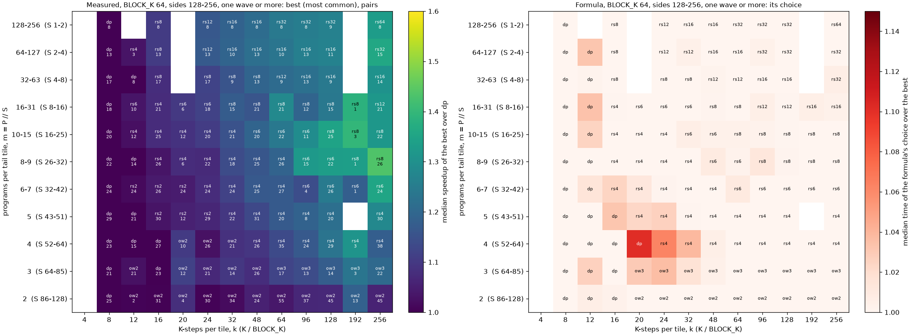
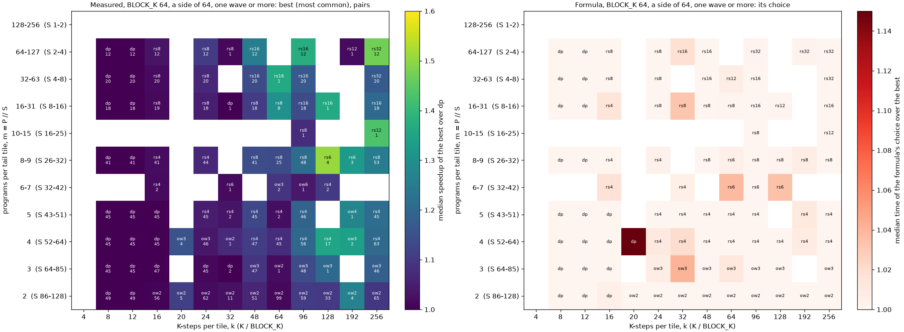
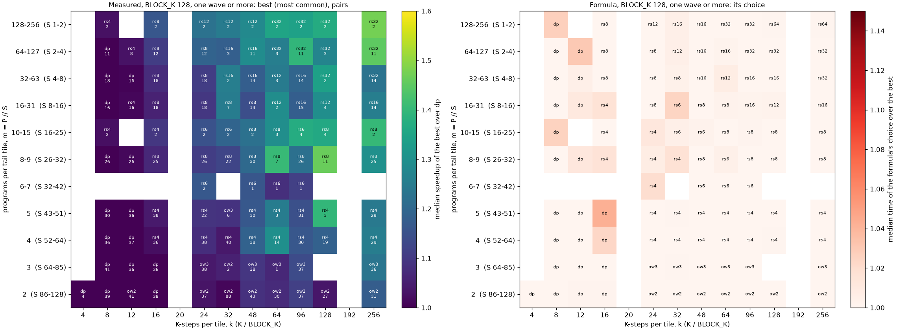
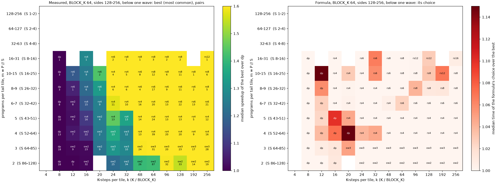

# A default Stream-K plan for v31, given the tile

A simple formula for the gfx950 gluon GEMM
([v31_streamk_aiter](../../kernels/gemm/intra_wave/a16w16/v31_streamk_aiter/README.md)):
given a tile (any of the 13 specs v31 runs) and a shape, data-parallel, a one-tile
owner split or a one-tile reduce-scatter, and the split count. It is the fallback
when a shape is not tuned. It is meant to be easy to read and good on average, not
optimal everywhere; for smaller tiles the same form should need only its constants
refitted.

## The formula ([candidates.py](candidates.py) `streamk_default`, [results/streamk_rule.json](results/streamk_rule.json))

P programs (one per CU), T = ceil(M / BLOCK_M) ceil(N / BLOCK_N) tiles, S = T mod P
tail tiles, **m = P // S** programs per tail tile, **pairs = ceil(K / (2 BLOCK_K))**
K-pairs per tile, cap = min(m, pairs).

```text
dp              if S == 0 or cap < 2
owner           if m <= 3:   n = sqrt(pairs / 1.5)   dp if pairs < 10
reduce-scatter  otherwise:   n = sqrt(pairs * m / 6)  dp if pairs * (1 - 1/n) < 6
```

n is clamped to [2, cap] and rounded to the nearest listed split (owner 2, 3, 4, 6, 8,
12, 16; reduce-scatter 2, 4, 6, 8, 12, 16, 32, 64). The same five constants serve every
tile spec and both regimes (below one wave, T < P, and after it).

How to read it:
- **Reduce-scatter's n** balances two costs: each program's MAC, pairs / n, against
  the partials all S n programs store and read at the same moment, which share the
  chip's bandwidth, n S / (6 P). Minimising the sum gives n = sqrt(pairs m / 6): more
  programs per tail tile and longer K both want a wider split, but only as the square
  root. With 8 programs per tail tile (S = 32) that is n = 4 at k = 32-64 and n = 8 at
  k = 256, as measured.
- **The owner** reads its n - 1 partials one after another on one CU, so its n grows
  only as sqrt(pairs). It is used only with 3 or fewer programs per tail tile (S >= 64),
  where reduce-scatter's barrier and slices have too few programs to pay off.
- **dp** when a split cannot save enough: reduce-scatter must save 6 K-pairs of the
  tail's time, the owner needs 10 K-pairs per tile.

## The maps

Each cell holds every (shape, spec) pair of the group with that many programs per tail
tile and K-steps per tile. Left: median speedup of the best configuration over dp and
the most common best (with the pair count). Right: the formula's choice and the median
of its time over the best ([figures.py](figures.py)).









The other below-one-wave maps: [side64](images/formula_side64_below.png),
[bk128](images/formula_bk128_below.png). Below one wave the formula is conservative at
k = 12-20 (it keeps dp where a split wins by 5-15% on the structured shapes); constants
per regime fix that in the training data but not on the held-out shapes (1.0035 against
1.0027 geomean below one wave), so the shared form stays.

## How robust it is ([results/formula.md](results/formula.md))

**Data.** 55,256 points (24,624 + 1,360 + 29,272), every one checked against torch and timed in two rounds
(a graph of 100 launches over 2 GB of rotating inputs under rocprofv3, the median of the
last 100; rounds in different shuffled orders; round-to-round spread 0.34% median):

| sweep | what | (shape, spec) pairs | points |
|---|---|---|---|
| grid | 5 large specs, W = 0-3 full waves, S = 1-128, k = 8-256 | 1,143 | 9,638 |
| tile sweep | 300 seeded shapes at their 4 cheapest tiles | 1,200 | 3,312 |
| gap | the S and k the grid skipped (S = 12-80, k = 12, 20) | 1,010 | 7,640 |
| formula | all 13 specs, W = 0-3, m = 2-100, k = 8-256, 3+ shapes per cell | 3,714 | 16,789 |
| joint train | 300 tile-sweep shapes x 13 specs (partial, one round) | | 1,360 |
| held out | 597 AITER shapes x 13 specs x every valid method | 7,721 | 4,034 + 12,483 |

After the formula sweep every spec has at least 3 shapes in 43-48 of the 48 (m, k) cells
after a full wave. Below one wave the 64-side specs have few or no cells: such shapes
(fewer 64-side tiles than CUs) fall below the domain (64x64 tiles must fill a wave).

**Form selection** (training pairs; the formula's time over the pair's best timed time,
geomean / median / 90th percentile / worst):

| form | in sample | leave one spec out |
|---|---|---|
| **shared constants** | 1.0104 / 1.000 / 1.036 / 1.355 | **1.0104 / 1.000 / 1.036 / 1.355** |
| per regime | 1.0112 / 1.000 / 1.036 / 1.350 | 1.0120 / 1.000 / 1.041 / 1.350 |
| shared, thresholds x 64 / BLOCK_K | 1.0146 / 1.000 / 1.050 / 1.477 | 1.0157 / 1.000 / 1.055 / 1.477 |
| shared, scaled by each spec's throughput | 1.0194 / 1.000 / 1.067 / 1.831 | 1.0195 / 1.000 / 1.067 / 1.831 |

Leaving out a whole spec costs nothing: the formula predicts a tile it was not fitted on
as well as the ones it was, the case that matters for adding smaller tiles. A tile term
(the thresholds in each tile's K-pairs, or scaled by its throughput) makes it worse.

- **Leave one k bin out:** 1.0109 / 1.000 / 1.040 / 1.355. **Leave one m bin out:**
  1.0173 / 1.000 / 1.060 / 1.458, the weakest: the thresholds in m (the owner's m <= 3)
  are the least certain between sampled values.
- **Bootstrap over shapes** (100 resamples, 10th / median / 90th percentile): B 6 / 6 / 6,
  c_ow 1.5 / 1.5 / 1.5, m_ow 3 / 3 / 3, gain 5 / 6 / 6, pairs_ow 10 / 10 / 16.
- **Against dp** (training): 92 of 7,368 pairs more than 5% slower, 27 more than 10%,
  worst 1.196.

**Held-out AITER shapes**, the formula given each of the 13 specs (7,721 pairs), time over
that spec's best: **1.0024 / 1.000 / 1.000 / 1.292**; 30 pairs more than 5% slower than
dp, 8 more than 10%. dp alone: 1.0776 / 1.000 / 1.320 / 4.969. Per spec the geomean is
1.0009-1.0039 and the 90th percentile 1.000-1.004.

## The tile ([results/tile_choice.md](results/tile_choice.md))

The formula takes the tile as given; untuned AITER would get it from `pick_gemm_tile`.
On the 573 held-out shapes timed at every spec (time over the shape's best over every
spec, method and split):

| tile, then plan | geomean / median / 90th / worst |
|---|---|
| pick_gemm_tile, dp | 1.078 / 1.010 / 1.256 / 1.943 |
| pick_gemm_tile, formula | 1.066 / 1.000 / 1.224 / 1.943 |
| Stream-K-aware pick, formula | **1.015 / 1.000 / 1.055 / 1.275** |
| best spec, formula | 1.0016 / 1.000 / 1.000 / 1.071 |
| best spec, dp | 1.060 / 1.000 / 1.217 / 1.784 |

The formula is close to the best plan once the tile is right (last rows); the tile is
the larger loss. `pick_gemm_tile` prices every partial wave as data-parallel, so it
prefers a smaller tile that fills the CUs where a larger tile with a split is faster.
The Stream-K-aware pick (`streamk_pick_tile`) prices each spec as the formula would run
it: its work over its measured full-wave TFLOPS per wave, a split tail 1/n of a wave plus
10 K-steps, a data-parallel partial wave 0.7 of a wave plus its fill (0.8 below one wave),
fitted on the 300 tile-sweep shapes. It is a starting point, not tuned like the formula.

## Tuning space (`streamk_candidates`)

dp; reduce-scatter at half, once and twice the formula's n; the owner at every n up to 4
where m <= 8; two_tile, spread and the l2 exchange opt-in. A tuned CSV row would carry
`kernelName = gluon_compute_bound_<BM>x<BN>x<BK>_<policy>[_<fixup>][_l2]` and
`splitK = SPLIT_N` (`kernel_name`, `parse_kernel_name`).

## How it got here

- **First rule** ([results/fit_safe_v1.md](results/fit_safe_v1.md)): piecewise
  (n = min(pairs / a, m / b, n_max), a K threshold per ending, rs from 8 programs per tail
  tile), fitted on the grid alone. The grid sampled m = 8 and 5 and k = 8, 16, 24, and its
  thresholds landed in those gaps: the owner for 5-7 programs per tail tile, dp below
  k = 32 there. On the gap sweep it fell to 1.029 / 1.012 / 1.085 / 1.306 against 1.014 /
  1.000 / 1.035 / 1.276 on its own data. The square-root form replaced it.
- **Tile and method chosen separately, scored on a restricted set**: the held-out shapes
  were first timed at 3 tiles chosen by `pick_gemm_tile`'s model, and the tile pick was
  scored among those 3 only (1.007 / 1.000 / 1.017 / 1.176, superseded). With every spec
  timed the Stream-K-aware pick is 1.015 / 1.000 / 1.055 / 1.275.
- **Constants in K-steps of one tile family**: the earlier fits rested on 4 large specs;
  the formula sweep covers all 13, and the shared constants held.

## Reproduce

```bash
source kernels/gemm/intra_wave/a16w16/v31_streamk_aiter/env.sh; cd $REPO
G=kernels/gemm/intra_wave/a16w16/v31_streamk_aiter/run_guarded.sh   # stops on any other process on the GPU
for s in grid tilesweep gap heldout formula; do                     # run_formula.sh also runs JOINT_HELDOUT
    bash $G experiments/streamk_v31_rule/results/$s.log bash experiments/streamk_v31_rule/run_$s.sh
done
cd experiments/streamk_v31_rule
TRAIN="results/grid_r*.csv results/tilesweep_r*.csv results/gap_r*.csv results/joint_train_r*.csv results/formula_r*.csv"
python fit_formula.py --train $TRAIN --test 'results/heldout_r*.csv' 'results/joint_heldout_r*.csv' \
    --out results/formula.md --rule-out results/formula_rule.json
python tile_choice.py --rule results/formula_rule.json --fit 'results/tilesweep_r*.csv' 'results/joint_train_r*.csv' \
    --test 'results/heldout_r*.csv' 'results/joint_heldout_r*.csv' --out results/tile_choice.md
python figures.py --rule results/streamk_rule.json $TRAIN 'results/heldout_r*.csv' 'results/joint_heldout_r*.csv'
```

The GPU runs were on rocm-smi GPU 1 (HIP 3) only, under `gpu_guard.py`: it compares the
GPU's process count (rocm-smi lists host PIDs) with the command's own processes holding
/dev/kfd and stops on any other user. No foreign process appeared. `fit.py`,
`tile_pick.py`, `evaluate.py` and `fit_time.py` are the earlier rule and the time-model
diagnostic, kept for the history above.

## Limits

- One GPU (256 CUs), bf16, no bias, contiguous B and C; GROUP_SIZE_M fixed at 4.
- Owner splits up to 16 and reduce-scatter up to 64; two_tile, spread and the l2
  exchange are not in the formula.
- The weakest part is the threshold in m: leaving out a whole m bin gives 1.060 at the
  90th percentile.
- Below one wave the 64-side specs have little data (such shapes are outside the domain).
- The sweeps timed dp with at most one tile per program without the persistent loop
  (v31's non-persistent path, since removed). The kernel now runs it with a one-trip loop,
  about 1.2% slower, so the formula's dp choices there are slightly conservative; the
  constants are unchanged.
- The Stream-K-aware tile pick is simple and fitted on 300 shapes; tuning or a better
  tile model is where the remaining time is.
