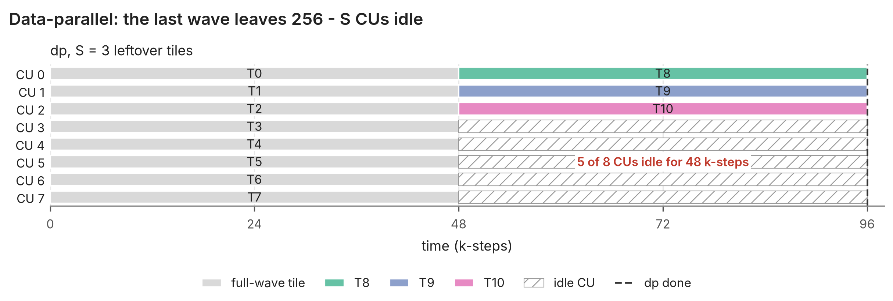
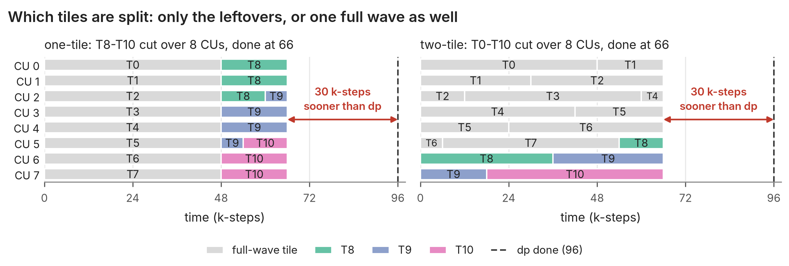
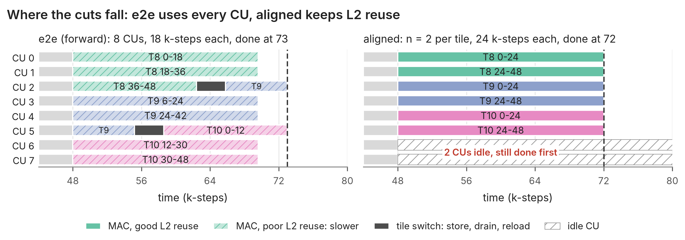
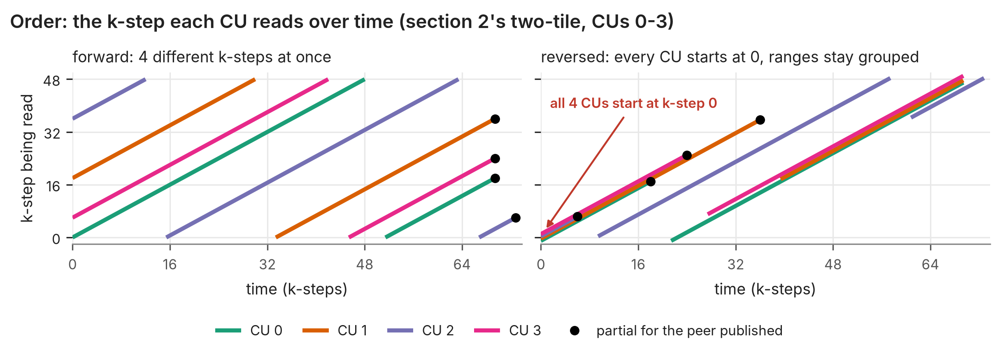
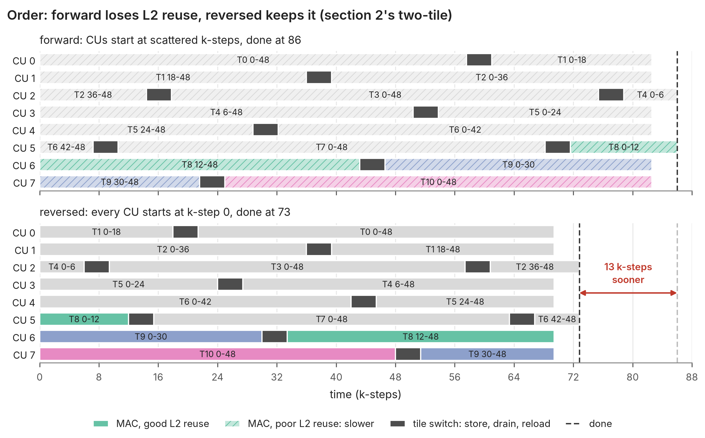
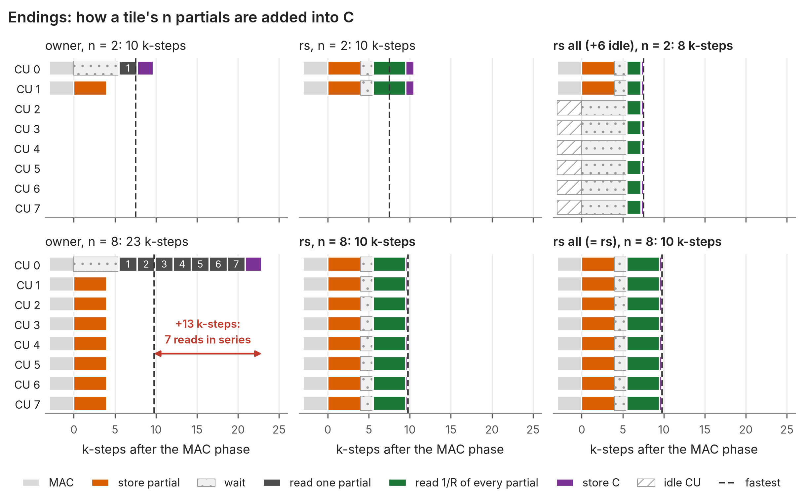
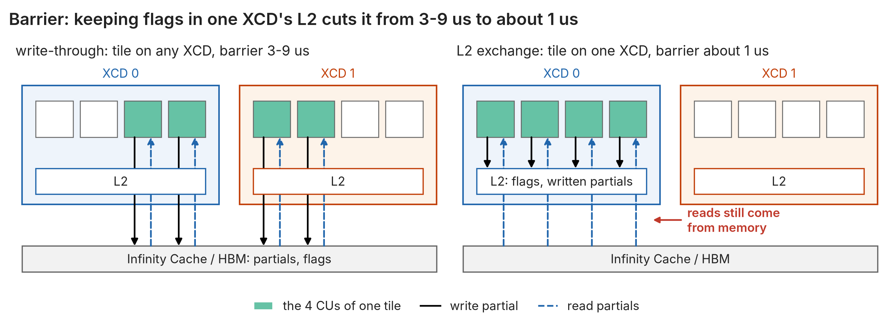

# Stream-K: the concepts

**Terms.** S is the number of leftover tiles (`total_tiles % 256`), n the number of CUs per split tile, and a k-step one 256x256x64 MAC step (about 1.21 us with all 256 CUs busy). A **partial** is a CU's fp32 accumulator for its share of a tile, 256 KiB. All figures use one toy problem: 8 CUs standing for 256, S = 3 and 48 k-steps per tile. They are generated by [v14_streamk/streamk_pr_diagrams.py](v14_streamk/streamk_pr_diagrams.py).

### 1. Data-parallel tail

Every tile runs whole on one CU, in waves of 256, so the last wave leaves 256 - S CUs idle.

- **Gain:** no fixed cost, and the best choice when the idle time, `(256 - S) / 256 * K / 64` k-steps, is under about 20. That covers every K <= 1024.
- **Cost:** at large K the tail can be nearly a whole wave of idle time.

### 2. Which tiles are split

**One-tile** splits only the S leftover tiles over the CUs. **Two-tile** moves one full wave into stream-K as well, so each CU gets between one and two tiles. Both panels use the same e2e cuts (section 3).

- **Gain:** two-tile needs no tuning of n, and each tile has at most one partial to add.
- **Cost:** one-tile's n must be tuned (S = 4, K = 8192: 208 us at n = 8 against 342 us at n = 64). Two-tile gives up the L2 reuse of a whole full wave.

### 3. Where the cuts fall

The one-tile tail from section 2; the ending (section 5) is left out because both pay it. **e2e** lays the leftover tiles' k-steps end to end and cuts them evenly over every CU. **Aligned** cuts every tile the same way over n CUs, and the CUs left over stay idle.

- **Gain:** e2e uses every CU and is the only useful split when S > 128. Aligned keeps L2 hits at dp's level (76% against 8% for forward e2e) and has no tile switches.
- **Cost:** an e2e CU that crosses a tile stores its partial, drains and reloads (about 3.4 k-steps), and its scattered k-ranges get less L2 reuse. Aligned leaves `256 - S·n` CUs idle.

### 4. Order (e2e only)

Reversed order is an optimisation for e2e cuts, which in practice means two-tile and one-tile with S > 128. Aligned cuts give each CU one piece, so there is nothing to reorder.

Forward against reversed order

The two-tile schedule from section 2, not section 3's one-tile tail. Order only matters when a CU has several pieces, which in two-tile is every CU. **Forward** runs each CU's pieces in k order, so the CUs of one XCD read 4 different k-steps at once and share little in L2. **Reversed** runs them last to first, so every CU starts at k-step 0 and the ranges stay in a few groups. Each CU also finishes the tile it owns last.

- **Gain:** an XCD's CUs read a few nearby k-ranges instead of drifting apart, so the MAC keeps its L2 reuse. Each peer's partial is published early, so the owner rarely waits. Reversed beat forward by 2-55% in every measured case.
- **Cost:** none measured.

### 5. Endings

**Owner:** n - 1 CUs store their partials, and one CU reads and adds them in turn. **Reduce-scatter (rs):** every CU stores its partial, then after a barrier reads 1/n of every partial and writes 1/n of C. **rs all:** the CUs the tail leaves idle join the barrier and read slices too, so R readers share the tile. Phase lengths are v23's measured medians.

- **Gain:** rs reads in parallel, so its ending stays about 10 k-steps at any n, while the owner's grows by 2.2 k-steps per partial. rs all shortens the read and the C store further when n is small: up to 3.9% faster than rs at small S·n.
- **Cost:** rs moves 2n partials per tile against the owner's 2(n - 1). At n = 2 that is twice the bytes, so in kernel time the owner stays level up to about n = 8. rs all needs one cache line per tile barrier.

### 6. A faster barrier: L2 exchange (rs only)

**Write-through** sends the partials and the barrier flags to memory. **L2 exchange** places all of a tile's CUs on one XCD, so the flags and the partial writes stay in its L2.

- **Gain:** the barrier drops from 3-9 us to about 1 us, and the store gets up to 2.4 us faster.
- **Cost:** the slice read is no faster, because the first read of a line written into L2 still fetches it from Infinity Cache/HBM. It is only correct when no tile spans two XCDs, which caps n at `32 / ceil(S / 8)`.
