# Stream-K variants: the concepts, then the combinations we run

Part 1 explains each idea once: what it changes, why we tried it, and what goes wrong. Part 2 lists the configurations that sweep F runs, named from part 1's concepts, and says why the list is not every combination. The full history and measurements are in [STREAMK.md](STREAMK.md); the figures are generated by [v14_streamk/streamk_concepts_diagrams.py](v14_streamk/streamk_concepts_diagrams.py).

**Terms.** S is the number of leftover tiles (`total_tiles % 256`), n the number of programs per leftover tile, ipt the number of k-steps per tile (`K / 64`), and a k-step is one 256x256x64 MAC step, about 1.21 us with all 256 CUs busy. A program's **partial** is its fp32 accumulator for its part of a tile, 256 KiB.

## Part 1: concepts

### 1. Data-parallel (dp)

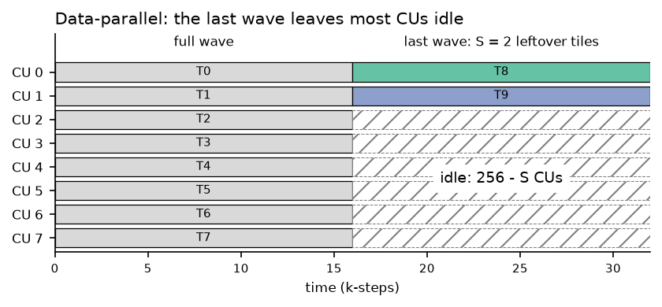

- **What:** every tile runs whole on one CU, in waves of 256. In the last wave S CUs run the leftover tiles and 256 - S sit idle.
- **Why:** the full waves stay data-parallel in every variant, so stream-K only has to fix the last wave. It is also the baseline every tail is measured against.
- **When it wins:** when the idle time, `(256 - S) / 256 * ipt` k-steps, is under about 20, the fixed cost of any split. That includes every K <= 1024.

### 2. One-tile

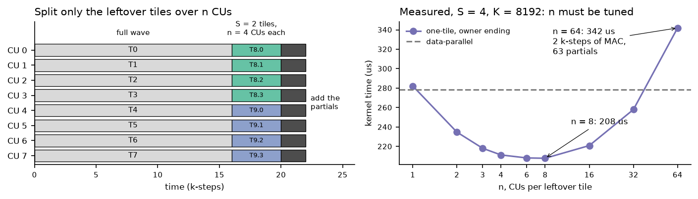

- **What:** only the S leftover tiles are split. Each tile's K loop is cut over n CUs, and the n partials are added at the end.
- **Why:** it is the simple, obvious approach.
- **Issue:** n has to be tuned to S and K. Every extra split shortens each program's MAC work but adds a partial to move and add.
- **Example** (S = 4, K = 8192): dp takes 279 us. Splitting each tile 8 ways takes 208 us. The default, all 256 CUs or 64 per tile, takes 342 us, slower than dp: each program does 2 k-steps of MAC and then waits behind 63 partials.

### 3. Two-tile

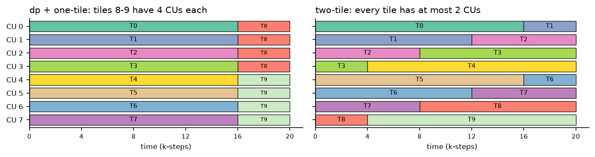

- **What:** one full wave moves into stream-K along with the leftover tiles. Each program gets between one and two tiles of work, so every tile has at most two producers and one partial to add.
- **Why:** there is no n to tune, and the single partial read is cheap. It is the paper's recommended schedule.
- **Issues:**
  - **L2 reuse, even in reversed order.** Reversed order ([concept 6](#6-order-forward-against-reversed-e2e-only)) keeps 68% L2 hits against dp's 76% at S = 8, where forward order falls to 9%. The remaining gap grows with S: 58% against 73% at S = 38, and 28% against 79% at S = 240 (4096x7936x8192).
  - **It needs a full wave to borrow, and spends it.** With one full wave the whole kernel becomes stream-K and none of it keeps dp's reuse. Against a tuned one-tile split it led on only 3 of 9 compute shapes, by 0.2-1.5%: both shapes with four full waves before the tail, and 4352x4096x4096.
  - **More work per program:** two or three segments each, with pipeline restarts and register spills.

### 4. End-to-end cuts (e2e)

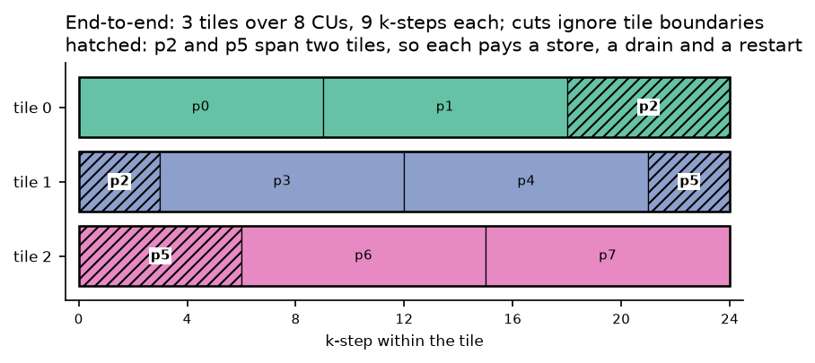

- **What:** the stream-K tiles' k-steps are laid end to end and cut evenly over the programs, so a cut can fall anywhere, including across a tile boundary. One-tile can use it (v15, v16); two-tile always does.
- **Why:** perfect balance. It is the paper's partition, and it is the only way to split usefully when S > 128.
- **Issues:**
  - **A CU can be both producer and consumer.** Crossing a tile boundary costs a partial store, a drain and a pipeline restart, about 3.4 k-steps.
  - **L2 reuse drops in forward order** (concept 6): 8% hits on 3840x4096x8192 against 76% with aligned cuts.
- **Note:** with n capped (S·n programs), the cuts fall on chunk boundaries anyway, so e2e and aligned give the same partition. They differ only when the programs do not divide the tiles evenly, which is why e2e is kept only for S > 128.

### 5. Aligned cuts

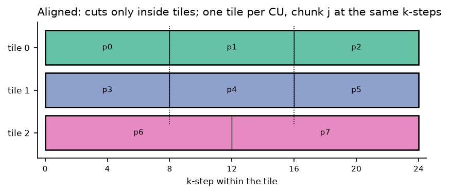

- **What:** cuts are made only inside tiles. Each CU works on one tile, and chunk j of every tile covers the same k-steps.
- **Why:** an XCD's programs read one or two k-ranges at once, which brings L2 back to dp's level (76% on the shape above). No tile switches, one segment per program, and no spills.
- **Issue:** a tile needs a whole number of programs. Once S > 128 most tiles get just one, and the split can at best match dp.

### 6. Order: forward against reversed (e2e only)

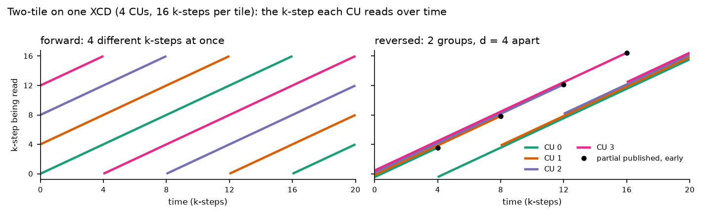

- **What:** reversed order runs a program's pieces last to first: the head of its last tile first, starting at k-step 0, then any whole tile, then the tail of its first tile, which it owns.
- **Why:**
  - **L2:** every program starts at k-step 0, so an XCD's programs fall into two groups `d` k-steps apart instead of drifting apart. `d = ipt * S / 256` is how far each program's range runs past one tile.
  - **The wait is hidden:** a program publishes its partial first and finishes the tile it owns last, so its peer's partial is usually ready when the owner needs it.
  - Reversed beat forward by 2-55% on every shape.
- **Measured L2 hit rate** (sweep C counters, 4096x8192x8192 with 256 + S tiles):

  | schedule | S = 8 | S = 38 |
  |---|---|---|
  | dp | 76% | 73% |
  | two-tile, reversed | 68% | 58% |
  | two-tile, forward | 9% | 17% |
  | one-tile e2e, default split, either order | 70% | 65% |

  Only long ranges drift. Two-tile's ranges are always longer than a tile. A one-tile e2e split at S = 8 gives each program 4 k-steps, so even forward order stays close to dp. It collapses only when S is large: 8% on 3840x4096x8192 (S = 240, 120 k-steps per program).
- **Note:** aligned cuts give each program one segment, so there is nothing to reorder.

### 7. Owner ending

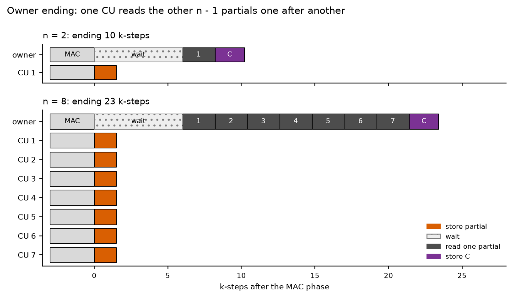

- **What:** n - 1 programs store their partials, and one owner reads them one after another, adds them and writes C.
- **Why:** it moves the fewest bytes: n - 1 stores and n - 1 reads.
- **Issue:** the reads are serial and limited by one CU's bandwidth, about 2.2 k-steps each. The ending costs about `10 + 2.2 (n - 1)` k-steps, so the owner suits small n. Its best n is near `sqrt(ipt / 2.2)`: 8 at K = 8192.

### 8. Reduce-scatter (rs)

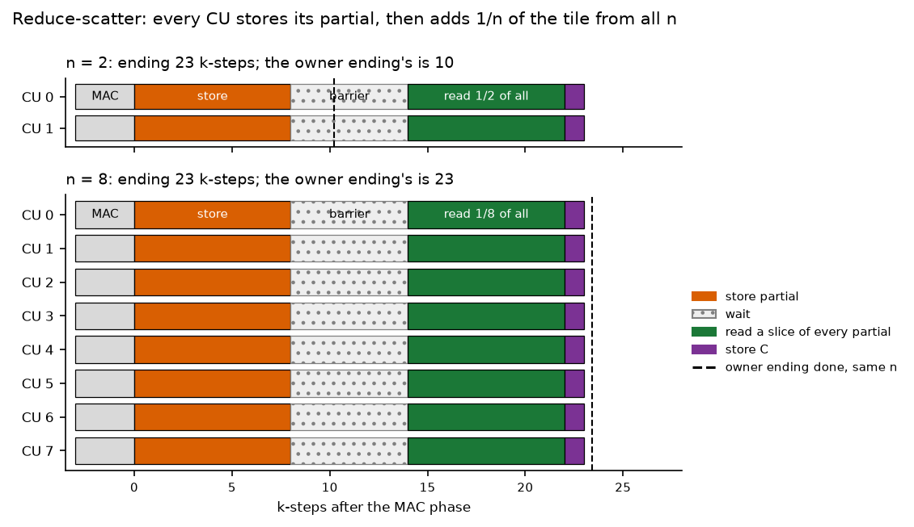

- **What:** every program stores its whole partial. After a per-tile barrier, each program reads 1/n of every partial, adds them, and writes that slice of C.
- **Why:** it removes the owner's serial chain. The reads are spread over n CUs, so the ending costs about 24 k-steps at any n.
- **Issue:** it moves more bytes, 2n partials per tile against the owner's 2(n - 1): twice as many at n = 2, about the same at n = 16. And since every program stores and reads at the same moment, the bursts are limited by the whole chip's bandwidth.
- **Example** (S = 4, K = 8192): at n = 16, rs takes 195 us and the owner 221 us. At n = 2, rs takes 240 us and the owner 235 us. The two endings cross near n = 8.

### 9. Chunk-major placement

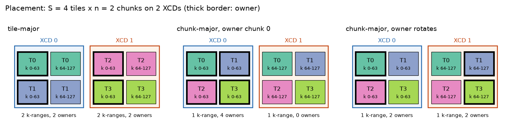

- **What:** consecutive programs share an XCD (32 per XCD). Tile-major numbering gives an XCD whole tiles; chunk-major numbering gives it the same chunk of many tiles.
- **Why:** a small tweak to test whether making an XCD's programs read the same k-steps improves L2 in the MAC phase.
- **Issues:**
  - **If L2 is already good enough, it gains nothing.** Aligned tile-major is already close to dp. Chunk-major measured within ±3%, with 0-4 more points of L2 hits at S = 32-128.
  - **The owner has to rotate.** Chunk 0 of every tile lands on the same XCDs, so with a fixed owner all collection goes through those XCDs' links. That cost up to 8%; the owner is chunk `t % n` instead.

### 10. Atomic ending

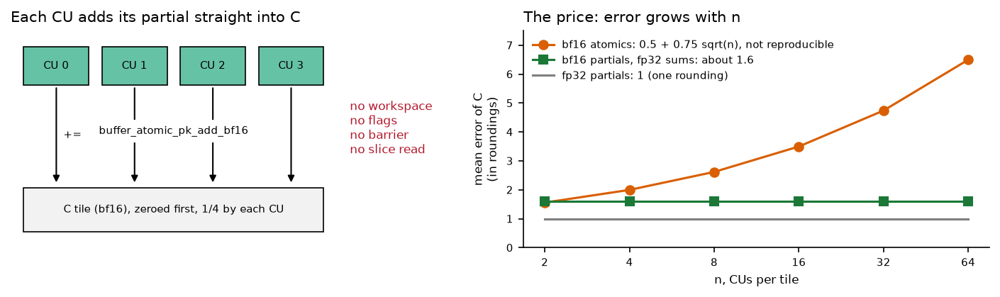

- **What:** no workspace, flags, barrier or slice read. Every program adds its partial straight into C with bf16 `pk_add`.
- **Why:** it removes the partial traffic and the reduction.
- **Issues:**
  - **C must be zeroed before the first add.** v24 does this inside the GEMM, each program zeroing 1/n of the tile behind a per-tile counter, so some synchronisation remains.
  - **fp32 atomics are slower than a store plus a read** ([experiments/streamk_atomics](../../../../experiments/streamk_atomics/README.md)).
  - **bf16 atomics lose accuracy as n grows:** C is rounded once per program, about `0.5 + 0.75 sqrt(n)` times one rounding's error (3.4 measured at n = 16).
  - **Neither is reproducible:** the order of the adds changes from run to run.
- **Verdict:** only worthwhile if it is noticeably faster, and only where reproducibility does not matter.

### 11. bf16 partials

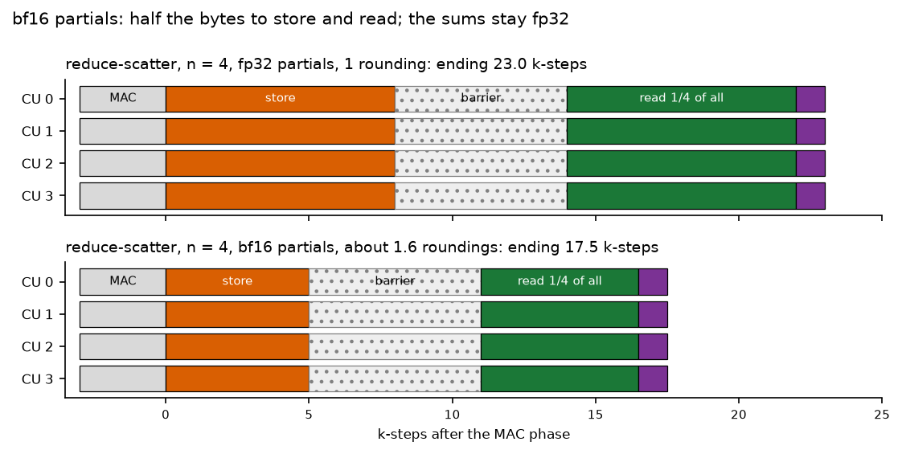

- **What:** the partials are stored as bf16 (pairs of register blocks packed into 16 bytes per lane). The reads are added in fp32.
- **Why:** it halves the partial bytes, and it makes the comparison with the bf16 atomic ending fair: bf16 against bf16.
- **Against atomics:** about 1.6 roundings whatever n is, and reproducible. If it is as fast, it is the obvious choice. In v23's seven test cells it was as fast as the atomic ending or faster; sweep F checks the whole grid.

### 12. L2 exchange (rs only)

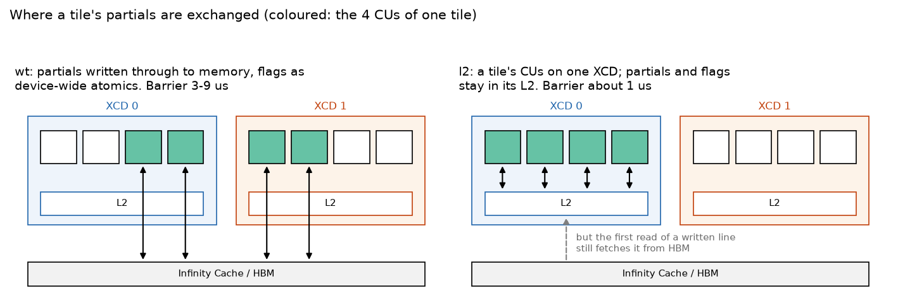

- **What:** all of a tile's programs are placed on one XCD, and the partials and flags stay in that XCD's L2 instead of being written through to memory.
- **Why:** it cuts the barrier wait from 3-9 us to about 1 us (v21).
- **Issues:**
  - **It is only correct when no tile spans two XCDs:** the eight L2s are not coherent with each other. The host checks the placement.
  - **That placement caps n** at `32 / ceil(S / 8)`.
  - **The slice read is no faster:** the first read of a line written into L2 still costs a trip to HBM ([experiments/l2_fill_on_read_mre](../../../../experiments/l2_fill_on_read_mre/README.md)).

## Part 2: the combinations sweep F runs

Sweep F times every configuration below on 4096x8192xK with `GEMM_TILE_LIMIT = 256 + S` (S = 1-128 at K = 512-16384, and S = 160-255 at K = 8192-32768), every split configuration at every valid n. All are builds of [v24](v24_streamk_combined/WORKLOG.md) except `dp` (v13) and `1T rs (v20)`.

### Labels

A label lists only what differs from the defaults: fp32 partials, tile-major placement, write-through exchange. Every `1T` label without `e2e-rev` uses aligned cuts.

| label | work | cuts, order | n | ending | partials | placement | exchange |
|---|---|---|---|---|---|---|---|
| `dp` | none | - | 1 | - | - | - | - |
| `1T owner` | one-tile | aligned | swept | owner | fp32 | tile | wt |
| `1T rs` | one-tile | aligned | swept | rs | fp32 | tile | wt |
| `1T atomic` | one-tile | aligned | swept | atomic | none | tile | - |
| `1T owner bf16` | one-tile | aligned | swept | owner | bf16 | tile | wt |
| `1T rs bf16` | one-tile | aligned | swept | rs | bf16 | tile | wt |
| `1T owner chunk` | one-tile | aligned | swept | owner | fp32 | chunk | wt |
| `1T rs chunk` | one-tile | aligned | swept | rs | fp32 | chunk | wt |
| `1T atomic chunk` | one-tile | aligned | swept | atomic | none | chunk | - |
| `1T rs l2` | one-tile | aligned | swept, capped | rs | fp32 | tile | l2 |
| `2T e2e-rev` | two-tile | e2e, reversed | at most 1 peer | owner | fp32 | tile | wt |
| `1T e2e-rev` | one-tile, S > 128 only | e2e, reversed | all 256 programs | owner | fp32 | tile | wt |
| `1T rs (v20)` | as `1T rs`, without v23's band C store and power-of-two readers | | | | | | |

`1T e2e-rev` is `STREAMK_POLICY=spread` in the code. `1T rs (v20)` ties sweep F's numbers to sweep C's, which used v20.

### How the list is built

Each modifier is added once to the build it applies to, and products of modifiers are not run:

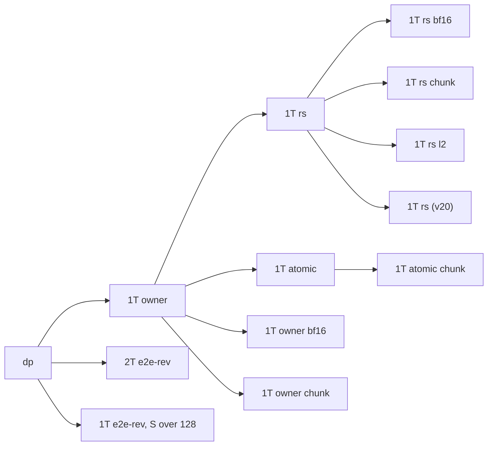

### Coverage

| | default | bf16 partials | chunk-major | L2 exchange |
|---|---|---|---|---|
| `1T owner` | run | run | run | not built |
| `1T rs` | run | run | run | run |
| `1T atomic` | run | meaningless | run | meaningless |
| `2T e2e-rev`, `1T e2e-rev` | run | not run | meaningless | unsafe |

- **Meaningless.** The atomic ending has no partials, so neither the partial type nor the exchange applies. An e2e split has no fixed chunks, so there is nothing to number chunk-major.
- **Unsafe without new code.** The L2 exchange with chunk-major or e2e cuts: a tile's programs would span XCDs, whose L2s are not coherent. With an unsafe placement the negative control gives wrong results on every launch.
- **Not built, could be.**
  - The owner ending with the L2 exchange. Expected 1-3 us from a faster store and flag poll; the serial reads would not change.
  - The atomic ending with e2e cuts.
- **Built, not run, assumed independent.** Chunk-major with bf16 partials, and the L2 exchange with bf16 partials. The placement acts on the MAC phase's reads and the partial type on the ending's bytes. A spot check on a few cells would confirm it.

**Settled earlier, so not in the sweep:**
- all programs reading against power-of-two readers (v23, sweep E1);
- v22's separate zeroing launch for the atomic ending, 13% longer than zeroing inside the GEMM;
- fp32 atomics;
- forward e2e, one-tile (v15, v16) or two-tile, which loses L2.

**Rounds C more than once:** the bf16 and atomic configurations. The sweep report therefore gives both the fastest configuration overall and the fastest that rounds C once.
