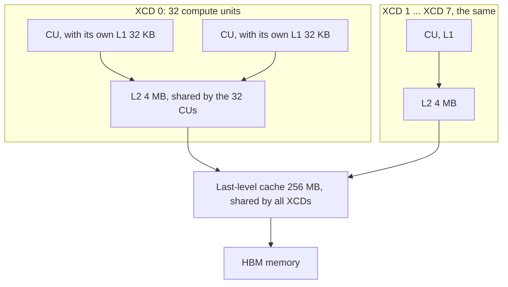

# How stream-K programs wait for each other in v20 and v21: code, assembly and assumptions

This note is for review by a hardware engineer, and is written so that a reader without a hardware
background can follow it too. It shows exactly what the kernels do when one program must wait for
data that other programs wrote during the same kernel, the assembly the compiler emits for it, and
the hardware behaviour we rely on. Section 7 lists the assumptions we would like checked.

Hardware: AMD Instinct MI355X (gfx950, CDNA4). References: the CDNA4 ISA guide (section 9.1.10,
Tables 49-52) and *AMD Instinct MI300 GPU Memory Bandwidth* (X. Lu, 2024). The assembly below is the
compiler's real output for a 4352x4096x8192 bf16 GEMM (Triton `gfx950-tutorial-v2.2`, with the
repository's LLIR scheduler and amdgcnas plugins), trimmed to the lines that matter; section 9 shows
how to regenerate it.

## 1. The problem in plain terms

A GEMM computes C = A x B in tiles of 256x256. In the stream-K tail a few tiles are each split
between n programs (workgroups, one per compute unit). Each program computes part of the sum for
its tile, then:

1. **publishes** its part, a 256 KiB "partial", by writing it to memory;
2. **waits** until all n programs of the tile have published;
3. **reads** a 1/n slice of every partial, adds them up and writes that slice of C.

Step 2 is a hand-made barrier between programs, which the GPU does not provide. The danger is in
the caches: a reader may see "everyone has published" but still read old data, because the new
data is not yet visible where it looks. Everything below is about making steps 1-3 safe and cheap.

## 2. The memory system, briefly



- **L1** belongs to one compute unit (CU). Stores go through it to L2; loads may be served from it.
- **L2** belongs to one XCD (a chiplet of 32 CUs). The 8 XCDs' L2s are *not* kept coherent with
  each other automatically: data written into XCD 0's L2 is invisible to XCD 1 until it is written
  back to the last-level cache or memory.
- **The last-level cache (LLC)** and **HBM** are shared by the whole GPU.

Workgroup `p` of our 256-workgroup grid runs on XCD `p % 8` (measured with the `HW_REG_XCC_ID`
hardware register).

## 3. The two kinds of cache control

There are two separate mechanisms, and the question "are `buffer_inv` and friends added on top of
the cache modifiers?" is answered by keeping them apart.

### 3.1 Cache bits on each load and store

Every vector load and store instruction carries three bits, `sc1`, `sc0` and `nt`, that say how far
it must reach (its scope) and whether the data is expected to be reused. In Triton/Gluon they are
chosen with the `cache=` argument of a load or store (Triton's
`getCtrlBitsForCacheModifierOn_CDNA3_CDNA4`):

| Triton `cache=` | on a load | on a store |
|---|---|---|
| none (default), `.ca`, `.wb` | no bits | no bits |
| `.cg` | `sc0 nt` | no bits |
| `.cs` | `sc0 nt` | `sc0 nt` |
| `.cv` | `sc0 sc1` | (not allowed) |
| `.wt` | (not allowed) | `sc0 sc1` |

What the bits do (ISA Tables 49 and 50; "more than one L2" applies to MI355X in its normal
single-partition mode):

| bits | meaning | L1 | L2 | LLC |
|---|---|---|---|---|
| none | wave scope, reuse expected | load: Hit LRU, store: Miss LRU | Hit LRU | Hit LRU |
| `sc0 nt` | group scope, no reuse | Miss Evict | Hit Stream | Hit Evict |
| `sc1` | device scope | Miss Evict | Coherent Cache Bypass | Hit LRU |
| `sc0 sc1` | system scope | Miss Evict | Coherent Cache Bypass | Hit LRU |

In words: default accesses use L1 and L2 normally; `sc0 nt` skips L1 and uses L2 with an
evict-first ("stream") policy; device and system scope skip both L1 and L2 and go to the shared LLC
or memory, so they see the same data on every XCD.

**Measured, and partly different** ([experiments/memory_model_litmus](../../../../../experiments/memory_model_litmus/README.md)).
On `torch` (coarse-grained) memory, the loads and the stores behave differently from the table:
- **Loads:** `sc1` and `sc0 sc1` loads skip L1 but are served from the reader's own L2 (77 ns) whenever
  it holds the line, even a stale copy. After a default store on another XCD they return that stale copy.
- **Stores:** write-through stores (`sc1`, `sc0 sc1`) and write-backs invalidate the other XCDs' L2
  copies. LLVM's gfx942 memory model calls this the "cache probe caused by the PTE C-bit".

So cross-XCD coherence comes from the *writer* pushing its data to memory, and the reader only has
to miss its L1. Sections 4-5 hold for that reason, not because the reads bypass L2.

### 3.2 Separate cache-maintenance and wait instructions

These are whole instructions, not bits on another instruction:

| instruction | what it does (ISA Tables 51 and 52) | who emits it in our kernels |
|---|---|---|
| `s_waitcnt vmcnt(0)` | the wave waits until all its own loads and stores have completed (stores: acknowledged) | the compiler before using loaded data; us, via inline assembly, before publishing |
| `s_barrier` | all waves of the workgroup wait for each other | the compiler; us, via inline assembly |
| `buffer_wbl2 sc1` | write back all dirty lines of this XCD's L2 to the LLC/memory | the compiler, for a *release* atomic (v20) |
| `buffer_inv sc1` | invalidate this CU's L1, and the L2 lines that are not kept coherent | the compiler, for an *acquire* atomic (v20) |
| `buffer_inv sc0` | invalidate this CU's L1 **only in TG-split mode; otherwise a NOP** (TG-split lets one workgroup's waves run on different CUs; it is off here) | us, by inline assembly, in early v21 (removed, section 6) |

Atomic operations get their cache maintenance from the compiler, according to the *memory order*
requested in the source:

| Gluon source | emitted (observed) |
|---|---|
| `gl.atomic_add(p, v, sem="relaxed", scope="gpu")` | `global_atomic_add ... sc0` (device scope; `sc0` = return the old value) |
| `gl.atomic_add(p, 0, sem="relaxed", scope="gpu")` | turned into an atomic load: `global_load_dword ... sc1` |
| `gl.atomic_xchg(p, v, sem="relaxed", scope="gpu")` | `global_atomic_swap ...` |
| `sem="release"` | the same, preceded by `buffer_wbl2 sc1` and `s_waitcnt vmcnt(0)` |
| `sem="acquire"` | the same, followed by `s_waitcnt vmcnt(0)` and `buffer_inv sc1` |
| `sem="acq_rel"` | both |

Our inline-assembly helpers, as they appear in the assembly:

```python
def drain_and_barrier():   # every wave waits for its own stores, then the workgroup barrier
    gl.inline_asm_elementwise("s_waitcnt vmcnt(0)\ns_barrier\nv_mov_b32 $0, $1", "=v,v,~{memory}", ...)

def asm_fence(code):       # `code`, plus a memory clobber: the compiler moves no load or store across it
    gl.inline_asm_elementwise(code + "\nv_mov_b32 $0, $1", "=v,v,~{memory}", ...)
```

The `v_mov_b32 vN, vN` that follows each one in the listings is only there because an inline
assembly block must produce a value; it does nothing. `asm_fence("s_nop 0")` is a pure compiler
fence: it emits nothing that affects the hardware.

## 4. v20 (`STREAMK_PARTIALS=mem`): write through, acquire-release barrier

Since 2026-10-08, `wt` (section 5) is v21's default, and v15-v20 and v22 use its sequence too
(v21 WORKLOG entry 4). This section describes `mem` and v20 before that date.

Source (`v21_streamk_l2_partials/matmul_kernel.py`, identical to v20 at the time):

```python
# step 1: publish (each of 4 quadrants)
gl.amd.cdna3.buffer_store(stored_value=acc, ptr=slot, offsets=offs, cache=".wt")
drain_and_barrier()
# step 2: tile barrier. sync[2b] counts arrivals, sync[2b+1] is a generation number.
g0 = gl.atomic_add(gen_ptr, 0, sem="relaxed", scope="gpu")         # read the generation
arrived = gl.atomic_add(cnt_ptr, 1, sem="acq_rel", scope="gpu")    # arrive
if arrived == n - 1:                                                # the last to arrive:
    gl.atomic_xchg(cnt_ptr, 0, sem="relaxed", scope="gpu")         #   reset the count
    gl.atomic_xchg(gen_ptr, g0 + 1, sem="release", scope="gpu")    #   open the barrier
else:                                                               # the others:
    while gl.atomic_add(gen_ptr, 0, sem="relaxed", scope="gpu") == g0:
        pass                                                        #   spin until it opens
    gl.atomic_add(gen_ptr, 0, sem="acquire", scope="gpu")          #   then acquire once
# step 3: read the slice from every partial
s += gl.amd.cdna3.buffer_load(ptr=slot_k, offsets=off, cache=".cv")
```

Assembly (one CU's view; `;` comments are ours):

```text
; step 1: 64 stores of 16 bytes per thread, system scope = write-through to the LLC/memory
buffer_store_dwordx4 a[116:119], v13, s[4:7], 0, offen sc0 sc1
...                                                   ; (62 more)
buffer_store_dwordx4 a[0:3], v7, s[0:3], 0, offen sc0 sc1
s_waitcnt vmcnt(0)                                    ; drain_and_barrier: my stores are acknowledged
s_barrier                                             ; ... and so are the other 3 waves'
; step 2: only thread 0 of the workgroup talks to memory (v_mbcnt/v_cmp select one lane),
; and shares the result with the other waves through LDS (ds_write / s_barrier / ds_read)
global_load_dword v0, v0, s[2:3], offset:4 sc1        ; g0 = generation (device-scope atomic load)
s_waitcnt vmcnt(0)
buffer_wbl2  sc1                                      ; acq_rel arrival, release half: write back L2
s_waitcnt vmcnt(0)
global_atomic_add v3, v3, v4, s[2:3] sc0              ; arrived = count++ (returns old value)
s_waitcnt vmcnt(0)
buffer_inv  sc1                                       ; acq_rel arrival, acquire half: invalidate
; last arriver:
global_atomic_swap v2, v2, s[2:3]                     ; count = 0
buffer_wbl2  sc1                                      ; release
s_waitcnt vmcnt(0)
global_atomic_swap v2, v0, s[2:3], offset:4           ; generation = g0 + 1
; everyone else:
.LBB0_24:                                             ; spin loop
  global_load_dword v3, v2, s[2:3], offset:4 sc1      ;   read the generation (device scope)
  s_waitcnt vmcnt(0)
  ... compare with g0 (via LDS broadcast), branch back to .LBB0_24 while equal
global_load_dword v2, v2, s[2:3], offset:4 sc1        ; the acquire load
s_waitcnt vmcnt(0)
buffer_inv  sc1                                       ; invalidate L1 (and non-coherent L2 lines)
; step 3: read the partials past L1 and L2
buffer_load_dwordx4 v[52:55], v43, s[40:43], 0, offen sc0 sc1
```

Why it is safe: the partials are written through (`sc0 sc1`) and the drain waits for them to be
acknowledged, so they are in the shared LLC/memory before the program arrives. The barrier's
atomics act at a point shared by all XCDs. The reads also go past L1 and L2 (`sc0 sc1`). The
`buffer_wbl2 sc1` / `buffer_inv sc1` that the acquire-release adds are therefore redundant for
the partials, and they are expensive: they write back and invalidate the *whole* L2 of the XCD,
which other programs are using.

Correction after [memory_model_litmus](../../../../../experiments/memory_model_litmus/README.md):
- **Why it is safe.** The `sc0 sc1` reads do *not* go past L2. The sequence is safe because the
  write-through stores invalidate any copy in the reader's L2, and the reads miss L1.
- **What the fences cost.** `buffer_inv sc1` does not invalidate this memory's L2 lines; it is
  effectively an L1 invalidate. Its cost is in contention: 32 simultaneous `buffer_wbl2 sc1` or
  `buffer_inv sc1` take 6.4-8.8 us each.

## 5. v21 `wt`: the same, without the redundant cache maintenance

Only the barrier's memory orders change: every atomic is `relaxed`, so no `buffer_wbl2` or
`buffer_inv` is emitted. One ordering must then be added by hand: the generation read has to
complete before the arrival, otherwise the last arrival and the generation bump could overtake it,
and the program would wait for a generation that never comes.

```python
g0 = gl.atomic_add(gen_ptr, 0, sem="relaxed", scope="gpu")
asm_fence("s_waitcnt vmcnt(0)")                      # the generation read completes first
arrived = gl.atomic_add(cnt_ptr, 1, sem="relaxed", scope="gpu")
...                                                  # as v20, all relaxed
asm_fence("s_nop 0")                                 # compiler fence: no slice load moves up
```

```text
buffer_store_dwordx4 a[0:3], v7, s[0:3], 0, offen sc0 sc1    ; partials: still write-through
s_waitcnt vmcnt(0)
s_barrier
global_load_dword v0, v0, s[2:3], offset:4 sc1               ; g0 = generation
s_waitcnt vmcnt(0)                                           ; our explicit wait
global_atomic_add v3, v3, v4, s[2:3] sc0                     ; arrive: no wbl2, no inv
...
.LBB0_24:                                                    ; spin
  global_load_dword v3, v2, s[2:3], offset:4 sc1
  ...
global_atomic_swap v2, v2, s[2:3]                            ; last arriver: count = 0
global_atomic_swap v2, v0, s[2:3], offset:4                  ;   generation + 1, no wbl2
buffer_load_dwordx4 ..., offen sc0 sc1                       ; slice reads: unchanged
```

In this build the compiler already waits for the generation read before the arrival, because it
shares the value with the other waves through LDS first; the explicit wait makes the order hold
whatever the scheduling.

Why it should still be safe: the partials reach the LLC/memory before the drain completes (write
through), so no L2 write-back is needed; and the slice reads bypass L1 and L2, so no invalidate is
needed. This relies on assumptions A3, A4 and A8 below.

## 6. v21 `l2`: keep everything in one XCD's L2

v21 places all n programs of a tile on the same XCD (consecutive workgroups `p` with the same
`p % 8`, checked on the host and with `HW_REG_XCC_ID`). Their L2 is then a shared meeting point,
and both the partials and the barrier can stay in it:

```python
# step 1: publish with no cache bits: the stores go through L1 into this XCD's L2
gl.amd.cdna3.buffer_store(stored_value=acc, ptr=slot, offsets=offs, cache="")
drain_and_barrier()
# step 2: one flag per program, holding the launch number ("epoch") that the host passes in
gl.store(flags + spid, epoch)                        # a plain store, no atomics
done = 0
while done == 0:
    asm_fence("s_nop 0")                             # compiler fence: re-read every iteration
    f = gl.amd.cdna3.buffer_load(ptr=flags + b, offsets=m, mask=m < n, other=epoch, cache=".cg")
    done = (gl.min(f, axis=0) == epoch).to(gl.int32) # all n flags hold this launch's number
asm_fence("s_nop 0")                                 # compiler fence: no slice load moves up
# step 3: read the slices with sc0 nt (skip L1, use L2)
s += gl.amd.cdna3.buffer_load(ptr=slot_k, offsets=off, cache=".cg")
```

```text
; step 1: no cache bits
buffer_store_dwordx4 a[0:3], v7, s[0:3], 0, offen
s_waitcnt vmcnt(0)                                   ; drain: my stores are acknowledged (by L2)
s_barrier
v_mov_b32 v3, v0                                     ; (inline-asm value, no effect)
; step 2: thread 0 stores the epoch (s42) to this program's flag, no cache bits
global_store_dword v0, v3, s[4:5], offset:2048
.LBB0_15:                                            ; spin loop
  s_nop 0                                            ;   the compiler fence
  v_mov_b32 v4, v0
  buffer_load_dword v4, v2, s[0:3], 0, offen sc0 nt  ;   lane i reads program i's flag
  s_waitcnt vmcnt(0)
  v_min_i32_dpp ...                                  ;   minimum over the lanes
  v_readlane_b32 s4, v4, 63
  s_cmp_lg_u32 s4, s42                               ;   all flags == epoch ?
  s_cbranch_scc1 .LBB0_15
; step 3: sc0 nt = L1 Miss Evict, L2 Hit Stream
buffer_load_dwordx4 v[52:55], v43, s[40:43], 0, offen sc0 nt
```

No `buffer_wbl2`, no `buffer_inv` and no atomics at all are emitted.

**About `buffer_inv sc0`.** Until this review, the `l2` path ended the wait with an inline-assembly
`buffer_inv sc0` (and an `s_waitcnt vmcnt(0)`), meant as an "invalidate this CU's L1" so the slice
could not read stale L1 copies. It *was* added in addition to the cache bits. The ISA (Table 52)
defines `buffer_inv sc0` as an L1 invalidate only in TG-split mode and a NOP otherwise, so it did
nothing; the instruction is valid but useless here. It has been replaced by a pure compiler fence.
Correctness never depended on it: the flag polls and the slice loads use `sc0 nt`, which always miss
L1 (Table 49, "Miss Evict"). The stress tests were repeated after the change and pass.

Why it should be safe, in one sentence: by the time a program stores its flag, its partial stores
have been acknowledged by the L2 they live in; every reader reads both the flag and the partials
from that same L2, skipping its own L1, so if it sees the flag it must see the partials. This relies
on assumptions A1, A3, A5, A6 and A7.

Two measured costs of this path (see [experiments/l2_memsys](../../../../../experiments/l2_memsys/README.md)):
the first read of a partial line still fetches the line's old contents from the LLC or HBM and
merges the new bytes over it (A10), and the dirty partials are written back when the kernel ends.

## 7. Owner endings: per-program flags

Some tile sizes use a different ending (`STREAMK_FIXUP=owner`): the program holding the tile's first
chunk (the "owner") adds the others' partials itself. Each contributor raises a flag after its
partial; the owner spins on each flag, reads the partials and re-arms the flags.

```text
; v20 contributor: release store of its flag
buffer_wbl2  sc1
s_waitcnt vmcnt(0)
global_atomic_swap v16, v17, s[2:3]              ; flag = 1
; v20 owner: spin on each peer's flag, then acquire once
global_load_dword v2, v1, s[6:7], offset:4 sc1   ; (in a loop) read a peer's flag
global_load_dword v1, v1, s[2:3] sc1             ; the acquire load
s_waitcnt vmcnt(0)
buffer_inv  sc1
buffer_load_dwordx4 ..., offen sc0 sc1           ; read the partials past L1 and L2
global_atomic_swap v0, v0, s[0:1]                ; re-arm: flag = 0 (relaxed)
```

In v21 (`wt` and `l2`) the owner's partials are still written through (`sc0 sc1`), the
contributor's `global_atomic_swap` has no `buffer_wbl2` before it, and the owner's spin has no
`buffer_inv` after it; the reads stay `sc0 sc1`.

## 8. Assumptions we would like checked

Each line: what we assume, where we rely on it, and our evidence.

| # | assumption | used by | evidence |
|---|---|---|---|
| A1 | In single-partition mode, workgroup `p` of a 256-workgroup grid always runs on XCD `p % 8`. (The bandwidth paper says workgroups are dealt to XCDs in chunks of a configurable size; we rely on a chunk of 1.) | `l2` placement | `HW_REG_XCC_ID` recorded for every workgroup in every test |
| A2 | All 256 workgroups of the grid are resident at the same time (one per CU), so spinning cannot deadlock. | all | launch configuration; no hangs except the deliberate negative control |
| A3 | `s_waitcnt vmcnt(0)` after a store returns only when the store is visible at the level that handles it: for a store with no cache bits, in this XCD's L2, to every CU of the XCD; for `sc0 sc1`, beyond L2, to every XCD. | all | all stress tests pass; the `l2` path fails (hangs or wrong data) when a tile spans two XCDs, as expected. [litmus](../../../../../experiments/memory_model_litmus/README.md): true for both, and stronger for write-through: once a `sc0 sc1` / `sc1` store is acknowledged, other XCDs' L2 copies are already invalidated (0 stale in 4.9M flag-ordered line reads, readers primed with stale copies). Default stores stay invisible to other XCDs until written back. |
| A4 | Device-scope atomics (`global_atomic_*` without `sc1`) and device-scope loads (`global_load_dword ... sc1`) on a multi-L2 part are served at a point that all XCDs share (Table 49: "Coherent Cache Bypass"), and a spinning device-scope load eventually observes another XCD's atomic. | v20, `wt` barriers and owner flags | cross-XCD barriers and atomic sums are correct. [litmus](../../../../../experiments/memory_model_litmus/README.md): the atomics are; but `sc1` *loads* are served from the reader's L2 when it holds the line (77 ns), stale or not. They are not an L2 bypass. A spinning `sc1` load still sees another XCD's atomic: 0 timeouts at `gpu` scope. |
| A5 | Loads with `sc0 nt` never return a stale L1 copy (Table 49: L1 "Miss Evict") and are served by the local L2 (Hit Stream). | `l2` poll and slice | correct results; latency tests show L2 latency (85 ns) for these loads. [litmus](../../../../../experiments/memory_model_litmus/README.md): confirmed: `sc0 nt` loads were never stale from L1 in any cell; they hit L2 at 77 ns. |
| A6 | A plain `global_store_dword` (no bits) issued by one CU becomes visible in its XCD's L2, and a spinning `sc0 nt` load by another CU of the same XCD eventually sees it. | `l2` flags | no hangs in thousands of launches. [litmus](../../../../../experiments/memory_model_litmus/README.md): confirmed with default stores and `sc0 nt` polls, 0 stale in 2.5M line reads. A `cta`-scope atomic load (`sc0`) instead hits L1 and never sees the flag (12,800 of 12,800 waits timed out). |
| A7 | If a CU's partial stores were acknowledged (A3) before its flag store was issued, then any CU of the same XCD that reads the new flag value from L2 and then reads the partial from L2 gets the new partial, even though the flag and the partial are in different L2 channels. | `l2` | correct results in every stress test. [litmus](../../../../../experiments/memory_model_litmus/README.md): 0 stale in 4.9M line reads with a flag and no time gap, including no drain and 2 MiB of stores queued ahead. The memory model still requires the drain. |
| A8 | Two device-scope atomics to different addresses issued by the same wave may complete out of order, so an `s_waitcnt vmcnt(0)` is needed to order the generation read before the arrival. | `wt` barrier | design argument; the compiler happens to emit the wait anyway. [litmus](../../../../../experiments/memory_model_litmus/README.md): not tested directly; it found no reordering of a store before a following atomic, even without a wait. Keep the wait: AMDGPUUsage requires `s_waitcnt vmcnt(0)` between vector memory operations that must be ordered. |
| A9 | `buffer_inv sc0` is a NOP outside TG-split mode (Table 52), and there is no L1-only invalidate outside TG-split mode (`buffer_inv sc1` also invalidates non-coherently cached L2 lines). | documentation | ISA Table 52. [litmus](../../../../../experiments/memory_model_litmus/README.md): `buffer_inv sc0` changed nothing in any cell. `buffer_inv sc1` invalidated L1 but *not* this memory's L2 lines: AMDGPUUsage's "non-local" lines only; the neighbours' re-reads were not slowed. For about 2 us after it, reads find another XCD's dirty data, but not reliably. |
| A10 | A read of an L2 line that was allocated by stores but never filled fetches the whole 128-byte line from the next level and merges the written bytes over it, even when every byte was written, and even when the read covers only written bytes. After that fill the line is valid. | performance of `l2` only | counters and latency measurements in experiments/l2_memsys, section "What exactly the read fetches" |
| A11 | At the end of a kernel, the dirty L2 lines are written back, so the next kernel sees the data on any XCD. | all | standard runtime behaviour; measured as 1-3 us at kernel end |

**Questions for the reviewer** (the [litmus](../../../../../experiments/memory_model_litmus/README.md) tests answer parts of 1 and 4: in practice A3, A6 and A7
hold with margins to spare; what remains is whether they are guaranteed):
1. Are A3, A6 and A7 guaranteed by the hardware, or only true in practice?
2. Is the chunk size in A1 fixed at 1 on MI355X in single-partition mode, or can the driver or
   firmware change it?
3. Is A10 the intended behaviour, and is there a store or line state that lets a fully written
   line be read without a fill?
4. Is there an L1-only invalidate outside TG-split mode (A9)? We no longer need one, but we would
   like to know. (On coarse-grained memory `buffer_inv sc1` acts as one.)
5. Is the probe invalidation of other L2s' copies complete when a write-through store is
   acknowledged (`vmcnt`)? That is what the cross-XCD `wt` path relies on.
6. What is the ~2 us window after `buffer_inv sc1` in which reads find another XCD's dirty data?

## 9. Regenerating the assembly

```bash
cd kernels/gemm/intra_wave/a16w16
export LLVM_PASS_PLUGIN_PATH=$PWD/../../../../plugins/llir_scheduler/libLlirSched.so TRITON_AMDGCNAS_PLUGIN=1
HIP_VISIBLE_DEVICES=1 python v21_streamk_l2_partials/asm_check.py      # counts per mode
```

`asm_check.py` compiles the kernel in each mode and counts the memory instructions by cache bits;
for a full listing, read `k.asm["amdgcn"]` of the compiled kernel (the script shows how to find it)
and search for `buffer_wbl2`, `buffer_inv`, `global_atomic`, `sc0 nt` and `sc0 sc1`.
