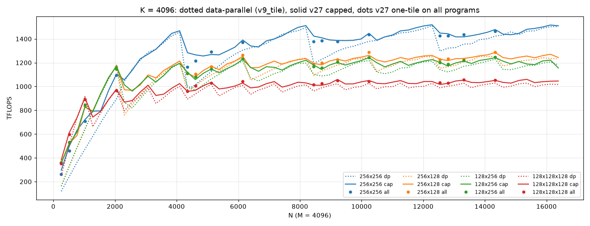
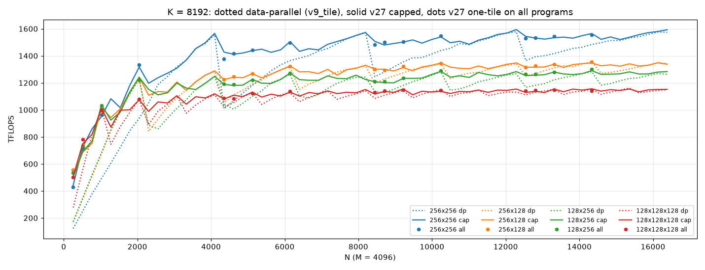
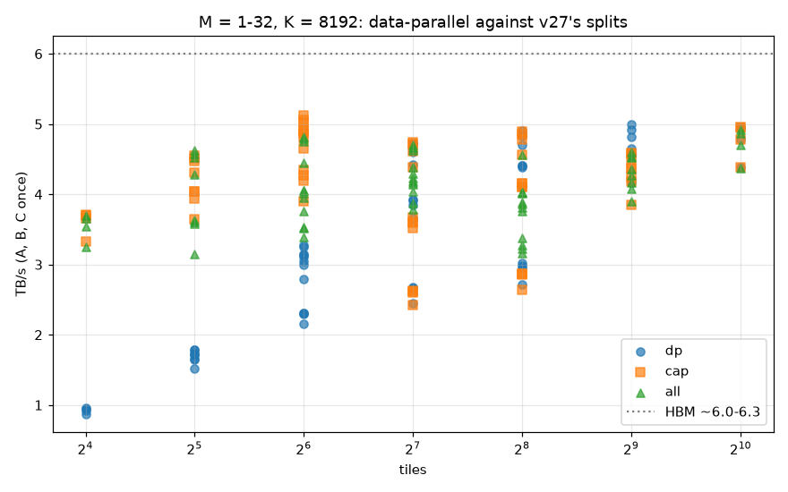

# v27_streamk_tile work log

v26 over v9_tile's tiles: one stream-K kernel, `v27_streamk_tile`, whose constexpr `SMALL` picks one of two
segment bodies. Quadrant tiles (BM, BN in {64, 128, 256}, BK in {64, 128}, two stages within one CU's LDS) run
v26's four-quadrant pair loop with v9_tile's derived layouts; tiles with a side of 32 or less run
v9_tile_small's strip loop. The scheduling, sync, workspace and edges are v26's. Everything here runs on the
gfx950-tutorial-v3.0 stack (the installed Triton, MFMA scheduler through `schedule_hint`) with no plugins
([env.sh](env.sh)), from `a16w16/`. Timings are back-to-back rocprof medians unless noted; raw tables are in
`results/`.

## 1. The stack, and v26 re-baselined on it (2026-10-13)

`env.sh` is v9_tile's without `TRITON_AMDGCNAS_PLUGIN` (v9_tile WORKLOG §16's stack). v26's timings, spill fixes
and policy fits were all made on Triton v2.2 + llirSched, so v26 was re-checked first, unchanged:

- **`asm_check.py`** ([v26_asm_check_v30.md](results/v26_asm_check_v30.md)): PASS. All aligned builds are
  identical to v25's. Apart from the two end-to-end builds, VGPRs are 464-484 aligned (v2.2: 440-484), 472-492
  at K - 16 / K - 112 (448-488) and 488-500 with all edges forced (the same), with no spills. The end-to-end
  builds spill as on v2.2: two-tile 6 (K - 16, K - 112: 9, 9; forced 14), spread 6 (7, 5; 22).
- **`check_streamk.py`** ([v26_check_streamk_v30.md](results/v26_check_streamk_v30.md)): PASS, 224 configurations
  on 1000x2000x8080 and 4300x4000x8176, no wrong results, every flag and count re-armed.
- **Negative controls:**
  - `--stale-count` ([v26_check_stale_v30.md](results/v26_check_stale_v30.md)): detected, every configuration
    hangs.
  - `--unsafe-placement` ([v26_check_unsafe_v30.md](results/v26_check_unsafe_v30.md)): **detected only
    weakly.** With 30 launches, each fp32 configuration has 1 wrong launch and the bf16-pair ones none; on v2.2
    (v24 entry 1) every launch was wrong. The hardware has not changed: experiments/memory_model_litmus's
    `controls` sweep, re-run on this stack, still finds cross-XCD default stores 100% stale. This is the litmus
    `pollute` effect: enough other traffic evicts the dirty lines in time, and on this stack it usually does.
    So the l2 exchange still needs its placement check, but this control now misses most failures. A sharper
    control would need a shape where the reader polls before the writer's L2 can evict.
- **`regress.py --versions 26 --streamk`** ([v26_regress_streamk_v30.md](results/v26_regress_streamk_v30.md)):
  correct on all 9 shapes, 0 VGPR spills.

The policy constants stay as fitted on v2.2.

## 2. Step 1: ragged N and K in v9_tile_small (2026-10-13)

So that v27's data-parallel fallback takes every shape v27 does, `v9_tile_small` gets v9_tile's two edge flags
([v9_tile/matmul_kernel.py](../v9_tile/matmul_kernel.py)):
- **EDGE_N:** B's column offsets are clamped to the tile's last in-bounds column; the C store is masked to N,
  and so is the bias without C_T. Under C_T the bias runs along M and was already masked.
- **EDGE_K:** K is rounded up to K_PAD, and the prologue loads the last, partial pair first, as v9_tile does. The
  mask compares the column each lane actually loads, `swizzled_k(offs_k, offs_r)`, against K. `offs_k` would
  be wrong, because the swizzle is folded into the copy addresses.
- **Host:** `matmul_small` sets the flags (`V9_FORCE_EDGE=1` sets both) and keeps only `K % 16 == 0`. One pair
  stays allowed (it was before); v27 itself needs two.

**Gate:** with the flags off, all 20 small tiles of `results/asm_small.md` compile to the same instructions and
registers as before the change, each against a build of the git HEAD source
([v9_small_gate.md](results/v9_small_gate.md), [v9_small_gate.py](v9_small_gate.py)). The first version
computed the swizzled columns once, ahead of the offsets, and that alone reordered a few address
instructions. It now builds them in the original order and computes the swizzled column only under EDGE_K.

**Checks:** `check_tiles.py` has `SMALL_RAGGED_SHAPES` (N in {4000, 4032}, K in {4080, 4000}, M = 1-32 and the
mirror images), all in its sentinel window. 8 small tiles, bf16 and fp16, with and without bias: 960 cases,
0 failures ([v9_check_tiles_small_ragged.md](results/v9_check_tiles_small_ragged.md)); `V9_FORCE_EDGE=1` on 4
tiles: 480 cases, 0 failures ([v9_check_tiles_small_forced.md](results/v9_check_tiles_small_forced.md)).

## 3. v27: one kernel, two bodies (2026-10-13)

[matmul_kernel.py](matmul_kernel.py), from v26's:
- **Entry point.** `SMALL` selects the LDS allocation (four half-tile buffers, or v9_tile_small's two strips;
  until §10 also `lds_pads`), the layouts and the body (`streamk_segment` dispatches to `quadrant_segment`, v26's, or
  `small_segment`). The other body's buffers are `None`.
- **Quadrant body.**
  - v9_tile's `tile_shared_layout` / `tile_load_layout` / `mfma_layout` replace v26's hand-built layouts, and
    `store_layout(BLOCK_N / 2)` the fixed C-store layout.
  - `lane_contiguous_offsets` and the bf16 pair maps are parametric in a HALF_M x HALF_N quadrant (each side
    32-128; VQ = (HALF_M / 32)(HALF_N / 32) register vectors, column blocks first; the pair map takes
    NP = HALF_N / 64). A `static_assert` checks the order against `gl.to_linear_layout` of the MFMA layout:
    for every quadrant shape the registers are column 1, 2, then the column blocks, then the row blocks; the
    lanes are rows 1-8 and columns 4, 8; the warps are column 16 and row 16.
  - `reduce_scatter_slice` works on NBLK = BM BN / 1024 blocks; `to_band` and `band_pos` take VN and VQ, and a
    group stays inside one quadrant (NB <= VQ, which `rs_split` enforces).
  - `atomic_layout` and `zero_layout` are derived from the quadrant and tile width. At 128 columns every
    generic expression is written in v26's operation order, so the 256x256 IR is unchanged.
- **Small body.**
  - `small_segment` is v9_tile_small's two-stage loop over a run-time pair count, with step 1's EDGE_N and
    EDGE_K and v26's ragged-K order (the segment at k0 = 0 loads the last pair first).
  - Partials are the [MP, BN] accumulator, row-major, fp32 or bf16, in a 16-byte-per-lane layout. Endings:
    owner, `reduce_scatter_rows` (reader j takes 64-column blocks), and atomic_iz, with packed pairs along C's
    contiguous dimension (N, or M under C_T) after `zero_small_tile`.
  - Every layout conversion goes through the free B strip (`lds_convert`), not `convert_layout`. Inside the
    persistent loop the strips stay live, so `convert_layout`'s scratch would come on top of them and leave
    no room for 4 / W workgroups per CU.
  - The persistent loop runs whole-tile segments (`WHOLE`), with no cross-tile prefetch.
- **Host.** `matmul(..., tile=...)` or `STREAMK_TILE`, v9_tile's spec format, default 256x256x64:
  - `tile_geometry` applies the checks and returns BLOCK, W, swap, NUM_PROGRAMS (256, or 1024 / W for small
    tiles), the slot shape and NBLK.
  - Rejected with a message: r2, the 32x32x16 MFMA, m4, eE, replicated warps, BK = 128 with a side of 256 (LDS),
    and bf16_pairs on small tiles or BN = 64. Small tiles always run one wave per SIMD (pinned by LDS pads
    here, by `waves_per_eu = 1` since §10; `p` and `e1` are implied), and a small tile whose W-wave
    workgroups do not fit 4 / W to a CU is rejected (32x64x128 needs w2).
  - `GROUP_SIZE_M` comes from `group_size_m` (4 at 256x256 on any grid of 96 tiles or more, v26's constant).
  - `rs_split` takes the tile's blocks (readers capped at NBLK) and a quadrant's block cap.
  - The data-parallel one-wave fallback is `v9_tile.matmul` on the same tile (one wave per SIMD if small).
  - `check_residency` compiles each small configuration once without launching and asserts its LDS leaves
    room for 4 / W workgroups per CU. With fewer, not every program is resident and the endings' waits never
    return.

**The gate: at 256x256x64 v27 is v26** ([asm_gate.md](results/asm_gate.md)). All 34 configurations of v26's asm
check, at K, K - 16, K - 112 and K - 112 with all edges forced: 136 builds, identical instructions, VGPRs, AGPRs
and spills. `regress.py --versions 26 27 --streamk` ([regress_streamk.md](results/regress_streamk.md)): v27 is
-0.7% to +1.1% of v26 on all 9 shapes, same registers.
- **The gate has to compile each build in its own process with an empty cache.** When v26 and v27 were built in
  one process, 5 of the 136 differed by 2 lines: a commutative `xor` in the lowering came out with its
  operands swapped (a `v_bitop3` with the swapped truth table). The TTGIR and the source were identical. In
  fresh processes the two are byte-identical (3 runs each), so the lowering depends on what the process
  compiled before. [asm_check.py](asm_check.py) `gate` now compiles every build fresh.

## 4. Three problems the new tiles exposed, and their fixes (2026-10-13)

1. **A scalar atomic's result costs LDS.** Triton runs a scalar `atomic_add` in one thread and broadcasts its
   result through 4 bytes of LDS. 32x128x128's strips fill its 80 KB share exactly (two workgroups of two waves
   per CU), and inside the end-to-end segment loop the strips stay live, so the owner's peer poll took 81,924 B
   and the residency check refused the build (two-tile, spread). In the tile-aligned path the A strip is dead
   after the K loop and the scratch reuses it. The small owner ending now polls with `gl.atomic_poll(flag, 1,
   relaxed, gpu)`. Its result needs no broadcast; it compiles to `global_load_dword ... sc1`, the relaxed
   `gpu` spin that the memory_model_litmus write-up lists as correct for any placement. The quadrant body
   keeps v26's poll.
2. **Packed bf16 atomics silently add nothing when N is not a multiple of 16.** v22-v26 have this bug too;
   their checks used N = 2000 and 4000. The lowering forces two elements per `buffer_atomic_pk_add_bf16`, but:
   - if C's row stride is not known to be even (Triton only specialises multiples of 16), it asserts (`vec >=
     2`; 1000x1000, 4000x30 under C^T);
   - if the edge mask is not provably constant over each pair (N not a multiple of 16), it narrows the add to
     one bf16 element. That add does nothing: C stayed all zeros on 500x1000 at 64x64x128 and 128x128x128.

   The fix is `ATOMIC_EVEN`. The host asserts the stride and the pair dimension's extent are even, and sets the
   flag when either is not a multiple of 16. The atomic ending then takes both as `x // 2 * 2` (the same
   values), which axis analysis sees as even. Aligned builds, and the gate, are unchanged. An odd N (or C
   stride) is rejected for `atomic_iz`.
3. **The mean-error tolerance is noise on a tile with one row.** 16x64x128 at M = 1 failed 1-3 of 10 launches
   of atomic_iz: the per-tile mean covered 64 elements. The check now widens each tile along its long side to
   at least 1024 in-bounds elements. A lost or doubled partial (error ~2 across a tile) is still caught.

## 5. Checks (2026-10-13)

**Stress** ([check_streamk.py](check_streamk.py) `--tile`, `results/check_streamk_<tile>.md`):
- Configurations: every ending, partial type, reader mode, placement, exchange and split the host allows, with
  and without bias, 10 launches each, with C inside a sentinel window.
- Quadrant shapes: v26's S = 16, 33, 4 and 128 scaled to the tile, plus its two ragged ones (all stream-K with
  M, N, K ragged; S = 16 with all three ragged).
- Small shapes: M = 1-32, N = 4000-8192, K = 4080-8192, plus a full wave of small tiles with all edges, mirrored
  for 256x16.
- To make this tractable, cases compile in parallel (12 per GPU, without launching) and take a per-GPU file
  lock for their launches, so no two stream-K kernels ever share a GPU.
- For the quadrant tiles, the atomic_iz rows are the re-run after fix 2 (`_atomic.md`); the small tiles were
  re-run whole after fixes 1-3.

| tile | shapes | configurations | wrong launches | flags or counts left up | errors | result |
|---|---|---|---|---|---|---|
| 256x256x64 | 6 | 904 | 0 | 0 | 0 | PASS |
| 256x128 | 6 | 904 | 0 | 0 | 0 | PASS |
| 128x256 | 6 | 904 | 0 | 0 | 0 | PASS |
| 128x128x128 | 6 | 904 | 0 | 0 | 0 | PASS |
| 128x128 | 6 | 904 | 0 | 0 | 0 | PASS |
| 64x64x128 | 6 | 624 | 0 | 0 | 0 | PASS |
| 64x256 | 6 | 904 | 0 | 0 | 0 | PASS |
| 256x64x64 | 6 | 624 | 0 | 0 | 0 | PASS |
| 16x256x128 | 5 | 580 | 0 | 0 | 0 | PASS |
| 16x64x128 | 5 | 580 | 0 | 0 | 0 | PASS |
| 32x128x128 | 5 | 580 | 0 | 0 | 0 | PASS |
| 1x256x128 | 5 | 364 | 0 | 0 | 0 | PASS |
| 256x16x128 (C^T) | 5 | 568 | 0 | 0 | 0 | PASS |

**Registers** ([asm_tiles.md](results/asm_tiles.md), summary [asm_tiles_summary.md](results/asm_tiles_summary.md)):
every configuration of every tile, aligned and with all edges (K - 112), compiled without launching.

| tile | VGPRs (arch + acc) | AGPRs | LDS KB | builds that spill (aligned / all edges) |
|---|---|---|---|---|
| 256x256 | 464-512 | 256 | 147.9 | two-tile 5 / 13, spread 5 / 21 (v26's) |
| 256x128, 128x256 | 312-424 | 128-188 | 106.9, 114.9 | none |
| 128x128x128, 128x128 | 184-272 | 64-88 | 139.9, 73.9 | none |
| 64x64x128, 64x256, 256x64x64 | 112-272 | 16-92 | 67.9-90.4 | none |
| 16x256x128, 1x256x128, 256x16x128 (W = 4) | 257-272 | 20-24 | 136.0 | none |
| 32x128x128 (W = 2) | 292-312 | 44-56 | 80.0 | none |
| 16x64x128 (W = 1) | 257-276 | 24 | 40.0 | none |

The small rows are §10's builds (`waves_per_eu = 1`); with the LDS pads they were 228-312 VGPRs, the quadrant
rows are unchanged. Every small build's LDS fits t = 4 / W workgroups per CU (at most 160 / t KB): 136, 80 and
40 KB, the last two exactly at that limit.

## 6. Compute-bound: wave quantization per tile (2026-10-13)

v9_tile §13's sweep (M = 4096, N = 256-16384 in steps of 256, K = 4096 and 8192) at 256x256, 256x128, 128x256
and 128x128x128, on GPU 0 ([sweep.py](sweep.py), [wq_report.md](results/wq_report.md),
`results/wq{4096,8192}.csv`). `dp` is v9_tile at the tile; `cap` is v27 at the tile as deployed; `all` is v27's
one-tile split over all 256 programs (§13's sk256). 1152 points, all correct.

- **At every tile, v27 flattens the sawtooth.** Against data-parallel at the same tile, over every N:

  | tile | K = 4096: median / min / max | K = 8192 |
  |---|---|---|
  | 256x256 | 1.024 / 0.983 / 2.475 | 1.053 / 0.992 / 3.618 |
  | 256x128 | 1.028 / 0.996 / 2.211 | 1.021 / 0.983 / 2.972 |
  | 128x256 | 1.021 / 0.978 / 2.181 | 1.043 / 0.985 / 2.921 |
  | 128x128x128 | 1.028 / 0.989 / 1.525 | 1.011 / 0.989 / 1.829 |

  The losses (to -2.2%) are where capped picks data-parallel above one wave and runs its persistent loop (as
  v26 does) against v9_tile's non-persistent launch.
- **Under a quarter of a 256x256 wave, a smaller tile with stream-K wins.** Best v27 tile against best
  data-parallel tile:
  - K = 8192: 1.83x at N = 256 (128x128x128, 507 TFLOPS), 1.35x at 512, 1.26x at 1280.
  - K = 4096: 1.53x and 1.21x.

  It also beats v26's 256x256 stream-K there:
  - K = 8192: 507 against 443 TFLOPS at N = 256, and 1038 (128x256) against 951 at N = 1024. `all` at
    128x128x128 reaches 782 at N = 512, against 722.
  - K = 4096: 382 against 296 at N = 256, and 906 against 721 at N = 1024.
- **From half a 256x256 wave up, 256x256 stream-K is the fastest choice**, as §13 found. Best v27 tile against
  best data-parallel tile, per N: median 1.013 (K = 4096) and 1.039 (8192), worst 0.983 and 0.992. One step
  past a full wave (N = 4352) it is 1.28x and 1.36x.

## 7. Memory-bound: M = 1-32, N = 4096-16384, K = 8192 (2026-10-13)

v9_tile §14.7's grid (BM = M, BN = 16-256, BK = 128), weights from HBM, TB/s counting A, B and C once
([mb_report.md](results/mb_report.md), `results/mb.csv`). `dp` is v9_tile with one wave per SIMD, `cap` is v27 as
deployed, and `all` is v27's one-tile split over all 1024 / W programs. 180 points, all correct. 32x64x128 runs as
w2, the fewest waves whose LDS fits 4 / W workgroups per CU. The numbers are §10's re-run with `waves_per_eu = 1`
(the LDS-padded run, within noise of it, is in `results/pads/`).

| tiles | points | dp TB/s | cap | all | best of cap and all / dp: median (range) |
|---|---|---|---|---|---|
| 16 | 4 | 0.93 | 3.68 | 3.60 | 3.90 (3.82-3.98) |
| 32 | 8 | 1.72 | 4.17 | 3.96 | 2.48 (2.34-2.60) |
| 64 | 12 | 3.02 | 4.83 | 4.03 | 1.61 (1.56-1.88) |
| 128 | 12 | 3.88 | 3.60 | 4.21 | 1.19 (0.99-1.64) |
| 256 | 12 | 4.39 | 4.13 | 3.83 | 1.00 (0.94-1.16) |
| 512 | 8 | 4.62 | 4.37 | 4.31 | 0.93 (0.92-0.95) |
| 1024 | 4 | 4.86 | 4.86 | 4.78 | 1.00 (1.00-1.00) |

- **Below about 128 tiles a split is what reaches HBM.** 16 tiles go from 0.9 to 3.7 TB/s and 64 tiles from 3.0
  to 4.8, as §14.7 predicted: data-parallel cannot fill the chip's window with fewer than about 110 busy CUs.
  The best points reach 5.0-5.1 TB/s (HBM 6.0-6.3).
- **From 256 tiles a split only costs**: 5-8% lost at 512 tiles, by either variant. Not in bytes: at 512 tiles
  (16x8192x8192 on 16x16x128, 1024 programs) a partial is a 16x16 fp32 tile, 1 KB. Each split tile pays a second
  pipeline fill and the owner's wait, a fixed cost per segment, while data-parallel already streams 4.6 TB/s.
- **Fewer programs can be better, but this comparison mixes n with the ending.** At 64 tiles, `cap`
  (reduce-scatter on 3 programs per tile) gives 4.8 TB/s against 4.0 for `all`, which changes both n (4-16 per
  tile) and the ending (the auto rule takes owner below 8 per tile). Held apart (§11), n is what matters:
  - 16x4096x8192 on 16x64x128: n = 16 leaves each program 2 pairs of k-steps, and both endings lose
    (reduce-scatter 3.40 TB/s, owner 3.12, against 3.88 and 4.13 at n = 3). The partials add only about 12% to
    B's bytes.
  - 16x16384x8192 on 16x256x128: at equal n the ending barely matters (n = 3: 5.03 and 5.13 TB/s; n = 4: 4.09
    and 3.95). The gap is n = 3 against n = 4.

## 8. AITER's shapes at three more tiles (2026-10-13)

[experiments/streamk_aiter_test](../../../../../experiments/streamk_aiter_test/test.py) now has `v27 capped @TILE` rows
at 256x128, 128x256 and 128x128x128: v27 as deployed at that tile, on the 440 shapes with a partial last wave of
256x256 tiles, timed as the other rows (cold rocprof, contiguous B and C), on 6 GPUs. All 1320 cases are correct
([check_v27.md](../../../../../experiments/streamk_aiter_test/results/check_v27.md)). Against each shape's fastest
256x256 choice ([test.md](../../../../../experiments/streamk_aiter_test/results/test.md); the v27 rows are left out
of that fastest choice), median / 90th percentile / worst:

| shapes | count | v26 deployed | v27 @256x128 | v27 @128x256 | v27 @128x128x128 |
|---|---|---|---|---|---|
| less than one wave, S <= 128 | 254 | 1.022 / 1.112 / 1.231 | 0.957 / 1.128 / 1.319 | 0.951 / 1.134 / 1.413 | 0.910 / 1.243 / 1.458 |
| less than one wave, S > 128 | 60 | 1.002 / 1.014 / 1.061 | 1.162 / 1.299 / 1.330 | 1.179 / 1.321 / 1.399 | 1.263 / 1.372 / 1.491 |
| one full wave or more | 126 | 1.003 / 1.015 / 1.039 | 1.158 / 1.224 / 1.342 | 1.218 / 1.292 / 1.328 | 1.341 / 1.429 / 1.542 |

What a per-shape tile choice is worth over v26 as deployed (the fastest of v26 and the three v27 tiles, per
shape; [v27_tile_oracle.md](../../../../../experiments/streamk_aiter_test/results/v27_tile_oracle.md)):

| shapes | count | oracle / v26: median / 10th percentile / best | more than 2% faster |
|---|---|---|---|
| less than one wave, S <= 128 | 254 | 0.856 / 0.637 / 0.496 | 200 |
| less than one wave, S > 128 | 60 | 1.000 / 1.000 / 0.970 | 2 |
| one full wave or more | 126 | 1.000 / 1.000 / 0.938 | 2 |

By the number of 256x256 tiles: 1-32 tiles, median 0.789 (256x256 kept on 1 of 71 shapes); 33-64, 0.856 (10 of
84); 65-128, 0.947 (37 of 99); 129-255, 1.000 (58 of 60). This is the held-out confirmation of section 6:
below a quarter to half of a 256x256 wave a smaller tile with stream-K wins, often by 1.3-2x. Above that,
256x256 stays.

## 9. Host rules that need re-fitting

No rule was re-fitted. Every policy runs unchanged in the tile's k-steps, tile count and NUM_PROGRAMS, with
constants fitted at 256x256, 256 programs, on compute-bound shapes. What the data says needs re-fitting:
- **`capped_policy`'s constants are counts of 256 programs.** `192 // S`, `128 // S` and the `14 / 20 x
  num_programs` idle tests do not scale to 1024 / W programs. At 128 small tiles on 1024 programs, n = 192 // 128
  = 1 picks data-parallel and misses 1.63x (1x4096x8192 at 1x32x128: 2.6 TB/s against 4.3).
- **A memory-bound regime.** The rule counts k-steps; memory-bound shapes want a split up to about 128 tiles and
  none above. At 512 tiles on 1024 programs it splits 2 ways and loses 5-8%. That loss is a fixed cost per
  segment (a second pipeline fill and the owner's wait; a partial is 1 KB there), against a data-parallel run
  that already streams near what these kernels reach. The 64-tile gap of §7 is n (3 against 4-16 programs per
  tile), not the ending.
- **The program count per tile at smaller quadrant tiles.** At 256x128, K = 8192, N = 256 (32 tiles) capped's
  n = 6 gives 504 TFLOPS and all 8 per tile give 554 (+10%). The `192 // S` cap was fitted at 256x256's
  per-tile cost.
- **Choosing the tile.** Under a quarter of a 256x256 wave (64 tiles or fewer), 128x128x128 or 128x256 with
  stream-K beats 256x256 stream-K by 4-29% in the sweep, and on AITER's shapes a per-shape choice is a median
  14% faster (section 8). From about half a wave up, 256x256 wins. Small tiles are the memory-bound choice for
  M <= 32. The default stays 256x256x64. A tile rule fitted on the sweeps needs a held-out check, and AITER's
  shapes have now been seen for this question, so they can no longer be that check.

§11 has preliminary data on all four.

## 10. One wave per SIMD by `waves_per_eu = 1`, not LDS pads (2026-10-14)

Small tiles were held to one wave per SIMD by padding their LDS (v9_tile_small's `PAD0..2`), so that only 4 / W
workgroups fit in a CU. v9_tile §14.9 found that `waves_per_eu = 1` does the same through LLVM's register budget:
1.00 waves per SIMD against about 1.2 with the pads, and no pad allocations. v27 now launches every small build
with `waves_per_eu = 1` and no pads, and its data-parallel fallback runs v9_tile with `e1` (`fallback_spec`).
- **Residency is still checked from LDS.** The endings need every program resident, so 4 / W workgroups must fit
  a CU's LDS; `check_residency` stays. 16x64x128 and 32x128x128 still fill their share exactly (40 and 80 KB)
  with the strips alone, so §4's fix 1 (the owner's `atomic_poll`) stays too.
- **Checks:** the five small-tile stress checks pass again (`results/check_streamk_<tile>.md`; the padded runs are
  in `results/pads/`).
- **Memory-bound re-run** (§7 now quotes it): against the padded run, TB/s per point has a median ratio of 1.001
  (10th-90th percentile 0.987-1.010, extremes 0.91-1.09), inside §11's measured noise (90th percentile 3.2%,
  max 10.7%).
- **Registers** (`asm_check.py tiles` re-run, [asm_tiles.md](results/asm_tiles.md); §5's table): every small build
  now allocates 257-312 VGPRs, more than half a SIMD's 512, so a second wave cannot fit (228-312 with the pads,
  which these tiles' LDS had already made zero). No build spills, the LDS is unchanged, and all eight quadrant
  tiles' registers are identical.

## 11. A preliminary sweep: tiles x stream-K configurations (2026-10-14)

**Preliminary:** a coarse factorial to choose the re-fit's design (a configuration per tile then a tile, or every
combination), not a rule fit. Report: [prelim_report.md](results/prelim_report.md); data
`results/prelim_<GPU>.csv`, merged in `results/prelim.csv`; [sweep.py](sweep.py) `PRELIM`,
[run_prelim.sh](run_prelim.sh), [prelim_report.py](prelim_report.py).

- **Grid.** 7 tiles: 256x256, 256x128, 128x256 and 128x128x128 on 40 compute-bound shapes (M = 1024, 4096,
  N = 256-8448, K = 2048, 8192), and those plus 16x256x128, 16x64x128 and 32x128x128 on 30 memory-bound and
  crossover shapes (M = 1-128, N = 4096-16384, K = 4096, 8192), bf16, aligned N and K. Up to 12 configurations per
  tile: `dp` (v9_tile), `cap` (as deployed), one-tile `rs{2,4,8,16,all}` and `ow{2,4,all}` with fp32 partials, `2t`
  and `sp`, less those that cannot run or repeat another. That gives 2,632 points, all correct, plus 129 timed again
  on another GPU.
- **Opt-in configurations are not part of the search.** The atomic ending and 16-bit partials are only used when
  selected explicitly, and no rule picks them (capped never does). The run also timed `azall` (316 points); the
  report leaves those rows out. A separate one-GPU run timed them against bf16 and bf16-pair partials
  (`results/bf16.csv`), for if they are ever selected.
- **Cost: minutes, not hours.** A v27 build compiles in 0.4-1.3 s (the plan assumed 15 s): 2,578 builds took 64 s
  in 48 processes. Timing ran about 4 points per second per GPU: 3,095 timings in 92 s on 8 GPUs. So a full
  factorial ten times larger would take about half an hour; cost is no argument against it.
- **Noise.** Repeats differ by a median 0.57%, 90th percentile 3.2%, max 10.7%, with no bias per GPU. The report
  treats differences under 3.2% as not significant. The winning tile is within that of the runner-up on 14 of
  the 40 compute-bound shapes and 13 of the 30 memory-bound ones.
- **Cutoffs (best tile).**
  - Compute-bound: up to 68 256x256 tiles, 128x128x128 wins 17 of 19 shapes and 256x128 or 128x256 the other 2.
    Above that, 256x128 or 128x256 win until 256x256 takes over: from 80-96 tiles at K = 8192, but only from 192
    at K = 2048. So the crossover to 256x256 comes later at small K.
  - Memory-bound: a small tile wins every shape with M = 1-64 (16x64x128 and 32x128x128 mostly, 16x256x128 on 2),
    and 2 of the 6 with M = 128, where 128x128x128 or 128x256 win the rest. 32x128x128 wins all of M = 64 even though
    it reads B twice.
- **What a better choice is worth** (time over each shape's winner, median / worst):
  - v26 as deployed: 1.13 / 1.65 compute-bound and 1.58 / 2.65 memory-bound.
  - Capped at the best tile per shape: 1.01 / 1.15 and 1.04 / 1.16. The tile choice is most of the gain, the
    configuration rule the rest.
- **Separability.** Every tile keeps data-parallel plus its k most frequent near-best split configurations, and the
  shape takes the fastest kept (tile, configuration). Ranking each tile over all 70 shapes:
  - k = 1: 24 shapes lose more than noise, worst 1.19.
  - k = 3: 5 lose, worst 1.12.
  - k = 4: 3 lose, worst 1.09.

  Ranking each tile per regime (compute-bound and memory-bound separately) does better: k = 3 loses on 2 shapes
  (worst 1.12) and k = 4 on none (worst 1.025). So a per-tile stage keeping about four split configurations per
  regime, then a choice across tiles, loses nothing measurable here. A crude per-tile rule (the nearest other shape
  in the tile's own coordinates) does worse: 9 shapes lose more than noise, worst 1.26.
- **Configurations.** `rsall` is the most frequent near-best split at every tile except 16x64x128 and 32x128x128,
  where data-parallel is. With the ending fixed, owner's time grows steeply with n on compute-bound shapes (256x256:
  1.25 at n = 4, 2.06 at n = 16 over the tile's best). Reduce-scatter stays within 1.00-1.09 from n = 4 to 16.
- **Gaps in the grid.** `cap` beats every configuration the sweep has at its tile, by more than noise, on 24
  (shape, tile) pairs, all through choices the grid lacks:
  - **n = 3 (18 pairs) and n = 6 (2).** At 64 tiles (M = 1-128, N = 16384, K = 8192), n = 3 is 16-24% faster than
    both n = 2 and n = 4, with either ending, at 16x256x128 and at 128x256. Re-timed, it reproduces to 2%. At
    128x8192x8192 on 256x256, capped's n = 6 is 20% faster than anything the sweep has there, n = 4 and 8 included. A re-fit needs every n from 2 to about 8, not
    powers of two.
  - **Persistent data-parallel, 3 pairs.** v27's persistent loop beats v9_tile by 4-5.5% at 4096x{3072, 5120,
    6144}x2048 on 128x128x128. `dp` here is only v9_tile.
  - **n = 32, 1 pair** (1024x256x8192 at 256x256, 4%).
- **Memory-bound against v9_tile §14.7's model** (measured over model TB/s, median): small tiles 0.84-0.91 for
  data-parallel, reduce-scatter and owner, 0.78 for the end-to-end splits. Quadrant tiles at M <= 128 are
  0.57-0.73: the model, fitted on small tiles, overestimates them.
  - **Caveat: both TB/s and the model count unique bytes.** §14.7 had M = BM, so B was read exactly once. Here
    M is up to 128: each tile row reads all of B again (8 times at M = 128 on 16-row tiles), and each tile column
    reads A again. A tile's traffic is `A ceil(N / BN) + B ceil(M / BM) + C`, served from L2, MALL or HBM
    depending on how close in time the re-reads are. Unique bytes understate it, most for small tiles at
    M = 64-128. Fetched bytes need the counters (`ea_rd_over_unique`).

## 12. Tooling

- [bench_ext.py](../bench_ext.py): version 27; `--tile` sets `STREAMK_TILE` as well as `V9_TILE`.
- [regress.py](../regress.py): versions `27@TILE` (and `9t@TILE`) set `STREAMK_TILE` / `V9_TILE` in the worker;
  the docstring describes the v3.0, no-plugin stack.
- [v20_streamk_reduce_scatter/rocprof_check.py](../v20_streamk_reduce_scatter/rocprof_check.py): v27, with v9_tile
  as its fallback kernel.
- [experiments/streamk_aiter_test/test.py](../../../../../experiments/streamk_aiter_test/test.py): `v27 capped
  @TILE` rows at 256x128, 128x256 and 128x128x128, kept out of the per-shape best and reported as their own
  columns; `SWEEP_SHARD=i/n` for one process per GPU.
- [check_streamk.py](check_streamk.py) `--tile`, `--jobs`; [asm_check.py](asm_check.py) `gate` / `tiles`;
  [sweep.py](sweep.py) and [report.py](report.py) for sections 6 and 7; [run_checks.sh](run_checks.sh).
- For §11:
  - [sweep.py](sweep.py) has the kinds `rs{n}`, `ow{n}`, `az{n}`, `2t` and `sp`, a validity filter, the `PRELIM`
    preset with noise repeats, `--shard i/n`, and a `warm` mode that compiles every point without launching.
  - Each row records S, n, the ending, programs, pairs per program and busy CUs.
  - A point that fails or prints nothing for `--point-timeout` seconds is killed, retried alone once, then
    written as an error row.
  - [run_prelim.sh](run_prelim.sh) runs warm, then one shard per GPU, then the merge (`PRESET` for another
    preset); [prelim_report.py](prelim_report.py) writes the report, leaving out opt-in configurations.
  - A suffix `b` or `p` on `rs{n}` / `ow{n}` gives bf16 or bf16-pair partials (opt-in, explicit points only), held
    to the mean-error test.
  - `results/bf16.csv` was timed in one process on one GPU, because 8 parallel shards segfaulted at random
    points. **The cause was the worker itself:** it set each kind's `STREAMK_*` options with `os.environ`
    (setenv) around every launch, about 1,100 times a point, while rocprofv3's threads read the environment;
    glibc's setenv is not thread-safe (faulthandler caught one crash inside `os.environ.__setitem__`). The
    worker now gives matmul_kernel a private copy of the environment (`v27_module`), which it only reads
    through `os.environ.get`; 4 parallel shards then ran 60,433 timings with no crash.
- **`tile_geometry` rejects 10 more small tiles:** BK = 64 with 4 waves and an A strip under 32 rows (1-16 x256x64
  and their C^T mirrors). The strip is less than one load per wave (v9_tile's `strip_load_layout` assert), so they
  never compiled; v27 now rejects them with a message, leaving 102 tiles.
- **`sweep.py` FULL** (`results/full_<GPU>.csv`, merged in `results/full.csv`): every tile v27 accepts (102) on the
  memory-bound grid M = 1-128, N = 512-16384, K = 4096 and 8192, and the 13 quadrant tiles on PRELIM's
  compute-bound shapes, with n = 2-8, 12, 16 and all, `pdp` (v27's persistent data-parallel loop), `2t` and `sp`:
  59,248 points plus 1,185 repeats, all correct, 55 minutes on 4 GPUs (2026-10-14, compact grid on). The 89 new
  tiles were stress-checked first in the configurations FULL times (`results/check_sweep_<tile>.md`: rs and owner,
  fp32 partials, pow2 readers, tile placement, wt, no bias; one-tile, two-tile and spread): all PASS. Not analysed
  yet.
  - `matmul_kernel.LAST_LAUNCH` also records `streamk_programs`.

## 13. Launch only the working programs below one wave (2026-10-14)

With no full tiles, every v27 launch was the tile's full grid (256, or 1024 / W), and the programs past the
stream-K phase's count only idled. Now the host launches only the working programs
([matmul_kernel.py](matmul_kernel.py)):
- **Kernel:** a constexpr `GRID` (0 = the full grid). When it is set, both stream-K branches take
  `spid = get_logical_chiplet_mapped_pids(GRID, NUM_XCDS)` instead of `streamk_compact_pid`. `NUM_PROGRAMS` keeps
  the workspace layout (slots, flags, barriers), and the persistent loop is empty.
- **Host:** compact when the shape has no full tiles (`STREAMK_TILES == total_tiles`), placement is balanced
  (`STREAMK_BALANCE_XCDS`, the default), the l2 XCD-local split is off (it needs the full grid's per-XCD counts), there
  are fewer stream-K programs than `NUM_PROGRAMS`, and `STREAMK_COMPACT_GRID` is not 0 (the A/B escape hatch,
  default on). Then grid = `GRID` = `STREAMK_NUM_PROGRAMS`. `LAST_LAUNCH` records `grid`, `compact` and
  `requested_programs`.
- **Why it changes nothing else:** for p < SNP, `streamk_compact_pid(get_logical_chiplet_mapped_pids(NUM_PROGRAMS))`
  equals `get_logical_chiplet_mapped_pids(SNP)` (XCD p % 8, local p // 8: both give `xcd · BASE + min(xcd, TALL) +
  local`), and it marks exactly p < SNP active. So the working programs already were hardware ids 0 .. SNP - 1 with
  these ids. The compact grid drops the idle tail; the stream-K ids, tiles, roles, slots and XCDs are the same.

**The working count, for every split: `STREAMK_NUM_PROGRAMS = min(request, S · pairs)`.** A program needs at least
one pair of k-steps:
- Tile-aligned: with q = SNP // S, the kernel's `SK_PROGRAMS` is SNP when q < pairs (`N_HI = q + 1`, `EXTRA = SNP % S`)
  and S · pairs when q >= pairs (one program per pair), so `min(SNP, S · pairs)` in both cases. Passing it back gives
  the same `N_LO`, `N_HI` and `EXTRA`.
- End to end: SNP > S · pairs gives L = 0, R = S · pairs (program i < R takes pair i); S · pairs gives L = 1, R = 0, the
  same ranges and owners. Two-tile never reaches the cap (S > NUM_PROGRAMS).
- XCD-local (`S · XCD_SPLIT`, `XCD_SPLIT <= pairs`) and capped's choices (`n <= pairs`) are below it already; only all
  programs (`None`) or an explicit `STREAMK_NUM_PROGRAMS` can exceed it.

The host applies this to every stream-K launch, compact or not, and the kernel asserts it (`SK_PROGRAMS ==
STREAMK_NUM_PROGRAMS`; end to end, `STREAMK_NUM_PROGRAMS <= S · pairs`). **Before, the XCD balancing spread the
request, not the working programs**: at 256x256 on 768x2816x512 (S = 33, 4 pairs, request 165, 132 working) the
balanced compact ids put `21, 21, 21, 21, 21, 20, 7, 0` working programs on the XCDs, and with all 256 programs
requested (`all`) half the XCDs can sit idle (16x64x128 on 16 tiles, K = 8192: 512 of 1024 working, all on XCDs 0-3).
Now they are spread within 1 (`17, 17, 17, 17, 16, 16, 16, 16`) on the full grid as well, which also changes the
stream-K phase of shapes with full tiles when the request exceeds S · pairs. Results are unchanged (the same split).

**Placement recorder:** `STREAMK_RECORD_PLACEMENT=1` (constexpr `RECORD_PLACEMENT`, off by default: no code) has every
working program write (hardware pid, spid, stream-K tile, role, chunk, `HW_REG_XCC_ID`, `HW_REG_HW_ID`) to
`LAST_LAUNCH["placement"]`, NUM_PROGRAMS x 8 int32 by hardware pid. The buffer is a `rec_ptr=None` argument, a
constexpr when unused, so the default signature is unchanged.

### Checks

- **Gate** ([asm_gate_grid.md](results/asm_gate_grid.md)): 135 of 136 builds identical to v26, every v27 grid 256.
  The other build (owner, chunk-major, n = 128, K - 112 with all edges) differs by one `v_bitop3_b32` with its operands
  swapped and the truth table to match (0x78 / 0x6c), 2 lines, same registers. It is §3's nondeterminism, now
  measured in fresh processes: 12 fresh builds of each version gave the same two variants, 11 and 1 times each, for
  v26 and for v27. The first gate run, before the normalization, had the same single miss. `asm_check.py gate` now
  builds in parallel, one GPU per build (`GATE_GPUS`), about 4 minutes on 4 GPUs.
- **Equivalence, [check_grid.py](check_grid.py)** (`results/check_grid_<tile>.md`, `_capped.md`): every tile, every
  ending, partial type, reader mode, placement, the l2 exchange on the balanced placement where the host takes it
  (and once XCD-local, which stays on the full grid), spread and capped, with and without bias, at program counts 4S,
  4S + S/2, 165, 200 and all, on shapes without full tiles: for quadrant tiles 3 x 11 tiles at K = 8192, check_streamk's
  ragged 32-tile shape, and 3 x 11 at 4 pairs (the request capped); for small tiles check_streamk's SMALL_SHAPES,
  3x4000x4080 and 1x8192 at 2 pairs. Each configuration runs `STREAMK_COMPACT_GRID=0` and 1, interleaved, 3 launches
  each plus 2 recorded. **13,002 configurations, all PASS**, 0 errors, 2,132 skipped (l2 placements the host
  rejects):
  - C bit-identical in every configuration except atomic_iz (add order), which, like bf16 partials, is held to
    check_streamk's tolerance in both modes; every flag and count re-armed after every launch.
  - Both modes pass the same `STREAMK_NUM_PROGRAMS`; the compact grid is exactly that many programs; in both modes the
    working programs are hardware ids 0 .. SNP - 1, within 1 per XCD, with the same (spid, tile, role, chunk) per
    hardware id and from launch to launch.
  - The 10 tiles finished before the normalization were run with the earlier host, which launched SK_PROGRAMS but left
    the full grid packed. On shapes where the request does not exceed S · pairs both hosts pass the same arguments, so
    those results stand; the 13 shapes where it can were re-run on the final host (`_capped.md`: 2,414 configurations,
    the request capped in 1,852), and 128x128, 64x64x128 and 256x64x64 ran whole on it.
- **Hardware dispatch: the XCD of workgroup p is (p + r) % 8, with r constant within a launch but not across
  launches.** In every recorded launch (about 52,000) the XCC id was a rotation of p % 8, and every r from 0 to 7
  occurred. The dispatcher appears to deal workgroups to the XCDs round-robin and keep its position from one dispatch
  to the next: after a grid that is not a multiple of 8 (here 132, 148, 165, 189, 252, 283, 567), or any small kernel in
  between, the next kernel starts on another XCD. A 256-program grid returns it to where it started, which may be why
  v21 only saw r = 0. This is inferred, not tested directly (a kernel of g workgroups, then a recorded one, should move
  r by g mod 8). It does not affect correctness: the l2 exchange needs only that programs with equal p % 8 share an
  XCD, which a rotation keeps. v21's assumption A1 should read "XCD (p + r) % 8".
- **CU spread:** every working program of a quadrant tile had a CU to itself (up to 32 per XCD); at 567 programs of
  16x64x128 (4 per CU allowed) the compact grid used all 32 CUs of every XCD, at most 3 per CU.
- **Stress, [check_streamk.py](check_streamk.py) `--no-full`** (check_grid's shapes, spread also at the one-tile
  program counts; `results/check_streamk_<tile>_nofull.md`): 256x256x64 540 configurations, 128x128x128 540,
  16x64x128 744, 256x16x128 708, 10 launches each, all PASS; 1,504 of them on a compact grid.

### Timing A/B: no change beyond noise

`PRESET=COMPACT bash run_prelim.sh` on 8 GPUs (1.6 minutes), [compact_report.md](results/compact_report.md), data
`results/compact.csv`: cap and all on §7's memory-bound grid, §6's wave-quantization points below one wave, and 100
seeded AITER shapes below one wave at 256x256 and 128x128x128. Each point was timed full, compact, full, compact, back
to back, with the normalized program count in both modes (so this measures the dropped tail alone, not the
rebalancing). All 2,336 rows are correct.

| set | points where the compact launch applies | median compact / full | best | worst |
|---|---|---|---|---|
| memory-bound | 24 | 0.998 | 0.993 | 1.004 |
| wave quantization | 16 | 1.000 | 0.994 | 1.020 |
| AITER | 42 | 0.999 | 0.993 | 1.014 |

- **The noise to compare against is the control, not the repeat band.** The 502 points where the compact launch does
  not apply launch the same kernel twice: their ratio is within 1.22% at the 95th percentile and 6.25% at most, and
  21 of them are "slower" than the 1.0% repeat band. The 82 applied points are within 0.98% at the 95th percentile and
  2.0% at most; 4 exceed the band.
- **Those 4 re-timed** (4 rounds each, the mode order alternating, 8 timings per mode): 0.997, 0.994, 1.007 and 1.000
  (each mode's own timings spread 3-5%). So the compact launch neither gains nor loses measurably: the idle programs
  of the full grid exit after the prologue, and that costs nothing visible at these sizes.
- **A timing artifact: the first point a rocprof process times comes out 3-6% fast.** The first run had 3 applied
  points "slower" by 1.9-3.0%. In each, only the first full-grid timing was fast (16.0-16.2 us against 17.1-17.2 for
  the other three at 16x4096x8192 on 16x64x128). With the compact mode timed first, compact got the fast time instead
  (16.0 against 17.1-17.2), every time. sweep.py starts a process every 40 points, and the COMPACT order starts every
  process on a -full point. sweep.py now times each process's first point twice and drops the first (also on the
  single-point retry). That run is kept in `results/compact_no_lead_in/`. **§6, §7 and §11 were timed without
  the lead-in**: about one point in 40 there (each process's first) may be 3-6% fast.

**Not run** (the machine was needed by someone else; run on request): the stale-count control with the compact launch,
AITER correctness over the v27 cases below one wave (`test.py check --select v27-below`, `CHECK_GPUS`), `regress.py
--versions 26 27 --streamk`, the stress check of the other 9 tiles, and a timing of the balanced placement against the
old packed one for requests over S · pairs (the A/B above has the normalization in both modes).

**Follow-up, not part of this change:** `HAS_FULL` stays on for aligned shapes without full tiles (v25 / v26 parity),
so every working program still issues and drains one unused prologue tile load. Turning it off when `total_tiles ==
STREAMK_TILES` changes v26's code on those shapes; it needs its own A/B on the same points.

### Tooling

- [check_grid.py](check_grid.py), [run_check_grid.sh](run_check_grid.sh) (tiles dealt over `GPUS`; `CHECK=check_streamk`
  runs the stress check the same way).
- [check_streamk.py](check_streamk.py) `--no-full`; the kernel column shows the grid when it is not NUM_PROGRAMS.
- [sweep.py](sweep.py): a `-full` suffix on any v27 kind (`STREAMK_COMPACT_GRID=0`), the `COMPACT` preset (each point
  full, compact, full, compact back to back), a `grid` column, and a dropped lead-in point per rocprof process;
  [compact_report.py](compact_report.py).
- [experiments/streamk_aiter_test/test.py](../../../../../experiments/streamk_aiter_test/test.py) `check --select
  v27-below` (every v27 case below one wave, timed or not) and `CHECK_GPUS` (one worker per GPU).
- [asm_check.py](asm_check.py) `gate`: parallel over `GATE_GPUS`, and asserts v27's grid is 256.

## 14. The re-fit sweep: setup for timings that can be trusted (2026-10-14)

A sweep to fit the rules of §9 on, set up so that its decisions hold up to the noise. This section covers the setup
and the checks; the report is `results/refit_report.md` once the run finishes. The rule fitting is a separate step.
Code: [refit.py](refit.py) (rounds, merge, report), [run_refit.sh](run_refit.sh), and [sweep.py](sweep.py)'s `REFIT`
preset, `pdp{P}` kind and per-chunk guards.

**What made the earlier sweeps less reliable, and what changed:**
- **The code changed while runs went on** (v27 is untracked, and another session edited `matmul_kernel.py` during
  checks). `refit.py init` writes `results/refit_manifest.json`: the sha256 of `v27_streamk_tile/matmul_kernel.py`,
  `sweep.py`, `refit.py` and `v9_tile/matmul_kernel.py`, the Triton commit (872c90a6, a dirty tree), the
  repository HEAD (dirty, v27 untracked: recorded, not committed), the GPUs, the start time, and every shape's
  block of points and GPU slot. Every timing chunk, and the warm compile, re-hashes the files and stops (exit 3) on
  a change. The REFIT stress checks stamp their reports with the kernel's hash (and with CHANGED if it moved during
  the check), and a tile enters the sweep only with a passing report for the current hash (`sweep.refit_checked`).
- **Shared GPUs.** Each chunk holds the per-GPU lock that check_streamk.py and check_grid.py take
  (`/tmp/v27_check_gpu<N>.lock`), and looks for processes on its GPU (`rocm-smi --showpidgpus`) before starting
  its rocprofv3 process and again after it. Before, it waits (logged) and stops after 30 minutes. After, the chunk's
  rows are dropped and it is timed again. rocm-smi lists PIDs in the host's namespace (478110 for this container's
  3820537), so ours cannot be told apart by PID; the checks run while none of ours is on the GPU, so anything there
  is foreign. `init` also refuses to start if pgrep finds checks or sweeps running.
  - **rocm-smi numbers the GPUs differently from HIP**, so `sweep.smi_index` matches them by PCI address (from a
    short-lived subprocess, so the shard itself never opens the GPU). Here HIP 0-7 are rocm-smi's 3, 0, 2, 1, 7, 4,
    6, 5. The first launch compared indices directly. Shard 0 then saw shard 1's worker as foreign and waited, and
    shard 1 dropped every chunk on shard 3's. A one-GPU test had happened to use HIP 2, the one that maps to itself.
  - **The machine was shared during setup.** From about 16:30 to 17:10 another container held a process on each of
    the 8 GPUs (about 119 GB of VRAM each, idle: 0-1% use, no CU occupancy). The guard flagged them on GPUs 4-7 as well.
    They had left by 17:10. With the fix above, the run started at 17:13 on GPUs 0-3, every GPU clear, and it waits
    up to 12 hours for any that come back (`FOREIGN_WAIT=43200`). The aborted attempts' logs and manifests are kept
    in `tmp/refit_gpus*_aborted_*`; their rows were discarded.
  - **Stopped at 19:27, partway through round 1** (the machine was needed), with about 27,960 of 89,033 points timed
    in `results/refit_1_<GPU>.csv`. Another container's job kept starting a process on all four GPUs at once, for
    minutes at a time (once 21 minutes), so the shards spent much of the time waiting. `tmp/gpu_watch.py` logged
    every process on the GPUs from 18:05 (`tmp/gpu_watch.log`). To resume: `GPUS=0,1,2,3 FOREIGN_WAIT=43200 bash
    run_refit.sh`. It skips the done points, as long as the frozen files and the manifest are unchanged and
    `tmp/triton_refit` (78 GB) is kept or rebuilt.
  - **Resumed at 18:55; round 1 finished at 20:14 on GPUs 0-3. Rounds 2 and 3 then moved to GPU 0 alone** (GPUs 1-3
    were needed): `GPUS=0,0,0,0 SINGLE_GPU=0 FROM_ROUND=2 bash run_refit.sh` runs each round's 4 slots one after
    another on GPU 0. The manifest now has `gpus` all 0 (`gpus_round1` keeps 0-3, `gpu_change` says when).
    GPU 0's first minutes of round 2 were kept; GPUs 1-3's were discarded (`tmp/refit_round2_gpus1-3_discarded/`).
    So a shape now sees 1 or 2 GPUs instead of 2-3: a quarter of the shapes repeat on GPU 0, and their noise from the
    rounds contains no GPU-to-GPU part. The within-block ratios are unaffected. On one GPU a round takes about
    7-8 hours.
- **Single timings.** Every point is timed twice, then the close calls a third time, on different GPUs (below).
- **Configuration gaps.** n = 2-8, 10, 12, 16, 24, 32 and all, and persistent data-parallel at 256 programs and more.
- **A sparse compute-bound grid.** 198 shapes stratified in the tiles' own coordinates instead of 40 at two M.
- **Recorded per row:** GPU, round, chunk, position in the chunk, finish time and launches timed.

### Persistent data-parallel on more programs (`pdp{P}`)

[matmul_kernel.py](matmul_kernel.py), host only: `STREAMK_PERSISTENT_PROGRAMS=P`, with `STREAMK_POLICY=dp` and quadrant
tiles only, sets `NUM_PROGRAMS` (grid, persistent stride, workspace) to P, a multiple of 8 (the XCD remap), at least
256. With no stream-K tiles nothing waits, but P only means P concurrent programs if all are resident, so
`check_residency` now also checks VGPRs: ceil(P / 256) workgroups of 4 waves need that many waves per SIMD in 512
VGPRs (`.amdhsa_next_free_vgpr`, arch + acc, in granules of 8) and that many times the LDS per CU. The GROUP_SIZE_M
footprint rule counts ceil(P / 256) tiles per CU (1, so unchanged, at 256). Which tiles fit
([tmp/pdp_probe.py](tmp/pdp_probe.py): dp builds aligned and with every edge, at K = 4096 and 16384):

| tile | LDS | VGPRs | most programs |
|---|---|---|---|
| 64x64x64 | 34.9 KB | 80 | 1024 (4 per CU by LDS, 6 by VGPRs) |
| 64x64x128, 64x128x64, 128x64x64 | 53-68 KB | 112-128 | 512 |
| 128x128x64 | 73.9 KB | 184-192 | 512 |
| every other quadrant tile | 90-148 KB | 176-512 | 256 |

These are the tiles where v27's persistent loop lost 1.1-1.35x to v9_tile. A first timing: 4096³ at 128x128x64 is 145 us
on 256 programs, 130 on 512 and 129 for v9_tile; 2048x4096x4096 at 64x64x64 is 173, 122 (512), 119 (768), 121 (1024)
and 118 for v9_tile. `sweep.PDP_MAX_PROGRAMS` holds the table; a build that fails the host's check at warm time is
dropped from the timing. `check_streamk.py --persistent-programs P` checks it: the quadrant shapes plus 1.5 waves of
P aligned and about 2.2 waves with M, N and K ragged, with and without bias.

### The REFIT preset

- **Tiles (26):** FULL's greedy covers within the noise (1.85%) and within 5%, per regime
  ([tmp/refit_tiles.py](tmp/refit_tiles.py) on `results/full.csv`, the same 17 tiles as the plan listed), plus the next
  two fastest of each tile class (median of the tile's best over the shape's best), so each class has at least 3:
  - quadrant: 256x256x64, 128x256x64, 256x128x64, 128x128x128, 128x128x64, 64x64x128, 64x128x128, 64x128x64, 128x64x128,
    128x64x64, + 64x256x64, 256x64x64;
  - small, 1024 programs: 16x16x256, 16x16x128, 1x16x256, 32x32x128, + 16x32x128, 16x64x128;
  - small, 512 programs: 32x128x128, 128x32x128, + 16x128x128, 16x128x64;
  - small, 256 programs: 32x256x128, + 16x256x128, 32x256x64;
  - **and 64x64x64**, outside the rule: the only tile that holds `pdp768` and `pdp1024`.
- **Configurations (no opt-in ones):** `dp`, `pdp`, `pdp512/768/1024` where they fit, `cap`, `rs{n}` and `ow{n}` for
  n = 2-8, 10, 12, 16, 24, 32 and all, `2t` and `sp`, less what `valid()` drops.
- **Shapes (seeded, `REFIT_SEED`; none of the 617 held-out shapes):**
  - Compute-bound, the quadrant tiles, 198 shapes: 22 in each cell of 256x256 waves (0, 1-3, 4-7) x leftover tiles over
    256 programs (1/64-1/16, 1/16-1/4, 1/4-1), M = 512-8192 and N = 256-16384 in multiples of 256. Each cell has each K
    bin (512 to 32768 by powers of 2) three times plus one at random; half a bin's shapes are at its power of two and
    half log-uniform within half an octave (57 distinct K).
  - Memory-bound, all 26 tiles, 152 shapes: 19 for each M in 1, 4, 8, 16, 32, 64, 128 and 256, N = 256-32768 (multiples
    of 256) one per equal log stratum, K bins 1024-16384 dealt evenly.
- **Size:** 89,033 points (28,203 compute-bound), all compiled once in their own cache, `tmp/triton_refit`.
- **Launches per point (`sweep.shape_iters`), a change from FULL:** 1,000 as before, unless the shape's fastest kernel
  (estimated at 256x256x64) takes more than 250 us. Then about 0.25 s of launches, at least 200 (69 shapes, 200-900
  launches). Only the last 100 launches are timed either way; the rest warm up. It is the same for every point of a
  shape, so the comparisons stay like for like. At a fixed 1,000 a round would take 11.2 GPU-hours instead of 6.7,
  mostly on a few large shapes.
- **Estimate:** 6.7 GPU-hours per round, 1.7 hours on GPUs 0-3 (the deal puts 1.68 hours on each slot).

### Rounds, ratios and close calls

- **Blocks, one GPU each:** every point of a shape is timed in one block on one GPU per round, in a shuffled order
  (seeded per round and shape), and decisions use ratios within the block. Whole shapes go to the 4 GPU slots by
  estimated cost (longest first onto the least loaded). In round r, shape s runs on slot (g(s) + r - 1) % 4, so it
  sees a different GPU in each round. The shape order is reshuffled per round and slot, so a point's repeats are
  never back to back. Each rocprofv3 process still drops its lead-in point, and a chunk is 60 points (each costs
  two 0.7 s rocm-smi looks).
- **Normalisation:** rel_r(p) is the time over the geometric mean, in that round, of the shape's normalising set: all its
  points, or for a shape in round 3 that round's points. **The noise sigma** is the 90th percentile of
  |rel_1 / rel_2 - 1|, which leaves out GPU offsets (those are reported separately).
- **Round 3 (`refit.py close`), on a slot neither round used:** a tile's best and runner-up explicit (non-cap)
  configurations if within 2 sigma; a shape's best and runner-up tiles (their best configurations) if within 2
  sigma; every point whose two rounds differ by more than sigma (10% of points by definition); and the best points of
  the shape's 3 best tiles, as anchors for the block's normalisation.
- **Merge (`refit.py merge`):** `results/refit.csv`, one row per point: the median time over rounds, rel (median over
  rounds), `cfg_ratio` (over the tile's best explicit configuration), `tile_ratio` (the tile's best over the shape's),
  the rounds, GPUs, spread and each round's time. `results/refit_report.md` reports the noise (per regime, tile class
  and launch count), the per-GPU offsets, the position-in-chunk effect, round 3's share, how it compares with rounds
  1-2 and which decisions it changed, how close the winners are, v26 as deployed against each shape's best, and the
  coverage per tile class in the tiles' own coordinates (waves, S / P, k-steps).
- **Smoke test** (6 shapes, 84 points, HIP 5 and 6, all three rounds, then deleted): sigma 1.35%, GPU offsets within
  0.13%, and no foreign detections. That proves less than it seemed: HIP 5 was compared with rocm-smi's 5, which is
  HIP 7 (idle), and HIP 6 maps to itself.

### Pre-flight checks on the hashed kernel (sha256 b96067e2...)

- **Stress, sweep scope** (`SCOPE=sweep STAMP=1 tmp/check_queue.py tmp/refit_checks.txt 0,1,2,3`,
  `results/refit_checks/`): all 26 tiles PASS (rs and owner, fp32, pow2 readers, tile placement, wt; one-tile, two-tile
  and spread), and the 7 `pdp{P}` checks PASS (64x64x64 at 512, 768, 1024; 64x64x128, 64x128x64, 128x64x64 and
  128x128x64 at 512), about 8 minutes on 4 GPUs.
- **Gate** (`results/asm_gate_refit.md`): 135 of 136 builds identical to v26, every grid 256. The other (owner,
  chunk-major, n = 100, K - 112 with all edges) differs by §13's `v_bitop3_b32` operand swap, 2 lines, same
  registers. Six fresh builds each ([tmp/gate_repeat.py](tmp/gate_repeat.py)) gave both variants for both versions
  (v26 5 and 1, v27 4 and 2). The default build is unchanged.

### The held-out test (prepared, to run after fitting)

`refit.py init --study heldout --rule FILE` (FILE defines `pick(M, N, K) -> (kind, tile)`), then
`STUDY=heldout bash run_refit.sh`: the same blocks, rounds and close calls on the 617 distinct shapes of
`experiments/aiter_lixun_shapes/supported_status_scoped.csv` (M = 512-32768, N = 512-129280, K = 512-35840, all
multiples of 128). Per shape: the rule's pick, v26 as deployed (`cap` at 256x256x64), and a reduced factorial for
the regret: the REFIT quadrant tiles x `dp`, `pdp`, `pdp{P}`, `cap` and their 4 most often near-best split
configurations on REFIT's compute-bound shapes. On the smoke test's configurations that came to about 31,000 points,
1.2 hours per round on 4 GPUs. What it can and cannot test:
- **No memory-bound shape** (none has M < 512), so the memory-bound rule is judged only by leaving shapes and K values
  out of REFIT's grid, unless a seeded memory-bound held-out set is added.
- 32 of the 630 rows have fp32 output; the timing is bf16 for all, and the 617 are the distinct (M, N, K).
- 16 shapes have K a multiple of 128 but not 256, which takes the EDGE_K build at BK = 128; REFIT's K are multiples of
  256.

**Unchanged from FULL, for reading the small shapes:** the graph cycles through at most 100 rotating copies, so a
shape whose A, B and C take less than about 2.5 MB (M <= 16 with N and K near their minimum) stays within the 256 MB
MALL from one launch to the next. Those are launch-bound anyway.

## 15. REFIT results, a fitted rule, and the held-out test (2026-10-15)

### The sweep

[refit_report.md](results/refit_report.md), data `results/refit.csv` (one row per point, merged) and
`results/refit_<round>_<GPU>.csv`. Round 1 ran on GPUs 0-3 (17:13-20:14 with a stop, §14). Rounds 2 and 3 ran on
GPU 0 alone (to 05:10). All 89,033 points were timed twice and 16,080 (18.1%) a third time, and none was wrong or
failed.
- **Noise:** sigma = 1.89% (90th percentile of the round-to-round difference of within-block ratios; median 0.52%,
  99th percentile 6.3%). That is 1.87% at the 90th percentile on compute-bound shapes and 2.0-3.0% on memory-bound
  ones, where the small tiles have the heavy tails. Timings repeated on the same GPU differ by 1.83% at the 90th
  percentile, against 2.03% across GPUs. Per-GPU offsets are within ±0.2% (the 90th percentile of blocks at most
  +0.55%). Position in the chunk makes no difference (median 0.00% everywhere), so the lead-in drop is enough.
- **The largest disagreements are the smallest shapes** (M = 1-4, N = 512, K = 1536-2560, 4-30 us). Those swing 30-55%
  both ways between rounds, which looks like two modes of a launch-bound timing; the median of three settles them.
- **Round 3** changed the best tile of 26 of 350 shapes and the best configuration of 521 of 6,526 (shape, tile)
  pairs. Its timings are within sigma of rounds 1-2's mean for 80% of points.
- **One round-3 chunk pair was re-timed.** 13 timings in chunks 165-166 (04:40-04:41, just after a 25-minute wait for
  another user on GPU 0) came out 1.5-4.9x slow. The guard had missed whatever shared the GPU. The 120 rows were
  dropped (the originals are kept in `tmp/refit_3_0_before_chunk165-166_drop.csv`), re-timed and merged again. The
  worst round-3 disagreement then fell from 353% to 35%.
- **How close the winners are:** the runner-up tile is within sigma of the best on 34 of 198 compute-bound shapes and
  79 of 152 memory-bound ones. Within a tile, the runner-up configuration is within sigma on about half the pairs.
- **v26 as deployed** (`cap` at 256x256x64) is a median 1.24x slower than each shape's best, 3.4x at the 90th
  percentile, 4.6x at worst.
- **Winners:** compute-bound, 256x256x64 on 138 of 198 shapes, then 128x128x64 (23), 64x64x128 (11) and 128x256x64 (9);
  `cap` is the best configuration on 42, `dp` 29, `pdp` 18, `2t` 16. Memory-bound: 16x16x256 (53), 1x16x256 (17),
  16x16x128 (15), 16x32x128 (12), 32x32x128 (11) and 14 more tiles; `cap` 43, `dp` 35, `rsall` 16.

### The rule ([refit_rule.py](refit_rule.py), [tmp/fit_rule.py](tmp/fit_rule.py), [refit_fit.md](results/refit_fit.md))

Nearest neighbours that minimise expected regret. For a shape, take the k nearest REFIT shapes of its regime
(compute-bound M >= 512, else memory-bound) and pick, among the (tile, configuration) valid at the shape, the one with
the smallest geometric-mean time over each neighbour's best. A candidate a neighbour did not time counts as 1.5x
there. The training table is `results/refit_rule_table.json`. Variants were compared by leaving each shape out
(regret: the pick's time over the shape's best; median / 90th percentile / worst / geometric mean):

| regime | v26 deployed | best single (tile, configuration) | cap at the kNN tile | kNN regret (chosen) |
|---|---|---|---|---|
| compute-bound (198) | 1.010 / 1.604 / 3.545 / 1.136 | the same as v26 | 1.008 / 1.146 / 1.465 / 1.038 | 1.005 / 1.072 / 1.246 / 1.023 |
| memory-bound (152) | 2.459 / 3.846 / 4.646 / 2.383 | 1.250 / 1.509 / 1.944 / 1.257 | 1.059 / 1.216 / 1.462 / 1.086 | 1.026 / 1.155 / 1.235 / 1.051 |

- The chosen features are log M, N and K plus 3 x the leftover fraction of a wave at the regime's usual winning
  class (256x256 on 256 programs; 16x64 on 1024). k = 5 for compute-bound shapes and 8 for memory-bound ones; log
  M, N, K alone at k = 5 is within 0.002 of the geometric mean. k = 1 is clearly worse (1.048 and 1.078).
- **Choosing the tile is most of the gain;** the configuration adds the rest (cap at the kNN tile against the full
  rule: 1.038 against 1.023, and 1.086 against 1.051).
- **Memory-bound, with the shape's K bin left out as well** (the only test this regime gets): 1.043 / 1.173 / 1.403 /
  1.067 at k = 5.
- Still 56 of 198 compute-bound and 83 of 152 memory-bound shapes lose more than sigma. This is a first rule; a
  closed-form host rule would be fitted against the same table.

### The held-out test

The rule (sha256 recorded with its table's in `results/heldout_manifest.json`, with every pick, before any timing)
on the 617 real-model shapes, on GPUs 0-3: 36,355 points, about 1.3 hours per round. It picks 256x256x64 for 417
shapes, then 128x128x64 (54), 128x256x64 (52), 128x128x128 (48) and 64x64x128 (24); `cap` for 487, `dp` 55, `rsall` 24,
`pdp512` 15. [tmp/heldout_report.py](tmp/heldout_report.py) writes the regret to
[heldout_regret.md](results/heldout_regret.md). The timing report is [heldout_report.md](results/heldout_report.md), the
data `results/heldout.csv`.

- **Run:** 05:25-08:52 on GPUs 0-3 with no foreign processes. Warm compiled 28,334 builds, all fine. Noise sigma
  1.24% (median 0.38%); round 3 re-timed 11,319 points (31%) and changed the best tile of 16 shapes. Round 1 on GPU 0,
  chunks 15-19 (05:38-05:41), had 4-7 points per chunk 1.1-2.1x slow, as in REFIT's round 3. Those 300 rows were
  dropped (`tmp/heldout_1_0_before_chunk15-19_drop.csv`), re-timed and merged again.
- **Regret over the best point timed** (a reduced factorial, so a lower bound):

| set | shapes | rule: median / 90th / worst / geomean | v26 deployed |
|---|---|---|---|
| all | 617 | 1.004 / 1.183 / 1.644 / 1.047 | 1.004 / 1.315 / 2.599 / 1.093 |
| below one 256x256 wave | 314 | 1.039 / 1.239 / 1.644 / 1.077 | 1.112 / 1.516 / 2.599 / 1.186 |
| 1-3 waves | 148 | 1.002 / 1.183 / 1.436 / 1.030 | 1.000 / 1.017 / 1.101 / 1.006 |
| 4 waves or more | 155 | 1.000 / 1.008 / 1.267 / 1.006 | 1.000 / 1.007 / 1.030 / 1.002 |
| inside REFIT's ranges | 425 | 1.010 / 1.195 / 1.472 / 1.055 | 1.031 / 1.418 / 2.599 / 1.135 |
| outside (M > 8192, N > 16384 or K > 32768) | 192 | 1.000 / 1.151 / 1.644 / 1.031 | 1.000 / 1.010 / 1.160 / 1.005 |

- **The rule beats v26 overall** (faster than v26 by more than sigma on 145 shapes, slower on 56). The whole gain is
  below one wave, where the tile choice matters (a geometric mean of 1.077 against 1.186, worst 1.64 against 2.60).
- **From one wave up it is worse than v26**, which is already near the best there (1.030 against 1.006 at 1-3 waves).
  Leaving shapes out of REFIT did not show this: there the two are level from one wave up (1.013 against 1.018, worst
  1.246 against 1.265, 132 shapes), while below one wave the rule wins 1.043 against 1.416. So it is a
  generalisation gap that only the held-out set could reveal. It is largest outside REFIT's ranges.
- **The worst picks are tall and skinny shapes** (N = 512, M = 7424-32768): `sp` or `cap` at 64x128x128 against `cap`,
  `dp` or `pdp` at 256x256x64, 128x256x64 or 128x128x128, 1.43-1.64x. REFIT's compute-bound grid stops at M = 8192
  and has few N = 512 shapes with large M.
- **The held-out result is the rule as frozen before timing.** A change motivated by these numbers would need a
  fresh held-out set, so none has been made. For the next fit:
  - widen REFIT's compute-bound grid to M = 32768 and N = 131072, with more tall, skinny shapes;
  - weigh the neighbours' wave count more, or fit a closed-form rule on the same table.
- **Memory-bound** remains untested by any held-out shape (none has M < 512).
- `refit.py` was changed after REFIT (the held-out manifest also records the rule's picks and hashes), so REFIT's
  recorded hash of it no longer matches the file; the timing code, `sweep.py` and the kernels, is unchanged.
- **One call for other harnesses:** [refit_matmul.py](refit_matmul.py) `matmul(a, b, c=None, bias=None)` runs the
  rule's tile and configuration for the shape (cached per shape). The options go through a private copy of the
  environment, never setenv. `choice(M, N, K)` says what it runs. `refit_matmul.py picks` writes
  `results/heldout_picks.csv` (the 617 AITER shapes: kind, tile, kernel, options; identical to the frozen held-out
  picks). `refit_matmul.py check` runs one shape per kind against torch, in bf16 and fp32 output: all correct.
- **A closed-form tile rule in the kernel: `tile="auto"` (or `STREAMK_TILE=auto`)**, [matmul_kernel.py](matmul_kernel.py)
  `auto_tile`, host only (the default and every explicit tile are unchanged).
  - **The rule:** with a wave or more of 256x256 tiles, or M < 512, 256x256x64, so v26 exactly. Below a wave, the
    largest-area quadrant tile that makes at least 128 tiles (ties: the fewest tiles, then BK = 128), else 64x64x128.
    The split stays the policy's, `capped` by default, at that tile.
  - **How it was fitted:** the two parameters (128 tiles, prefer BK = 128) by grid search on REFIT's compute-bound
    shapes ([tmp/heuristic_rule.py](tmp/heuristic_rule.py)). Regret (median / 90th percentile / worst / geometric
    mean): REFIT 1.007 / 1.222 / 1.864 / 1.054 (the kNN rule leaving shapes out: 1.023; v26: 1.136). Held-out 1.003 /
    1.158 / 1.573 / 1.042 (kNN 1.047; v26 1.093); below one wave 1.081 (kNN 1.077).
  - **The held-out figure is post hoc:** keeping v26 from one wave up came from the held-out result; only the two
    parameters were fitted blind to those shapes.
  - On the 617 AITER shapes it picks 256x256x64 for 393, 128x256x64 93, 128x128x128 75, 64x128x128 36 and 64x64x128 20,
    the same as tmp/heuristic_rule.py on all 617. Checked against torch on 5 shapes, bf16 and fp32 output.
  - **Memory-bound** shapes keep 256x256x64 under `auto`. A table by M and N band was worse than the kNN rule there
    (1.142 against 1.051 leaving shapes out), so `refit_matmul.py` stays the memory-bound route.
  - The edit changes `matmul_kernel.py`'s hash, so the REFIT check stamps (`results/refit_checks/`) no longer
    match. A new REFIT run would re-run them; the device code is unchanged.
- **`auto_tile` halving step (2026-10-15, post hoc):** if the tile `auto` picks makes exactly 128 tiles (half a wave)
  and K <= 4096 (`AUTO_HALVE_K`), it takes the half-area tile that makes exactly 256 instead (ties: BK = 128, then
  `AUTO_TILES`' order). That covers 256x256x64 → 128x256x64, 128x256x64 → 128x128x128 and 128x128x128 → 64x128x128.
  - **Why it's needed:** with that little K, stream-K can't fill the idle half of the CUs. `cap` runs the larger tile
    data-parallel on half the CUs, or splits it at a loss. This was the largest remaining source of losses against
    AITER (for example 4096x2048x512: 1.37x our best at 256x256, 1.00x at 128x256).
  - **How it was found:** on the held-out timings, CPU-only.
    - Simpler variants failed: a K cut-off on the 128-tile threshold; switching whenever `cap` would run
      data-parallel (the smaller tile often makes about 1.5 waves); a flops-per-tile model with wave quantization;
      switching to any tile that exactly fills its waves.
    - Only the one-step halving to exactly one wave works. On the held-out set it changes 42 shapes, 40 better by
      more than 2% and none worse. From K ≈ 5120 up, the larger tile with stream-K wins again at every level.
  - **Regret against our best timed point** (median / 90th / worst / geometric mean, shapes above 1.15x):
    - held-out: 1.002 / 1.115 / 1.573 / 1.030, 41 (before 1.003 / 1.158 / 1.573 / 1.042, 63);
    - REFIT compute-bound: 1.053, 26 (before 1.054, 27).
    - It matches the evaluated rule on all 815 compute-bound shapes.
  - **Checked against torch** in bf16 and fp32 on one shape per halving level, plus two that keep 256x256. The halved
    shapes launch v9_tile, because `cap` runs them data-parallel on exactly one wave.
  - **The evidence is post hoc:** REFIT had a single exactly-half-wave shape. REFIT2's structured shapes are meant to
    test the rule and its K boundary on unseen shapes.
  - **REFIT2 needs re-initialising:** the edit changes `matmul_kernel.py`'s hash, so REFIT2's manifest (frozen files)
    no longer matches.
- **v9_tile's 32-bit tile bases (found 2026-10-15):** v9_tile, and the data-parallel versions v0-v9 including
  v9_ragged, form tile base pointers as `pid_m * BLOCK_M * stride` in 32-bit. Past 2^31 elements of A, B or C the
  address wraps.
  - **What it did:** in REFIT2, `dp` points on 24320x114688x512 faulted, and each fault wrote a 6-58 GB GPU core dump
    (`a16w16/gpucore.<pid>.gpu`). 426 GB filled the disk and the sweep exited (the dumps are deleted).
  - **Not affected:** every persistent and stream-K version from v10 to v27 already promotes to int64. v27's fallback
    only hands off grids of one wave or less, and no REFIT, held-out or AITER shape exceeds 2^31 output elements.
  - **Fix:** the REFIT2 plan's `overflow` task.
- **Disk:** the Triton caches `tmp/triton_refit` (80 GB), `tmp/triton_heldout` (12 GB) and `tmp/triton_refit_checks`
  (1.3 GB) can be deleted; a re-run rebuilds them.

## 16. REFIT2: tall-skinny, large and memory-bound shapes, and a tiered rule (2026-10-15)

The held-out test (§15) showed where REFIT's grid stops: the worst picks were tall and skinny shapes beyond M = 8192,
and no held-out shape is memory-bound. REFIT2 is a second sweep on the shapes REFIT did not cover, to fit a rule in
three tiers: a simple host rule that is rarely worse than 1.15x of the best timed point, a short list of tiles to time
when that rule is unsure, and the full factorial as the last resort.

### The sweep ([sweep.py](sweep.py) `refit2_shapes`, `refit2_test`, `refit2_points`; [refit.py](refit.py) `--study refit2`)

- **Shapes (450, seeded `REFIT2_SEED` = 2620; none of REFIT's 350 or the 617 held-out shapes):**
  - **Tall-skinny compute-bound, 120:** M = 8448-65536, N = 256-2048, K = 512-32768, 12 per cell of 256x256 waves (0,
    1-3, 4-8) x leftover tiles (0-3, 4-15, 16-63, 64-255), in the 10 cells these M and N can reach. The new leftover
    cell 0-3 holds the aligned shapes (32768x512 is exactly one wave at 256x256), which REFIT left out.
  - **Large compute-bound, 60:** M = 8192-31232, N = 2304-128512, 5 per cell of waves (1-3, 4-15, 16-63, 64-256) x
    leftover (0-3, 4-63, 64-255).
  - **Wide-short compute-bound, 42:** M = 512-2048, N = 16384-131072, 6 per reachable cell of waves (0, 1-3, 4-16) x
    leftover (0-3, 4-63, 64-255).
  - **Memory-bound, 228:** 12 shapes for each M in 1, 2, 3, 4, 6, 8, 12, 16, 24, 32, 48, 64, 96, 128, 192, 256, 320, 384
    and 448 (the non-powers of two are ragged, like decode batches; 320-448 fill the gap below 512), N = 256-131072 one
    per equal log stratum, K bins 1024-32768 dealt evenly.
  - **Cost caps instead of fewer strata:** K drops to a lower bin when M N K would exceed 4e12 (compute-bound; so the
    large group has K <= 10752) or N K would exceed 2^30 (memory-bound; above every AITER shape's 0.87e9).
  - **Test split:** a seeded 20% of each compute-bound group and 2 of the 12 shapes per memory-bound M (82 shapes,
    `sweep.refit2_test`, listed in the manifest's `test`), held back from all fitting. The AITER set is post hoc only.
- **Tiles and configurations:** REFIT's 26 tiles and `REFIT_KINDS`, quadrant tiles only on compute-bound shapes. One
  prune, from REFIT's data: 1x16x256 is left out of memory-bound shapes from M = 32 up (`REFIT2_MB_PRUNE`). There its
  best is 1.39-3.65x the shape's best tile, and its re-reads of B make it the slowest point of a block (up to 15x the
  cost estimate at M = 256). Every other tile comes within 1.25x of the best somewhere in M = 1-256.
- **Size:** 110,309 points (28,089 compute-bound), estimated at 9.5 GPU-hours per round, 3.18 hours per GPU on 3 GPUs.
  The estimate ran 7-14% low on REFIT and the held-out run (REFIT round 2: 6.7 estimated, 7.25 hours on one GPU).

### Pre-flight (kernel sha256 6c5ab21d..., with `auto_tile`)

- **Re-stamped checks** (`SCOPE=sweep STAMP=1 tmp/check_queue.py tmp/refit2_checks.txt 1,2,3`, about 12 minutes): all
  26 tiles and the 7 `pdp{P}` builds PASS. The stale stamps (b96067e2...) are kept in
  `results/refit_checks/stale_b96067e2/`.
- **Ragged-M check, new:** a check_queue line `TILE raggedm` runs check_streamk.py's sweep scope on M = 3, 24, 96 and
  384 (3x4352x8192, 24x1280x4096, 96x8448x2048, 384x2304x8192). All 13 small tiles PASS, and REFIT2 requires it for a
  small tile on memory-bound shapes (`sweep.raggedm_checked`).
- **GPUs:** another container started three processes on HIP 3 (rocm-smi's 1) at 12:22, 4-13 GB of VRAM each and
  changing, so REFIT2 started on **HIP 1, 2 and 4** instead of 1-3.
- **Launch:** `STUDY=refit2 GPUS=1,2,4 FOREIGN_WAIT=43200 bash run_refit.sh` at 12:25, logs `tmp/refit2_*.log`, Triton
  cache `tmp/triton_refit2`. Warm compiled all 101,615 builds in 26 minutes (93 GB), no failures; round 1 began 12:52.
- **Moved at 13:12 to HIP 1, 2 and 0** (physical 0, 2 and 3, so physical 4-7 are free; the other job is on physical
  1). HIP numbers physical GPUs 3, 0, 2, 1, 7, 4, 6, 5, so HIP 4 was physical 7. Slot 2's round-1 rows from HIP 4
  (gpu column 4) moved to `results/refit2_1_0.csv`, less the one shape it had partly timed (32x6144x8192, 337 rows),
  which is re-timed whole on HIP 0 so that its block stays on one GPU. The manifest records `gpus_initial` and
  `gpu_change`; the originals are in `tmp/*_before_move_to_hip0.*`. Relaunched with `GPUS=1,2,0`.

### The fitting script ([tmp/fit_rule2.py](tmp/fit_rule2.py), `results/fit2_report.md`, `results/fit2_rule.json`)

- **Data:** training is REFIT plus REFIT2's training shapes, test is REFIT2's split, and the held-out AITER set is post
  hoc only. Every regret is against the best point timed for the shape.
- **Split rule:** `capped_policy` with its 13 constants exposed (and an option for `pdp{P}` on the most programs a tile
  holds), mapped to the timed kinds (n snapped to REFIT_N). At the default constants it reproduces the timed `cap`
  within 3% on 96.5% of REFIT's 6,526 (shape, tile) pairs. The constants are refitted per tile class by coordinate
  descent on the pairs whose tile is within 1.15 of the shape's best.
- **Tile rule:** a greedy tree on readable features (compute-bound: log2 of the 256x256 tile count, the leftover
  fraction, log2 M / N, K, M and N; memory-bound: log2 M, N and K), each leaf a fixed tile or `auto_tile`'s area
  rule at a threshold. Objective: the fewest shapes above 1.15x, then the sum of log regrets. Depth and leaf size are
  chosen by leaving each shape out.
- **Tier 2:** Tier 1's tile, then the tiles the 8 nearest training shapes score best; coverage for k = 1-5.
- **A dry run on REFIT alone** (so not the result), leaving shapes out: compute-bound, a depth-3 tree has 9 of 198
  shapes above 1.15x and a geometric mean of 1.024 (`auto` 1.054, nearest neighbours 1.023). Memory-bound, the best
  tree still has 48 of 152 above 1.15x (1.107), while a short list of 2 tiles holds one within 1.15x for 149 of 152.
  So memory-bound shapes will lean on Tier 2 unless REFIT2's denser grid changes that.

## 17. Two stages: a split table per tile, then the tile (2026-10-17)

The best tile under one stream-K method is often not the best under another, so tiles are compared each at its own
best method. That method should depend mostly on the tile's own leftover tiles S, k-steps and full waves, so it is
measured once per tile as a table (stage 1), and the tile is then chosen per shape from a few timings per tile
(stage 2). REFIT2 never produced results (§15's 32-bit fault filled the disk), and timings from other days and GPUs
are not compared with new ones: everything below is one session on physical GPU 2 (HIP 2, rocm-smi 2,
PCI 0000:65:00.0), with older runs used only to decide what to time.

### Phase 0: the idea checked on REFIT, CPU only ([tmp/phase0.py](tmp/phase0.py), [phase0_report.md](results/phase0_report.md))

- **Two stages lose little.** Each tile at the method predicted from its 3 nearest other REFIT shapes (same tile and
  wave class, in log S and log k-steps), then the best of those tiles: geomean 1.005 against the joint best on
  compute-bound shapes (worst 1.056) and 1.012 on memory-bound ones (worst 1.120).
  - Choosing the tile under one method first is what loses: under `dp`, 1.046 and 1.040 (worst 1.80 and 1.78), and
    the best tile under `dp` differs from the joint best on 45 of 198 compute-bound shapes.
  - Adding log M / N to the neighbours' features does not help (1.006 and 1.015), so geometry is not a table axis.
- **The method does not carry over between BK = 64 and 128** of the same BM x BN (geomean 1.03-1.05, 90th percentile
  1.09-1.17): every BK gets its own table.
- **The method matters at every wave count.** On tiles within 1.10 of a shape's best, `cap` is 1.039-1.052 behind the
  tile's best method (geomean) at 0, 1-3 and 4+ waves of quadrant tiles, and 1.140 at 0 waves of small tiles. It is
  easiest to predict from 4 waves up (1.005).
- **Pruning:** the owner ending is within sigma only at n = 2-4 and all; `pdp768` and `pdp1024` almost never; `2t`
  and `sp` are kept where they can win (a full wave; S >= P / 4).
- **Coarse n (2, 4, 8, 16, 32, all) then the n between the coarse best's neighbours** finds the family's best within
  sigma on 502 of 521 pairs (geomean 1.002).
- **Noise** (within-block, round 1 against round 2): 90th percentile 1.8-2.2% for quadrant tiles at every duration,
  2.7% for small tiles under 15 us, 99th percentile up to 9%.
- **Racing, replayed on REFIT's rounds:** every method once, round 2 only within leader x (1 + 2 sigma90 + 1%),
  round 3 for close survivors. That uses 67% of the timings of two full rounds, and its pick is more than sigma off
  on 2 of 1,136 (shape, tile) pairs (worst 1.042). The replay's truth shares its rounds, so it is optimistic; the
  audit below is the unbiased check.
- **The uneven split for S > P / 2** (`P % S` tiles on 2 programs, the rest on 1) needs no kernel change: it is the
  `all` kind (one-tile on every program). In WORST10 it ran correctly on all 161 such points but beat the best of
  `dp`, `pdp`, `sp`, `cap` and `2t` by more than 2% on 1 (median 1.24x behind), so it is only in the audit.

### The session ([split_sweep.py](split_sweep.py), [split_extra.py](split_extra.py), [tilesel.py](tilesel.py), [split_report.py](split_report.py), [run_split.sh](run_split.sh))

- **Tiles:** quadrant 256x256x64, 256x128x64, 128x256x64, 128x128x64, 128x128x128, 64x128x128, 64x64x128 (P = 256);
  small 1x16x256, 16x16x256, 16x16x128, 16x32x128, 32x32x128 (P = 1024) and 32x128x128 (P = 512). From Phase 0's
  covers within 1.05, plus 1x16x256 for M down to 1.
- **Cells:** per tile, S at 1, 2, 4, ... P / 2, 5P/8, 3P/4, 7P/8 and P - 1; k-steps 4-512 (K = 512-32768, small
  tiles from 1024); wave classes 0, 1 (the first of 1-3 that fits) and 4 (4-7). Each cell is one real shape with
  exactly `waves * P + S` tiles; the geometry alternates over the grid (square, skinny M, skinny N; for small tiles
  one row of tiles or as many as M <= 448 allows). 3,258 cells, 28,572 points in stage A.
- **Timing:** each cell's methods are one block, shuffled, in one profiler process; every comparison is within a
  block. Racing as Phase 0 (z = 2, delta = 1%: methods within 1% count as tied, broken toward the simpler one); the
  noise model is re-estimated from the session's own round 2. Stages B1 and B2 add a cell between neighbours whose
  picks cost each other more than sigma (up to 600 each); stage N times the n between the coarse neighbours of a
  cell's best reduce-scatter n with its leader and runner-up. Every chunk starts and ends with a reference kernel
  (`cap` at 256x256x64 on 4096^3), and is timed again if it moves more than 5% from the session's median or a foreign
  process is on the GPU after it. A manifest hashes the kernel, sweep.py, refit.py, v9_tile and split_sweep.py.
- **Then, in the same session:** split_extra.py's audit (a random 3% of cells, every method in 2-3 full rounds,
  `all` included), the other geometry of 8% of cells, the transposed twins of 36 small-tile cells, and 60 cells at
  the other wave counts of their class; then tilesel.py on 570 shapes (120 of REFIT's, re-timed, 300 that REFIT did
  not cover, 150 AITER shapes held out from fitting), each tile at its table pick, runner-up and `cap`, plus v26.
- **Housekeeping:** WORST10 was still running on physical GPU 1 when its Triton cache was deleted as stale (it was
  thought stopped). One chunk failed and was retried, and no row was lost; its round 3 rebuilt the cache. The other
  deletions (REFIT2's 94 GB cache, finished runs' profiler scratch) freed about 110 GB.
- **Start:** warm compile 07:51-08:11 (25,314 builds, `tmp/triton_split`); stage A round 1 at 3.0 points/s, the
  reference at 93.5-96.2 us.

### Results ([tables.md](results/split/tables.md), [extra_report.md](results/split/extra_report.md), [tilesel_report.md](results/split/tilesel_report.md), [tile_rule.md](results/split/tile_rule.md))

- **The run:** stages A (3,258 cells), B1 and B2 (600 cells each) and N (577 blocks) 08:11-14:06; the checks
  14:07-14:56; tile selection (570 shapes, 12,596 points) to 17:13. About 85,000 timings. No foreign process; the
  reference stayed within 92.6-96.6 us all day. Every point matched torch except 15 in tile selection (below).
  Racing timed 44% of stage A's points a second time and 9% of its blocks a third.
- **The tables** (`tables.json`: per tile and wave class, every cell's shape, pick, runner-up, margin and every
  method's time over the cell's best; `tables.md`: the S x k pick matrices with cap's loss per cell, and per method
  its wins, cells within sigma and geomean / 90th / worst loss). On the grid, cap is 1.006-1.077 behind each cell's
  best for quadrant tiles and 1.012-1.229 for small ones; dp up to 20x (no full wave, long K).
- **The audit** (103 random cells, every method in full rounds): the sweep's pick is a geomean 1.007 behind the best
  there (90th percentile 1.019, worst 1.102; 11 above sigma). Racing, coarse n and the grid cost little.
- **The transposed twins** (36 small-tile cells): 1.007, so one table serves both orientations.
- **Other wave counts in the class** (60 cells): 1.019 (worst 1.30).
- **The other geometry at the same S and k** (248 cells): 1.032, 44 above 1.05; quadrant 1.014-1.030, small tiles
  without a full wave 1.101 (one 6.1x outlier, 16x16x128 at 256x64x32768). Phase 0 said geometry did not matter;
  at this resolution it does, so split_geo.py times a second geometry for every cell (below).
- **The uneven split (`all`) at S > P / 2:** within sigma of the best in 5 of 33 audited cells (geomean 1.112).
- **Tile selection** (each tile at its table pick, against the best point timed for the shape; median / worst /
  geomean):

| group | v26 | auto_tile + cap | oracle tile at its table pick |
|---|---|---|---|
| AITER (150, held out) | 1.005 / 1.96 / 1.094 | 1.003 / 1.43 / 1.025 | 1.002 / 1.33 / 1.011 |
| REFIT compute-bound (70) | 1.002 / 3.60 / 1.143 | 1.000 / 1.62 / 1.064 | 1.000 / 1.32 / 1.016 |
| REFIT memory-bound (50) | 2.43 / 4.70 / 2.388 | the same as v26 | 1.000 / 1.18 / 1.013 |
| small M, 1-448 (100) | 1.68 / 4.31 / 1.876 | the same as v26 | 1.000 / 1.37 / 1.016 |
| small N, 1-448 (60) | 1.33 / 4.13 / 1.466 | 1.158 / 1.60 / 1.185 | 1.000 / 1.17 / 1.009 |
| tall-skinny (60) | 1.003 / 1.87 / 1.059 | 1.003 / 1.28 / 1.026 | 1.001 / 1.12 / 1.012 |

- **But off the grid the tables do not reliably beat cap at the same tile.** Table pick over cap, geomean (better
  by more than 2% / worse by more than 2%): quadrant without a full wave 1.008 (295 / 227, worst 3.0x), 1-3 waves
  0.987, 4+ waves 0.950; small tiles without a full wave 0.943, with full waves 1.018 and 1.007. The same pattern
  as v20's split-rule table (§9's experiment): ahead on its grid, mixed off it.
- **Why: the lookup across S.** Leaving out a table's S row and predicting it from the cell at or below costs
  1.16-1.38 (geomean) at no full wave on quadrant tiles; leaving out a k column costs 1.02-1.04. Predicting instead
  with the method best over both neighbouring S rows (smallest summed log time over the two):

| tile class, waves | at or below | nearest in log S | best over both neighbours | cap |
|---|---|---|---|---|
| quadrant, 0 | 1.068 | 1.072 | 1.019 | 1.046 |
| quadrant, 1-3 | 1.036 | 1.032 | 1.020 | 1.041 |
| quadrant, 4+ | 1.014 | 1.014 | 1.011 | 1.027 |
| small, 0 | 1.064 | 1.062 | 1.026 | 1.152 |
| small, 1-3 | 1.029 | 1.033 | 1.026 | 1.036 |
| small, 4+ | 1.027 | 1.026 | 1.021 | 1.018 |

  So between grid rows the table should store the bracket's best method, not the lower row's pick.
- **A tile rule** ([tmp/tile_rule.py](tmp/tile_rule.py)), trained on the 420 non-AITER tile-selection shapes and
  scored on the 150 AITER ones: a depth-5 tree is 1.040 on AITER (39 above 1.05), nearest neighbours 1.044, against
  auto_tile's 1.027 (23) and the oracle tile's 1.011 (6). auto_tile's halving step was found on AITER shapes, so its
  figure there is optimistic; still, the tree does not beat it on compute-bound shapes. On small shapes a tree fitted
  to them alone (CV 1.101) is far better than auto_tile (1.07-1.09 against 1.6-2.1) but well short of the oracle
  (1.01-1.02): the tile choice there needs more than a few thresholds.
- **The 15 failures** are not a hang: v27's host needs two pairs of k-steps (`K_PAD >= 4 BLOCK_K`), so BK = 256
  tiles reject K = 512 (`AssertionError`), and tilesel.py offered them there (`sweep.valid` does not check it). The
  host asserts before deciding the policy, so `cap` fails even where it would hand the shape to v9_tile, which runs
  it.
- **Second geometry for every cell** ([split_geo.py](split_geo.py)): the 3,983 cells not in GEO, at their other
  geometry, with the methods within 1.25 of the first geometry's best (at most 10) plus dp and cap; on GEO's cells
  that set held the other geometry's best within 0.02% (worst 2%). 28,425 points from 18:56; split_report.py then
  picks each cell's method on the geometric mean over both geometries.

### Both geometries and the bracket lookup ([tables.md](results/split/tables.md), [validate_report.md](results/split/validate_report.md))

- **The run** (split_geo.py, 18:56-23:11): G2a 2,615 cells, G2b 771, G2c 597; every point correct, the reference
  92.6-96.4 us. Each cell's values are now the geometric mean over its two geometries (kinds timed at both).
- **The tables are read by bracket** (split_report.bracket): the kind with the smallest summed log time over the
  cells either side of S and of k (one cell on the grid), ties within DELTA per cell to the simpler kind. Cross-
  validated over all 4,458 cells (geomean / worst time over the cell's best): cap 1.047 / 3.33; S row left out,
  at or below 1.066 / 10.1, bracket 1.025 / 3.54; k column left out, at or below 1.020, bracket 1.015. Bracket beats
  cap in every tile class and wave class except the large quadrant tiles without a full wave (256x256x64 1.063
  against 1.027, 256x128x64 1.049 against 1.039, 128x256x64 1.052 against 1.032, with an S row left out, which
  doubles the gap to the neighbours).
- **Off the grid, on tilesel's shapes:** the new pick against cap at the same tile, in one block. 3,516 of the 4,089
  (shape, tile) pairs were already in tilesel's blocks; the other 573 were timed on 05:00 18 Oct as stage V
  (tmp/validate_new.py: new pick, old pick and cap together), on the same GPU.

| tile class | waves | pairs | new / cap | better by > 2% | worse by > 2% | worst | old pick / cap |
|---|---|---|---|---|---|---|---|
| quadrant | 0 | 1,086 | 0.984 | 334 | 134 | 1.62 | 1.005 |
| quadrant | 1-3 | 748 | 0.980 | 211 | 48 | 1.18 | 0.990 |
| quadrant | 4+ | 1,088 | 0.962 | 360 | 27 | 1.46 | 0.967 |
| small | 0 | 595 | 0.930 | 287 | 75 | 1.63 | 0.944 |
| small | 1-3 | 293 | 0.992 | 60 | 27 | 1.29 | 1.012 |
| small | 4+ | 279 | 0.998 | 20 | 14 | 1.10 | 1.005 |
| all | | 4,089 | 0.971 | 1,272 | 325 | 1.63 | |

  So the merged tables beat cap in every class, most at 4+ waves on quadrant tiles and without a full wave on small
  ones; with full waves on small tiles they are level. Still 325 pairs lose more than 2% (worst 1.63x): a cap
  fallback where a cell's margin over cap is within noise would trim those, at some cost to the wins.
- Stage V's 8 failures are the K = 512 limit of BK = 256 tiles again (`cap` at 16x16x256).

### Is the best tile the largest that fills the GPU? ([tmp/tile_fill.py](tmp/tile_fill.py), [tile_fill.md](results/split/tile_fill.md))

On tilesel's 570 shapes, each tile at its best timed point; compute-bound = arithmetic intensity >= 312 flop/byte
(2.5 PF / 8 TB/s; 353 shapes), memory-bound below (217).
- **Compute-bound: the largest tile that fills half the GPU.** "The largest tile with at least 128 tiles" (half of
  256 CUs) is 1.021 behind the best tile (geomean; 42 above 1.05, worst 1.62); requiring a full wave (256 tiles)
  is 1.067, two waves 1.144. Stream-K fills the idle half. This is auto_tile's rule (`AUTO_MIN_TILES = 128`). The
  best tile is 256x256 on 275 shapes, BK = 64 on 320.
- **Memory-bound: no fill rule.** Counted in programs (a small tile runs 4 per CU, P = 1024), the best tile makes
  about half as many tiles as P (median 0.45-0.73 in every band of min(M, N)), but "the largest tile with at
  least P / 2 tiles" is 1.147 (16-row tiles at least; 1.44 without that floor), and matching the tile's short side
  to min(M, N) first (within 2x, at least 16) still 1.121. The best tile follows min(M, N): 16-row tiles (mostly
  16x16x256, not 1x16) below 16, 64-row quadrant tiles at 17-64, 128- and 256-row ones above 128, with exceptions in
  every band. v26 is 2.4x behind there, so even these rules gain a lot, but the choice needs more than a fill rule
  (the small-shape tree of tmp/tile_rule.py: 1.07-1.09).
