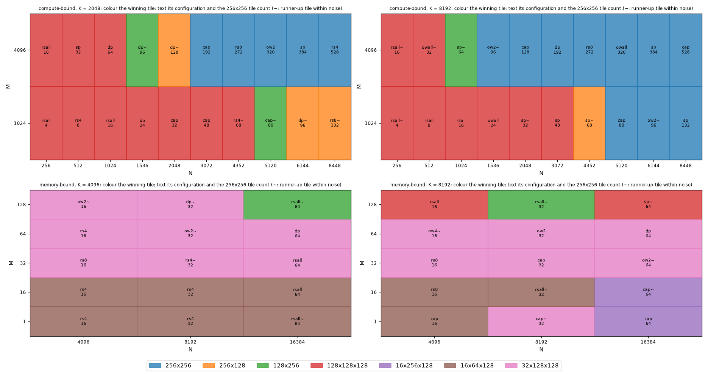
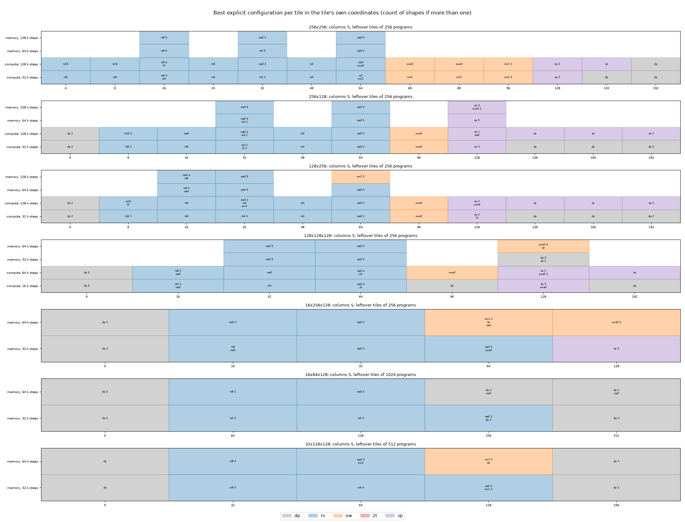
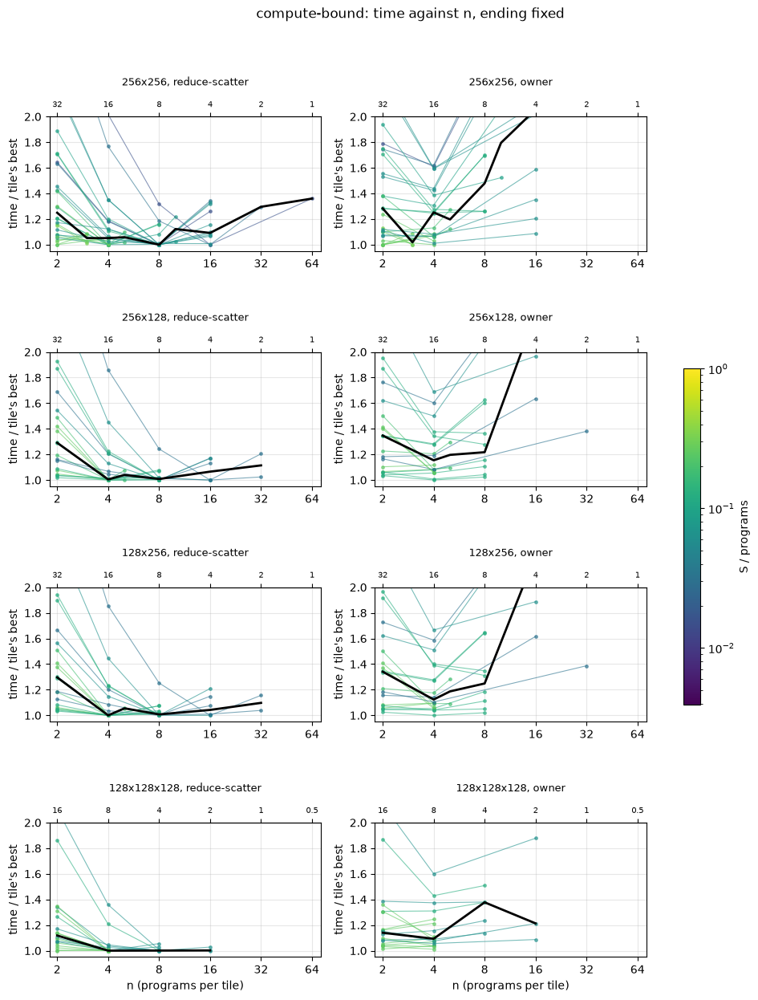
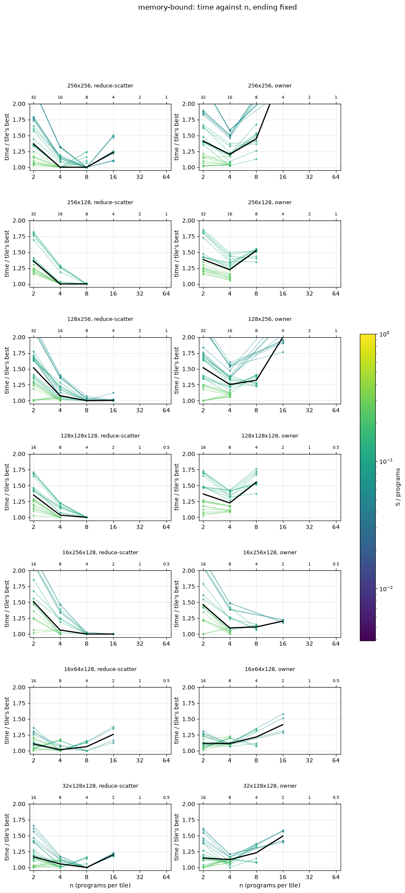
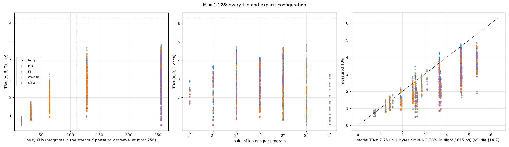

# v27 preliminary sweep: tiles x stream-K configurations

PRELIMINARY: a coarse factorial (WORKLOG §11) to decide between a two-stage and a factorial re-fit; not a rule fit. Aligned N and K, bf16, back to back (HIP graph), 2 GB of rotating inputs, rocprof median of 100 dispatches ([sweep.py](../sweep.py) PRELIM, [run_prelim.sh](../run_prelim.sh)). Tiles: 256x256, 256x128, 128x256 and 128x128x128 on the compute-bound shapes (M = 1024, 4096, N = 256-8448, K = 2048, 8192), and those plus 16x256x128, 16x64x128 and 32x128x128 on the memory-bound and crossover shapes (M = 1-128, N = 4096-16384, K = 4096, 8192). Configurations: `dp` (v9_tile at the tile), `cap` (v27 as deployed), one-tile `rs{n}` / `ow{n}` (reduce-scatter, owner, fp32 partials, on n programs per leftover tile; `all` = every program), `2t` (two-tile) and `sp` (spread). The atomic ending and 16-bit partials are opt-in (selected explicitly, never by a rule), so they are not part of the search; the run also timed `azall`, and its rows are left out.

2632 points (2632 correct and timed), 70 shapes. Wrong results: 0; failed or hung: 0.

## 1. Noise

129 points timed twice, on different GPUs and at different times. |second / first - 1|: median 0.57%, 75th percentile 1.22%, 90th percentile 3.21%, max 10.67%. No GPU is biased: the median second / first per repeating GPU is 0.995-1.006. Below, a difference under **3.2%** (the 90th percentile) is treated as not significant (marked ~). Twice the median (1.1%) would be too tight: a quarter of the repeats differ by more.

| kernel time | pairs | median | 90th percentile | max |
|---|---|---|---|---|
| 0-20 us | 10 | 0.23% | 1.70% | 7.79% |
| 20-60 us | 85 | 0.52% | 3.20% | 10.67% |
| >= 60 us | 34 | 0.72% | 3.21% | 8.23% |

Largest differences: ow4:128x256:16x8192x4096 27.5 / 30.5 us; owall:256x256:16x8192x4096 49.7 / 54.3 us; sp:256x256:16x8192x4096 58.4 / 53.2 us; dp:32x128x128:16x16384x8192 59.1 / 64.2 us; rsall:256x256:4096x6144x8192 300.2 / 275.5 us.

## 2. Per-shape winners and regrets

Per shape: the fastest (tile, configuration); v26 as deployed (`cap` at 256x256, which v27 at 256x256 is); capped at its best tile; the best data-parallel tile; and each tile's best configuration, all as time over the winner's. ~ marks a winner whose runner-up tile is within noise (3.2%). Throughput is TFLOPS for M >= 1024, TB/s (A, B, C once) below.

### compute-bound (M 1024, 4096)

| M | N | K | 256x256 tiles | winner | us | thr | v26 | best cap | best dp | 256x256 | 256x128 | 128x256 | 128x128x128 |
|---|---|---|---|---|---|---|---|---|---|---|---|---|---|
| 1024 | 256 | 2048 | 4 | rsall @128x128x128 | 13.5 | 80 | 1.47 | 1.04 | 1.39 | 1.47 | 1.04 | 1.05 | 1.00 |
| 1024 | 512 | 2048 | 8 | rs4 @128x128x128 | 14.2 | 151 | 1.38 | 1.01 | 1.29 | 1.38 | 1.06 | 1.06 | 1.00 |
| 1024 | 1024 | 2048 | 16 | rsall @128x128x128 | 16.1 | 267 | 1.39 | 1.15 | 1.14 | 1.39 | 1.15 | 1.13 | 1.00 |
| 1024 | 1536 | 2048 | 24 | dp @128x128x128 | 18.4 | 349 | 1.50 | 1.00 | 1.00 | 1.35 | 1.10 | 1.11 | 1.00 |
| 1024 | 2048 | 2048 | 32 | cap @128x128x128 | 18.7 | 459 | 1.53 | 1.00 | 1.01 | 1.44 | 1.26 | 1.25 | 1.00 |
| 1024 | 3072 | 2048 | 48 | cap @128x128x128 | 19.5 | 660 | 1.62 | 1.00 | 1.01 | 1.62 | 1.31 | 1.29 | 1.00 |
| 1024 | 4352 | 2048 | 68 | rs4 @128x128x128~ | 28.9 | 631 | 1.37 | 1.02 | 1.02 | 1.27 | 1.03 | 1.02 | 1.00 |
| 1024 | 5120 | 2048 | 80 | cap @128x256~ | 30.2 | 712 | 1.29 | 1.00 | 1.01 | 1.25 | 1.02 | 1.00 | 1.13 |
| 1024 | 6144 | 2048 | 96 | dp @256x128~ | 31.4 | 821 | 1.42 | 1.00 | 1.00 | 1.26 | 1.00 | 1.01 | 1.18 |
| 1024 | 8448 | 2048 | 132 | rs8 @256x128~ | 41.4 | 857 | 1.04 | 1.01 | 1.02 | 1.02 | 1.00 | 1.01 | 1.12 |
| 4096 | 256 | 2048 | 16 | rsall @128x128x128 | 16.5 | 260 | 1.37 | 1.15 | 1.15 | 1.36 | 1.13 | 1.13 | 1.00 |
| 4096 | 512 | 2048 | 32 | sp @128x128x128 | 19.1 | 451 | 1.52 | 1.01 | 1.01 | 1.43 | 1.23 | 1.23 | 1.00 |
| 4096 | 1024 | 2048 | 64 | dp @128x128x128 | 21.5 | 800 | 1.65 | 1.00 | 1.00 | 1.65 | 1.25 | 1.25 | 1.00 |
| 4096 | 1536 | 2048 | 96 | dp @128x256~ | 31.3 | 824 | 1.44 | 1.00 | 1.00 | 1.25 | 1.00 | 1.00 | 1.20 |
| 4096 | 2048 | 2048 | 128 | dp @256x128~ | 33.0 | 1042 | 1.31 | 1.00 | 1.00 | 1.26 | 1.00 | 1.00 | 1.22 |
| 4096 | 3072 | 2048 | 192 | cap @256x256 | 46.5 | 1108 | 1.00 | 1.00 | 1.00 | 1.00 | 1.21 | 1.21 | 1.21 |
| 4096 | 4352 | 2048 | 272 | rs8 @256x256 | 68.4 | 1068 | 1.02 | 1.02 | 1.16 | 1.00 | 1.12 | 1.10 | 1.23 |
| 4096 | 5120 | 2048 | 320 | ow2 @256x256 | 79.9 | 1075 | 1.03 | 1.03 | 1.08 | 1.00 | 1.06 | 1.07 | 1.16 |
| 4096 | 6144 | 2048 | 384 | sp @256x256 | 87.3 | 1180 | 1.02 | 1.02 | 1.02 | 1.00 | 1.03 | 1.07 | 1.28 |
| 4096 | 8448 | 2048 | 528 | rs4 @256x256 | 114.0 | 1243 | 1.06 | 1.06 | 1.13 | 1.00 | 1.18 | 1.17 | 1.35 |
| 1024 | 256 | 8192 | 4 | rsall @128x128x128~ | 18.4 | 233 | 1.25 | 1.06 | 3.28 | 1.25 | 1.02 | 1.04 | 1.00 |
| 1024 | 512 | 8192 | 8 | rsall @128x128x128 | 20.8 | 414 | 1.43 | 1.14 | 2.88 | 1.32 | 1.17 | 1.19 | 1.00 |
| 1024 | 1024 | 8192 | 16 | rsall @128x128x128 | 29.2 | 589 | 1.24 | 1.11 | 2.03 | 1.22 | 1.04 | 1.04 | 1.00 |
| 1024 | 1536 | 8192 | 24 | owall @128x128x128 | 38.3 | 672 | 1.09 | 1.01 | 1.58 | 1.09 | 1.04 | 1.04 | 1.00 |
| 1024 | 2048 | 8192 | 32 | sp @128x128x128~ | 41.4 | 831 | 1.15 | 1.00 | 1.43 | 1.15 | 1.03 | 1.03 | 1.00 |
| 1024 | 3072 | 8192 | 48 | sp @128x128x128 | 57.3 | 900 | 1.05 | 1.05 | 1.06 | 1.04 | 1.06 | 1.05 | 1.00 |
| 1024 | 4352 | 8192 | 68 | sp @256x128~ | 74.1 | 986 | 1.03 | 1.00 | 1.35 | 1.03 | 1.00 | 1.09 | 1.05 |
| 1024 | 5120 | 8192 | 80 | cap @256x256 | 79.4 | 1082 | 1.00 | 1.00 | 1.28 | 1.00 | 1.14 | 1.17 | 1.12 |
| 1024 | 6144 | 8192 | 96 | ow2 @256x256~ | 93.5 | 1103 | 1.08 | 1.08 | 1.11 | 1.00 | 1.02 | 1.03 | 1.08 |
| 1024 | 8448 | 8192 | 132 | sp @256x256 | 119.0 | 1191 | 1.02 | 1.02 | 1.23 | 1.00 | 1.06 | 1.07 | 1.17 |
| 4096 | 256 | 8192 | 16 | rsall @128x128x128~ | 31.8 | 540 | 1.27 | 1.07 | 1.93 | 1.18 | 1.03 | 1.00 | 1.00 |
| 4096 | 512 | 8192 | 32 | owall @128x128x128~ | 43.8 | 785 | 1.09 | 1.02 | 1.41 | 1.09 | 1.02 | 1.02 | 1.00 |
| 4096 | 1024 | 8192 | 64 | sp @128x256~ | 65.5 | 1049 | 1.14 | 1.01 | 1.04 | 1.05 | 1.04 | 1.00 | 1.03 |
| 4096 | 1536 | 8192 | 96 | ow2 @256x256~ | 92.9 | 1110 | 1.11 | 1.10 | 1.12 | 1.00 | 1.01 | 1.00 | 1.09 |
| 4096 | 2048 | 8192 | 128 | cap @256x256 | 102.8 | 1336 | 1.00 | 1.00 | 1.06 | 1.00 | 1.08 | 1.06 | 1.22 |
| 4096 | 3072 | 8192 | 192 | dp @256x256 | 154.1 | 1337 | 1.01 | 1.01 | 1.00 | 1.00 | 1.08 | 1.11 | 1.20 |
| 4096 | 4352 | 8192 | 272 | rs8 @256x256 | 204.6 | 1428 | 1.00 | 1.00 | 1.37 | 1.00 | 1.16 | 1.18 | 1.28 |
| 4096 | 5120 | 8192 | 320 | owall @256x256 | 236.3 | 1454 | 1.00 | 1.00 | 1.22 | 1.00 | 1.12 | 1.16 | 1.26 |
| 4096 | 6144 | 8192 | 384 | sp @256x256 | 271.7 | 1518 | 1.09 | 1.09 | 1.09 | 1.00 | 1.13 | 1.19 | 1.32 |
| 4096 | 8448 | 8192 | 528 | cap @256x256 | 370.6 | 1530 | 1.00 | 1.00 | 1.20 | 1.00 | 1.17 | 1.24 | 1.33 |

Winning tiles: 128x128x128 18, 256x256 15, 256x128 4, 128x256 3.

| choice | median / 90th percentile / worst time over the winner | shapes more than 3.2% slower |
|---|---|---|
| v26 as deployed | 1.127 / 1.500 / 1.654 | 28 of 40 |
| capped, best tile per shape | 1.012 / 1.105 / 1.150 | 12 of 40 |
| data-parallel, best tile per shape | 1.112 / 1.578 / 3.282 | 26 of 40 |
| best configuration @256x256 | 1.092 / 1.428 / 1.654 | 23 of 40 |
| capped @256x256 | 1.127 / 1.500 / 1.654 | 28 of 40 |
| best configuration @256x128 | 1.061 / 1.206 / 1.305 | 27 of 40 |
| capped @256x128 | 1.114 / 1.244 / 1.309 | 33 of 40 |
| best configuration @128x256 | 1.069 / 1.228 / 1.289 | 29 of 40 |
| capped @128x256 | 1.122 / 1.278 / 1.289 | 33 of 40 |
| best configuration @128x128x128 | 1.065 / 1.275 / 1.354 | 21 of 40 |
| capped @128x128x128 | 1.146 / 1.283 / 1.421 | 30 of 40 |

### memory-bound (M 1-128)

| M | N | K | 256x256 tiles | winner | us | thr | v26 | best cap | best dp | 256x256 | 256x128 | 128x256 | 128x128x128 | 16x256x128 | 16x64x128 | 32x128x128 |
|---|---|---|---|---|---|---|---|---|---|---|---|---|---|---|---|---|
| 1 | 4096 | 4096 | 16 | rs4 @16x64x128 | 9.7 | 3.45 | 2.65 | 1.10 | 1.63 | 2.44 | 2.06 | 1.86 | 1.49 | 1.19 | 1.00 | 1.21 |
| 1 | 8192 | 4096 | 32 | rs4 @16x64x128 | 15.8 | 4.24 | 2.15 | 1.09 | 1.09 | 2.03 | 1.63 | 1.56 | 1.33 | 1.12 | 1.00 | 1.08 |
| 1 | 16384 | 4096 | 64 | rsall @16x64x128~ | 28.2 | 4.76 | 1.65 | 1.00 | 1.04 | 1.63 | 1.52 | 1.28 | 1.27 | 1.03 | 1.00 | 1.07 |
| 16 | 4096 | 4096 | 16 | rs4 @16x64x128 | 10.3 | 3.29 | 2.55 | 1.02 | 1.58 | 2.36 | 1.98 | 1.67 | 1.46 | 1.15 | 1.00 | 1.16 |
| 16 | 8192 | 4096 | 32 | rs4 @16x64x128 | 16.1 | 4.19 | 2.18 | 1.10 | 1.20 | 2.03 | 1.68 | 1.55 | 1.33 | 1.12 | 1.00 | 1.08 |
| 16 | 16384 | 4096 | 64 | rsall @16x64x128 | 28.7 | 4.70 | 1.77 | 1.00 | 1.03 | 1.68 | 1.52 | 1.30 | 1.34 | 1.04 | 1.00 | 1.07 |
| 32 | 4096 | 4096 | 16 | rs8 @32x128x128 | 12.1 | 2.82 | 2.19 | 1.05 | 1.35 | 1.98 | 1.70 | 1.56 | 1.26 | 1.11 | 1.04 | 1.00 |
| 32 | 8192 | 4096 | 32 | rs4 @32x128x128~ | 17.8 | 3.82 | 1.96 | 1.03 | 1.03 | 1.82 | 1.62 | 1.43 | 1.23 | 1.11 | 1.03 | 1.00 |
| 32 | 16384 | 4096 | 64 | rsall @32x128x128 | 31.1 | 4.36 | 1.58 | 1.14 | 1.07 | 1.49 | 1.42 | 1.16 | 1.19 | 1.14 | 1.07 | 1.00 |
| 64 | 4096 | 4096 | 16 | rs4 @32x128x128 | 14.0 | 2.46 | 1.89 | 1.13 | 1.17 | 1.76 | 1.50 | 1.38 | 1.12 | 1.16 | 1.17 | 1.00 |
| 64 | 8192 | 4096 | 32 | ow2 @32x128x128~ | 22.3 | 3.08 | 1.56 | 1.09 | 1.12 | 1.45 | 1.28 | 1.16 | 1.00 | 1.19 | 1.12 | 1.00 |
| 64 | 16384 | 4096 | 64 | dp @32x128x128 | 33.6 | 4.07 | 1.48 | 1.16 | 1.00 | 1.39 | 1.31 | 1.10 | 1.16 | 1.40 | 1.34 | 1.00 |
| 128 | 4096 | 4096 | 16 | ow2 @32x128x128~ | 18.1 | 1.97 | 1.45 | 1.11 | 1.23 | 1.35 | 1.17 | 1.19 | 1.03 | 1.33 | 1.23 | 1.00 |
| 128 | 8192 | 4096 | 32 | dp @32x128x128~ | 26.1 | 2.69 | 1.36 | 1.03 | 1.00 | 1.29 | 1.13 | 1.08 | 1.00 | 1.51 | 1.44 | 1.00 |
| 128 | 16384 | 4096 | 64 | rsall @128x256~ | 40.8 | 3.42 | 1.31 | 1.03 | 1.07 | 1.17 | 1.18 | 1.00 | 1.02 | 2.10 | 1.96 | 1.21 |
| 1 | 4096 | 8192 | 16 | cap @16x64x128 | 16.7 | 4.03 | 2.02 | 1.00 | 1.74 | 1.93 | 1.57 | 1.46 | 1.23 | 1.11 | 1.00 | 1.05 |
| 1 | 8192 | 8192 | 32 | cap @32x128x128~ | 29.3 | 4.58 | 1.60 | 1.00 | 1.17 | 1.57 | 1.48 | 1.20 | 1.19 | 1.01 | 1.00 | 1.00 |
| 1 | 16384 | 8192 | 64 | cap @16x256x128 | 52.7 | 5.09 | 1.44 | 1.00 | 1.05 | 1.44 | 1.31 | 1.23 | 1.17 | 1.00 | 1.04 | 1.09 |
| 16 | 4096 | 8192 | 16 | rs8 @16x64x128 | 17.0 | 3.97 | 2.01 | 1.01 | 1.75 | 1.89 | 1.53 | 1.46 | 1.23 | 1.10 | 1.00 | 1.04 |
| 16 | 8192 | 8192 | 32 | rsall @16x64x128~ | 29.6 | 4.56 | 1.58 | 1.01 | 1.18 | 1.58 | 1.54 | 1.22 | 1.19 | 1.02 | 1.00 | 1.01 |
| 16 | 16384 | 8192 | 64 | cap @16x256x128~ | 55.4 | 4.86 | 1.39 | 1.00 | 1.01 | 1.39 | 1.27 | 1.22 | 1.13 | 1.00 | 1.01 | 1.05 |
| 32 | 4096 | 8192 | 16 | rs8 @32x128x128 | 18.2 | 3.73 | 1.92 | 1.04 | 1.63 | 1.78 | 1.49 | 1.39 | 1.16 | 1.09 | 1.12 | 1.00 |
| 32 | 8192 | 8192 | 32 | cap @32x128x128 | 30.5 | 4.43 | 1.51 | 1.00 | 1.16 | 1.51 | 1.45 | 1.15 | 1.18 | 1.20 | 1.16 | 1.00 |
| 32 | 16384 | 8192 | 64 | ow2 @32x128x128~ | 58.9 | 4.58 | 1.32 | 1.04 | 1.02 | 1.32 | 1.20 | 1.15 | 1.07 | 1.06 | 1.02 | 1.00 |
| 64 | 4096 | 8192 | 16 | ow4 @32x128x128~ | 21.3 | 3.22 | 1.65 | 1.15 | 1.39 | 1.52 | 1.29 | 1.19 | 1.02 | 1.32 | 1.29 | 1.00 |
| 64 | 8192 | 8192 | 32 | ow2 @32x128x128 | 36.1 | 3.77 | 1.33 | 1.04 | 1.30 | 1.27 | 1.34 | 1.03 | 1.04 | 1.29 | 1.30 | 1.00 |
| 64 | 16384 | 8192 | 64 | dp @32x128x128 | 60.6 | 4.48 | 1.30 | 1.05 | 1.00 | 1.30 | 1.17 | 1.09 | 1.05 | 1.37 | 1.37 | 1.00 |
| 128 | 4096 | 8192 | 16 | rsall @128x128x128 | 25.6 | 2.74 | 1.31 | 1.09 | 1.66 | 1.29 | 1.17 | 1.11 | 1.00 | 1.60 | 1.56 | 1.15 |
| 128 | 8192 | 8192 | 32 | rsall @128x256~ | 40.8 | 3.39 | 1.20 | 1.03 | 1.19 | 1.20 | 1.15 | 1.00 | 1.03 | 1.82 | 1.70 | 1.19 |
| 128 | 16384 | 8192 | 64 | sp @128x128x128~ | 67.2 | 4.09 | 1.26 | 1.03 | 1.12 | 1.25 | 1.10 | 1.03 | 1.00 | 2.16 | 2.03 | 1.30 |

Winning tiles: 32x128x128 15, 16x64x128 9, 128x256 2, 16x256x128 2, 128x128x128 2.

| choice | median / 90th percentile / worst time over the winner | shapes more than 3.2% slower |
|---|---|---|
| v26 as deployed | 1.579 / 2.179 / 2.648 | 30 of 30 |
| capped, best tile per shape | 1.037 / 1.125 / 1.158 | 16 of 30 |
| data-parallel, best tile per shape | 1.161 / 1.635 / 1.746 | 24 of 30 |
| best configuration @256x256 | 1.515 / 2.032 / 2.444 | 30 of 30 |
| capped @256x256 | 1.579 / 2.179 / 2.648 | 30 of 30 |
| best configuration @256x128 | 1.437 / 1.680 / 2.058 | 30 of 30 |
| capped @256x128 | 1.483 / 2.004 / 2.255 | 30 of 30 |
| best configuration @128x256 | 1.207 / 1.557 / 1.858 | 27 of 30 |
| capped @128x256 | 1.288 / 1.558 / 1.901 | 29 of 30 |
| best configuration @128x128x128 | 1.163 / 1.335 / 1.494 | 22 of 30 |
| capped @128x128x128 | 1.187 / 1.427 / 1.708 | 27 of 30 |
| best configuration @16x256x128 | 1.147 / 1.598 / 2.156 | 25 of 30 |
| capped @16x256x128 | 1.243 / 1.602 / 2.163 | 28 of 30 |
| best configuration @16x64x128 | 1.055 / 1.555 / 2.029 | 17 of 30 |
| capped @16x64x128 | 1.270 / 1.662 / 2.029 | 24 of 30 |
| best configuration @32x128x128 | 1.003 / 1.188 / 1.299 | 14 of 30 |
| capped @32x128x128 | 1.133 / 1.301 / 1.722 | 26 of 30 |

## 3. Separability

Stage 1 of a two-stage sweep keeps a few configurations per tile, chosen on that tile alone; stage 2 picks the tile among those. For each tile, the explicit configurations (not `cap`) ranked by how many shapes they are within 2% of the tile's best on (count / shapes the tile ran):

| tile | shapes | top configurations (count) |
|---|---|---|
| 256x256 | 70 | rsall (22), rs8 (21), rs4 (12), ow2 (10), sp (7), owall (5) |
| 256x128 | 70 | rsall (33), sp (21), rs4 (11), owall (11), dp (8), 2t (7) |
| 128x256 | 70 | rsall (34), rs8 (11), sp (11), rs4 (9), dp (8), 2t (7) |
| 128x128x128 | 70 | rsall (38), dp (18), sp (17), owall (13), 2t (4), rs4 (3) |
| 16x256x128 | 30 | rsall (16), sp (7), owall (7), dp (6), rs8 (2), ow2 (2) |
| 16x64x128 | 30 | dp (16), rsall (9), rs4 (5), rs8 (2), ow2 (1), rs2 (1) |
| 32x128x128 | 30 | dp (8), rsall (7), ow2 (7), rs8 (6), rs4 (5), rs2 (4) |

Restricting every tile to data-parallel and its top k split configurations (ranked over all shapes, or per regime), against the best explicit configuration of any tile:

| sets | k | shapes whose best is outside | loss: median / worst | shapes losing more than 3.2% | worst shapes |
|---|---|---|---|---|---|
| all shapes | 1 | 39 of 70 | 1.009 / 1.193 | 24 | 1x4096x4096 1.193 (rs4 @16x64x128); 16x4096x4096 1.152 (rs4 @16x64x128); 16x8192x4096 1.139 (rs4 @16x64x128) |
| all shapes | 2 | 24 of 70 | 1.000 / 1.117 | 11 | 64x4096x4096 1.117 (rs4 @32x128x128); 32x4096x8192 1.093 (rs8 @32x128x128); 4096x6144x8192 1.091 (sp @256x256) |
| all shapes | 3 | 16 of 70 | 1.000 / 1.117 | 5 | 64x4096x4096 1.117 (rs4 @32x128x128); 4096x6144x8192 1.091 (sp @256x256); 1024x8448x8192 1.076 (sp @256x256) |
| all shapes | 4 | 11 of 70 | 1.000 / 1.091 | 3 | 4096x6144x8192 1.091 (sp @256x256); 1024x8448x8192 1.076 (sp @256x256); 4096x2048x8192 1.048 (sp @256x256) |
| per regime | 1 | 37 of 70 | 1.004 / 1.193 | 23 | 1x4096x4096 1.193 (rs4 @16x64x128); 16x4096x4096 1.152 (rs4 @16x64x128); 16x8192x4096 1.139 (rs4 @16x64x128) |
| per regime | 2 | 20 of 70 | 1.000 / 1.117 | 11 | 64x4096x4096 1.117 (rs4 @32x128x128); 1024x5120x8192 1.107 (owall @256x256); 32x4096x8192 1.093 (rs8 @32x128x128) |
| per regime | 3 | 10 of 70 | 1.000 / 1.117 | 2 | 64x4096x4096 1.117 (rs4 @32x128x128); 1024x5120x8192 1.107 (owall @256x256); 32x8192x4096 1.027 (rs4 @32x128x128) |
| per regime | 4 | 8 of 70 | 1.000 / 1.025 | 0 | 1024x4352x2048 1.025 (rs4 @128x128x128); 1024x8448x2048 1.025 (rs8 @256x128); 64x4096x8192 1.020 (ow4 @32x128x128) |
| nearest-neighbour rule per tile | 1 | 19 of 70 | 1.000 / 1.256 | 9 | 1024x3072x2048 1.256 (dp @128x128x128); 1024x1536x2048 1.180 (dp @128x128x128); 32x8192x8192 1.127 (rsall @32x128x128) |

The last row replaces the fixed sets by a rule in each tile's own coordinates (leftover tiles over programs, k-steps, whether there is a full wave, the share of the tile's rows in M): at each tile, the best configuration of the nearest other shape that also runs here (leave one shape out), then the fastest tile among those. It picks the tile's own best configuration on 283 of 370 (shape, tile) pairs; over all pairs it costs the tile a median 1.000, 90th percentile 1.034.

The same question per tile: the tile's best configuration on the shapes it wins against those it does not (the three most frequent, with counts). If stage 1 is enough, the two columns agree:

| tile | shapes won | best configuration there | shapes not won | best configuration there |
|---|---|---|---|---|
| 256x256 | 15 | sp 4, ow2 3, dp 2 | 55 | rsall 18, rs8 17, rs4 10 |
| 256x128 | 4 | dp 2, rs8 1, sp 1 | 66 | rsall 26, sp 16, rs4 8 |
| 128x256 | 5 | dp 2, rsall 2, sp 1 | 65 | rsall 24, rs8 9, rs4 7 |
| 128x128x128 | 20 | rsall 8, sp 5, dp 3 | 50 | rsall 23, dp 12, owall 6 |
| 16x256x128 | 0 |  | 30 | rsall 13, dp 6, owall 4 |
| 16x64x128 | 12 | rs4 4, rsall 4, rs8 2 | 18 | dp 14, rsall 3, rs4 1 |
| 32x128x128 | 14 | ow2 4, dp 3, rs8 2 | 16 | rs8 4, rsall 4, dp 4 |

`cap` beats every explicit configuration of its tile by more than noise on 24 (shape, tile) pairs: 128x8192x8192 @256x256 by 1.196 (one_tile rs n = 6); 1x16384x8192 @16x256x128 by 1.163 (one_tile rs n = 3); 128x16384x8192 @128x256 by 1.153 (one_tile rs n = 3); 16x16384x8192 @16x256x128 by 1.125 (one_tile rs n = 3); 64x16384x8192 @128x256 by 1.117 (one_tile rs n = 3); 16x8192x8192 @256x256 by 1.097 (one_tile rs n = 6).

## 4. Cutoff maps

Best explicit configuration at each tile against the tile's own coordinates: leftover tiles S (columns) and regime and k-steps per tile (rows). A cell lists the winners of the shapes that fall in it, shaded by the most frequent one.

## 5. n curves

Time over the tile's best explicit configuration at the shape, against n (programs per tile; for `all` with uneven tiles, the smaller count), the ending held fixed. One line per shape, colour S / programs; black: the median over shapes at each n. Top axis: pairs of k-steps per program at K = 8192.

Median time over the tile's best, per n (shapes):

| regime | tile | ending | n = 2 | n = 3 | n = 4 | n = 6 | n = 8 | n = 16 | n = 32 | n = 64 |
|---|---|---|---|---|---|---|---|---|---|---|
| compute-bound | 256x256 | rs | 1.249 (28) | 1.051 (4) | 1.051 (24) |  | 1.000 (18) | 1.092 (12) | 1.296 (1) | 1.360 (1) |
| compute-bound | 256x256 | owner | 1.283 (28) | 1.019 (4) | 1.252 (24) |  | 1.479 (4) | 2.056 (10) | 4.174 (1) | 7.847 (1) |
| compute-bound | 256x128 | rs | 1.291 (20) |  | 1.005 (20) |  | 1.008 (14) | 1.065 (6) | 1.114 (2) |  |
| compute-bound | 256x128 | owner | 1.347 (20) |  | 1.154 (20) |  | 1.217 (8) | 2.299 (4) | 2.561 (2) |  |
| compute-bound | 128x256 | rs | 1.297 (20) |  | 1.000 (20) |  | 1.007 (14) | 1.042 (6) | 1.097 (2) |  |
| compute-bound | 128x256 | owner | 1.341 (20) |  | 1.124 (20) |  | 1.249 (8) | 2.253 (4) | 2.561 (2) |  |
| compute-bound | 128x128x128 | rs | 1.118 (18) |  | 1.000 (18) |  | 1.001 (8) | 1.002 (3) |  |  |
| compute-bound | 128x128x128 | owner | 1.140 (18) |  | 1.093 (18) |  | 1.377 (5) | 1.213 (3) |  |  |
| memory-bound | 256x256 | rs | 1.367 (30) |  | 1.001 (30) |  | 1.000 (20) | 1.236 (10) |  |  |
| memory-bound | 256x256 | owner | 1.414 (30) |  | 1.204 (30) |  | 1.448 (10) | 2.515 (10) |  |  |
| memory-bound | 256x128 | rs | 1.359 (20) |  | 1.000 (20) |  | 1.000 (10) |  |  |  |
| memory-bound | 256x128 | owner | 1.384 (20) |  | 1.226 (20) |  | 1.524 (10) |  |  |  |
| memory-bound | 128x256 | rs | 1.517 (30) |  | 1.078 (30) |  | 1.000 (20) | 1.004 (10) |  |  |
| memory-bound | 128x256 | owner | 1.519 (30) |  | 1.254 (30) |  | 1.319 (10) | 2.002 (10) |  |  |
| memory-bound | 128x128x128 | rs | 1.352 (20) |  | 1.035 (20) |  | 1.000 (10) |  |  |  |
| memory-bound | 128x128x128 | owner | 1.369 (20) |  | 1.227 (20) |  | 1.552 (10) |  |  |  |
| memory-bound | 16x256x128 | rs | 1.509 (18) |  | 1.063 (18) |  | 1.000 (10) | 1.000 (4) |  |  |
| memory-bound | 16x256x128 | owner | 1.460 (18) |  | 1.097 (18) |  | 1.112 (6) | 1.204 (4) |  |  |
| memory-bound | 16x64x128 | rs | 1.108 (18) |  | 1.015 (18) |  | 1.064 (10) | 1.257 (4) |  |  |
| memory-bound | 16x64x128 | owner | 1.112 (18) |  | 1.114 (18) |  | 1.216 (6) | 1.411 (4) |  |  |
| memory-bound | 32x128x128 | rs | 1.167 (24) |  | 1.057 (24) |  | 1.000 (14) | 1.200 (6) |  |  |
| memory-bound | 32x128x128 | owner | 1.148 (24) |  | 1.124 (24) |  | 1.231 (8) | 1.494 (6) |  |  |

## 6. Memory-bound shapes

Every explicit configuration at M = 1-128, all 7 tiles. Busy CUs is the estimate in sweep.py; the model takes those programs' bytes in flight (2 stages, at most 32 KB per CU) and charges §14.7's fixed 7.75 us once, so a split's extra fixed cost shows as measured below model.

| tiles | ending | points | measured / model: median (10th-90th percentile) | median TB/s |
|---|---|---|---|---|
| small | dp | 90 | 0.84 (0.40-1.16) | 2.31 |
| small | rs | 184 | 0.91 (0.67-1.09) | 3.31 |
| small | owner | 170 | 0.84 (0.65-1.01) | 3.11 |
| small | e2e | 76 | 0.78 (0.61-0.92) | 3.08 |
| quadrant | dp | 120 | 0.73 (0.62-0.97) | 1.54 |
| quadrant | rs | 300 | 0.65 (0.54-0.82) | 2.31 |
| quadrant | owner | 280 | 0.60 (0.42-0.75) | 1.93 |
| quadrant | e2e | 120 | 0.57 (0.30-0.73) | 2.36 |

Best TB/s per shape: data-parallel (any tile) against the best split (any tile, configuration):

| M | N | K | best dp (tile) | best split (configuration) | split / dp |
|---|---|---|---|---|---|
| 1 | 4096 | 4096 | 2.11 (16x64x128) | 3.45 (rs4 @16x64x128) | 1.63 |
| 1 | 8192 | 4096 | 3.89 (16x64x128) | 4.24 (rs4 @16x64x128) | 1.09 |
| 1 | 16384 | 4096 | 4.57 (16x64x128) | 4.76 (rsall @16x64x128) | 1.04 |
| 16 | 4096 | 4096 | 2.08 (16x64x128) | 3.29 (rs4 @16x64x128) | 1.58 |
| 16 | 8192 | 4096 | 3.49 (16x64x128) | 4.19 (rs4 @16x64x128) | 1.20 |
| 16 | 16384 | 4096 | 4.55 (16x64x128) | 4.70 (rsall @16x64x128) | 1.03 |
| 32 | 4096 | 4096 | 2.08 (16x64x128) | 2.82 (rs8 @32x128x128) | 1.35 |
| 32 | 8192 | 4096 | 3.72 (16x64x128) | 3.82 (rs4 @32x128x128) | 1.03 |
| 32 | 16384 | 4096 | 4.08 (16x64x128) | 4.36 (rsall @32x128x128) | 1.07 |
| 64 | 4096 | 4096 | 2.11 (16x64x128) | 2.46 (rs4 @32x128x128) | 1.17 |
| 64 | 8192 | 4096 | 2.75 (16x64x128) | 3.08 (ow2 @32x128x128) | 1.12 |
| 64 | 16384 | 4096 | 4.07 (32x128x128) | 3.70 (rsall @128x256) | 0.91 |
| 128 | 4096 | 4096 | 1.61 (16x64x128) | 1.97 (ow2 @32x128x128) | 1.23 |
| 128 | 8192 | 4096 | 2.69 (32x128x128) | 2.68 (rsall @128x128x128) | 1.00 |
| 128 | 16384 | 4096 | 3.20 (128x128x128) | 3.42 (rsall @128x256) | 1.07 |
| 1 | 4096 | 8192 | 2.31 (16x64x128) | 4.00 (rs8 @16x64x128) | 1.73 |
| 1 | 8192 | 8192 | 3.93 (16x64x128) | 4.58 (rsall @16x64x128) | 1.17 |
| 1 | 16384 | 8192 | 4.84 (16x64x128) | 4.69 (rs2 @16x64x128) | 0.97 |
| 16 | 4096 | 8192 | 2.27 (16x64x128) | 3.97 (rs8 @16x64x128) | 1.75 |
| 16 | 8192 | 8192 | 3.85 (16x64x128) | 4.56 (rsall @16x64x128) | 1.18 |
| 16 | 16384 | 8192 | 4.80 (16x64x128) | 4.64 (rs2 @16x64x128) | 0.97 |
| 32 | 4096 | 8192 | 2.28 (16x64x128) | 3.73 (rs8 @32x128x128) | 1.64 |
| 32 | 8192 | 8192 | 3.83 (16x64x128) | 4.33 (rsall @32x128x128) | 1.13 |
| 32 | 16384 | 8192 | 4.51 (16x64x128) | 4.58 (ow2 @32x128x128) | 1.02 |
| 64 | 4096 | 8192 | 2.31 (16x64x128) | 3.22 (ow4 @32x128x128) | 1.39 |
| 64 | 8192 | 8192 | 2.90 (16x64x128) | 3.77 (ow2 @32x128x128) | 1.30 |
| 64 | 16384 | 8192 | 4.48 (32x128x128) | 4.25 (owall @128x128x128) | 0.95 |
| 128 | 4096 | 8192 | 1.65 (16x64x128) | 2.74 (rsall @128x128x128) | 1.66 |
| 128 | 8192 | 8192 | 2.86 (32x128x128) | 3.39 (rsall @128x256) | 1.19 |
| 128 | 16384 | 8192 | 3.65 (128x128x128) | 4.09 (sp @128x128x128) | 1.12 |
