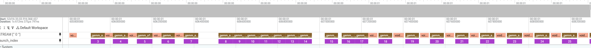

# v9_beyond_hotloop_tiles: reproducing the MFMA efficiencies in tcp_bound_tile_model.md

## Summary

`docs/tcp_bound_tile_model.md` (branch `tcp-bound-tile-model`, section 3) lists the in-loop MFMA efficiency of eight tiles. We were unable to reproduce these numbers with cold inputs. The document says they come from thread traces, but not which launch was traced or what was in the cache; we suspect the tutorial's default ATT path, which traces a launch inside `triton.testing.do_bench` and, as shown below, sees warm inputs.

With that default path we reproduce the document's numbers to within 2.6 points on every tile. With cold inputs, the tiles from 128x128 down measure roughly 10-20 points lower. For example, 128x128 is listed at 69% and measures 50-60% with cold inputs.

## Why the default ATT path sees warm inputs

The default path traces the 15th launch of the kernel: `scripts/run_att.py` runs `bench.py` without `--rocprof`, so `bench.py` times the kernel with `do_bench`, and the ATT config (`run_perf_table.py`'s template) has `"kernel_iteration_range": "[15]"`. `do_bench` has two properties that make the cache state of that launch unreliable.

1. **The warm-up calls do not clear the cache, so launch 15 is usually warm.** On one fixed `(a, b)`, `do_bench` makes 1 untimed call, 5 estimate calls, `int(25 ms / estimate)` warm-up calls and then the timed calls. The estimate and timed calls each follow a cache clear; the warm-up calls do not. With `bench.py`'s correctness check as launch 1, launch 15 is the 8th warm-up call, so it is warm whenever the warm-up has at least 8 calls. The warm-up length depends on the runtime estimate, and a one-time stall inflates it: the first cache clear is the first launch of PyTorch's fill kernel, which takes about 12 ms to launch under `rocprofv3 --att` (6.6 ms without a profiler). Spread over the 5 estimate calls, this gives an estimate of 2-4 ms instead of the true 0.1-0.3 ms, so the warm-up has 6-10 calls instead of about 190. In all 24 kernel-trace runs at K = 8192, launch 15 directly followed launch 14, with no cache clear between them.

   

   Kernel trace of the 128x128 default ATT path (step 4 of Reproducing), with the GEMM launches numbered on the `launch_index` track. Launches 3-7 (the estimate calls) each follow a cache clear (`void at::native::…FillFunctor`). Launches 8-17 are the warm-up, with no clear between them, so launch 15 (the traced launch) reads A and B straight after launch 14 read them.

2. **The cache clear has two limitations, so even a cleared launch is not reliably cold.**
   1. **It is a fixed 256 MB** (`get_empty_cache_for_benchmark`), the same size as the MI355X's 256 MB last-level cache (MALL), so it does not evict all of A and B (48-128 MB here).
   2. **It writes (`cache.zero_()`) instead of reading.** This leaves the last-level cache full of dirty lines, which the next kernel's misses then have to write back. gfx950 has no MALL counter, so this is inferred from the measurements below rather than observed directly.

To test this, we traced launch 15 with three edits to Triton's `do_bench` (see Reproducing): the warm-up removed with the 256 MB clear; the warm-up removed with a 1 GiB clear; and the warm-up removed with a 1 GiB read-only clear. As the cold reference, we traced it through `bench.py --rocprof`, which runs the kernel back to back over rotating copies of the inputs with no cache clear. This is the cold path the tutorial already uses for TFLOPS.

## Results

MI355X, fp16, K = 8192, M = 16 x BM, N = 16 x BN (256 workgroups, one per CU). In-loop MFMA efficiency of launch 15 from `process_json.py`, three runs per cell, shown as min-max.

| tile | M x N | listed in the document | default ATT path | no warm-up, 256 MB write clear | no warm-up, 1 GiB write clear | no warm-up, 1 GiB read clear | rotating inputs (`--rocprof`, 2048 MB) |
|---|---|---:|---:|---:|---:|---:|---:|
| 256x256 | 4096 x 4096 | 96% | 95.9-96.2% | 93.2-95.7% | 92.6-94.9% | 94.3-95.7% | 95.6-96.2% |
| 256x128 | 4096 x 2048 | 83% | 81.0% | 67.6-71.0% | 61.7-69.8% | 73.3-76.3% | 73.7-78.9% |
| 128x256 | 2048 x 4096 | 84% | 81.4% | 73.4-77.6% | 63.8-74.3% | 72.4-78.0% | 80.2-81.3% |
| 128x128 | 2048 x 2048 | 69% | 67.7-68.7% | 54.9-58.7% | 44.6-49.5% | 49.9-57.7% | 50.3-60.3% |
| 256x64 | 4096 x 1024 | 55% | 54.6-55.1% | 39.8-47.7% | 32.0-33.3% | 37.9-40.2% | 39.0-42.1% |
| 64x256 | 1024 x 4096 | 57% | 55.0-55.3% | 44.6-45.4% | 32.7-34.5% | 38.6-40.6% | 41.0-44.3% |
| 128x64 | 2048 x 1024 | 47% | 47.3-47.4% | 33.9-38.8% | 24.6-26.0% | 28.4-31.2% | 31.6-33.1% |
| 64x128 | 1024 x 2048 | 47% | 47.5-47.9% | 42.8-46.2% | 25.5-27.2% | 30.2-31.6% | 31.7-33.3% |

- **The default ATT path reproduces the document** to within 2.6 points on every tile, with warm inputs.
- **A 256 MB clear gives no consistent cache state.** On the four tiles with a 64 side it lies between warm and cold; on the larger tiles it is at or below cold. It varies by up to 8 points from run to run.
- **A 1 GiB write clear is colder than cold.** On average it is 4-9 points below the 1 GiB read clear on every tile but 256x256, consistent with the cost of writing back the clear's dirty lines.
- **The 1 GiB read clear and the rotating inputs are both cold.** They agree to within a few points (rotating is 1-5 points higher on average), and these are the numbers to compare with the model.
- **256x256 is compute-bound** and within 4 points across all cache states.

## The kernel

`matmul_kernel.py` is AITER's gfx950 compute-bound Gluon GEMM, `aiter/ops/triton/_gluon_kernels/gfx950/gemm/basic/gemm_a16w16.py` at AITER commit `66e96218c`. It is v9 with every layout derived from `BLOCK_M` and `BLOCK_N` (sides 64, 128 or 256; `BLOCK_K` 64). The only changes from AITER's file are the removed config lookup (the AITER import and `default_tile`, so the tile must be passed in) and an appended `matmul(a, b, c, tile=(256, 256))` entry point for `bench.py`. `bench.py --version 10 --tile BMxBN` runs it on M = 16 x BM, N = 16 x BN. It uses Triton's MFMA scheduler (`schedule_hint="mfma-schedule"`), which is the document's LLIR scheduler under its in-tree name.

## Reproducing

Measured with Triton `bbe38e5742` (gfx950-tutorial-v3.1-141), PyTorch 2.13.0+rocm7.14.0, rocprofv3 1.3.2 and the ATT decoder from `scripts/install_att_decoder.sh`, with no compiler-plugin variables set (`LLVM_PASS_PLUGIN_PATH`, `TRITON_AMDGCNAS_PLUGIN`).

Run every command from `kernels/gemm/intra_wave/a16w16`. `run_att.py --kernel-regex` writes `att_matmul.json` (`run_perf_table.py`'s ATT template, launch 15) before tracing. The result is the `"mfma efficiency"` line at the end of the output. Use a new `--att-output` directory for each run, since `run_att.py` processes the first trace it finds there. The commands use 128x128; for the other rows, pass `--tile` 256x256, 256x128, 128x256, 256x64, 64x256, 128x64 or 64x128.

### 1. Default ATT path

```bash
cd kernels/gemm/intra_wave/a16w16
HIP_VISIBLE_DEVICES=0 python ../../../../scripts/run_att.py --kernel-regex _gemm_a16w16_compute_bound_kernel --att-output tmp/std_128x128 python bench.py --K 8192 --dtype fp16 --version 10 --tile 128x128
```

### 2. Cold inputs

The same command with `bench.py`'s `--rocprof --rotating-buffer-size 2048`. 2048 MB gives 12-39 copies of the inputs per shape, so the traced launch's inputs were last touched at least 12 launches earlier. The default 512 MB gives 256x256 only 3 copies.

```bash
HIP_VISIBLE_DEVICES=0 python ../../../../scripts/run_att.py --kernel-regex _gemm_a16w16_compute_bound_kernel --att-output tmp/cold_128x128 python bench.py --K 8192 --dtype fp16 --version 10 --tile 128x128 --rocprof --rotating-buffer-size 2048
```

### 3. The three `do_bench` variants

Apply the edits cumulatively to the Triton checkout and rerun step 1 after each one. Paths are relative to the Triton repository.

**No warm-up.** In `python/triton/testing.py`, `do_bench`, delete the warm-up loop:

```python
    # Warm-up
    for _ in range(n_warmup):
        fn()
```

**1 GiB write clear.** In `third_party/amd/backend/driver.py`, `get_empty_cache_for_benchmark`:

```python
        cache_size = 256 * 1024 * 1024    # before
        cache_size = 1024 * 1024 * 1024   # after
```

**1 GiB read clear.** In the same file, `clear_cache`:

```python
        cache.zero_()   # before
        cache.max()     # after: reads the buffer without writing it
```

### 4. Checking which launch was traced

`run_att.py` cannot add `--kernel-trace`, so this calls `rocprofv3` directly with the `att_matmul.json` from step 1. It keeps `--att`, because ATT changes the warm-up length and so which call launch 15 is. The trace of every dispatch is written as a CSV (`tmp/kt_128x128/*/*_kernel_trace.csv`) and a Perfetto trace (`tmp/kt_128x128/*/*_results.pftrace`, open it at [ui.perfetto.dev](https://ui.perfetto.dev)). The 15th `_gemm_a16w16_compute_bound_kernel` dispatch is the traced launch. The dispatch before it is either the 14th GEMM (warm) or the cache clear (`FillFunctor` for a write clear, `reduce_kernel` for the read clear).

```bash
HIP_VISIBLE_DEVICES=0 rocprofv3 --att -i att_matmul.json --kernel-trace --output-format csv pftrace -d tmp/kt_128x128 -- python bench.py --K 8192 --dtype fp16 --version 10 --tile 128x128
```
