# v9_tile worklog: tile sizes on the v9 base

v9_tile is [v9_beyond_hotloop](../v9_beyond_hotloop/README.md) with the tile size as a parameter
(`bench.py --version 9t --tile 256x128`, or `V9_TILE=256x128`). Everything here runs on GPU 2 with
Triton `gfx950-tutorial-v2.2` and the shipping `llir+amdgcnas` stack ([env.sh](env.sh)).

The question: when is a smaller tile than 256x256 worth it, before stream-K enters the picture?
This round has no stream-K; shapes with M or N of 256 or less are left for later.

**Summary.**

- **Where it wins.** A smaller tile wins wherever 256x256 leaves about half the CUs or more idle:
  - 256x128 / 128x256 by 20-38%;
  - 128x128x128 by up to 2.1x (1024x2304x16384: 261 to 550 TFLOPS).

  It loses (-23%) where 256x256 already fills ~75% of the CUs.
- **What limits small tiles.** Not registers, quadrants or MFMA scheduling. It is a per-CU
  ceiling of ~60 bytes per ns of global loads (32 KB in the TCP over a ~550 ns round trip):
  - The waves stall issuing `buffer_load`s into a full TCP, not waiting for data.
  - The ceiling is the same with 8 CUs busy at 2.4 GHz as with 256 CUs at 1.9 GHz.
  - At a full wave, loop MFMA efficiency falls from ~96% (256x256) to 59-70% (256x128) and
    39-52% (128x128). A higher clock under the same 1400 W cap wins part of it back.
- **What doesn't help.**
  - A deeper pipeline helps only 128x128x64 (`BLOCK_K = 128`, +4-6%).
  - Two regions instead of four quadrants is slower.
- **A one-line model picks the tile** on all 9 measured shapes:
  `busy CUs x 60 B/ns x BM*BN/(BM+BN)`, capped at the power-limited peak.
- **Interaction with stream-K.** At 128 tiles, halving the tile matches stream-K with no fixup;
  at 36-72 tiles, stream-K's split still wins. The fixup's latency costs grow 1.5-2.3x in k-steps
  for smaller tiles while its bandwidth costs shrink (§8).
- **Where the latency comes from.** The L2 hit rate is already at its geometric limit (~81-83%),
  and the remaining misses dominate the latency. With the inputs warm in the MALL, per-CU
  bandwidth rises 30-45%: 256x128's loop goes from 59% to 89%, 128x128's from 44% to 66% (§9).
- **A shared-plugin bug the tiles exposed.** The `amdgcnas` loop-invariant hoist could corrupt a
  live register (§2). It is fixed, and v9-v13's output is unchanged.
- **aiter's derived layouts (§15).** Ours has two-way LDS bank conflicts at a tile side of 128 and at
  BK = 128, and aiter's has none. Removing them moves throughput by -2% to +4%, because the window binds.
  v9_tile now uses aiter's layouts for every tile.
- **The round trip, measured (§16).** Hardware counters, calibrated on the tcp_latency probe, give the
  round trip per tile:
  - 130-280 ns from the TCP to L2 and back.
  - 410-670 ns from issue.
  - Up to ~45 KB in flight per CU from issue, but never 32 KB between the TCP and L2.

  The inferred 550 ns holds for tiles with one 4-wave workgroup per CU (490-580 ns). Tiles with 2-4
  workgroups per CU get 330-440 ns, and the L2 hit rate barely matters. On the v3.0 stack the tiles reach
  what this window allows, and two stages are enough down to 16x64x128 (16x32x128 is borderline).
- **256x256 down to 256x128, 16 columns at a time (§19).** On one full wave each, plugin off, the hot loop
  falls from 95.6% to 71.7% in a sawtooth: the 16-column band tiles (240, 208, 176, 144) sit at or below the
  next narrower tile. Down to 256x176 the loss is the schedule, fixed in cycles: exposed issue, the band's
  `ds_read` stalls, `v_add` + `ds_read` address holes and barriers, with every region's work fitting its MFMA
  shadow. The TCP window binds from 256x160 down: the loop sits at 60 B/ns per CU whatever the clock.

## 1. Predictions (written before any measurement)

### Constants from the repo

| constant | value | source |
|---|---|---|
| FP16/BF16 `v_mfma_f32_16x16x32` | 16 cycles | [v8 README §4.6](../v8_sliceMN/README.md), [process_json.py](../../../../../scripts/process_json.py) |
| TCP processing of one `buffer_load_to_lds_dwordx4` (1 KB per wave) | 16 cycles, so at most 64 B/clk per CU | [v8 README §4.3-4.4](../v8_sliceMN/README.md) |
| bytes in flight per CU | 32 KB (the TCP), plus a ~12-entry queue | [memory_bandwidth_model.md](../../../../../docs/memory_bandwidth_model.md) |
| conflict-free `ds_read_b128` | one per wave every 16 cycles with 4 waves | [v3 README](../v3_lds/README.md) |
| v9 k-step under load | 2048 MFMA cycles, 1.34 us at 1608 TFLOPS, so about 1.53 GHz | v9 README §4 |

### Per tile, per CU, per k-step, at 100% MFMA

Four waves in a 2x2 grid; each wave owns a (BM/2)x(BN/2) quadrant's (BM/4)x(BN/4) sub-tile in
each of the four regions.

| | 256x256x64 (v9) | 256x128x64 | 128x256x64 | 128x128x64 | 128x128x128 |
|---|---|---|---|---|---|
| MFMAs per wave per k-step | 128 | 64 | 64 | 32 | 64 |
| MFMA cycles per k-step | 2048 | 1024 | 1024 | 512 | 1024 |
| MFMAs per region per wave | 32 | 16 | 16 | 8 | 16 |
| global bytes per k-step, `(BM+BN)*BK*2` | 64 KB | 48 KB | 48 KB | 32 KB | 64 KB |
| `buffer_load` x4 per wave per k-step | 16 | 12 | 12 | 8 | 16 |
| global bytes needed per clock | 32 B/clk | 48 B/clk | 48 B/clk | 64 B/clk | 64 B/clk |
| **TCP processing busy** (64 B/clk peak) | **50%** | **75%** | **75%** | **100%** | **100%** |
| latency 32 KB in flight can hide | 1024 cyc (0.67 us) | 683 cyc (0.45 us) | 683 cyc (0.45 us) | 512 cyc (0.33 us) | 512 cyc (0.33 us) |
| `ds_read_b128` per wave per k-step | 32 | 24 | 24 | 16 | 32 |
| LDS read issue busy (16 cyc each) | 25% | 37.5% | 37.5% | 50% | 50% |
| accumulator registers per lane | 256 | 128 | 128 | 64 | 64 |
| LDS, 2 buffers + padding | 132 KB | 99 KB | 99 KB | 66 KB | 132 KB |
| intensity at the L2 boundary, `H(BM,BN)/e` | 128 FLOP/B | 85 FLOP/B | 85 FLOP/B | 64 FLOP/B | 64 FLOP/B |
| L2-to-CU bandwidth at full chip (256 CUs, 1.53 GHz) | 12.5 TB/s | 18.8 TB/s | 18.8 TB/s | 25.1 TB/s | 25.1 TB/s |

What the table predicts:

- **256x128 and 128x256** keep the four-region structure with 16 MFMAs per region, half of v9's.
  The TCP runs 75% busy and the latency budget falls to two thirds of v9's. v9 already loses
  ~1.5 pp at K = 16384 when HBM latency rises (v8 README §4.5), so expect a few points less
  MFMA efficiency than v9, falling faster with K. Registers stop mattering: 128 accumulators
  instead of 256.
- **128x128** (either BK) needs the TCP 100% busy at 100% MFMA. It cannot reach v9's efficiency
  with 4 waves on one CU however it is scheduled; a realistic ceiling is the TCP's sustained
  rate, so expect well under 90% MFMA efficiency. `BLOCK_K = 128` fixes the 8-MFMA regions (back
  to 16) but not the bytes per FLOP. More LDS stages cannot help: the 32 KB in-flight cap, not
  the number of buffers, sets the latency budget.
- **L2.** The full-chip L2-to-CU demand rises from 12.5 to 18.8 and 25 TB/s. Expect lower
  L2 hit rates and more power, so a lower clock even at equal MFMA efficiency.

How these held up (§4-§7):

- **256x128 / 128x256: too optimistic.** The loop fell to 59-70%, not "a few points" below v9.
  The binding limit is bytes in flight over the round trip (60 B/ns per CU), which this table
  only approximated with a cycle budget.
- **128x128: right.** Measured 39-52%, against "well under 90%".
- **More LDS stages: right, with one exception.** They don't help, except at 128x128x64, where
  two buffers are shorter than the round trip.
- **L2 and power: wrong.**
  - L2 hit rates rose for the smaller tiles (78-83% against 75-81%).
  - The smaller tiles ran at a *higher* clock under the same 1400 W cap: their MFMA pipes idle
    more.

### Break-even (existing data, to be redone on GPU 2)

[wave_quant.csv](../v9_beyond_hotloop/images/wave_quant.csv) (M = K = 4096, v9, an earlier GPU):
128 tiles take 77.6 us (885 TFLOPS) and 256 tiles 100.1 us (1372 TFLOPS), so half the CUs give
64.5% of the full-chip throughput. A smaller tile that brings a shape to 256 tiles wins if its
full-wave throughput beats the 256x256 kernel's throughput at the original tile count:

| shape (K = 4096) | 256x256 tiles | 256x256 TFLOPS | smaller tile | its tiles | it must beat |
|---|---|---|---|---|---|
| 4096x2048 | 128 | 885 | 256x128 | 256 | 64.5% of 1372 |
| 4096x1024 | 64 | 477 | 128x128 | 256 | 35% of 1372 |

## 2. Build and gate

- `matmul_kernel.py` is v9's kernel with its layouts built at compile time from the block sizes
  (`gluon.constexpr_function`s). `half_tile_load_layout` / `half_tile_shared_layout` build the
  global-load and padded shared layouts of a [rows, BK] half-tile from the rows (warps take rows
  1 and 2, the lanes the top three row bits, the registers the rest) and reproduce v9's bases at
  128 rows. The C-store layout keeps 8 values per lane along N with
  `min(64, cols / 8)` lanes across. `GROUP_SIZE_M` minimises `GM * BM + ceil(P / GM) * BN` (v9's
  rule with the tile sizes; ties to the smaller GM), and `V9_TILE_GM` overrides it.
- **Gate:** at 256x256 the generated assembly is identical to v9's (only a comment's whitespace
  differs): 448 VGPRs, 256 AGPRs, 0 spills; 4096x4096x8192 bf16 `do_bench` 1442 TFLOPS against
  v9's 1437 in the same session.
- **Correctness:** [results/check_tiles.md](results/check_tiles.md): 3 tiles x 8 shapes x
  {bf16, fp16} x {bias, none}, padded and ([check_tiles_nopad.md](results/check_tiles_nopad.md))
  contiguous, against an fp32 torch reference with C pre-filled with NaN. 0 failures, after the
  fix below.

### An amdgcnas bug the smaller tiles exposed

The first run failed every bias case at 256x128 and 128x256 (half of C wrong in 8-row bands,
none unwritten), and nothing else. No plugins and `llirSched` alone were correct; disabling
amdgcnas passes one at a time pinned it on the loop-invariant hoist (`licm`).

`licm` renames a hoisted instruction's output to a register that is free in the loop. The free
set comes from liveness, and liveness got `v_cmp_eq_u32_e32 vcc, 0, v25` wrong: `compute_def_use`
took the first register of any instruction as its destination, and since `vcc` is not a tracked
register, that was the source `v25`. So liveness believed the epilogue overwrote v25 before
reading it, v25 (set before the loop, read after it) looked dead across the loop, and `licm`
put an LDS address in it. The bias path is what made the allocator keep that value in a register
across the loop at these tiles.

Fix ([plugins/amdgcnas/amdgcnas_ext.py](../../../../../plugins/amdgcnas/amdgcnas_ext.py),
`compute_def_use`): only registers named in operand 0 are destinations. Running the old and new
plugin on the `llirSched` output of v9-v13, with and without bias, gives byte-identical assembly,
so the shipping kernels are unaffected.

### The launcher has to be as cheap as v9's

The first version built its layouts on the host and passed them in as constexpr arguments. The
kernel was identical to v9's (same assembly, same descriptor), yet it timed ~5% *faster* than v9
at 4096x4096x8192: the per-call Python work left a 41-97 us gap between dispatches (v9's are
back to back), and an idle GPU between launches runs cooler and boosts higher. The layouts are
now `gluon.constexpr_function`s evaluated inside the kernel, so the launch passes only integers,
like v9's; the gap is 0 and v9 and v9_tile at 256x256 time within 0.5% of each other (173.5-175 us).
Any comparison of launchers has to check the gaps in the kernel trace.

### Hot loop ([results/asm_check.md](results/asm_check.md), [asm_check.py](asm_check.py))

One loop iteration is two k-steps. Under `llir+amdgcnas`:

| tile | VGPRs | AGPRs | spills | MFMAs | buffer loads | ds_reads | s_waitcnt | v_accvgpr | scratch | longest non-MFMA run | MFMAs between buffer loads |
|---|---|---|---|---|---|---|---|---|---|---|---|
| 256x256 | 448 | 256 | 0 | 256 | 32 | 64 | 20 | 0 | 0 | 5 | 4-20 |
| 256x128 | 304 | 160 | 0 | 128 | 24 | 48 | 8 | 0 | 0 | 8 | 2-12 |
| 128x256 | 404 | 168 | 0 | 128 | 24 | 48 | 8 | 0 | 0 | 8 | 2-12 |

No spills, scratch or accumulator copies in any loop; the memory ops sit between MFMAs. The
llirSched model wants 4 MFMAs (64 cycles) per `buffer_load`; with 12 loads against 64 MFMAs per
k-step the smaller tiles average 5.3 but come as close as 2. 128x256's extra 100 VGPRs are outside
the loop and cost nothing at one workgroup per CU (99 KB of LDS already rules out a second).

## 3. Measuring

[sweep.py](sweep.py) runs a list of (tile, shape) points, bf16, B and C rows padded:

- `timing`: rocprofv3 kernel trace, 1000 launches over a rotating 512 MB, median of the last 100;
  `--graph` launches from a HIP graph instead.
- `clock`: the same launches back to back from a HIP graph for 3 s while a thread polls the
  device's hwmon (graphics clock, socket power) every 20 ms.
- `counters`: L2 hit rate and memory read requests (rocprofv3 `--pmc`).
- `att`: thread trace of CU 0 on one launch, reduced by `scripts/process_json.py`
  (main-loop MFMA efficiency, prologue / loop / epilogue shares). [att_stalls.py](att_stalls.py)
  splits a loop iteration's stall cycles by instruction class.

[report.py](report.py) merges them. Two traps found on the way:

- **Isolated launches.** From Python a launch takes ~135 us, so any kernel shorter than that
  leaves the GPU idle between launches (`gap_us` in the timing CSV), and an idle GPU boosts. This
  is the repo's standard harness, so earlier tables have the same property; the back-to-back
  (`--graph`) numbers are what a stream of such GEMMs gets. Here the two agree within ~5%.
- **Clock from counters.** `GRBM_GUI_ACTIVE` / 8 XCDs agrees with `SQ_CYCLES` / 32 SEs, but counter
  collection serialises dispatches, so the counter run's clock (up to 2.9 GHz on short kernels,
  past the part's 2.4 GHz limit) and cycle counts do not describe the timed run. The clock below
  is hwmon's during back-to-back launches. e2e MFMA util = back-to-back TFLOPS / (1.048576 TFLOP
  per GHz x clock): the whole kernel in time.

## 4. Measurement A: one full wave per tile

Exactly 256 tiles per tile size, so every CU has one tile: 256x256 on 4096x4096, 256x128 on
4096x2048, 128x256 on 2048x4096. CSVs: [a_timing.csv](results/a_timing.csv),
[a_timing_graph.csv](results/a_timing_graph.csv), [a_clock.csv](results/a_clock.csv),
[a_att.csv](results/a_att.csv), [a_counters.csv](results/a_counters.csv).

| tile | M x N x K | TFLOPS isolated | TFLOPS back to back | vs 256x256 same K | clock GHz | power W | e2e MFMA util | ATT loop MFMA eff | prologue / epilogue | L2 hit | B/ns per CU |
|---|---|---|---|---|---|---|---|---|---|---|---|
| v9 | 4096x4096x8192 | 1582 | 1592 | | 1.72 | 1400 | 88% | | | | 49 |
| 256x256 | 4096x4096x1024 | 1121 | 1111 | | 1.98 | 1368 | 54% | 95.8% | 13.3% / 26.3% | 75.3% | 34 |
| 256x256 | 4096x4096x2048 | 1389 | 1324 | | 1.87 | 1400 | 68% | 95.5% | 7.8% / 14.4% | 77.9% | 40 |
| 256x256 | 4096x4096x4096 | 1560 | 1482 | | 1.81 | 1400 | 78% | 97.1% | 4.0% / 8.2% | 79.5% | 45 |
| 256x256 | 4096x4096x8192 | 1585 | 1593 | | 1.71 | 1400 | 89% | 95.0% | 2.0% / 4.2% | 80.3% | 49 |
| 256x256 | 4096x4096x16384 | 1507 | 1524 | | 1.88 | 1400 | 77% | 98.1% | 1.1% / 2.2% | 80.8% | 46 |
| 256x128 | 4096x2048x1024 | 813 | 830 | 75% | 2.10 | 1323 | 38% | 61.1% | 13.5% / 21.4% | 78.8% | 38 |
| 256x128 | 4096x2048x2048 | 1036 | 1023 | 77% | 2.09 | 1386 | 47% | 62.9% | 7.6% / 11.3% | 80.9% | 47 |
| 256x128 | 4096x2048x4096 | 1197 | 1165 | 79% | 1.97 | 1397 | 56% | 59.2% | 3.7% / 5.8% | 82.0% | 53 |
| 256x128 | 4096x2048x8192 | 1230 | 1228 | 77% | 1.92 | 1397 | 61% | 64.3% | 2.1% / 3.2% | 82.7% | 56 |
| 256x128 | 4096x2048x16384 | 1106 | 1117 | 73% | 2.15 | 1393 | 50% | 67.5% | 1.1% / 1.7% | 83.0% | 51 |
| 128x256 | 2048x4096x1024 | 841 | 844 | 76% | 2.11 | 1305 | 38% | 61.2% | 13.0% / 19.6% | 78.8% | 39 |
| 128x256 | 2048x4096x2048 | 1045 | 1025 | 77% | 2.10 | 1381 | 47% | 62.5% | 7.7% / 10.9% | 80.9% | 47 |
| 128x256 | 2048x4096x4096 | 1187 | 1146 | 77% | 2.00 | 1398 | 55% | 58.9% | 4.0% / 5.5% | 82.0% | 52 |
| 128x256 | 2048x4096x8192 | 1258 | 1238 | 78% | 1.88 | 1399 | 63% | 68.3% | 2.2% / 3.3% | 82.7% | 57 |
| 128x256 | 2048x4096x16384 | 1149 | 1154 | 76% | 2.12 | 1399 | 52% | 70.2% | 1.3% / 1.7% | 83.0% | 53 |

(ATT is one launch on one CU, so it moves by a few points between runs; the e2e columns are the
whole chip.)

**A smaller tile with every CU busy delivers 73-79% of 256x256's throughput** at the same K. The
two orientations are within noise of each other (B is K-contiguous like A, so they are mirror
images). The main-loop MFMA efficiency falls from ~96% to 59-70%; a higher clock (1.9-2.15 GHz
against 1.7-1.9 GHz, all at the 1400 W cap) wins part of it back, because an MFMA pipe that is
idle a third of the time burns less power per cycle.

### Why: the loads, not the MFMAs or the registers

[att_stalls.py](att_stalls.py) on the K = 8192 traces, per loop iteration (two k-steps) and wave:

| tile | cycles issued | stalled | stalled on `buffer_load` issue | on `s_barrier` | on `s_waitcnt vmcnt` |
|---|---|---|---|---|---|
| 256x256 | 4278 | 2657 (1919 of them MFMA back-pressure) | 329 | 90 | 32 |
| 256x128 | 3160 | 2159 | 870 | 246 | 32 |
| 128x256 | 2979 | 1975 | 672 | 257 | 32 |

The smaller tiles do not wait for data (`vmcnt` waits are the same 32 cycles); they wait to
*issue* loads. A `buffer_load` that cannot enter the full TCP blocks the in-order wave, MFMAs
behind it included, and the barriers then wait for the slowest wave.

Converting each run's time per k-step to bytes delivered per CU gives one number for every tile
and K: **about 50-60 bytes per ns per CU** (28-34 B/clk at the measured clocks). With fewer CUs
busy it does not rise ([a_lowload_clock.csv](results/a_lowload_clock.csv), K = 8192):

| tile | tiles | clock GHz | power W | ns per k-step | B/ns per CU | e2e MFMA util |
|---|---|---|---|---|---|---|
| 256x128 | 8 | 2.40 | 396 | 790 | 62 | 54% |
| 256x128 | 32 | 2.40 | 550 | 783 | 63 | 55% |
| 256x128 | 128 | 2.40 | 1093 | 797 | 62 | 54% |
| 256x128 | 256 | 1.94 | 1399 | 880 | 56 | 60% |
| 256x256 | 8 | 2.39 | 409 | 1107 | 59 | 77% |
| 256x256 | 32 | 2.39 | 592 | 1074 | 61 | 80% |
| 256x256 | 128 | 2.19 | 1152 | 1119 | 59 | 83% |
| 256x256 | 256 | 1.72 | 1399 | 1364 | 48 | 87% |

The time per k-step is fixed in nanoseconds, not cycles, and does not depend on how many CUs
share the memory system: a per-CU limit of roughly 60 B/ns, which is 32 KB in flight (the TCP)
over a ~550 ns round trip. A tile's ceiling follows from its bytes per FLOP:

```
MFMA efficiency <= 60 B/ns / ((BM + BN) * BK * 2 bytes / (MFMA cycles per k-step / clock))
```

| tile | needs at 1.9 GHz | ceiling | measured loop eff |
|---|---|---|---|
| 256x256 | 59 B/ns | ~100% | 95-98% |
| 256x128, 128x256 | 89 B/ns | ~67% | 59-70% |
| 128x128 (x64 or x128) | 119 B/ns | ~50% | (step 3) |

Consequences:

- **The quadrants are not the problem and a deeper pipeline is not the fix.** Registers are
  plentiful (304 / 404 VGPRs, no spills, no copies). The waves are not starved of data in flight
  (no `vmcnt` waits); the TCP is full. More LDS stages add buffers behind the same 32 KB.
- **The boost does not save 256x256 either.** At 8-128 tiles the clock reaches 2.4 GHz but
  256x256 then needs 77 B/ns, past the limit, and its utilisation falls to 77-83%. Part of the
  "half the CUs give 65% of the throughput" effect is this, not just power.
- **The levers left** are latency (a higher L2 hit rate), fewer bytes per FLOP (bigger tiles),
  or a lower clock (the power cap does that for free at full load).
- **Prologue and epilogue** are 35-40% of a wave's time at K = 1024 for every tile, but the
  smaller tiles' are shorter in cycles (4.5-4.9K + 6.5-7.7K against 5.6-6.6K + 12K), so they
  weigh the same fraction. At K = 16384 the e2e utilisation drops for all tiles while CU 0's loop
  does not: the kernel waits on its slowest CUs.

## 5. Measurement B: the same shape under each tile

CSVs `results/b_*.csv`; table by `python v9_tile/report.py b`. Back-to-back TFLOPS:


| shape | 256x256 tiles | 256x256 | 256x128 | 128x256 | best small vs 256x256 |
|---|---|---|---|---|---|
| 4096x1024x4096 | 64 | 453 | 624 | 602 | **+38%** |
| 4096x2048x4096 | 128 | 900 | 1166 | 1138 | **+30%** |
| 4096x3072x4096 | 192 | 1283 | 976 | 905 | -24% |
| 4096x1024x8192 | 64 | 478 | 649 | 652 | **+36%** |
| 4096x2048x8192 | 128 | 941 | 1221 | 1222 | **+30%** |
| 4096x3072x8192 | 192 | 1350 | 1036 | 985 | -23% |
| 16384x512x8192 | 128 | 1054 | 1209 | 1264 | **+20%** |
| 1024x2304x16384 (aiter) | 36 | 261 | 352 | 358 | **+37%** |
| 2048x2304x16384 (aiter) | 72 | 496 | 651 | 674 | **+36%** |

- **Where 256x256 leaves half the CUs or more idle, the smaller tile wins by 20-38%**, on every
  shape and K tried. Break-even on GPU 2, back to back, K = 4096: 256x256 at 128 tiles gives 900
  TFLOPS, 61% of its full-wave 1482, and 256x128 at a full wave gives 79%; at 64 tiles the bar is
  31% (453 / 1482).
- **At 192 tiles (75% of the CUs) 256x256 wins by ~24%**: halving the tile makes 384 tiles, a
  full wave plus a half-empty second one.
- The two orientations trade places by a few percent; neither is consistently better. On
  16384x512, 128x256 (a 128-row by 256-column tile: 128 row-blocks x 2 column-blocks) beats
  256x128 by 5%.
- The aiter loss shapes: 1024x2304x16384 goes from 261 to 358 TFLOPS, 2048x2304x16384 from 496
  to 674. Better, but still far from aiter's picks there (881-973 and 466-946 in
  [the aiter comparison](../../../../../experiments/aiter_256x256_loss_investigation/results/aiter_live_compare.md)):
  72 tiles still leave 72% of the CUs idle, which is stream-K's (or split-K's) job, not the tile's.
- Every point again moves 52-64 B/ns per CU, whatever the tile, shape or clock.

## 6. Measurement C: throughput against N, per tile

M = K = 4096, N = 256 to 8192 in steps of 256, back to back
([c_timing_graph.csv](results/c_timing_graph.csv)), with each tile's ceiling from the per-CU
load limit alone (60 B/ns x the tile's FLOP per byte x the average busy CUs of a non-persistent
launch):


- The per-CU load ceiling tracks every curve, including the drops when a wave spills over: it is
  the one number that predicts this kernel's throughput, for every tile.
- **Crossover:** the smaller tiles win up to N = 2304 (256x256: 144 tiles, 56% of the CUs) and
  lose from N = 2560 (160 tiles) until 256x256's first wave is full. Past one full 256x256 wave
  the curves are within a few percent of each other until 256x256 is near two full waves.
- A rule that fits A, B and C: **use the smaller tile when 256x256 would occupy at most ~55% of
  the CUs in its last (only) wave and the smaller tile's tiles fit in one wave**; otherwise keep
  256x256. With several waves, wave quantisation decides, and that is better handled by
  persistence and stream-K than by the tile.

## 7. Step 3: 128x128

Three variants, all correct ([check_tiles_128.md](results/check_tiles_128.md), 0 failures):

- `128x128`: v9's four quadrants (64x64 each), 8 MFMAs per region per wave.
- `128x128r2`: two regions per k-step, v7's N slice (whole A tile against each B half, 16
  MFMAs per region), as `v9_tile_2r` in [matmul_kernel.py](matmul_kernel.py).
- `128x128x128`: the four quadrants with `BLOCK_K = 128`, 16 MFMAs per region, 64 KB per k-step.

Loops ([asm_check.md](results/asm_check.md)): 176-260 VGPRs, no spills, scratch or AGPR copies;
LDS 66 KB at BK = 64 (two workgroups would fit, not tried: one wave per SIMD is this kernel's
design).

### Full wave (2048x2048, 256 tiles; `results/a128_*.csv`, `python v9_tile/report.py a128`)

| tile | K = 1024 | 2048 | 4096 | 8192 | 16384 | ATT loop MFMA eff (K = 8192) | B/ns per CU (K = 8192) |
|---|---|---|---|---|---|---|---|
| 256x256 (4096x4096, for scale) | 1111 | 1324 | 1482 | 1593 | 1524 | 95% | 49 |
| 128x128 | 639 | 762 | 869 | 932 | 870 | 44.8% | 57 |
| 128x128r2 | 598 | 735 | 848 | 896 | 858 | 43.7% | 55 |
| 128x128x128 | 635 | 768 | 902 | 992 | 852 | 48.6% | 61 |

Back-to-back TFLOPS. The prediction held: a ~50% ceiling from the per-CU load limit, 39-52%
measured, and the same 52-61 B/ns per CU. A full wave of 128x128 gives 58-62% of 256x256's
throughput.

Where the loop stalls (K = 8192, per iteration and wave, [att_stalls.py](att_stalls.py)):

| tile | stalled on `s_waitcnt vmcnt` | on `buffer_load` issue | on `s_barrier` |
|---|---|---|---|
| 128x128 | 699 | 204 | 294 |
| 128x128r2 | 676 | 325 | 150 |
| 128x128x128 | 32 | 882 | 341 |

- At BK = 64 the k-step is only 512 MFMA cycles, so two buffers put the data 1024 cycles ahead of
  its use, less than the ~1200-cycle round trip at 2.1 GHz: the waves wait for data (`vmcnt`).
  This is the one tile where pipeline depth matters.
- `128x128x128` is that deeper pipeline (2048 cycles of lead, same bytes per FLOP): the `vmcnt`
  waits vanish and the stall moves to the TCP (`buffer_load` issue), exactly as in 256x128. It
  buys +4 points of loop efficiency and +6% TFLOPS at K = 4096-8192, which is all the 32 KB in
  flight allows. At K = 16384 it falls back (852 against 870).
- Two regions do not help: 8 MFMAs per region was not the limit. With v7's grouping the loads
  bunch up (0-12 MFMAs between them) and it is 2-4% slower. **The quadrants stay.**

### Same shape (`results/b128_*.csv`)


| shape | 256x256 | 256x128 / 128x256 | 128x128 / 128x128x128 | best |
|---|---|---|---|---|
| 4096x1024x4096 | 453 (64 tiles) | 624 / 602 | 856 / **892** (256 tiles) | 128x128x128, 2.0x |
| 4096x1024x8192 | 478 | 649 / 652 | 897 / **971** | 128x128x128, 2.0x |
| 1024x2304x16384 | 261 (36) | 352 / 358 | 523 / **550** (144) | 128x128x128, 2.1x |
| 2048x2304x16384 | 496 (72) | 651 / **674** (144) | 650 / 572 (288) | 128x256, 1.36x |
| 4096x2048x8192 | 941 (128) | 1221 / **1222** (256) | 1027 / 996 (512) | 256x128 class, 1.30x |
| 16384x512x8192 | 1054 (128) | 1209 / **1264** (256) | 1033 / 1054 (512) | 128x256, 1.20x |
| 4096x3072x8192 | **1350** (192) | 1036 / 985 | 1047 / 1019 | 256x256 |

128x128 wins exactly where 256x128 still leaves half the chip idle, and loses where 256x128
already fills it. Throughput against N:


### One model picks the tile

Per-CU throughput is capped at ~60 B/ns times the tile's FLOP per byte, `BM * BN / (BM + BN)`
(128, 85 and 64 for 256x256, 256x128 and 128x128), and at the power-capped peak (~1590 TFLOPS
for the chip on GPU 2). A non-persistent launch of T tiles averages T / ceil(T / 256) busy CUs:

```
TFLOPS(tile) ~ min(1590, T / ceil(T / 256) x 60 B/ns x BM*BN/(BM+BN))
```

On the 9 same-shape points it picks the measured winner's tile class every time (counting the
two orientations, and the two 128x128 BKs, as one class) and predicts within ~5-15%:

| shape | predicted (256x256 / 256x128 / 128x128) | measured best of each |
|---|---|---|
| 4096x1024x4096 | 492 / 655 / 983 | 453 / 624 / 892 |
| 4096x2048x4096 | 983 / 1311 / 983 | 900 / 1166 / 949 |
| 4096x3072x4096 | 1475 / 983 / 983 | 1283 / 976 / 990 |
| 4096x1024x8192 | 492 / 655 / 983 | 478 / 652 / 971 |
| 4096x2048x8192 | 983 / 1311 / 983 | 941 / 1222 / 1027 |
| 4096x3072x8192 | 1475 / 983 / 983 | 1350 / 1036 / 1047 |
| 16384x512x8192 | 983 / 1311 / 983 | 1054 / 1264 / 1054 |
| 1024x2304x16384 | 276 / 369 / 553 | 261 / 358 / 550 |
| 2048x2304x16384 | 553 / 737 / 553 | 496 / 674 / 650 |

It over-predicts 256x256 near a full wave (power, not loads, binds there) and the two-wave
points (the second wave's CUs finish at different times). As a heuristic: **take the largest tile
whose tile count still fills the CUs best in one wave; break ties toward the bigger tile.**

## 8. Conclusions and what they mean for stream-K

### Answers to the questions this started with

- **Is a smaller tile worth it?** Yes, wherever 256x256 leaves about half the CUs or more idle:
  +20-38% for 256x128 / 128x256 and up to 2.1x for 128x128, on every shape tried. Not where
  256x256 already fills ~75% of the CUs (-23%).
- **Does the "half the CUs give ~70%" effect make it pointless?** No. On GPU 2, 256x256 at half the
  CUs gives 59-61% of its full-wave throughput; a full wave of 256x128 gives 73-79% and of
  128x128 58-62%. The smaller tile clears the bar with room to spare at 128 tiles, and 128x128
  clears the 31% bar at 64 tiles by 2x.
- **Are the quadrants still needed?** Not for registers (176-404 VGPRs), but they do no harm and
  the two-region alternative was slower. Keep them.
- **Is a longer pipeline needed?** Only for 128x128x64, where two buffers lead by less than the
  memory round trip; `BLOCK_K = 128` provides it and gains 4-6%. For every other tile the waves
  stall on the TCP being full, not on data, and more LDS buffers cannot add bytes in flight.
- **Compute-bound or memory-bound?** Every shape here is compute-bound at HBM, yet every
  smaller tile is bound by a per-CU limit: ~60 B/ns of global loads (32 KB in flight over a
  ~550 ns round trip), fixed in nanoseconds, independent of how many CUs share the memory system.
  A tile's ceiling is 60 B/ns x `BM*BN/(BM+BN)` FLOP/B: ~7.7 TFLOPS per CU for 256x256, 5.1 for
  256x128, 3.8 for 128x128. 256x256 itself hits this limit once the clock rises above ~1.9 GHz,
  which is part of why fewer CUs do not run proportionally faster.

### Recommendations for the base kernel

- Keep 256x256 as the default; add **256x128 / 128x256** and **128x128x128** (BK = 128 beats
  BK = 64 by 4-6% except at K = 16384) as alternatives, picked by the busy-CU model in §7.
- The quadrant code needs no changes beyond the generated layouts in this kernel.
- Persistence (v10-v13) was not ported; the smaller tiles' prologue and epilogue are shorter
  in cycles, so they weigh the same share of a wave as 256x256's. Its benefit should carry over.
- The levers left for the smaller tiles are on the memory side: a higher L2 hit rate shortens the
  round trip and raises the 60 B/ns directly. `GROUP_SIZE_M` was set by the footprint rule, not
  tuned; L2 hit rates were 78-83% for the smaller tiles at a full wave (256x256: 75-81%).

### Stream-K

- **Tile choice and stream-K solve the same problem and should be chosen together.** On the
  shapes both have been run on (stream-K numbers from
  [the aiter shape study](../../../../../experiments/aiter_lixun_shapes/results/summary_aisched.md),
  compared as a ratio to v9 in the same run because the harness and GPU differ):

  | shape | 256x256 tiles | stream-K / v9 | best tile here / v9 |
  |---|---|---|---|
  | 16384x512x8192 | 128 | 1.22x | 1.20x (128x256) |
  | 2048x2304x16384 | 72 | 1.95x | 1.36x (128x256) |
  | 1024x2304x16384 | 36 | 2.5-2.8x | 2.1x (128x128x128) |

  At 128 tiles and K = 8192, halving the tile matches stream-K with no fixup, workspace or
  synchronisation. At 36-72 tiles and K = 16384 the smaller tile still leaves 44-72% of the
  CUs idle and stream-K's split wins. The obvious next step is both: the smaller tile first, then
  stream-K over what is left (1024x2304 at 128x128 is 144 tiles; splitting those over 256 CUs is a
  much smaller fixup than splitting 36 tiles six ways).
- **The k-step gets shorter, but not by the tile ratio.** At a full wave a k-step takes 1.35 us
  (256x256), 0.87 us (256x128) and 0.58 us (128x128), because the smaller tiles run at lower
  efficiency. So the latency-type costs of the fixup (flag polls and barriers, 1-9 us; a pipeline
  restart) cost 1.5x and 2.3x more k-steps, not 2x and 4x, and stream-K's break-even moves to
  larger K by about that factor.
- **Partials shrink faster than the k-step.** An fp32 partial is 256, 128 or 64 KiB, while a
  k-step loads 64, 48 or 32 KB: moving one partial costs 4, 2.7 or 2 k-steps of loading at the
  same per-CU 60 B/ns. The bandwidth part of the ending gets cheaper in k-steps as the tile
  shrinks; the latency part gets dearer. The owner / reduce-scatter crossover (n ~ 8 at
  256x256) needs re-measuring: reduce-scatter slices of a 64 KiB partial at n = 16 are 4 KiB.
- **Code that assumes the four 128x128 accumulators** (lane-contiguous partials, the band C
  store, bf16 pair packing, the L2-exchange placement cap `32 / ceil(S / 8)`) has to be redone per
  tile. With smaller tiles S (leftover tiles) is larger for the same shape, so the L2 exchange's
  cap bites more often.
- **The fewer-splits point holds.** 4096x2048 needs n = 2 at 256x256 (128 tiles over 256 CUs) and
  no split at all at 256x128.

## 9. What latency is worth: warm against cold inputs

Little's law ties the three quantities together: bytes in flight = latency x bandwidth. A tile needs
`B / C` bytes per ns (bytes per k-step over compute time per k-step) and has at most `Q` = 32 KB in
flight, so it is capped at `Q / L`, where `L` is the mean time a request spends in flight. With an
80% L2 hit rate one might expect `L` to be short. The cold runs above already had 78-83% hits,
though, so the ~550 ns was measured *with* them.

`sweep.py --rotating-mb 0` reuses one set of inputs, so every launch finds A and B in the MALL
(Infinity Cache) instead of HBM ([warm_*.csv](results/)):

| tile | shape | inputs | L2 hit | loop MFMA eff | B/ns per CU | TFLOPS (back to back) |
|---|---|---|---|---|---|---|
| 128x128 | 2048x2048x1024 | cold | 78.0% | 44.3% | 63 | 639 |
| 128x128 | 2048x2048x1024 | warm | 78.0% | 66.4% | 91 | 784 |
| 128x128 | 2048x2048x4096 | cold | 80.4% | 45.0% | 63 | 869 |
| 128x128 | 2048x2048x4096 | warm | 80.4% | 66.2% | 83 | 1057 |
| 128x128x128 | 2048x2048x4096 | cold | 80.4% | 48.1% | 64 | 902 |
| 128x128x128 | 2048x2048x4096 | warm | 80.4% | 62.1% | 82 | 1046 |
| 256x128 | 4096x2048x1024 | cold | 78.8% | 61.1% | 62 | 830 |
| 256x128 | 4096x2048x1024 | warm | 78.8% | 88.7% | 87 | 983 |
| 256x128 | 4096x2048x4096 | cold | 82.0% | 59.2% | 56 | 1165 |
| 256x128 | 4096x2048x4096 | warm | 82.0% | 88.6% | 75 | 1359 |
| 256x256 | 4096x4096x4096 | cold | 79.5% | 97.1% | 56 | 1482 |
| 256x256 | 4096x4096x4096 | warm | 79.5% | 98.4% | 56 | 1591 |

(B/ns from the ATT loop cycles per k-step and the hwmon clock.)

- **The hit rate does not move; the misses get cheaper, and that is worth 30-45% of per-CU
  bandwidth.** Serving the ~20% of misses from the MALL instead of HBM lifts 256x128 from 59% to
  89% and 128x128 from 44% to 66%. 256x256 has no load limit to lift.
- **The misses dominate the mean latency.** With `Q` = 32 KB, the implied `L` falls from
  ~520 ns cold to ~360-400 ns warm. That suggests an HBM miss costs several hundred ns more
  than a MALL hit, and that even the warm mean is far above the unloaded L2 latency (77-85 ns,
  [memory_model_litmus](../../../../../experiments/memory_model_litmus/README.md)): under load the
  hits queue too.
- **Even with every miss in the MALL, 128x128 reaches 66%, not ~90%.** 90% needs ~121 B/ns at
  2.1 GHz, a mean latency under ~270 ns.
- **The L2 hit rate is already at its geometric limit.** An XCD runs 32 tiles at once, GM rows
  by 32/GM columns, and needs only that group's outer strips from beyond L2. So the best hit rate
  is `1 - (GM*BM + (32/GM)*BN) / (32*(BM+BN))`: 81.3% for 256x256 and 128x128, 83.3% for 256x128
  (GM = 4). Measured: 79.5-81%, 82-83%, 80.4-81%. Even the optimal non-power-of-two GM only
  reaches ~82%, so `GROUP_SIZE_M` tuning has nothing left to give.
- **Benchmarks: whether the inputs are in the MALL decides how good a small tile looks**
  (639 against 784 TFLOPS for the same 128x128 launch). In a model, small weights reused across
  calls may well stay in the 256 MB MALL. The cold rotating numbers in §4-§7 are the conservative
  case, and the tile choice can shift toward smaller tiles when the operands are warm.

## 10. The concepts as figures

All five figures come from [plot_concepts.py](plot_concepts.py), using the CSVs above plus
[k_timing_graph.csv](results/k_timing_graph.csv). Model constants: `Q` = 32 KB in flight per CU;
`L` = 550 ns cold and ~385 ns warm (both inferred from measured bytes per ns with that `Q`);
4096 FLOP per clock per CU.

**Where the prefetch distance must sit.** Hiding the latency needs `d >= L/C` k-steps in flight
(`C` = MFMA time per k-step); the TCP allows `d <= Q/B` (`B` = bytes per k-step). If the two
overlap, the cap is `eff <= (Q/B) / (L/C)`:


**The per-CU roofline.** The memory roof for one CU is `Q/L`, not HBM. A tile sits at
`I = BM*BN/(BM+BN)`. The ridge, `R / (Q/L)`, moves right as the clock rises and left as the
latency falls:


**Power, clock and MFMA utilisation.** At the 1400 W cap, kernels whose MFMAs idle get a higher
clock, and throughput is clock x utilisation. A ns-latency limit does not shrink with the clock,
so the smaller tiles' extra clock does not buy back their lost utilisation. With fewer tiles than
CUs the clock reaches 2.4 GHz, but half the chip is idle:


**Where the CU-time goes** on 4096x2048x8192, for 256x256 on half the chip, 256x128, and 256x256
with split-K 2. The split-K bar is estimated: a full wave of 256x256 at K/2 (measured) plus a
12 k-step owner ending from [STREAMK_VARIANTS.md](../STREAMK_VARIANTS.md):


**K decides between the tile and split-K**, because the fixup is a fixed cost (split-K estimated
as above):


## 11. M and N that are not multiples of the tile (2026-10-10)

The host asserted `M % BLOCK_M == 0 and N % BLOCK_N == 0`; the kernels had no edge masks. Both
kernels (`v9_tile`, `v9_tile_2r`) now take v25's edge handling: with `EDGE_M` / `EDGE_N` (the host sets
both when either dimension is ragged; `V9_FORCE_EDGE=1` for any shape) A rows past M and B columns past
N are clamped to the tile's last in-bounds one, so every load reads valid memory, and the C stores and
the bias load are masked to M x N. With both off the kernels are unchanged.

- **Code** ([asm_ragged.md](results/asm_ragged.md)): with the flags off, 256x256, 256x128, 128x256 and
  128x128r2, with and without bias, compile to the same instructions and registers as before. The edge
  builds of 4000x4000x8192 add 0-12 VGPRs (256x256: 448 to 460), no spills.
- **Correctness** ([check_tiles_ragged.md](results/check_tiles_ragged.md)): `check_tiles.py` now also runs
  RAGGED_SHAPES (4000x4000x8192, 1000x2000x4096, 4096x2032x4096, 130x1040x1024), with C a window of a
  sentinel-filled buffer 256 rows and columns larger: a case fails if anything outside the window
  changes. The four tiles above, bf16 and fp16, with and without bias: 192 cases, 0 failures.
- **Timing** (256x256, GPU 0): cold kernel-only (v25's `rocprof_cold.py`, 1000 launches over a rotating
  512 MB, median) 174.2 us on 4000x4000x8192 against 176.6 us on 4096x4096x8192, the same 16x16 grid;
  `regress.py` (do_bench, two rounds) 183.1 / 185.3 us against 182.5 / 186.1 us.

## 12. K that is not a multiple of 2 BLOCK_K (2026-10-10)

The host asserted `K % BLOCK_K == 0 and K // BLOCK_K >= 4`, which let through an odd number of K-steps
(4096x4096x8128 at 256x256x64: 127 steps), while the kernels consume K-steps in pairs: that C was wrong.
Both kernels now take v9_ragged's ragged-K handling (`EDGE_K`, set when K % (2 BLOCK_K) != 0): K is rounded
up to a whole number of pairs and the prologue loads the last, partial pair with the lanes at or past K masked
to zero, so the main loop is unchanged (`k_tail_mask`; `v9_tile_2r` masks both prologue K-steps). The host
requires K % 16 == 0 and at least two pairs after rounding up.

- **Code** ([asm_ragged_k.md](results/asm_ragged_k.md)): with the flags off, 256x256, 256x128, 128x256 and
  128x128r2, with and without bias, compile to the same instructions and registers as before; the ragged-K
  builds of 4096x4096x8080 use 252-452 VGPRs, no spills.
- **Correctness** ([check_tiles_ragged.md](results/check_tiles_ragged.md)): RAGGED_SHAPES gain 4096x4096x8176,
  4000x4000x8080, 1000x2000x4032 and 130x1040x400; tiles 256x256, 256x128, 128x256, 128x128r2 and 128x128x128
  (BLOCK_K = 128), bf16 and fp16, with and without bias: 316 cases, 0 failures.
- **Timing** (256x256, row stride 8256 for every K, cold rocprof; [stride_timing.md](../v26_streamk_ragged_k/results/stride_timing.md)):
  4096x4096x8192 183.7 us, 8176 182.9, 8080 184.1; 4000x4000x8080 177.7.

## 13. Wave quantization: smaller tiles against stream-K (2026-10-11)

This repeats the [wave-quantization figure](../v9_beyond_hotloop/images/wave_quant.png) (M = K = 4096, N in
steps of 256) with three data-parallel tiles. It adds stream-K at 256x256 wherever its split fills the chip,
and records MFMA utilization, clock and power alongside throughput.

- **Tiles:** v9_tile at `256x256` (v9's code), `128x256` and `128x128x128`, over N = 256..16384.
- **Stream-K:** v26 with `STREAMK_POLICY=one_tile STREAMK_NUM_PROGRAMS=256` (`sk256` in [sweep.py](sweep.py)).
  It runs the full waves data-parallel and splits each of the S leftover tiles n = 256 / S ways. Only N with
  S in {16, 32, 64, 128} is run: N = 4096 w + {256, 512, 1024, 2048}, for w = 0 to 3. The ending is the
  policy's: reduce-scatter for n >= 8, owner otherwise. The default `capped` policy would use at most 128
  programs at small S.
- **K:** 4096, to match the original figure, and 8192.
- **Measurement:** bf16, M = 4096. [run_wave_quant_tiles.sh](run_wave_quant_tiles.sh) does `timing --graph`
  (back to back) and `clock` (hwmon, 3 s back to back) for every point, on GPU 6 (K = 4096) and GPU 7
  (K = 8192). `att` spot checks ran on GPU 4. All 416 points are correct.
- **Utilization:** MFMA utilization of the busy CUs is sustained TFLOPS / (1048.6 TFLOPS per GHz x clock),
  scaled by 256 / average busy CUs. That average is tiles / ceil(tiles / 256) for a non-persistent launch,
  and 256 for stream-K.
- **Figures and tables:** [plot_wave_quant_tiles.py](plot_wave_quant_tiles.py) draws the figures and
  prints the tables below.
- **CSVs:** `results/wq{K}_{timing_graph,clock,att}.csv` and `results/wqsk{K}_{timing_graph,clock}.csv`.

**In short:**

- **Under one 256x256 wave, the smaller tile wins at K = 4096 and stream-K at K = 8192.**
  - At K = 4096, the best smaller tile beats stream-K by 5-29% at N = 512-2048. At N = 1024, 128x128x128
    gives 885 TFLOPS, stream-K 684 and 256x256 data-parallel 451. Only at N = 256 (n = 16) is stream-K
    ahead, by 5%.
  - At K = 8192, stream-K ties 128x128x128 at N = 1024 (980 against 973) and beats 128x256 at N = 2048
    (1317 against 1234). At N = 256 and 512 it is 1.3-1.6x ahead.
  - The split's fixed cost is the same at both K, but at K = 8192 each program does twice the k-steps
    to pay for it.
- **Past the first wave, stream-K wins at every point measured, at both K.**
  - It is 2-23% (K = 4096) and 4-27% (K = 8192) above the best data-parallel tile. The gap shrinks as
    the tail wave fills, to n = 2 just before the next wave.
  - The largest gains are one step past a full wave (N = 4352 and 4608), where 256x256 data-parallel runs a
    16- or 32-tile tail. At K = 8192, N = 4352, stream-K gives 1349 TFLOPS, 128x256 1062 and 256x256 1018.
- **Once 256x256 fills more than about half the chip, the smaller tiles never win.**
  - Their peaks over the whole sweep are 1171 and 1275 TFLOPS (128x256, K = 4096 and 8192) and 970 and
    1054 (128x128x128), against 1561 and 1648 for 256x256.
  - Halving the tile only moves the wave boundaries, it does not remove them: 128x256's sawtooth has
    half the period and the same shape.
- **The trade in the premise holds.**
  - 256x256 on half the chip (N = 2048) gives 59-61% of its full-wave throughput, not 50%. The clock
    rises from 1.79-1.82 GHz to 2.19-2.39 GHz, at 1092-1191 W instead of the 1400 W cap.
  - A full wave of a smaller tile is load-bound: busy-CU MFMA utilization is 52-62% (128x256) and 39-47%
    (128x128x128). 256x256 reaches 79-84%, and its main loop (ATT) 96-98%.
  - The smaller tiles do run faster, at 1.94-2.17 GHz against 1.79-1.82, but they do not draw less power.
    Once the chip is full they sit at the 1400 W cap like 256x256 and spend the budget on clock instead of
    MFMA cycles.
- **Stream-K stays compute-bound but pays for the fixup.**
  - After a full wave its busy-CU utilization is 57-82%. It is lowest at n = 16 and reaches 70-82% at
    n = 2, close to 256x256's 79-91% on its busy CUs.
  - At n = 16 under one wave, each program has only 4 (K = 4096) or 8 (K = 8192) k-steps against the
    fixed cost of the split (about 20 k-steps, [STREAMK.md](../STREAMK.md)). Utilization falls to 10-17%.
  - From N = 2048 up, its clock (1.80-1.99 GHz) and power (1340-1400 W) are those of a full-chip 256x256
    kernel. Under one wave, at n = 4-16, it boosts to 2.04-2.30 GHz at 980-1300 W.

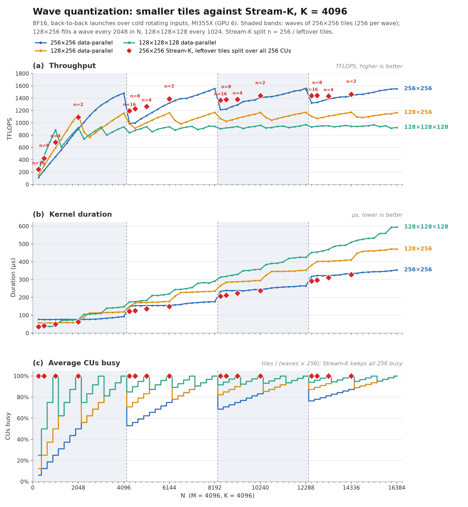

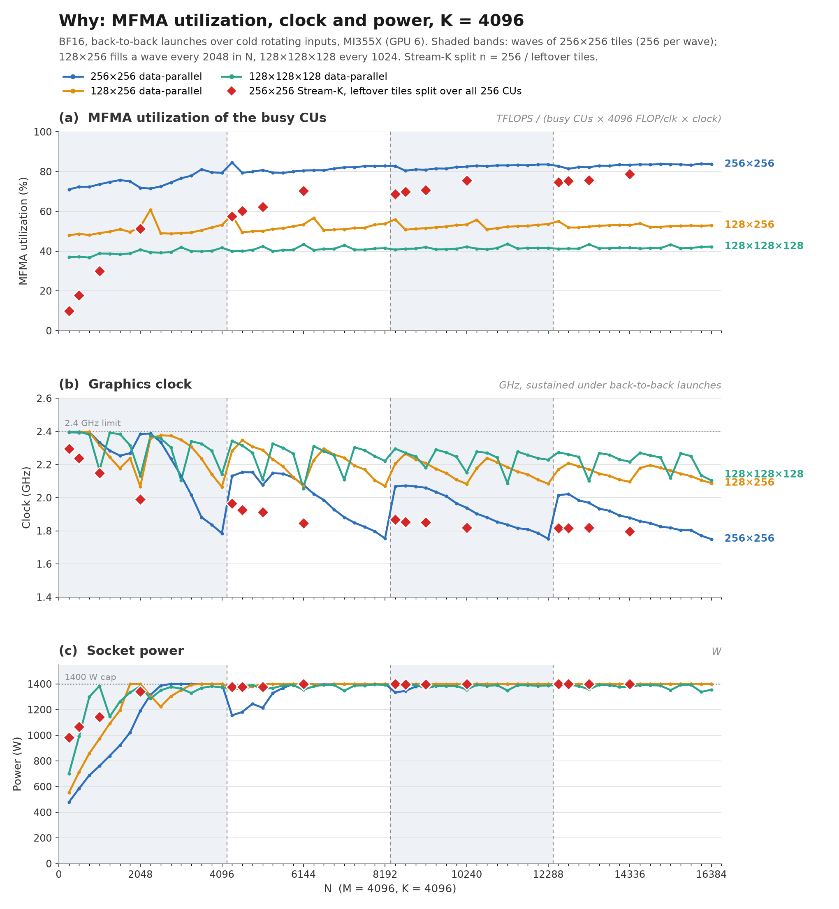

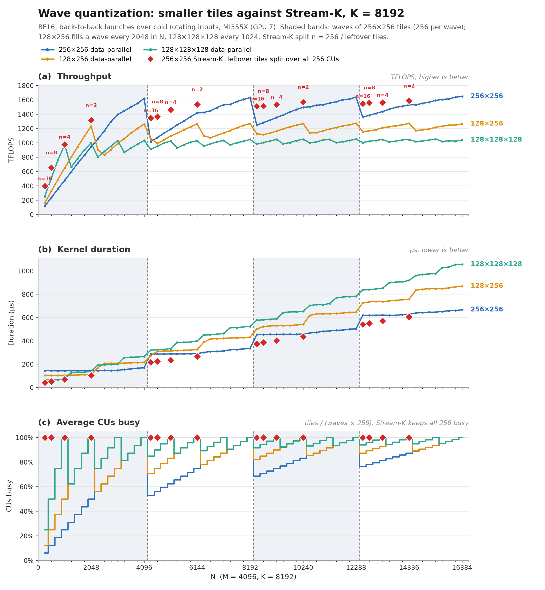

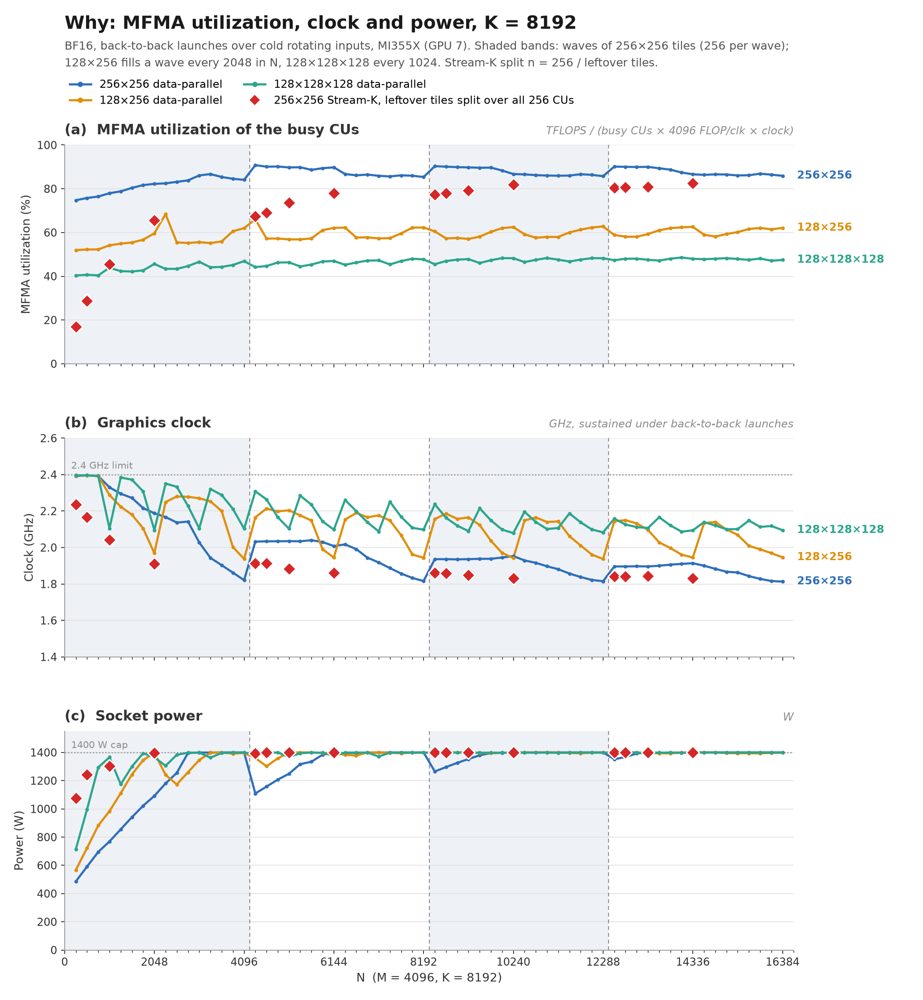

Representative points (DP = data-parallel; the ATT column is CU 0's main loop on one cold launch, and is blank
where it was not run):

#### K = 4096

| N | kernel | tiles | CUs busy | TFLOPS | us | MFMA util, chip | MFMA util, busy CUs | ATT loop MFMA eff | clock GHz | power W |
|---|---|---|---|---|---|---|---|---|---|---|
| 1024 | 256×256 DP | 64 | 25% | 451 | 76.2 | 18% | 74% |  | 2.333 | 761 |
| 1024 | 128×256 DP | 128 | 50% | 596 | 57.6 | 25% | 49% |  | 2.318 | 973 |
| 1024 | 128×128×128 DP | 256 | 100% | 885 | 38.8 | 39% | 39% | 46% | 2.165 | 1385 |
| 1024 | 256×256 Stream-K (n=4) | 64 | 100% | 684 | 50.2 | 30% | 30% |  | 2.148 | 1142 |
| 2048 | 256×256 DP | 128 | 50% | 901 | 76.3 | 36% | 72% | 84% | 2.385 | 1191 |
| 2048 | 128×256 DP | 256 | 100% | 1139 | 60.3 | 52% | 52% | 57% | 2.067 | 1400 |
| 2048 | 128×128×128 DP | 512 | 100% | 923 | 74.4 | 41% | 41% | 48% | 2.131 | 1382 |
| 2048 | 256×256 Stream-K (n=2) | 128 | 100% | 1089 | 63.1 | 51% | 51% |  | 1.989 | 1342 |
| 4096 | 256×256 DP | 256 | 100% | 1481 | 92.8 | 79% | 79% | 96% | 1.785 | 1400 |
| 4096 | 128×256 DP | 512 | 100% | 1157 | 118.8 | 53% | 53% |  | 2.065 | 1400 |
| 4096 | 128×128×128 DP | 1024 | 100% | 934 | 147.2 | 42% | 42% |  | 2.142 | 1373 |
| 4352 | 256×256 DP | 272 | 53% | 988 | 147.8 | 45% | 85% |  | 2.131 | 1155 |
| 4352 | 128×256 DP | 544 | 71% | 982 | 148.7 | 41% | 58% |  | 2.282 | 1365 |
| 4352 | 128×128×128 DP | 1088 | 85% | 836 | 174.7 | 34% | 40% |  | 2.342 | 1366 |
| 4352 | 256×256 Stream-K (n=16) | 272 | 100% | 1196 | 122.1 | 57% | 57% |  | 1.966 | 1377 |
| 6144 | 256×256 DP | 384 | 75% | 1320 | 156.2 | 60% | 81% |  | 2.078 | 1400 |
| 6144 | 128×256 DP | 768 | 100% | 1163 | 177.3 | 53% | 53% |  | 2.072 | 1400 |
| 6144 | 128×128×128 DP | 1536 | 100% | 936 | 220.4 | 43% | 43% |  | 2.055 | 1354 |
| 6144 | 256×256 Stream-K (n=2) | 384 | 100% | 1387 | 148.7 | 70% | 70% |  | 1.846 | 1399 |

#### K = 8192

| N | kernel | tiles | CUs busy | TFLOPS | us | MFMA util, chip | MFMA util, busy CUs | ATT loop MFMA eff | clock GHz | power W |
|---|---|---|---|---|---|---|---|---|---|---|
| 1024 | 256×256 DP | 64 | 25% | 478 | 143.8 | 19% | 78% |  | 2.33 | 769 |
| 1024 | 128×256 DP | 128 | 50% | 650 | 105.8 | 27% | 54% |  | 2.288 | 984 |
| 1024 | 128×128×128 DP | 256 | 100% | 973 | 70.6 | 44% | 44% | 49% | 2.104 | 1366 |
| 1024 | 256×256 Stream-K (n=4) | 64 | 100% | 980 | 70.1 | 45% | 45% |  | 2.043 | 1303 |
| 2048 | 256×256 DP | 128 | 50% | 947 | 145.2 | 41% | 82% | 92% | 2.188 | 1092 |
| 2048 | 128×256 DP | 256 | 100% | 1234 | 111.4 | 60% | 60% | 63% | 1.969 | 1398 |
| 2048 | 128×128×128 DP | 512 | 100% | 1000 | 137.4 | 46% | 46% | 52% | 2.095 | 1366 |
| 2048 | 256×256 Stream-K (n=2) | 128 | 100% | 1317 | 104.3 | 65% | 65% |  | 1.91 | 1396 |
| 4096 | 256×256 DP | 256 | 100% | 1618 | 169.9 | 84% | 84% | 98% | 1.821 | 1400 |
| 4096 | 128×256 DP | 512 | 100% | 1263 | 217.7 | 62% | 62% |  | 1.937 | 1396 |
| 4096 | 128×128×128 DP | 1024 | 100% | 1033 | 266.1 | 47% | 47% |  | 2.103 | 1399 |
| 4352 | 256×256 DP | 272 | 53% | 1018 | 287.0 | 48% | 91% |  | 2.032 | 1109 |
| 4352 | 128×256 DP | 544 | 71% | 1062 | 274.9 | 47% | 66% |  | 2.165 | 1360 |
| 4352 | 128×128×128 DP | 1088 | 85% | 910 | 320.8 | 38% | 44% |  | 2.308 | 1387 |
| 4352 | 256×256 Stream-K (n=16) | 272 | 100% | 1349 | 216.5 | 67% | 67% |  | 1.913 | 1394 |
| 6144 | 256×256 DP | 384 | 75% | 1418 | 290.9 | 67% | 90% |  | 2.008 | 1398 |
| 6144 | 128×256 DP | 768 | 100% | 1265 | 325.9 | 62% | 62% |  | 1.945 | 1397 |
| 6144 | 128×128×128 DP | 1536 | 100% | 1031 | 400.1 | 47% | 47% |  | 2.098 | 1375 |
| 6144 | 256×256 Stream-K (n=2) | 384 | 100% | 1538 | 268.2 | 78% | 78% |  | 1.862 | 1400 |

**Caveats.**

- **Main loop against whole kernel.** "90-95% MFMA" for v9 is the main loop (ATT, 96-98% here). Over the
  whole kernel, a full 256x256 wave reaches 79% (K = 4096) and 84% (K = 8192), because the prologue and
  epilogue are a larger share at small K.
- **Back-to-back timing.** The launches run back to back (HIP graph), unlike the original figure's isolated
  launches, so that the clock and power describe the timed runs. 256x256 at N = 4096, K = 4096 gives
  1481 TFLOPS here against 1372 (fp16, isolated, an earlier GPU) in the original figure.
- **Busy-CU utilization is an average.** For a non-persistent launch it averages over the waves, so a
  partial last wave's CUs count as busy only for their share. Stream-K's figure includes its fixup.
- **Two traps found along the way:**
  - With 512 MB of rotating inputs, the points where one copy of A, B and C exceeds 256 MB got a single
    copy. That is K = 8192 from N = 8448, and K = 4096 from about N = 14000. The inputs then stayed warm in
    the MALL, and the smaller tiles jumped 10-25% (section 9). The sweep now uses 2 GB, at least 4 copies.
  - The first attempt, on GPU 2, shared that GPU with another tenant for about ten minutes: 1350 W at
    16 tiles, and sustained throughput at 40% of the timed. The plot script now flags any point whose clock
    run and timed run disagree by more than 7%. The final runs show none, and no other process appeared on
    GPUs 6 or 7.

## 14. Tiles with a side of 1 to 32 (2026-10-12)

The question: how far below 64 can the tile go, what MFMA efficiency do such tiles reach on compute-bound
shapes, and is two-stage pipelining enough for them? And what changes on memory-bound shapes? Every run
here is on GPU 3 (`GPU=3 source v9_tile/env.sh`).

### 14.1 Predictions (written before any measurement)

[model_small.py](model_small.py) takes README §3's ceilings and adds two of its own: MFMA padding
(`BM/16`: the MFMA is 16 rows) and the LDS read rate. A ds_read_b128 (1 KB) per wave per 16 cycles
against one 16x16x32 MFMA (2 KB of operands) per 16 cycles caps a wave tile `wm x wn` at
`wm wn / (16 (wm + wn))`. B is never reused when the wave has one 16-row block, so BM = 16 tops out at
`wn / (16 + wn)`. Each tile runs on W waves side by side along N, one wave per SIMD (4 / W tiles per CU),
2 stages, Q = 32 KB, 2.1 GHz:

| tile | W | tiles/CU | bytes/k-step | in flight (2 stages, CU) | window, cold | 2 stages, cold | LDS read | busy | useful | binds |
|---|---|---|---|---|---|---|---|---|---|---|
| 64x64x64 | 4 | 1 | 16 KB | 32 KB | 22% | 18% | 80% | 18% | 18% | stages |
| 64x64x128 | 4 | 1 | 32 KB | 64 KB | 22% | 31% | 80% | 22% | 22% | window |
| 32x256x64 | 4 | 1 | 36 KB | 72 KB | 20% | 30% | 100% | 20% | 20% | window |
| 32x128x64 | 4 | 1 | 20 KB | 40 KB | 18% | 17% | 100% | 17% | 17% | stages |
| 32x32x128 | 1 | 4 | 16 KB | 128 KB | 11% | 24% | 100% | 11% | 11% | window |
| 16x256x128 | 4 | 1 | 68 KB | 136 KB | 10% | 23% | 80% | 10% | 10% | window |
| 16x64x128 | 1 | 4 | 20 KB | 160 KB | 9% | 21% | 80% | 9% | 9% | window |
| 16x16x128 | 1 | 4 | 8 KB | 64 KB | 5.5% | 7.7% | 50% | 5.5% | 5.5% | window |
| 8x256x128 | 4 | 1 | 66 KB | 132 KB | 11% | 23% | 80% | 11% | 5.4% | window |
| 1x256x128 | 4 | 1 | 64 KB | 128 KB | 11% | 23% | 80% | 11% | 0.7% | window |

(Warm, L = 385 ns, every window ceiling is 1.43x higher; `python v9_tile/model_small.py` prints both.)

- **Every tile below 64 is load-bound at 5-20% MFMA busy on a cold compute-bound shape.** The
  per-CU ceiling is `60 B/ns x BM BN / (BM + BN)` (README §5), whatever the shape: 0.9 TFLOPS per CU for
  16x256, 0.48 for 16x16, against ~8.6 at 2.1 GHz.
- **Two stages are enough wherever the CU's tiles hold 32 KB in flight:**
  `stages x tiles per CU x B >= Q (1 + T_issue / L)`. With one wave per SIMD that holds for every tile
  above with BK >= 128, 16x16x128 included: 4 tiles x 2 stages x 8 KB = 64 KB. 16x16 needs more stages
  only when it runs as one tile per CU (2 x 8 KB = 16 KB in flight). The tiles that 2 stages do not
  cover are those with B < 32 KB on one tile per CU: 64x64x64 and 32x128x64. BK = 128 fixes both.
- **Below 16 rows nothing improves except the waste:** the bytes per k-step barely shrink (B dominates),
  so 8, 4, 2 and 1 rows run at the same ~11% busy, and the useful fraction is that times BM / 16.
- **Natural occupancy against pinned:** where one wave per SIMD already fills the window, more
  workgroups per CU should change nothing, because Q is per CU. If they do help, Q is not per CU.
- **Memory-bound (M = BM, B streamed once):** achieved bandwidth is
  `min(6.3 TB/s, busy CUs x min(Q, stages x tiles/CU x B) / L)`. With one tile per CU at 60 GB/s,
  HBM needs about 106 tiles. At M = 16, N = 8192: 128 tiles (BN = 64) reach HBM, 32 tiles (BN = 256)
  give 1.9 TB/s.

### 14.2 The kernel: v9_tile_small

`matmul(..., tile="16x256x128")` and any tile with a side of 32 or less runs `v9_tile_small` in
[matmul_kernel.py](matmul_kernel.py); every other spec runs the kernels as before.

- **Layout.** The small side is the kernel's M, padded to MP = 16 (or 32) rows. A is held in LDS as
  MP x BK; the rows at or past BM (or past M) are masked lanes in the async copies, so they read no
  memory and write zeros, and they are masked out of the C store. W waves (`w1`, `w2`, `w4`; by default
  one per 64 columns) sit side by side along N with `warps_per_cta = [1, W]`, each owning MP x BN / W.
- **Pipeline.** One region per k-step, two LDS buffers. k-step j + 2 goes into buffer j % 2 as soon as
  k-step j has been read out of it. The schedule is simple: per k-step, issue the loads, run the
  MFMAs, wait, read the next operands.
- **LDS.** Global loads are blocked (8 K per lane, whole rows per warp, one 1 KB
  `buffer_load_to_lds_dwordx4` per warp instruction). The MFMA operands are read through an
  XOR-swizzled view (16-byte chunk c of row r at c ^ phase(r)), so the 16 rows a ds_read_b128 reads
  land in 16 bank groups. v9's padded layout cannot do this at 16 rows: it keeps the rows one MFMA
  reads in different 1 KB chunks, and a 16-row strip has only 4 row bits for the 3 the lanes take
  (4-way conflicts).
- **The swizzle is in the addresses, not the copy.** A direct-to-LDS load writes lane i at
  M0 + 16 i, so with a swizzled destination Triton shuffles every copy's offsets across lanes with
  `ds_bpermute`, in the loop (17-34 per kernel). A linear layout cannot carry the swizzle instead:
  lane bases may move in one dimension only. So the copies write through a plain row-by-row view of
  the buffer, each lane loading the element whose swizzled slot it fills (`swizzled_k`, computed once
  before the loop), and the reads go through `reinterpret` with the swizzled layout. No `ds_bpermute`
  in the loop, every load still `dwordx4`, and the loops shrank by 20-60 instructions and 12-32
  `s_waitcnt`.
- **Small BN** runs as C^T = B^T A^T: the host swaps A and B (both K-contiguous) and C's strides. The
  C store and the bias then run along the kernel's M (`C_T`).
- **Pinning** (`p` suffix, or `V9_TILE_PIN=1`): up to three power-of-two LDS pads bring the workgroup's
  LDS into (160 KB / (t + 1), 160 KB / t], t = 4 / W, so exactly t workgroups fit in a CU: one wave per
  SIMD, as in v9. The pads are all allocated before any is written, so their live ranges overlap.
  Written one after another, the allocator stacked them in the same space.
- **Constraints:** N (M when swapped) a multiple of the long side; K a multiple of 2 BK; the padded A strip
  must hold one 1 KB load per wave, so W = 4 needs BK >= 128 at 16 rows. BM = 32 also works in
  `v9_tile_2r` (`32x256r2`, `32x128r2`, `32x64r2` pass as they are).
- **Correctness** ([check_tiles_small.md](results/check_tiles_small.md)): 25 tiles over SMALL_SHAPES
  in `check_tiles.py` and SHAPES wherever they fit. SMALL_SHAPES covers M = 1-32, M = 130 (ragged),
  and the mirrored N = 1-130 run as C^T. Each tile runs bf16 and fp16, with and without bias, with
  C a window of a sentinel-filled buffer: 1668 cases, 0 failures.
- **Code** ([asm_small.md](results/asm_small.md)): no spills or scratch. VGPRs are 120-276 plus
  4-48 AGPRs, set by the operand registers (two k-steps of B per wave: `(BN / W) BK / 32`). That bound
  rules out 16x64x256 and 1x64x256 at one wave per SIMD: ~395 VGPRs + ~140 AGPRs.

### 14.3 Five amdgcnas bugs the small tiles exposed

With `llir+amdgcnas` the first builds were wrong on most small tiles and correct without the plugin.
Disabling its passes one at a time found five bugs, all fixed in
[plugins/amdgcnas/amdgcnas_ext.py](../../../../../plugins/amdgcnas/amdgcnas_ext.py):

1. **`optimize_mfma_density` ignored register dependences.** It interleaves a run of MFMAs with the
   run of other instructions after (or before) it, five at a time, and moved a `ds_read` of the next
   k-step's operands above the MFMAs still reading those registers. The pass now lets an instruction
   cross only the MFMAs it shares no register with (`_can_swap`), and the first one that cannot cross
   holds back the rest of its list.
2. **The same pass moved MFMAs above an `s_waitcnt`.** At the loop head, the first MFMA was hoisted above
   the `s_waitcnt lgkmcnt(N)` that waits for its own operands, read by the previous iteration. A wait may
   now move earlier past an MFMA, never later. v7-v19, v9_ragged and v9_tile 256x256 had this race. Each
   has the same move at its loop head: v9's first MFMA reads `v[96:99]`, the oldest of the 8 ds_reads in
   flight at the back-edge, before `s_waitcnt lgkmcnt(7)`. It went unnoticed because ~8 MFMAs between the
   read and the back-edge usually cover the LDS latency. The fix moves that one MFMA below the wait in
   each of these kernels (56 compiles, nothing else changes). v9 and v13 at 4096x4096x8192, back to back:
   190.3 us before and after, 1443-1446 TFLOPS.
3. **`rotate_lgkmcnt` assumed v9's loop shape.** It merges a `lgkmcnt` wait + `s_barrier` pair into an
   earlier standalone `lgkmcnt` wait, and moves the first such pair to the end of the prologue and the
   loop. Merging dropped the wait for LDS reads issued between the two. Rotating moved the barrier above
   LDS accesses at the top of the loop. It now skips a merge across an lgkm op and a rotation across an
   LDS access.
4. **`licm` judged invariance per register, not per definition.** In
   `v116 = ds_bpermute ...; v116 = v116 << 1; ...; v116 = 0x10800 + v13`, the last write is invariant,
   so v116 entered the invariant set and the shift was hoisted with the wrong input: a memory fault.
   A use is now invariant only through its reaching definition (the last write before it in the
   iteration, itself invariant) or if the loop never writes the register.

5. **The m0 wait state.** A write of `m0` directly before the `buffer_load ... lds` that reads it needs
   one wait state. `optimize_buffer_load_m0` replaces that `s_nop` with an MFMA moved between the two,
   and the MFMA interleave can move the MFMA away again. A last pass (`restore_m0_wait_states`) puts the
   `s_nop` back wherever the pair has ended up adjacent. v9_tile 256x128, 128x256, 128x128x128 and
   128x128r2 had one such pair each, and gain one `s_nop`.

With (1), (3) and (4) alone, a16w16 v7-v26 and v9_tile's other tiles compile byte-identically to the old
plugin ([plugin_diff.py](plugin_diff.py): the old and new peephole on the same input, 72 compiles).
(2) and (5) change 68 of those 72 compiles, by the one instruction each described above.

**What is not fixed: `optimize_nops` deletes LLVM's hazard `s_nop`s.** It keeps only the m0 ones,
assuming the MFMA interleave leaves enough instructions between every other hazard pair. v9's input
loop has 98 `s_nop`s, about a third of them m0 ones, and the output has none. Its results are correct, so
the assumption holds there. v9_tile_small's single region breaks it: the next k-step's ds_reads overwrite
registers that MFMAs still in flight are reading, and LLVM's `s_nop 0` between them is the guard.
With it deleted, 16x32x128 at 1x4096x4096 was wrong in 9 of 10 runs. Making the pass sound needs a model
of the gfx950 hazards. So v9_tile_small is compiled without the peephole
(`SKIP_KERNELS` in [amdgcnas_plugin.py](../../../../../plugins/amdgcnas/amdgcnas_plugin.py)): `llir`
alone, as v24-v26's stream-K points were measured. Its loops interleave well under the LLVM scheduler
alone: the longest run of non-MFMA instructions is 2-13 (46 with the peephole).

### 14.4 Compute-bound: 2048x4096x{4096, 8192}

All bf16, 2 GB of rotating inputs, GPU 3. The points are `SMALL_CB` in [sweep.py](sweep.py), run by
`GPU=3 bash v9_tile/run_small_tiles.sh cb`. Each run gives back-to-back timing, clock and power from
hwmon, counters, and ATT on CU 0 at K = 8192 with [att_stalls.py](att_stalls.py).
[report_small.py](report_small.py) merges them with the model at the measured clock:
[small_cb_report.md](results/small_cb_report.md).

- **MFMA busy** is the whole kernel over every SIMD (`SQ_VALU_MFMA_BUSY_CYCLES`), padded rows included.
- **Useful** is the TFLOPS of the real M x N x K over the peak at the measured clock.
- **B/ns** is the real rows of A and B, every k-step of every tile, per ns per CU.

K = 8192, the pinned run (one wave per SIMD) where LDS allows it:

| tile | W | TFLOPS | MFMA busy | useful | model (cold) | B/ns per CU | L2 hit | stalls per loop iteration: vmcnt / buffer_load issue / of total |
|---|---|---|---|---|---|---|---|---|
| 128x128x128 (v9_tile) | 4 | 1006 | 47.6% | 46.2% | 44.8% | 61 | 81% | 32 / 383 / 3599 |
| 64x64x128 (v9_tile) | 4 | 625 | 27.6% | 26.3% | 17.3% | 77 | 81% | 262 / 718 / 2272 |
| 32x256x64 | 4 | 428 | 17.0% | 17.0% | 17.2% | 59 | 89% | 518 / 963 / 2599 |
| 32x128x128 | 2 | 538 | 22.0% | 21.4% | 15.5% | 82 | 90% | 8 / 2280 / 4021 |
| 32x64x128 (natural, 3 per CU) | 1 | 470 | 19.5% | 18.7% | 12.9% | 86 | 89% | 20 / 1396 / 3180 |
| 32x32x128 | 1 | 298 | 12.2% | 11.8% | 9.7% | 73 | 64% | 75 / 1966 / 3159 |
| 16x256x128 | 4 | 240 | 9.6% | 9.6% | 9.1% | 62 | 91% | 8 / 3606 / 5077 |
| 16x128x128 | 2 | 330 | 13.5% | 13.1% | 8.6% | 91 | 84% | 28 / 1404 / 2933 |
| 16x64x128 | 1 | 267 | 11.1% | 10.6% | 7.8% | 82 | 71% | 27 / 2035 / 3323 |
| 16x64x64 | 1 | 284 | 11.6% | 11.3% | 7.8% | 87 | 84% | 343 / 780 / 1839 |
| 16x32x128 | 1 | 256 | 10.4% | 10.2% | 6.5% | 94 | 78% | 151 / 1030 / 1968 |
| 16x16x128 | 1 | 208 | 8.3% | 8.3% | 4.9% | 102 | 90% | **608 / 272** / 1390 |
| 16x16x256 | 1 | 226 | 9.1% | 9.0% | 4.9% | 111 | 91% | 45 / 1282 / 2291 |
| 8x256x128 | 4 | 122 | 9.7% | 4.9% | 4.7% | 62 | 94% | 8 / 3583 / 5062 |
| 4x256x128 | 4 | 75 | 11.9% | 3.0% | 2.4% | 74 | 95% | 8 / 2685 / 4136 |
| 2x256x128 | 4 | 42 | 13.3% | 1.7% | 1.2% | 82 | 96% | 8 / 2248 / 3681 |
| 1x256x128 | 4 | 22 | 14.1% | 0.9% | 0.6% | 87 | 97% | 8 / 2028 / 3456 |
| 256x16x128 (C^T) | 4 | 306 | 12.2% | 12.2% | 9.1% | 79 | 91% | 8 / 2468 / 3902 |

(256x256 has 128 tiles here, half the CUs: 956 TFLOPS, 40.0% busy against 42.6% predicted. Every small
tile runs at 2.40 GHz, at 820-1290 W: none is power-capped.)

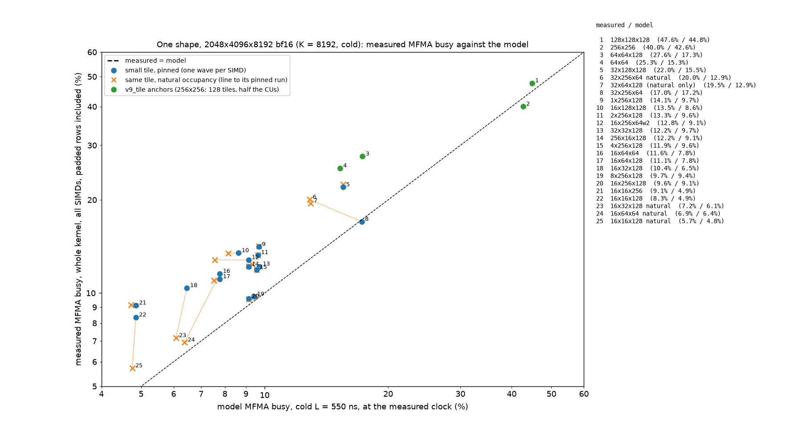

- **The model's order holds, and it is a floor.** Every small tile is load-bound at 8-22% MFMA busy, and
  bytes per FLOP set the order. The tiles with one 4-wave workgroup per CU land on the model: 16x256x128
  (9.6% / 9.1%), 8x256x128, and 32x256x64 pinned (17.0% / 17.2%). They move 59-63 B/ns per CU, the
  earlier tiles' 60 (§4).
- **More, smaller workgroups per CU move more bytes.** The tiles with 2-4 workgroups of 1 or 2 waves
  beat the cold window by 1.3-2x: 72-111 B/ns per CU, an implied round trip of 300-450 ns against 550.
  Latency is not what limits them: warm inputs add only 2-13% (§14.6), against +54% for 16x256x128.
  Two candidates are the TCP processing rate (111 B/ns is 46 B/clk of its 64 at 2.4 GHz) and bursts:
  one workgroup of 4 waves issues its loads in step, between barriers.
- **Below 16 rows only the waste changes.** 8, 4, 2 and 1 rows keep the 16-row MFMAs and nearly the same
  bytes, so MFMA busy stays at 10-14% while the useful share falls with BM / 16: 4.9%, 3.0%, 1.7%, 0.9%.
  1x256 is busier than 16x256 (14.1% against 9.6%) because A's 15 masked rows are not fetched at all:
  masked lanes appear to cost no TCP time. Its L2 misses fall with them (97% hits against 91%).

### 14.5 Which tiles two stages are enough for

ATT tells the two limits apart. Waiting on `s_waitcnt vmcnt` means the data is not back yet: the pipeline
is too shallow. Stalling to issue `buffer_load` means the TCP is full: the window binds, and more stages
cannot help.

- **Two stages are enough** (vmcnt waits 8-150 cycles, issue stalls 1000-3600) for every tile with
  BK = 128 and BN >= 32: 32x{32, 64, 128}x128, 16x{32, 64, 128, 256}x128, 8/4/2/1x256x128, 256x16x128.
  Also 16x16x256 and the v9_tile anchors 128x128x128 and 64x64x128.
- **Two stages are short** for the BK = 64 tiles that hold one k-step's B under 32 KB per CU:
  32x256x64 (vmcnt 518 of 2599), 16x64x64 (343 of 1839), and v9_tile 64x64x64 (439 of 2623). As
  §14.1 predicted, BK = 128 is the fix: 64x64x128's waits fall to 262.
- **16x16x128 is pipeline-bound, as expected:** 608 of its 1390 stall cycles are `vmcnt` and only 272
  are issue. Its two stages hold 4 tiles x 2 x 8 KB = 64 KB per CU, enough bytes, but each tile's 2 k-steps
  last 2 x 27 ns against a round trip of several hundred. 16x16x256 doubles the lead: the waits fall to 45,
  the stall moves to issue, and busy goes from 8.3% to 9.1% (+10%). A deeper pipeline would do the same.
  BK = 256 is the cheap form of it (32 KB of LDS, 160 VGPRs).
- **Occupancy instead of stages:** natural occupancy (more workgroups per CU than one wave per SIMD)
  helps only where two stages were short. 32x256x64 goes from 17.0% to 20.0% with 2 workgroups per CU.
  Elsewhere it hurts, because the extra workgroups widen each XCD's footprint and the L2 hit rate falls:
  16x64x64 at 1.9 waves per SIMD drops from 11.6% to 6.9% (L2 hits 84% to 52%), 16x32x128 from 10.4%
  to 7.2%, 16x16x128 from 8.3% to 5.7%. Where LDS already limits a tile to one wave per SIMD, pinned and
  natural are the same run. That fits a per-CU limit on bytes in flight: more workgroups add buffers,
  not bandwidth.

### 14.6 Warm inputs, padding and GROUP_SIZE_M

- **Warm** (inputs in the MALL; [small_warm_report.md](results/small_warm_report.md)): 16x256x128 goes
  from 63 to 97 B/ns per CU, 240 to 373 TFLOPS, as 256x128 did in §9. The one-wave tiles barely move:
  32x32x128 +3%, 16x64x128 +2%, 16x16x128 +13%, 1x256x128 +7%.
- **Row padding** ([pad_rows.py](pad_rows.py)): padding A's rows changes nothing (241 against 242
  TFLOPS for 16x256x128). Unpadded B rows are 1-9% faster for the small tiles, the opposite of the
  large tiles; the sweeps keep bench.py's padded B.
- **GROUP_SIZE_M is a 20-26% lever the footprint rule misses.** The mirror 256x16x128 beats 16x256x128
  (306 against 240 TFLOPS) with the same kernel tile; only the grid order differs. With
  `V9_TILE_GM` overridden:
  - 16x256x128: GM = 1, 4, 8, 16, 32, 64, 128 give 159, 302, 289, 241, 234, 284, 304 TFLOPS. The rule
    picks 16.
  - 16x64x128 pinned: GM = 4, 16, 32, 64, 128 give 162, 267, 311, 321, 317. The rule picks 16.

  The response is not monotone in GM, which suggests channel and XCD placement more than footprint. Every
  number in §14.4 uses the rule's GM, so the small tiles' TFLOPS are conservative by up to a quarter.

### 14.7 Memory-bound: M = 1-32, N = 4096-16384, K = 8192

`SMALL_MB`, back to back with 2 GB of rotating inputs, so the weights B come from HBM:
[small_mb_report.md](results/small_mb_report.md). Throughput counts A, B and C once over the kernel time.

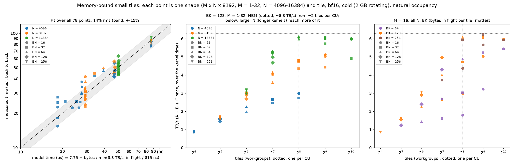

- **The metric changes.** MFMA busy is 2-3%, meaningless here. What counts is TB/s against HBM's 6.0-6.3,
  and whether any byte is read twice. It is not: bytes the L2 read from beyond itself are 1.00-1.05x the
  unique bytes on every point (counters, 32/64/128 B requests). B is streamed exactly once, and padded
  A rows cost nothing.
- **The tile count decides, then the bytes in flight per tile.** One small tile per CU with two stages
  holds `2 x B` bytes, far under 32 KB, so a CU streams far below the window's 60 B/ns. HBM saturates once
  there are about 2 tiles per CU:

  | tiles | TB/s (BK = 128) | BK = 64 | BK = 256 |
  |---|---|---|---|
  | 16 | 0.81-0.88 | | |
  | 32 | 1.43-1.71 | 1.23 | |
  | 64 | 1.98-3.19 | 1.43-2.38 | |
  | 128 | 2.46-5.26 | 1.60-4.28 | 3.72 |
  | 256 | 2.73-6.12 | 1.79-4.88 | 4.37-5.93 |
  | 512 | 4.43-6.07 | 3.23-5.23 | 5.66-6.23 |
  | 1024 | 4.90-6.01 | 5.45 | 5.94 |

  Within a row, the larger shapes (more bytes per tile, a longer kernel against its fixed start-up and
  finish) reach the higher end.
- **So pipeline depth matters here, unlike on compute-bound shapes.** At 16x4096x8192 with BN = 16 (256
  tiles), BK = 64, 128 and 256 give 1.79, 2.98 and 4.37 TB/s. At 16 x 8192 with BN = 32, 3.02, 4.72 and
  5.93. More stages, or larger BK, buy bytes in flight directly. Pinning changes nothing: the dispatcher
  already spreads a few hundred workgroups one per CU.
- **Little's law with a fixed cost fits every point.** Take the bytes the chip can hold in flight,
  `busy CUs x min(32 KB, 2 x tiles/CU x B)`. Then
  `time = 7.75 us + unique bytes / min(HBM, in flight / 615 ns)` fits all 78 points (natural occupancy)
  to 14% rms ([report_small.py](report_small.py) `mb_fit`).
  - The fixed 7.75 us (launch ramp, pipeline fill, epilogue) is half of a 15 us kernel. It is why the
    shortest shapes stay at 3-4 TB/s with enough bytes in flight.
  - The 615 ns round trip is a little longer than the 550 ns of the compute-bound tiles, as expected
    with HBM near saturation.
  - Fewer than about 110 busy CUs cannot reach HBM at all; that is split-K's or stream-K's job.

  Each point in the figure is one shape (M x N x 8192) and tile; colour is N, the marker BN (M barely
  matters).
  - **Left:** the measured time against the fitted model's, with a ±15% band.
  - **Middle:** TB/s against the tile count at BK = 128.
  - **Right:** the BK variants at M = 16.

How to assess a memory-bound point, then:

- **Throughput:** unique bytes over the back-to-back time, against the measured HBM ceiling (or the
  MALL's 7-7.9 TB/s if the weights stay warm).
- **Over-fetch:** `ea_rd_over_unique` from the counters, which should be 1.0.
- **Bytes in flight per CU:** `stages x tiles per CU x B` against the bandwidth per CU needed,
  6.3 TB/s / busy CUs x L. If short, raise BK or the stages, or split K.
- **Busy CUs:** at least ~110, or the window caps the chip at busy CUs x 60 B/ns.
- **Timing:** graph launches, since the kernels run 15-90 us.

### 14.8 Answers

- **What it took.**
  - A one-region kernel with the waves along N, a 16-row MFMA masked down to BM, and swizzled
    operand reads with the swizzle folded into the copy addresses.
  - C^T for small BN, and an LDS pin.
  - Five fixes to the shared amdgcnas peephole. Its nop deletion is still unsound in general, so the new
    kernel is compiled without it.
  - BM = 32 also runs in the existing `v9_tile_2r`.
- **Is the MFMA efficiency what we expect?** Yes for the tiles built like the earlier ones (one 4-wave
  workgroup per CU: 16x256, 8-1x256, 32x256), within a few points of the window model. The tiles with
  several one-wave workgroups per CU do 1.3-2x better than the cold model. It is a per-CU byte rate of
  72-111 B/ns that warm inputs barely raise, so the "60 B/ns" of §4 is that structure's number, not a
  hardware constant.
- **Two stages are enough** for every tile with BK >= 128 except 16x16x128, which waits on `vmcnt`.
  16x16 does need more pipelining, as expected, and BK = 256 provides it (+10%). BK = 64 tiles that hold
  less than 32 KB per CU are short too (32x256x64, 16x64x64).
- **Other changes the numbers point to:**
  - Retune GROUP_SIZE_M for small tiles (20-26% on the two tiles tried).
  - Keep one wave per SIMD, since extra occupancy costs L2 hits.
  - Below 16 rows the MFMA wastes 1 - BM/16 of its work at the same speed: 1x256 gives 22 TFLOPS. A
    decode-shaped compute-bound GEMM wants the large side as M, or a VALU kernel.
- **Memory-bound shapes** are a different problem with the same kernel. The tile count and the bytes in
  flight per CU decide, not intensity. BK and stages now matter, a few hundred tiles saturate HBM, and
  fewer need split-K.

### 14.9 What Triton does instead: 4x64 / 64x4 MFMA, v_dot2, replicated warps, waves_per_eu

Triton's AMD backend handles small dots differently from v9_tile_small. Its `AccelerateAMDMatmul`
chooses by min(M, N):
- **16 or more:** 16x16x32 (32x32 from 32).
- **4-15:** `mfma_f32_4x4x4bf16_1k` as a 4x64 or 64x4 tile. Its 16 blocks lie along the wide side, and
  `cbsz`/`abid` broadcast the narrow operand to all of them. For 64x4 the layout is transposed and the
  operands swapped, because the hardware can only broadcast its first operand.
- **Below 4:** no MFMA. The dot falls through to `AccelerateBlocked`, which for bf16 on CDNA4 emits
  `v_dot2_f32_bf16` (kpack plays no part: it only widens kWidth, and gfx950 forces it to 1).
- **Warps:** for 16x16 with 4 warps, `planWarps` gives `[4, 1]`, so the 4 warps compute the same tile.

Both routes were measured:
- **New options in v9_tile_small:**
  - `m4`: the 4x64 MFMA. A is read as an unswizzled 4-row slice, since a slice cannot split a 16-row
    swizzle.
  - `wW` above BN / 16: replicated warps.
  - `eE`: `waves_per_eu = E` instead of the LDS pin.
- **A plain Triton reference kernel,** [triton_ref.py](triton_ref.py) (`tri` specs: `tl.dot`, 2 stages,
  the same pid swizzle and GROUP_SIZE_M rule), compiled stock with no LLVM scheduler and no amdgcnas.
  Its inspect mode reads the chosen path back from the TTGIR and the assembly
  ([triton_ref_inspect.md](results/triton_ref_inspect.md)). Every path is the one described above.
  - The 4x64 and 64x4 kernels get swizzled LDS and 130-132 `ds_bpermute` per kernel, one per async
    load: Triton's padded layout only exists for 16- and 32-wide MFMAs.
  - BM = 1 and 2 have no MFMA, and 128 or 256 `v_dot2` per loop.

All new specs pass `check_tiles.py` (800 cases, [check_tiles_alt.md](results/check_tiles_alt.md)). The
runs are `run_small_tiles.sh alt` on GPU 3; tables are in [small_alt_report.md](results/small_alt_report.md),
and the figure is below.

**The 4x4x4 MFMA takes 8 cycles.** Cycles per MFMA come from the busy SIMD-cycles in the counters over
the MFMAs executed ([small_mfma_cycles.md](results/small_mfma_cycles.md)). The method gives 16.0 for
every 16x16x32 point, which checks it, and 8.0 for every `mfma_f32_4x4x4_16b_bf16`
(added to `MFMA_CYCLE_MAP` in [process_json.py](../../../../../scripts/process_json.py)).
- **Rate:** 1024 MACs per 8 cycles, a quarter of 16x16x32's 8192 per 16.
- **Useful MFMA throughput at BM <= 4:** the same as padding to 16. The 4x64 pads too, to 4 rows,
  and runs a quarter as fast.
- **At BM = 8:** half that of padding to 16.

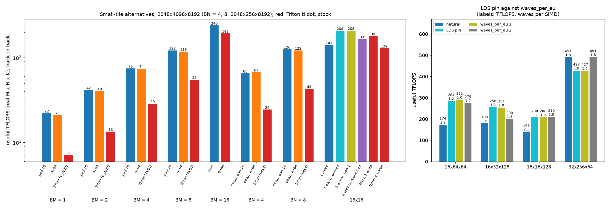

Compute-bound, 2048x4096x8192 (BN = 4, 8: 2048x256x8192), useful TFLOPS:

| BM (or BN) | pad 16 (ours) | 4x64 in ours | Triton |
|---|---|---|---|
| 1 | 22 | 21 | 7 (v_dot2) |
| 2 | 42 | 40 | 13 (v_dot2) |
| 4 | 75 | 74 | 29 (4x64) |
| 8 | 122 | 118 | 55 (4x64) |
| 16 | 240 | | 193 (16x16x32) |
| BN = 4 (C^T) | 65 | 67 | 24 (64x4) |
| BN = 8 (C^T) | 126 | 122 | 43 (64x4) |

Memory-bound (M = 1-8, N = 8192-16384, K = 8192; BN = 64 / 256), TB/s:
- **pad 16 against 4x64:** within 1% on most points; 4x64 is never more than 1% faster, and at most 5%
  slower (3.86 against 4.08 TB/s at 8x8192x8192, BN = 64).
- **Triton:** 1.3-5.3x lower. For example 1x16384x8192 at BN = 64: 4.71 against 6.10.
  4x8192x8192 at BN = 64: 1.18 against 4.11.

- **4x64 instead of padding (and 64x4 instead of the C^T swap): no difference.**
  - The tiles are load-bound (stalls on `buffer_load` issue), and the MFMA is not the limit.
  - At BM = 8 the 4x64 version keeps the MFMAs twice as busy (18.9% against 9.7%) for 3% less
    throughput.
  - It frees registers (132 VGPRs against 220 at BM = 4, a quarter of the operand registers), but
    that buys nothing here.
  - Below 16 rows, padding is as good or better and keeps one code path.
- **Triton's own code is 1.15-3.2x slower than v9_tile_small's best on every small tile,** and the
  instruction is not why. (One exception at natural occupancy: Triton's one-warp 16x16 gives 180 against
  ours at 141, with L2 hits of 88% against 59% at similar occupancy, 2.25 against 2.15 waves per SIMD.
  Pinned, ours gives 208.) Its
  loops stall on LDS: `lgkmcnt` waits and `ds_read`s take 1950-3700 of their 4700-5900 cycles, against
  270-640 in ours.
  - The 4x64 and 64x4 kernels pay a `ds_bpermute` for every async load, because their LDS is swizzled.
  - The v_dot2 kernels read every operand through LDS for VALU dot products.
  - At 16x256 it is the pipeline: 781 cycles of `vmcnt` against 8.

  Fixing the 64x4 tiles' GROUP_SIZE_M (L2 hits 75% to 95%) left them at 24 and 43 TFLOPS.
- **v_dot2 for M < 4 is the worst choice measured:** 7 and 13 TFLOPS against 22 and 42 for padded MFMA.
  Memory-bound at M = 1 and BN = 64 it reaches 2.6 and 4.7 TB/s against 4.1 and 6.1 (BN = 256: 0.8 and
  1.6 against 1.7 and 3.2). So M < 4 should still use the MFMA, padded.
- **waves_per_eu = 1 does what the LDS pin does.** LLVM honours `amdgpu-waves-per-eu="1,1"` by
  allocating 257 VGPRs (`.amdhsa_next_free_vgpr`), and `"2,2"` 169. The hardware then fits only 1 (2)
  waves per SIMD. Measured waves per SIMD and TFLOPS:

  | tile | natural | LDS pin | waves_per_eu 1 | waves_per_eu 2 |
  |---|---|---|---|---|
  | 16x64x64 | 174 (1.95) | 284 (1.21) | 291 (1.00) | 275 (1.90) |
  | 16x32x128 | 180 (1.56) | 256 (1.22) | 254 (1.00) | 200 (1.50) |
  | 16x16x128 | 141 (2.15) | 208 (1.24) | 208 (1.00) | 210 (2.0) |
  | 32x256x64 | 491 (1.79) | 428 (1.00) | 427 (1.00) | 491 (1.79) |

  - **The exact match:** `waves_per_eu = 4 / W` gives exactly one wave per SIMD, which the LDS pin only
    approximates (1.2), with no LDS pad and no code. It is the better pin.
  - **When it can't:** it cannot pin a tile whose LDS already allows fewer workgroups than it asks for,
    and it is per SIMD, so a W-wave workgroup needs E = 1 for one wave per SIMD.
  - **Two waves per SIMD:** at `waves_per_eu = 2`, 16x16x128 runs as fast as pinned (210, 2.0 waves, L2
    hits 90% against 59% at natural occupancy). 32x256x64 matches its natural run (491), the only tile
    where extra occupancy helped. 16x32x128 falls back towards natural (200).
- **One-wave workgroups beat replicated warps for 16x16:**
  - 208 TFLOPS pinned against 166 for 4 replicated waves in ours.
  - Triton: 180 with 1 warp against 129 with its default 4. Replication does 4x the MFMA work (35% busy
    for 6.6% useful) and 4x the LDS reads.

**Answers.**
- **4x64 / 64x4 MFMA:** no gain over padding at BM (or BN) = 1-8, compute- or memory-bound.
- **FMA (v_dot2) below 4:** 3x slower than padded MFMA.
- **Triton's generated code:** slower than v9_tile_small's best on every small tile. Its swizzled-LDS
  shuffles and LDS-fed operands cost more than any instruction choice.
- **waves_per_eu:** the cleanest way to pin occupancy, so it replaces the LDS pad.
- **16x16:** one-wave workgroups at one wave per SIMD, not replicated warps.

## 15. aiter's derived layouts against ours (2026-10-13)

aiter's draft gfx950 Gluon GEMM (`upstream/llirSched_integration`, 72ef58a89, "tiles from 64x64 to 256x256")
is v9's four-quadrant kernel with tiles of 64, 128 and 256 per side, like v9_tile. It builds its layouts
differently. The shared layout comes from Triton's `compute_efficient_padded_shared_layout` for the MFMA
operand that reads it. The global-load layout is cut from that layout's offset bases: 3 register bases
(16 B per lane), 6 lane bases, 2 warp bases, the rest registers (`compute_gload_layout`). v9_tile writes
both from one hand-built rule (`_half_tile_bases`: the top three row bits on lanes, rows 1 and 2 on warps).

For the A/B the tile spec took a trailing `d` (aiter's layouts) next to the hand-built default; the
results are in `results/layout_ab_*.csv`, and `python v9_tile/report.py layout_ab` prints the table.
Since then the derived layouts are v9_tile's only layouts and the suffix is gone (§15.5).

**The stack moved.** This section runs on the `gfx950-tutorial-v3.0` stack ([env.sh](env.sh)): the
installed Triton (a build with 3b0c7f081), its MFMA scheduler through `schedule_hint="mfma-schedule"`, no
llirSched plugin. Sections 1-14 ran on Triton v2.2 + llirSched + amdgcnas, which no longer works: the
re-pin brought main's amdgcnas, and on v2.2's output it breaks even v9_beyond_hotloop. Main's amdgcnas
also lacks the fixes of §2 and §14.3, and it miscompiles our hand-built layouts on v3.0:
[check_tiles_v30.md](results/check_tiles_v30.md) has 86 failures in 312 cases (256x128 and 128x256 with
bias, 128x128x128 everywhere, some ragged 128x256), all correct with amdgcnas off. The derived layouts pass
all 312 with it ([check_tiles_derived.md](results/check_tiles_derived.md)). So the measurements below use
the scheduler alone, and one timing pass with amdgcnas is kept for comparison.

**In short:**

- **Our layout has two-way LDS bank conflicts wherever it differs from aiter's.** That is every tile with
  a 64-row half (side 128) and every BK = 128 tile. Every `ds_read_b128` of those operands takes two
  passes. aiter's layout has none.
- **Removing them barely moves throughput.** The LDS read stalls halve, and the waves then stall issuing
  `buffer_load`s instead. These tiles are bound by the bytes in flight per CU (§4), not by LDS reads.
  - 128x128x128 gains 1-4% in every run.
  - 128x128 gains up to 1.3%, mixed at K = 4096.
  - 256x128 and 128x256 are unchanged (±0.6%).
  - 64x64x128 loses 0.4-2.3% in every run.
- **v9_tile now has one layout path, aiter's,** for every tile with sides of 64 or more and for
  v9_tile_2r (§15.5). The hand-built layouts are gone; every v9_tile number before this section used
  them.
- **aiter's derivation stops at 32 rows**, a tile side of 64. Triton returns no layout below that, so
  v9_tile_small keeps its swizzle (§14.2).

### 15.1 The two layouts

Both use the same padding (16 elements after every 512, so each wave's 1 KB load lands contiguously) and
the same split of the offset bases into registers, lanes and warps. Only the order of the bases differs.
Rows of A, in LDS address order after the first 64 K elements (B's are the same, transposed):

| half-tile | tiles | ours | aiter (derived) |
|---|---|---|---|
| 128 rows, BK 64 | side 256 | identical | |
| 32 rows, BK 64 | side 64 | identical | |
| 64 rows, BK 64 | side 128 | lanes: rows 8, 16, 32; then rows 1, 2, 4 | lanes: rows 4, 8, 16; then rows 1, 2, 32 |
| 64 rows, BK 128 | 128x128x128 | lanes: rows 8, 16, 32; then K 64, rows 1, 2, 4 | lanes: K 64, rows 16, 32; then rows 1, 2, 4, 8 |
| 32 rows, BK 128 | 64x64x128 | lanes: rows 4, 8, 16; then K 64, rows 1, 2 | lanes: K 64, rows 8, 16; then rows 1, 2, 4 |
| 128 rows, BK 128 | side 256 at BK 128 | lanes: rows 16, 32, 64; then K 64, rows 1, 2, 4, 8 | lanes: K 64, rows 16, 32; then rows 1, 2, 4, 8, 64 |

At BK = 128, aiter's wave covers 4 rows x 256 B per load instruction, and ours covers 8 rows x 128 B.

The compiled loops are the same instruction for instruction ([asm_derived.md](results/asm_derived.md)):
the same MFMAs, loads, waits and spacing. Only the `ds_read` offsets, the load offsets and 4 VGPRs differ.

### 15.2 Gates

- **Equivalence:** where the bases are equal, the option reproduces our layout. `256x256d` and `64x64d`
  compile byte-identical to `256x256` and `64x64`.
- **Correctness:** above. All `d` tiles pass with and without bias, ragged M, N and K included.
- **After the default switch:** `128x128x128` compiles byte-identical to `128x128x128d`, and `256x256` and
  `128x128` are unchanged. v9_tile 256x256's instruction stream is identical to v9_beyond_hotloop's (2339
  instructions; only the kernel name and labels differ).

### 15.3 LDS bank conflicts

`SQ_LDS_BANK_CONFLICT` and `SQ_LDS_IDX_ACTIVE` (counter set 4 in [sweep.py](sweep.py)), K = 8192:

| tile | ours: conflict cycles per access | ours: LDS busy, % of CU cycles | aiter: conflict | aiter: LDS busy |
|---|---|---|---|---|
| 128x128 | 0.99 | 40% | 0 | 20% |
| 128x128x128 | 0.99 | 43% | 0 | 22% |
| 256x128 | 0.33 | 30% | 0 | 22% |
| 128x256 | 0.33 | 30% | 0 | 23% |
| 64x64x128 | 0.99 | 64% | 0 | 31% |
| 256x256, 64x64 (identical code) | 0 | 20%, 29% | | |

0.99 means every LDS access takes two passes. 256x128 and 128x256 have one 64-row operand and one
128-row operand, so a third of their LDS cycles are conflicts.

A model reproduces every row: 128 banks of 4 B (512 B), with the 64 lanes of a `ds_read_b128` serviced
32 at a time. One MFMA operand read covers rows 0-15 of a 16-row block, four lanes per row (32 K values).
It is conflict-free when row bits 1, 2, 4 and 8 land 32, 64, 128 and 256 B apart (mod 512). A padded 1 KB
chunk is 1056 B, so a row bit at chunk index c moves the address by `1056 c mod 512 = 32 c` (c < 16).
The three bits on the lanes after the 64 K elements move it by 128, 256 and 512 B. Each pass of 32
lanes reads 16 rows x 32 B, so the rows must fill the 512 B exactly.

- **Ours at 64 rows:**
  - Row 4 sits at chunk 4, so 4224 B, which is 128 mod 512.
  - Row 8 sits on the first lane row bit, also 128 B.
  - Rows that differ in bits 4 and 8 collide.
- **Ours at BK = 128:**
  - K 64 takes chunk 1, which moves the row bits up one chunk each.
  - At 64 rows, row 2 lands at 128 and collides with row 8 on the lane.
  - At 32 rows, row 2 lands at 128 and collides with row 4 on the lane.
- **aiter:** in every case rows 1, 2, 4 and 8 land at 32, 64, 128 and 256 B.
- **Not built here:** the model predicts conflicts for our 128-row half at BK = 128 (row 8 at chunk 16 is
  0 mod 512). That covers 256x128x128 and 128x256x128.

### 15.4 Throughput

d / ours, back-to-back TFLOPS: four runs over two GPUs. The last column is with amdgcnas, where our
128x128x128 is wrong:

| tile | K | GPU 3 | GPU 4, repeat | GPU 3, sustained (clock run) | GPU 4, amdgcnas |
|---|---|---|---|---|---|
| 128x128 | 4096 | 0.989 | 1.004 | 1.005 | 1.002 |
| 128x128 | 8192 | 1.013 | 1.005 | 1.013 | 1.013 |
| 128x128x128 | 4096 | 1.016 | 1.019 | 1.038 | 1.024 |
| 128x128x128 | 8192 | 1.016 | 1.011 | 1.014 | 1.019 |
| 256x128 | 4096 | 0.999 | 0.999 | 0.999 | 1.002 |
| 256x128 | 8192 | 0.999 | 0.997 | 0.999 | 1.001 |
| 128x256 | 4096 | 1.001 | 0.994 | 1.002 | 1.004 |
| 128x256 | 8192 | 1.003 | 1.004 | 0.998 | 1.000 |
| 64x64x128 | 4096 | 0.983 | 0.986 | 0.983 | 0.977 |
| 64x64x128 | 8192 | 0.995 | 0.996 | 0.994 | 0.988 |

K = 8192, GPU 3. Stalls per loop iteration (2 k-steps) and wave, from ATT on CU 0
([att_stalls.py](att_stalls.py)):

| tile | layout | TFLOPS | ATT loop MFMA eff | vmcnt | buffer_load issue | lgkmcnt + ds_read | s_barrier | cycles issued |
|---|---|---|---|---|---|---|---|---|
| 128x128 | ours | 949 | 51.9% | 261 | 158 | 100 | 230 | 1983 |
| 128x128 | aiter | 961 | 50.6% | 301 | 177 | 98 | 221 | 2030 |
| 128x128x128 | ours | 1027 | 55.7% | 47 | 279 | 844 | 199 | 3657 |
| 128x128x128 | aiter | 1044 | 55.7% | 47 | 662 | 411 | 231 | 3646 |
| 256x128 | ours | 1233 | 74.6% | 48 | 268 | 140 | 153 | 2759 |
| 256x128 | aiter | 1232 | 73.0% | 48 | 313 | 141 | 167 | 2818 |
| 128x256 | ours | 1246 | 73.2% | 48 | 294 | 152 | 167 | 2798 |
| 128x256 | aiter | 1250 | 76.3% | 48 | 219 | 152 | 144 | 2699 |
| 64x64x128 | ours | 679 | 21.8% | 200 | 724 | 364 | 324 | 2448 |
| 64x64x128 | aiter | 676 | 21.1% | 75 | 987 | 191 | 461 | 2546 |

Clocks, power and L2 hit rates match within each pair: 1.9-2.3 GHz at the 1400 W cap, the same L2 hits
to 0.1 point.

- **Where the conflicts showed.** 128x128x128 and 64x64x128 are the two tiles with many LDS read stalls,
  and the derived layout halves them: 844 to 411 and 364 to 191. In 128x128 the reads were already
  hidden behind the `vmcnt` waits of its short pipeline (§7), so conflict-free reads change nothing there.
- **The stall moves, it does not go away.** The time saved on LDS reads reappears as `buffer_load` issue
  stalls (279 to 662, 724 to 987): the waves reach the next load sooner and find the TCP full. This is §4's
  window: removing a limit that does not bind only moves the wait.
- **64x64x128 is slower anyway.** Its `vmcnt` waits fall (200 to 75), but issue and barrier stalls grow
  more (+263 and +137). It runs 2 workgroups per CU (66 KB of LDS each). The loads per wave instruction
  change shape (4 rows x 256 B instead of 8 x 128 B), and that is the remaining difference. Why that costs
  1-2% here and not in 128x128x128 is open. [TODO.md](../TODO.md) has the details and experiments to try.

### 15.5 What changes: one layout path

v9_tile and v9_tile_2r build every layout the aiter way (`tile_shared_layout`, `tile_load_layout` in
[matmul_kernel.py](matmul_kernel.py)). The hand-built `_half_tile_bases`, the `d` / `h` suffixes and the
A/B presets are gone. The reasons:

- One way to build a layout, the one that has no bank conflicts at any size and that the aiter port
  uses. That includes 256x128x128 and other BK = 128 tiles at side 256, where the hand-built one would
  conflict (§15.3).
- The cost is small. 128x128x128 gains 1-4% and 128x128 up to 1.3%. 256x128 and 128x256 are unchanged,
  and 64x64x128 loses 0.4-2.3%.
- Main's amdgcnas compiles it correctly where it miscompiled the hand-built one: 256x128 and 128x256
  with bias, and 128x128x128.
- At 256x256x64 and 64x64x64 nothing changes: the code is byte-identical, and 256x256's instruction
  stream is v9's.
- Triton has no layout at 32 rows for the 32x32x16 MFMA, so `V9_TILE_MFMA=32` now needs both tile sides
  of 128 or more (at 64, the half-tile is 32 rows).
- v9_tile_small (a side of 32 or less) keeps its own swizzled layout (§14.2).

Gates for the switch ([check_tiles_derived.md](results/check_tiles_derived.md)): bf16 and fp16, with and
without bias, ragged M, N and K included.

- **All 11 four-quadrant tiles** with sides 64-256 pass under the documented stack (0 of 696 fail). That
  includes aiter's 256x64, 64x256, 128x64 and 64x128, which compile without spills
  ([asm_check.py](asm_check.py): 112-348 VGPRs, 1-3 workgroups per CU).
- **v9_tile_2r (128x128r2, 32x256r2, 128x128x128r2):**
  - It fails 27 ragged-K cases under main's amdgcnas.
  - The former hand-built layouts fail the same cases, so the layout is not the cause.
  - Without amdgcnas everything passes.
- **256x256** has the same instruction stream as v9_beyond_hotloop.

Open: main's amdgcnas lacks the §2 and §14.3 fixes (they are in d6873fa).

- v9_tile's four-quadrant tiles now compile correctly under it.
- v9_tile_2r with ragged K does not.
- v9_tile_small still needs the peephole skipped (§14.3).

This branch keeps main's files unchanged.

## 16. Load latency per tile, measured (2026-10-13)

Two questions before the tiles go into v26 and the other stream-K kernels:

- Do the tiles reach the MFMA efficiency the model says they can, on the current stack?
- What is the load round trip L for each tile on a compute-bound shape? Everything so far *inferred*
  L = 550 ns from 32 KB / (bytes per ns), which assumes the 32 KB window is full.

Only tiles that two stages are enough for (§14.5): 256x256, 256x128, 128x256, 128x128x128, 64x64x128,
32x{128, 64, 32}x128, 16x256x128, 16x128x128, 256x16x128, and as boundary points 16x64x128 and 16x32x128.
The small tiles are pinned to one wave per SIMD (`p`) where LDS allows (all but 32x64x128, which runs
3 workgroups per CU). Two shapes, both K = 8192 with 2 GB of rotating inputs:

- `LAT_FW`: one full wave per tile, 256 x (workgroups per CU) tiles, as square as the block counts allow
  (`sweep.full_wave_shape`; 16x256 runs on 1024x1024).
- `LAT_CB`: 2048x4096x8192 for every tile, §14.4's shape.

The stack is v3.0 with the MFMA scheduler alone (`source v9_tile/env.sh; unset TRITON_AMDGCNAS_PLUGIN`),
as in §15. `LAT_FW` and the calibration ran on GPU 3, and `LAT_CB` on GPU 4. Four `LAT_CB` points
repeated on GPU 3 agree within 0.5%. Scripts:

- `GPU=3 bash v9_tile/run_latency.sh calib|fw|cb`;
- [calib_latency.py](calib_latency.py);
- [sweep.py](sweep.py) counter sets 5-7 (`latency_columns`);
- [report_latency.py](report_latency.py), which writes [latency_report.md](results/latency_report.md) and
  `images/latency/`.

**In short:**

- **L is not one number, and 550 ns is the number for one workgroup per CU.** Inferred the old way
  (32 KB over the measured bytes per ns), the tiles that run one 4-wave workgroup per CU (256x128,
  128x256, 128x128x128, 16x256, 256x16) give 410-580 ns. The tiles with 2-4 workgroups per CU give
  330-440 ns.
- **The counters measure L directly, and it is shorter on the L2 side and longer from issue:**
  - The TCP->L2 round trip of a 128 B request is 130-280 ns.
  - A load instruction's round trip from issue is 410-670 ns.
  - The gap between the two, about 340 ns, is the same for every tile: loads queueing inside the CU.
- **The 32 KB window is never full, so the 550 ns is not a physical round trip.** Between the TCP and L2
  the CU holds 8-18 KB. Counted from issue it holds 33-44 KB, up to the ~44-45 KB cap that the
  tcp_latency experiment found. That cap, over the round trip from issue, is the per-CU limit.
- **The L2 hit rate barely moves L; the workgroup structure does.**
  - The correlation of L with the miss rate is 0.37 on `LAT_FW` and -0.14 on `LAT_CB`.
  - At the same 91% hit rate, 16x256x128p (one workgroup of 4 waves) has a TCP-side L of 257 ns and
    16x64x128p (4 one-wave workgroups) 129 ns, with about the same bytes in flight.
  - The likely cause: the one-workgroup tiles issue a k-step's loads from 4 waves in step, between
    barriers, so they queue in bursts.
- **The efficiency is what the window allows, and the current stack is no slower:**
  - The four-quadrant tiles are within -1.2% to +0.9% of §15.4, and 128x128x128 is +9% over §14.4.
  - The small tiles are +1% to +10% over §14.4, except 16x32x128p (-6.5%).
  - The loops stall mostly on `buffer_load` issue (the window), not on `vmcnt`, LDS or barriers. The
    one exception is 128x128x128 on 2048x4096, where LDS reads lead.
- **Two stages are enough down to 16x64x128.** 16x32x128p is borderline: 12% of its stalls are `vmcnt`,
  and its two k-steps last only 2.2-2.4 round trips. 16x16x128 was already out (§14.5).

### 16.1 The counters, and a calibration on known latencies

| measure | counters | what it is |
|---|---|---|
| L_tcp | `TCP_TCC_READ_REQ_LATENCY_sum / TCP_TCC_READ_REQ_sum` | mean TCP->L2->TCP round trip of one 128 B request |
| L_issue | `VmemLatency` = accumulated `SQ_INST_LEVEL_VMEM` / `SQ_INSTS_VMEM` | mean round trip of a VMEM instruction from issue |
| L_miss | `TCC_EA0_RDREQ_LEVEL_sum / TCC_EA0_RDREQ_sum` | mean L2-miss round trip (relative only, below) |
| in flight per CU | latency sum x bytes per request / (kernel cycles x CUs loading) | Little's law on the same counters |

Each set is one rocprofv3 pass. The TCC takes 4 counters per pass, so the hit rate comes from set 1. A
TCP->L2 request is 128 B: on 256x128 at 4096x2048x8192, 1.258e7 requests x 128 B is the 1.61 GB the
tiles load, and 1.573e6 VMEM reads x 1 KB is the same.

[calib_latency.py](calib_latency.py) runs experiments/tcp_latency's kernels under the same sets
([latency_calib.csv](results/latency_calib.csv)):

| run | probe's own mean, cycles | L_issue, cycles | L_tcp, cycles | L2 hit | in flight from issue / TCP-side, KB per CU | B/clk per CU |
|---|---|---|---|---|---|---|
| probe, 1 MB x 32 passes (L2) | 222 (passes 1-31) | 221 | 115 | 95% | | |
| probe, 16 MB x 8 passes (MALL) | 553 (passes 1-7) | 402 (reads and stores) | 457 | 11% | | |
| probe, 64 MB once (HBM) | 943 | 575 (reads and stores) | 759 | 11% | | |
| stream, 1 CU, HBM | | 1662 | 834 | 1% | 45.7 / 20.2 | 25.2 |
| stream, 1 CU, L2 | | 725 | 106 | 98% | 46.0 / 6.3 | 62.3 |
| stream, 256 CUs, HBM | | 4464 | 1633 | 0% | 38.2 / 13.3 | 9.2 |
| stream, 256 CUs, L2 | | 854 | 271 | 98% | 26.8 / 8.3 | 49.2 |

- **`VmemLatency` is the probe's own timer.** On L2 hits it reads 221 cycles against the probe's 222. On
  the MALL and HBM runs it averages the probe's loads with the stores of its samples, which return in
  ~210 cycles.
- **L_tcp is the part beyond the TCP:** an L2 hit is ~110 cycles of the ~220 from issue.
- **Little's law closes in both views.** One CU streaming from HBM holds 45.7 KB from issue over 1662
  cycles, and 20.2 KB TCP-side over 834. Both give its 25 B/clk. The 45.7 KB is the ~44-entry cap that the
  ATT traces in [tcp_latency](../../../../../experiments/tcp_latency/README.md) found. The 32 KB the
  README assumed is never held between the TCP and L2.
- **L_miss does not close.** It reads 1.5-2x the miss time that L_tcp and the hit rate imply, although
  every EA request is 128 B (`TCC_EA0_RDREQ_128B`: 97-100%). It is reported as a relative number only.

### 16.2 Latency per tile

`LAT_FW` / `LAT_CB` in each cell (ns at the counter run's clock; B/ns per CU from the timed run):

| tile | WG/CU | L2 hit | B/ns per CU | L inferred, 32 KB / (B/ns) | L_tcp (TCP to L2) | L_issue (from issue) | KB in flight per CU, from issue / TCP-side |
|---|---|---|---|---|---|---|---|
| 256x256 | 1 | 80% / 74% | 44 / 57 | 750 / 577 | 203 / 261 | 411 / 501 | 17 / 9, 28 / 15 |
| 256x128 | 1 | 83% / 83% | 56 / 57 | 581 / 576 | 271 / 278 | 654 / 663 | 35 / 14, 36 / 15 |
| 128x256 | 1 | 83% / 83% | 57 / 58 | 574 / 569 | 261 / 257 | 606 / 627 | 34 / 14, 36 / 15 |
| 128x128x128 | 1 | 81% / 81% | 63 / 67 | 517 / 491 | 216 / 203 | 545 / 526 | 33 / 13, 34 / 13 |
| 64x64x128 | 2 | 82% / 81% | 74 / 82 | 444 / 398 | 187 / 179 | 522 / 544 | 37 / 13, 42 / 14 |
| 32x128x128p | 2 | 90% / 90% | 84 / 91 | 389 / 362 | 153 / 156 | 481 / 492 | 38 / 12, 42 / 13 |
| 32x64x128 | 3 | 88% / 89% | 87 / 90 | 376 / 362 | 136 / 141 | 460 / 463 | 38 / 10, 39 / 11 |
| 32x32x128p | 4 | 87% / 64% | 90 / 75 | 364 / 439 | 133 / 198 | 472 / 593 | 39 / 8, 43 / 14 |
| 16x256x128p | 1 | 91% / 91% | 65 / 67 | 503 / 490 | 257 / 283 | 611 / 667 | 39 / 16, 43 / 18 |
| 16x128x128p | 2 | 90% / 84% | 79 / 100 | 412 / 328 | 161 / 131 | 467 / 412 | 36 / 12, 38 / 12 |
| 256x16x128p | 1 | 91% / 91% | 65 / 80 | 505 / 409 | 254 / 213 | 610 / 525 | 38 / 16, 40 / 16 |
| 16x64x128p | 4 | 92% / 71% | 91 / 84 | 359 / 389 | 129 / 167 | 459 / 519 | 40 / 10, 43 / 13 |
| 16x32x128p | 4 | 90% / 78% | 83 / 88 | 394 / 374 | 142 / 160 | 492 / 518 | 37 / 9, 44 / 13 |

256x256 is not load-bound: on its full wave it holds 17 KB from issue and runs at 96% loop efficiency.
Its inferred 750 ns there is not a latency.

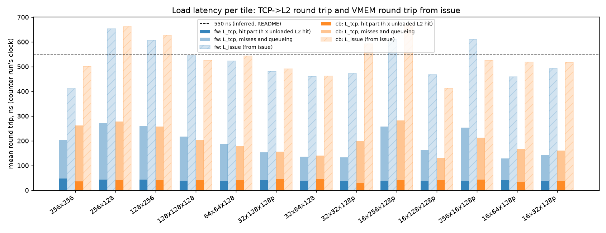

(Each bar of L_tcp is split into h x the unloaded L2-hit round trip of 110 cycles and the rest:
misses plus queueing. The hit part is 30-45 ns, so almost all of L_tcp is misses and queueing.)

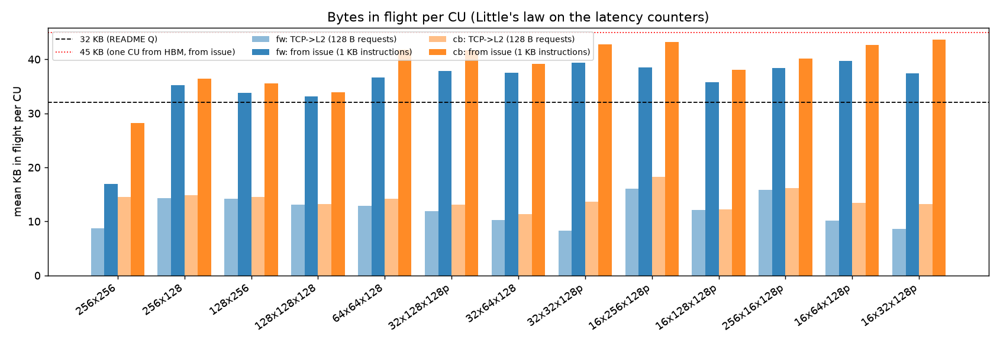

### 16.3 What moves L

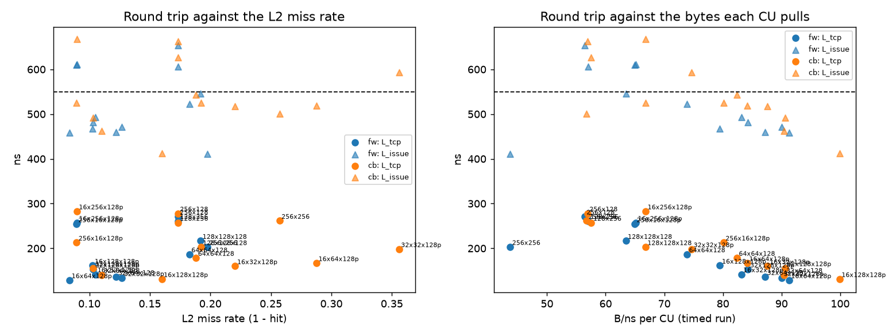

- **Not the L2 hit rate, within the 64-92% range here.** L_tcp correlates with the miss rate at 0.37
  (`LAT_FW`) and -0.14 (`LAT_CB`).
  - 256x128 and 128x256 (83% hits) and 16x256x128p (91%) all have L_tcp of 255-285 ns.
  - 16x64x128p at the same 91-92% hits has 129 ns.
  - Where the hit rate does fall a long way, L rises. 32x32x128p goes from 87% to 64% hits between the
    two shapes and from 133 to 198 ns.
- **The workgroup structure.** One 4-wave workgroup per CU means 203-283 ns TCP-side and 525-667 ns from
  issue. Two to four smaller workgroups mean 129-198 ns and 412-593 ns.
  - The bytes in flight do not separate the two groups:
    - The four-quadrant one-workgroup tiles hold less from issue (33-36 KB).
    - 16x256 and 256x16 hold 38-43 KB, as much as the multi-workgroup tiles (37-44 KB), and still take
      the longer round trip.
  - The likely difference is burstiness. One workgroup issues a k-step's loads from 4 waves at once,
    between barriers, so each request queues behind a burst. Independent one-wave workgroups spread
    their requests out. ATT timelines of a load burst would confirm it.
  - That is §14.4's open question: the one-wave tiles beat the 60 B/ns model not because Q is larger,
    but because their L is shorter.
- **The grid order matters as much.** 16x256x128p and its mirror 256x16x128p are the same kernel at the
  same 91% hit rate. At 2048x4096 their L_tcp is 283 and 213 ns, and their bandwidth 67 and 80 B/ns,
  which is §14.6's `GROUP_SIZE_M` effect. On 1024x1024 they are the same (257 and 254 ns).
- **About 340 ns of every round trip is spent inside the CU.** L_issue - L_tcp is 280-395 ns on every tile,
  and the TCP reports a `TCP_PENDING_STALL` (data pending from L2) on 26-54% of its cycles. A load waits
  that long before reaching L2 and after its data returns (the LDS write that `vmcnt` waits for), however
  short its L2 trip.

### 16.4 MFMA efficiency on the current stack

TFLOPS (sustained), the clock run's whole-kernel MFMA utilisation, and ATT loop efficiency (CU 0), against
the model at the clock run's clock with the documented window (Q = 32 KB, L = 550 ns) and with the measured
one (Q = 45 KB, L = L_issue). The last column compares back-to-back TFLOPS with the earlier run of the same
point: §15.4 is this stack with the same layouts, §14.4 is Triton v2.2 + llirSched + amdgcnas with the
hand-built layouts.

| tile | fw: TFLOPS, useful, ATT loop | model fw: 550 ns / own L | cb: TFLOPS, useful, ATT loop | model cb: 550 ns / own L | TFLOPS now / before |
|---|---|---|---|---|---|
| 256x256 | 1428, 72%, 96% | 99% / 100% | 937, 41%, (CU 0 idle) | 43% / 50% | cb 0.968 (§14.4); fw 0.988 (§15.4) |
| 256x128 | 1232, 62%, 73% | 65% / 77% | 1215, 59%, 72% | 63% / 74% | cb 1.009 (§15.4, mirror); fw 1.000 (§15.4) |
| 128x256 | 1237, 61%, 70% | 65% / 83% | 1256, 63%, 73% | 65% / 80% | cb 1.006 (§15.4); fw 0.997 (§15.4, mirror) |
| 128x128x128 | 1035, 48%, 55% | 45% / 64% | 1090, 53%, 66% | 47% / 70% | cb 1.090 (§14.4); fw 0.996 (§15.4) |
| 64x64x128 | 601, 25%, 19% | 20% / 30% | 674, 29%, 21% | 21% / 30% | cb 0.998 (§15.4) |
| 32x128x128p | 548, 22%, 25% | 16% / 25% | 591, 24%, 29% | 16% / 25% | cb 1.103 (§14.4) |
| 32x64x128 | 474, 19%, 29% | 13% / 22% | 494, 20%, 33% | 12% / 19% | cb 1.050 (§14.4) |
| 32x32x128p | 366, 15%, 16% | 10% / 16% | 305, 12%, 17% | 10% / 13% | cb 1.028 (§14.4) |
| 16x256x128p | 250, 10%, 11% | 9% / 12% | 259, 10%, 11% | 9% / 11% | cb 1.070 (§14.4) |
| 16x128x128p | 289, 11%, 18% | 9% / 14% | 362, 14%, 18% | 9% / 16% | cb 1.100 (§14.4) |
| 256x16x128p | 250, 10%, 11% | 9% / 12% | 308, 12%, 13% | 9% / 13% | cb 1.008 (§14.4) |
| 16x64x128p | 298, 12%, 13% | 8% / 13% | 275, 11%, 16% | 8% / 12% | cb 1.029 (§14.4) |
| 16x32x128p | 225, 9%, 9% | 6% / 10% | 239, 10%, 12% | 6% / 10% | cb 0.936 (§14.4) |

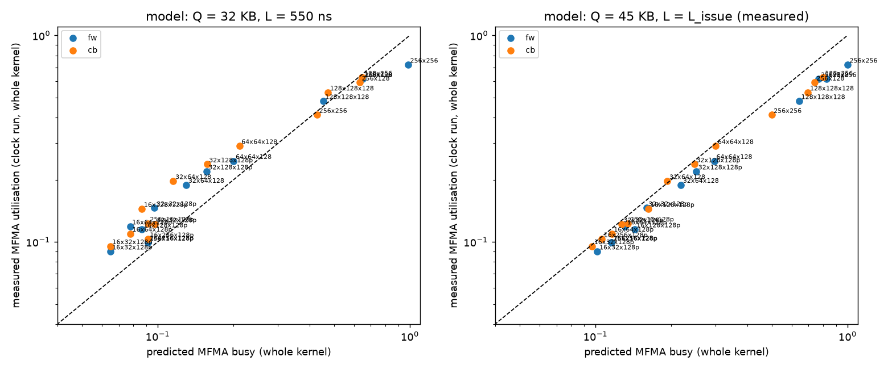

- **The tiles reach what the window allows.** Per loop iteration and wave, the largest stall is waiting to
  issue a `buffer_load` (the window): 310-3300 cycles, against 8-135 on `vmcnt` and 130-430 on LDS reads.
  There are two exceptions:
  - 128x128x128 on 2048x4096 (issue 178, LDS 425), the tile's fastest point: 66% loop efficiency;
  - 16x32x128p's `vmcnt` (§16.5).
- **The documented model (550 ns) still predicts the one-workgroup tiles:** 63-65% against 59-63% useful
  for 256x128 and 128x256, and 45-47% against 48-53% for 128x128x128. It under-predicts the multi-workgroup
  tiles by 1.2-1.7x, as in §14.4, because their L is shorter.
- **The measured pair (45 KB over L_issue) fits the multi-workgroup tiles:** within 0-22% of useful, closest
  on 2048x4096, since they hold close to the cap (37-44 KB). It over-predicts the one-workgroup tiles by
  20-36%. The four-quadrant ones hold only 33-36 KB, and the counter runs that measured L_issue ran
  0.2 GHz faster than the 1.9 GHz power-capped clock runs.
- **This stack is not slower.**
  - The four-quadrant tiles are within -1.2% to +0.9% of §15.4.
  - 128x128x128 at 2048x4096 is +9% over §14.4: the layouts of §15 plus the scheduler.
  - The small tiles, compiled without the peephole on both stacks (§14.3), gain 1-10% from the v3.0
    scheduler, except 16x32x128p, which loses 6.5%. On GPU 3 too it is 238 against 256 TFLOPS. Its
    `vmcnt` stalls rose from 151 of 1968 cycles per iteration (§14.4) to 199 of 2100.
- 256x256 on 2048x4096 is 2-3% under §14.4 on both GPUs. That is the stack, not v9_tile: its code is v9's
  (§15.2). ATT on CU 0 has no waves there, since 128 tiles leave half the CUs idle.

### 16.5 Which tiles two stages are enough for

The pipeline leads by about two k-steps, so 2 T_k must cover L_issue. T_k is the k-step time of the timed
run.

| tile | 2 T_k / L_issue (fw / cb) | `vmcnt` share of the loop's stalls (fw / cb) |
|---|---|---|
| 256x128, 128x256, 128x128x128 | 2.6-3.8 | 1.9-2.7% |
| 64x64x128 | 3.4 / 2.9 | 4.7% / 3.4% |
| 32x{128, 64, 32}x128 | 3.0-4.0 | 0.3-2.5% |
| 16x256x128p, 256x16x128p | 3.1-3.5 | 0.2-0.3% |
| 16x128x128p | 4.0 / 3.6 | 4.9% / 0.7% |
| 16x64x128p | 3.9 / 3.8 | 0.3% / 0.8% |
| **16x32x128p** | **2.4 / 2.2** | **12.6% / 11.9%** |

Two stages are enough for every tile down to 16x64x128. 16x32x128p is the first where the round trip
shows: it is borderline and the most sensitive to the schedule (§16.4). 16x16x128 is pipeline-bound
(§14.5). A shorter round trip would move this boundary: the warm inputs of §14.6 would, a more
loaded L2 the other way.

### 16.6 What this means

- **For the model:**
  - Keep `L` = 550 ns for tiles that run one 4-wave workgroup per CU (256x128, 128x256: 570-580 ns
    inferred; 128x128x128: 490-520). Use ~360-440 ns for tiles with 2-4 workgroups per CU.
  - Physically: ~45 KB in flight per CU from issue, over a 410-670 ns round trip from issue, of which
    130-280 ns is the trip to L2.
- **For the stream-K port:**
  - The tile list two stages support is 256x256, 256x128, 128x256, 128x128x128, 64x64x128, and the small
    tiles down to 16x64x128 (or 32x32). Treat 16x32x128 as borderline.
  - The stream-K fixup's latency costs (flag polls, partial reads from L2) scale with this L_issue, not with
    550 ns. A one-workgroup tile pays ~600-670 ns per dependent global round trip under load.
  - A tile with several workgroups per CU (§14.4's one-wave structure) has a shorter round trip, ~400-500
    ns. Keep that structure where the tile allows it.
- **Open:**
  - Why `TCC_EA0_RDREQ_LEVEL` reads 1.5-2x what the TCP side implies.
  - Where the ~340 ns inside the CU goes, between TA queueing and the LDS write of `buffer_load ... lds`.
    ATT on a one-wave tile could split it.

## 17. BLOCK_M a multiple of 16: row bands (2026-10-19)

Every Gluon tensor and layout has power-of-two sides (`validate_block_shape`; linear layouts are maps over
GF(2)), so a 240-row tile cannot be one accumulator. v9_tile now builds BLOCK_M = 128 + 64 a + 32 b + 16 c
(a, b, c in {0, 1}) from the quadrants of a 128-row tile and up to three row bands under them, each split
into a left and right half against the same B (`row_bands`, the `BAND64` / `BAND32` / `BAND16` constexprs).
All runs on physical GPU 1 (`GPU=1 source v9_tile/env.sh`), the v3.0 stack with amdgcnas.

### 17.1 The bands

| band | rows | LDS (per buffer, BK 64) | waves | operands |
|---|---|---|---|---|
| quadrants | 128 | A_top, A_bot: 8 KB each | 2x2 | v9's |
| BAND64 | 64 | A_mid: 8 KB, the quadrants' layout | 2x2 | A_mid, the quadrants' B registers |
| BAND32 | 32 | A_s32: 4 KB, `tile_shared_layout(32)` | 2x2 | A_s32, the quadrants' B registers |
| BAND16 | 16 | A_s16: 2 KB, v9_tile_small's swizzle | 1x4 | A_s16, B read again in the 1x4 operand layout |

- **Even waves.** Every band is split over all four waves. A 16-row band cannot take the 2x2 grid: a wave
  would hold 8 rows, less than one 16-row MFMA, so two waves would compute the same rows. Side by side
  each wave holds 16 x 16 of each half.
- **Wait counts unchanged.** A_mid's copy shares A_top's commit group and A_s32's and A_s16's share
  A_bot's, so there are still four groups per k-step. Each band operand is read with the quadrant operand
  of the same group (a_mid with a_top, a_s32 and a_s16 with a_bot, b_left_s and b_right_s with b_left and
  b_right), before the copy that refills its buffer.
- **The 16-row copy.** 2 KB is two 1 KB wave loads at BK 64; gfx950's direct-to-LDS loads are 4 or 16 B
  per lane, so `strip_load_layout(..., replicate=True)` gives waves 2 and 3 copies of rows 0-15, which
  `buffer_load_to_shared` predicates off.
- **Limits.** BLOCK_N >= 128 with BAND16 (16 columns per wave per half); no BAND32 / BAND16 with the 32x32x16
  MFMA (32 rows per wave, no 32-row layout); BLOCK_M x BLOCK_N <= 65536 (256 accumulator registers).
  240x128x128 needs 190 KB of LDS (as 256x128x128 does) and does not launch.

### 17.2 Gates

- **Power-of-two tiles unchanged.** 128x128, 256x128, 128x256, 256x256, 128x128x128 and 64x64, each plain,
  with bias, ragged M / N and ragged K: all 24 `.amdgcn` byte-identical before and after.
- **Correctness:** 880 cases, no failures ([check_tiles_bands.md](results/check_tiles_bands.md) and
  the runs below): 144, 160, 176, 192, 208, 224 and 240 x 128 over SHAPES, RAGGED_SHAPES and BAND_SHAPES
  (M a multiple of the tile), bf16 and fp16, with and without bias; 192x256; 240x128 and 144x128 under
  `V9_FORCE_EDGE=1`; 192x128 with `V9_TILE_MFMA=32`.

### 17.3 The compiled loop

One iteration = two k-steps ([asm_check.py](asm_check.py), 4096x4096x8192, so the banded tiles run EDGE_M):

| tile | VGPRs | AGPRs | spills | LDS KB | WGs per CU | loop insts | MFMAs | buffer loads | ds_reads | s_waitcnt | s_nop | longest non-MFMA run |
|---|---|---|---|---|---|---|---|---|---|---|---|---|
| 128x128 | 164 | 68 | 0 | 65.9 | 2 | 155 | 64 | 16 | 32 | 8 | 0 | 8 |
| 144x128 | 212 | 76 | 0 | 69.9 | 2 | 181 | 72 | 18 | 44 | 8 | 2 | 11 |
| 192x128 | 276 | 124 | 0 | 82.3 | 1 | 203 | 96 | 20 | 40 | 8 | 0 | 8 |
| 224x128 | 280 | 140 | 0 | 90.6 | 1 | 229 | 112 | 22 | 44 | 8 | 2 | 10 |
| 240x128 | 360 | 152 | 0 | 94.6 | 1 | 255 | 120 | 24 | 56 | 8 | 4 | 14 |
| 256x128 | 348 | 160 | 0 | 98.9 | 1 | 251 | 128 | 24 | 48 | 8 | 0 | 8 |

MFMAs, loads and LDS reads are the predicted ones: 60 MFMAs, 12 loads and 28 `ds_read_b128` per wave per
k-step at 240x128 (16 of A, 8 of B for the 2x2 operands, 4 of B again for the 16-row band).

### 17.4 Measurements

`sweep.py --points BANDS`, K = 8192, rotating inputs ([bands_timing.csv](results/bands_timing.csv),
[bands_timing_graph.csv](results/bands_timing_graph.csv)), microseconds, back-to-back launches (HIP
graph); one launch at a time in brackets:

| shape | banded tile | 128x128 | 256x128 | banded / faster power of two |
|---|---|---|---|---|
| 2304x4096 | 144x128: 137.2 (134.3) | 155.1 (156.3) | 170.8 (176.0) | 1.13x (1.16x) |
| 3072x4096 | 192x128: 167.9 (169.4) | 173.4 (173.7) | 181.3 (179.6) | 1.03x (1.03x) |
| 3584x4096 | 224x128: 188.6 (190.8) | 213.2 (216.0) | 196.5 (195.3) | 1.04x (1.02x) |
| 3840x4096 | 240x128: 203.3 (204.5) | 221.3 (229.2) | 201.8 (203.2) | 0.99x (0.99x) |

One full wave (256 tiles, N = 2048), graph TFLOPS and ATT main-loop MFMA efficiency on CU 0
([bands_att.csv](results/bands_att.csv)):

| tile | TFLOPS | ATT loop eff | epilogue cycles |
|---|---|---|---|
| 192x128 | 1113 | 57.4% | 5267 |
| 224x128 | 1191 | 64.9% | 6660 |
| 240x128 | 1215 | 69.0% | 7060 |
| 256x128 | 1240 | 65.5% | 6703 |
| 144x128 (2304x4096, 512 tiles) | 1127 | 42.9% | 5623 |
| 128x128 (2304x4096, 576 tiles) | 997 | 40.1% | 4844 |

LDS bank conflicts (`--sets 4`, [bands_lds_conflicts.csv](results/bands_lds_conflicts.csv)): 0 for every
banded tile, as §15.3's model predicts for the 1x4 B read (each `ds_read_b128` still covers one aligned
16-row block; the block's start shifts every lane alike). LDS busy rises with the extra reads: 35% of CU
cycles at 144x128 (128x128: 24%), 30% at 240x128 (256x128: 23%).

### 17.5 What it means

- **The full-wave TFLOPS follow §3's window.** Against 256x128, the MFMA time per byte loaded is 0.90 at
  192x128, 0.95 at 224x128 and 0.98 at 240x128; measured 0.90, 0.96, 0.98. 240x128's loop is the most
  efficient of all (69%), but its epilogue (ten stores) costs back the difference.
- **The gains are smaller than whole rounds predict.** A round model (time = rounds x tile time) gives
  192x128 25% over 256x128 on 3072x4096 (2 rounds of 0.75 against 2 rounds); measured 8%. Two reasons:
  - The banded tile is less efficient (above): 10% at 192x128.
  - A partly empty last round costs less than a full one. 256x128's 384 tiles take 181 us against 111 for
    one full wave, so the half-full second round takes 63% of a round; at 480 tiles the 7/8-full one takes
    82%. Fewer active CUs share the clock budget and L2.
- **Among 128-wide tiles, banded tiles pay** where the power-of-two tile's last round is nearly empty and
  the banded tile's efficiency is close to it. 144x128 on 2304x4096 is the clear case: 128x128 needs 576
  tiles over 512 slots (2 per CU), a 1/8-full second round, while 144x128 fits 512, at 7% higher loop
  efficiency. 240x128 on 3840x4096 gains nothing: 256x128's 480 tiles are nearly two full rounds already.
- **But the 128-wide comparison above misses the best tile.** With 256-wide tiles
  ([bands_192x256_graph.csv](results/bands_192x256_graph.csv),
  [bands_256wide_graph.csv](results/bands_256wide_graph.csv); graph, µs):

  | shape | 192x256 | 256x256 | 128x256 | best 128-wide |
  |---|---|---|---|---|
  | 2304x4096 | **125.5** (192 tiles) | 145.2 (144) | 169.0 (288) | 144x128: 135.7 |
  | 3072x4096 | **136.8** (256) | 149.8 (192) | 177.5 (384) | 192x128: 168.7 |
  | 3584x4096 | 224.8 (304) | **163.6** (224) | 193.3 (448) | 224x128: 189.0 |
  | 3840x4096 | 225.0 (320) | **169.4** (240) | 213.5 (480) | 256x128: 202.0 |

  The rule these follow: take the largest tile whose count stays at or under 256 (one 1-workgroup tile per
  CU). 256x256 leaves 64-112 CUs idle at 2304 and 3072, and 192x256 fills them (16% and 9% faster).
  At 3584 and 3840, 256x256 fits in one round and 192x256 spills 48-64 tiles into a second, so it
  takes 33-37% longer. The banded tile is the win when it turns an underfilled round of 256x256 into a full one;
  BLOCK_N bands (256x192, 192x192) would add the same choice along N.
- **Open:**
  - The 16-row band's extra B read and its two-wave copy are the only parts with new access patterns; the
    loop at 240x128 has the longest non-MFMA run (14) and 4 `s_nop`s, so its schedule may have room.
  - N bands (128x144) are the mirror (an A read in a 4x1 layout; §18); a 16x16 corner (144x144) cannot be
    split over four waves without splitting K.

## 18. BLOCK_N a multiple of 16: column bands (2026-10-19)

§17's bands turned sideways: BLOCK_N = 128 + 64 a + 32 b + 16 c (`col_bands`, the `NBAND64` / `NBAND32` /
`NBAND16` constexprs) puts up to three column bands right of a 128-column quadrant tile, each split into a
top and bottom half against A_top and A_bot. BLOCK_M stays a power of two (row and column bands together
would need corner pieces; `matmul()` rejects them). GPU 1, the v3.0 stack, amdgcnas on unless stated.

### 18.1 The bands

| band | columns | LDS (per buffer, BK 64) | waves | operands | commit group |
|---|---|---|---|---|---|
| NBAND64 | 64 | B_mid: the quadrants' B layout | 2x2 | B_mid, the quadrants' A registers | B_left's |
| NBAND32 | 32 | B_s32: `tile_shared_layout(32, ..., True)` | 2x2 | B_s32, the quadrants' A registers | B_right's |
| NBAND16 | 16 | B_s16: v9_tile_small's swizzled strip | 4x1 | B_s16, A read again in the 4x1 operand layout | B_right's |

- Triton has a 32-column padded layout for B at 16x16x32, so B_s32 needs no fallback to the strip layouts.
- The 16-column band stacks the waves along M: HALF_M / 4 rows of each half per wave, so BLOCK_M >= 128.
  Its copy (16 B per lane) covers 512 / BK columns per wave: at BK 64 two waves, the others predicated off.
- Each band operand is read with the quadrant operand of its group (b_mid with b_left, b_s32 and b_s16
  with b_right, a_top_s and a_bot_s with a_top and a_bot); the wait counts are v9's. The quadrant halves
  are QUAD_N / 2 = 64 wide whatever BLOCK_N is (`HALF_N`); their bias goes through `init_band_n`.

### 18.2 Gates

- **Earlier tiles unchanged.** The 24 power-of-two variants of §17.2 plus 144x128, 192x128, 240x128 and
  192x256 (plain, bias, edge, ragged K): all 40 instruction streams identical before and after
  ([tmp/gate_cmp.py](tmp/gate_cmp.py) compares the `.amdgcn` without its DWARF sections: inserting a
  function above `k_tail_mask` moves its source lines, which changes one debug abbreviation in the
  ragged-K variants and nothing else).
- **Correctness:** 1040 cases, no failures ([check_tiles_nbands.md](results/check_tiles_nbands.md)):
  128x144 to 128x240 in steps of 16 and 256x240 over SHAPES, RAGGED_SHAPES and BAND_N_SHAPES (N a multiple
  of the tile), bf16 and fp16, with and without bias; 128x240 and 256x240 under `V9_FORCE_EDGE=1`;
  256x192 with amdgcnas off, plain, under `V9_FORCE_EDGE=1` and with `V9_TILE_MFMA=32`.

### 18.3 256x192 and the amdgcnas plugin

With amdgcnas on, 256x192 is wrong in rows 224-255, columns 128-191 of every tile (in the bottom half of
the 64-column band, half of one wave row's share); with it off the same kernel is correct. Bisecting the plugin's
passes ([tmp/bisect_band.py](tmp/bisect_band.py)): disabling any one of `optimize_nops`, `rotate_lgkmcnt`
or `optimize_mfma_density` gives the right answer.

The cause: [tmp/lgkm_check.py](tmp/lgkm_check.py) walks the compiled kernel, retires ds_reads at each
`s_waitcnt lgkmcnt(N)` and flags any use of a destination still in flight. Without the plugin no tile has
one. With it, 256x192 has 46 in every variant (an MFMA right after the `ds_read_b128` that fills its
operand, the `lgkmcnt(0)` moved to the barrier 35 instructions later), 256x256 has 2 (at the loop head,
long since validated), and every other tile of §17 and §18 has none. `rotate_lgkmcnt` assumes a region's
MFMAs do not use that region's own LDS reads, which the scheduler's order for 256x192 breaks; with one of
the three passes off, 2-30 unwaited uses remain and the result is right only because the reads return in
time. The plugin is not changed here; `matmul()` refuses 256x192 while `TRITON_AMDGCNAS_PLUGIN` is set.

### 18.4 The compiled loop

One iteration = two k-steps ([asm_check.py](asm_check.py), 4096x4096x8192; 256x192, 192x256 and the second
256x256 row with amdgcnas off):

| tile | VGPRs | AGPRs | spills | LDS KB | WGs per CU | loop insts | MFMAs | buffer loads | ds_reads | s_waitcnt | s_nop |
|---|---|---|---|---|---|---|---|---|---|---|---|
| 128x128 | 164 | 68 | 0 | 65.9 | 2 | 155 | 64 | 16 | 32 | 8 | 0 |
| 128x144 | 204 | 76 | 0 | 69.9 | 2 | 181 | 72 | 18 | 44 | 8 | 2 |
| 128x192 | 240 | 120 | 0 | 82.3 | 1 | 203 | 96 | 20 | 40 | 8 | 0 |
| 128x224 | 272 | 136 | 0 | 90.6 | 1 | 227 | 112 | 22 | 44 | 8 | 0 |
| 128x240 | 352 | 152 | 0 | 94.6 | 1 | 253 | 120 | 24 | 56 | 8 | 2 |
| 256x240 | 476 | 256 | 0 | 127.6 | 1 | 415 | 240 | 32 | 80 | 12 | 0 |
| 256x256 | 456 | 256 | 0 | 131.9 | 1 | 423 | 256 | 32 | 64 | 20 | 0 |
| 256x192 (off) | 416 | 256 | 0 | 115.3 | 1 | 417 | 192 | 28 | 56 | 16 | 76 |
| 192x256 (off) | 420 | 252 | 0 | 115.3 | 1 | 417 | 192 | 28 | 56 | 12 | 80 |
| 256x256 (off) | 456 | 256 | 0 | 131.9 | 1 | 527 | 256 | 32 | 64 | 20 | 97 |

The mirror pairs have the same counts (128x240 against 240x128 of §17.3: 120 MFMAs, 24 loads, 56
ds_reads); the 128-row tiles keep v9's 8 waits.

### 18.5 Measurements

`sweep.py timing --graph --points NBANDS` (amdgcnas off, every tile;
[nbands_timing_graph_noas.csv](results/nbands_timing_graph_noas.csv)) and `NBANDS_AS` (on, without
256x192; [nbands_timing_graph.csv](results/nbands_timing_graph.csv)), µs, K = 8192; on in brackets:

| shape | banded tile | 256x256 | 128x256 | 256x128 | 128x128 | mirror |
|---|---|---|---|---|---|---|
| 4096x2304 | 256x192: **128.4** | 148.6 (145.5) | 172.1 (171.2) | 184.1 (183.6) | | 192x256 on 2304x4096: 126.7 (125.9) |
| 4096x3072 | 256x192: **141.6** | 152.5 (150.6) | 203.4 (201.1) | 187.4 (185.9) | | 192x256 on 3072x4096: 139.2 (138.2) |
| 4096x2304 | 128x144: 137.5 (138.9) | | | | 163.1 (164.4) | 144x128 on 2304x4096: 137.2 (§17) |
| 4096x3840 | 128x240: 210.3 (209.2) | **171.8** (166.5) | 211.9 (213.8) | | 225.0 (226.2) | 240x128 on 3840x4096: 203.3 (§17) |

- **256x192 is to 4096xN what 192x256 is to Mx4096:** 1.16x over 256x256 at 2304 columns and 1.08x at
  3072 (1.13x and 1.06x against 256x256 with the plugin on), and within 1.3-1.7% of its mirror.
- **128x144 is 1.19x over 128x128**, the same win as 144x128 on the transposed shape.
- **128x240 is no use on 4096x3840**, as 240x128 was not on 3840x4096: 256x256 fits that shape in 240 tiles.
- LDS bank conflicts ([nbands_lds_conflicts.csv](results/nbands_lds_conflicts.csv),
  [nbands_lds_conflicts_noas.csv](results/nbands_lds_conflicts_noas.csv)): 0 for every column-banded tile;
  LDS busy 34% at 128x144 (128x128: 22%), 30% at 128x240, 27% at 256x240 (256x256: 20%).
- ATT main-loop MFMA efficiency ([nbands_att.csv](results/nbands_att.csv),
  [nbands_att_noas.csv](results/nbands_att_noas.csv)): 128x144 42.9% (128x128 41.6%), 128x240 65.5%,
  256x240 93.9%; with the plugin off, 256x192 82.4% against 192x256's 89.1% and 256x256's 90.5%.

### 18.6 What it means

- The column bands give the same tile choice along N that §17.5 found along M: a banded tile pays where it
  turns an underfilled round of 256x256 into a full one (4096x2304, 4096x3072), and loses where 256x256
  already fits in one round.
- **Open:**
  - 256x192's loop is 7% less efficient than 192x256's on ATT (82% against 89%) for the same instruction
    counts; the end-to-end gap is only 1.3-1.7%. Its group sizes differ (B_left + B_mid is 16 KB, B_right
    8 KB; 192x256's A_bot is the small one), and it has 16 waits to 12.
  - The amdgcnas `rotate_lgkmcnt` assumption (§18.3) wants a check in the plugin itself; `lgkm_check.py`
    is one.

## 19. 256x256 down to 256x128 in steps of 16 (2026-10-20)

How hot-loop and end-to-end MFMA efficiency, TFLOPS and the clock change as the tile narrows from 256x256
to 256x128, 16 columns at a time, and whether the loss is the TCP window (the working theory) or the
schedule. Every tile runs on a 16x16 grid, `4096 x 16 BN x 8192`: 256 tiles, and since each needs 99-132 KB
of LDS, exactly one per CU. K, the k-step count and the GROUP_SIZE_M placement are the same for all.
Physical GPU 1, the v3.0 stack with the MFMA scheduler alone (`GPU=1 source v9_tile/env.sh; unset
TRITON_AMDGCNAS_PLUGIN`: 256x192 is miscompiled with the plugin, §18.3, so no tile uses it), cold inputs
(`--rotating-mb 2048`). [run_tile_n.sh](run_tile_n.sh) runs it; [report_tile_n.py](report_tile_n.py) merges it.

Three MFMA efficiencies:

- **hot loop** (ATT): loop MFMA cycles / cycles per iteration, as before (`att_mfma_eff`);
- **whole wave** (ATT): every MFMA a traced wave executed x 16 cycles / the wave's lifetime, first
  instruction to the end of the last (`att_e2e_eff`; `process_json.py`'s new `e2e mfma efficiency`, over all
  traced waves). It adds the prologue, the epilogue with its peeled k-steps, and the stores;
- **chip-wide**: TFLOPS / (1048.576 TFLOPS per GHz x clock), 1048.576 = 256 CUs x 4096 FLOP per clock.
  For the ATT launch (its kernel-trace duration and the clock from `realtime.json`) and for back-to-back
  launches (graph TFLOPS, hwmon clock). The gap to the whole-wave number is what CU 0's waves do not
  see: the slowest CU, dispatch, launch overhead.

[att_gaps.py](att_gaps.py) splits each traced wave's MFMA idle time (one wave per SIMD, so each wave owns
its MFMA pipe) into what the MFMAs failed to hide: issue cycles, `ds_read` stalls, barriers, `vmcnt` waits,
`buffer_load` issue stalls (the window), by code index; per region between waits it compares the non-MFMA
issue cycles with the MFMA shadow, measures the distance from each stalled wait to the load it waits on,
and the barrier arrival skew.

### 19.1 Predictions (written before any measurement)

Per k-step: `BM BN / 512` MFMAs per wave (`C_cyc` = 16 x that), `B = (256 + BN) x 64 x 2` bytes. The README §3
ceilings, with the clock interpolated linearly between §4's power-capped 1.71 GHz (256x256) and 1.92 GHz
(256x128), Q = 32 KB, L = 550 ns:

| tile | MFMAs / wave / k-step | C_cyc | B (KB) | B/clk at 100% | 1. processing | window at 1.71 | window at 1.92 | clock (interp.) | window there | 3. two buffers | predicted loop eff |
|---|---|---|---|---|---|---|---|---|---|---|---|
| 256x256 | 128 | 2048 | 64 | 32.0 | 100% | 100% | 97% | 1.71 | 100% | 100% | **100%** |
| 256x240 | 120 | 1920 | 62 | 33.1 | 100% | 100% | 94% | 1.74 | 100% | 100% | **100%** |
| 256x224 | 112 | 1792 | 60 | 34.3 | 100% | 100% | 91% | 1.76 | 99% | 100% | **99%** |
| 256x208 | 104 | 1664 | 58 | 35.7 | 100% | 98% | 87% | 1.79 | 93% | 100% | **93%** |
| 256x192 | 96 | 1536 | 56 | 37.3 | 100% | 93% | 83% | 1.81 | 88% | 100% | **88%** |
| 256x176 | 88 | 1408 | 54 | 39.3 | 100% | 89% | 79% | 1.84 | 82% | 100% | **82%** |
| 256x160 | 80 | 1280 | 52 | 41.6 | 100% | 84% | 75% | 1.87 | 77% | 100% | **77%** |
| 256x144 | 72 | 1152 | 50 | 44.4 | 100% | 78% | 70% | 1.89 | 71% | 100% | **71%** |
| 256x128 | 64 | 1024 | 48 | 48.0 | 100% | 73% | 65% | 1.92 | 65% | 100% | **65%** |

- **If the window is what binds,** the loop efficiency falls smoothly from ~100% to ~65%, crossing below 95%
  between 256x224 and 256x208, the loss shows up in att_gaps as `buffer_load` issue stalls, and a tile's
  efficiency tracks `59.6 B/ns x C_cyc / (B x clock)` at its own clock.
- **If issue and schedule bind,** the loss shows up as exposed issue cycles, `ds_read` stalls and barrier
  waits in regions whose work fits their shadow, does not track the clock, and steps with the code: the
  16-column band tiles (240, 208, 176, 144) carry an extra A read for the band and should sit below a
  smooth curve; 256x192 was already 7 points under its mirror on ATT (§18.6).
- **The clock** rises as the tile narrows (less MFMA power per cycle under the 1400 W cap), 1.7 to ~1.9 GHz
  back to back. The ATT launch (the 10th of 12 isolated launches) ran at 1.36 GHz and 1.95 GHz on
  launch 1 ([tcpL_report.md](results/tcpL_report.md)), so the ATT clock will not be the back-to-back one; isolated-launch timing without ATT tells the
  ATT overhead apart from the launch pattern.
- **Whole wave against loop:** about loop eff x 94% (the loop's share at K = 8192) plus the epilogue's MFMAs,
  so 1-2 points above that product.

### 19.2 Gates and the compiled loop

- **Correctness:** 688 cases, no failures ([check_tiles_tile_n.md](results/check_tiles_tile_n.md)): the nine tiles
  over SHAPES, RAGGED_SHAPES and (banded) BAND_N_SHAPES, bf16 and fp16, with and without bias, plugin off. 256x144,
  256x160, 256x176, 256x208 and 256x224 had not been gated before.
- **The loop** ([asm_tile_n.md](results/asm_tile_n.md); `asm_check.py --grid16` compiles each tile on its own
  16x16 grid, so the banded tiles run without EDGE_N, as in the sweep). One iteration = two k-steps, per wave:

| tile | loop insts | MFMAs | non-MFMA | per MFMA | buffer loads | ds_reads | s_waitcnt | s_nop | longest non-MFMA run | VGPRs / AGPRs |
|---|---|---|---|---|---|---|---|---|---|---|
| 256x256 | 527 | 256 | 271 | 1.06 | 32 | 64 | 20 | 97 | 5 | 456 / 256 |
| 256x240 | 522 | 240 | 282 | 1.18 | 32 | 80 | 12 | 92 | 6 | 468 / 256 |
| 256x224 | 480 | 224 | 256 | 1.14 | 30 | 60 | 16 | 90 | 7 | 424 / 256 |
| 256x208 | 470 | 208 | 262 | 1.26 | 30 | 76 | 12 | 82 | 12 | 456 / 256 |
| 256x192 | 422 | 192 | 230 | 1.20 | 28 | 56 | 16 | 76 | 15 | 412 / 256 |
| 256x176 | 426 | 176 | 250 | 1.42 | 28 | 72 | 12 | 78 | 22 | 400 / 208 |
| 256x160 | 366 | 160 | 206 | 1.29 | 26 | 52 | 8 | 70 | 15 | 428 / 200 |
| 256x144 | 368 | 144 | 224 | 1.56 | 26 | 68 | 8 | 66 | 19 | 432 / 180 |
| 256x128 | 311 | 128 | 183 | 1.43 | 24 | 48 | 8 | 58 | 13 | 348 / 160 |

  No spills, no `v_accvgpr` copies. MFMAs scale with BN, loads with 256 + BN, so the non-MFMA instructions per
  MFMA rise from 1.06 to 1.43. The tiles with a 16-column band (240, 208, 176, 144) carry 16-20 more `ds_read`s
  than their neighbours (A read again in the 4x1 layout, §18.1) and the highest ratio of their pair.

### 19.3 Measurements

[report.md](results/tile_n/report.md) has every column; CSVs `results/tile_n_*.csv`. ATT: median of three runs
(range in the report), clock from `realtime.json`. Back to back: HIP graph; clock and power from hwmon.

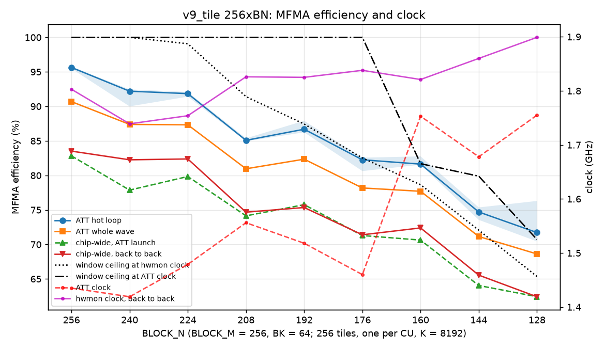

| tile | ATT loop | ATT whole wave | ATT GHz | ATT TFLOPS | ATT chip-wide | back-to-back TFLOPS | hwmon GHz | back-to-back chip-wide | window at ATT / hwmon clock | loop B/ns per CU | cycles / iteration |
|---|---|---|---|---|---|---|---|---|---|---|---|
| 256x256 | 95.6% | 90.7% | 1.44 | 1237 | 82.8% | 1579 | 1.80 | 83.5% | 100% / 100% | 40-47 | 4277-4291 |
| 256x240 | 92.2% | 87.4% | 1.42 | 1169 | 77.9% | 1500 | 1.74 | 82.3% | 100% / 100% | 43-48 | 4154-4267 |
| 256x224 | 91.8% | 87.3% | 1.48 | 1238 | 79.8% | 1515 | 1.75 | 82.4% | 100% / 99% | 42-47 | 3892-3921 |
| 256x208 | 85.1% | 81.0% | 1.56 | 1206 | 74.1% | 1430 | 1.83 | 74.7% | 100% / 91% | 44-49 | 3898-3918 |
| 256x192 | 86.7% | 82.3% | 1.52 | 1229 | 75.8% | 1442 | 1.82 | 75.3% | 100% / 87% | 48-55 | 3495-3562 |
| 256x176 | 82.3% | 78.2% | 1.46 | 1094 | 71.3% | 1376 | 1.84 | 71.4% | 100% / 83% | 47-55 | 3411-3492 |
| 256x160 | 81.6% | 77.7% | 1.75 | 1298 | 70.6% | 1382 | 1.82 | 72.4% | 82% / 79% | 60-62 | 3093-3139 |
| 256x144 | 74.7% | 71.2% | 1.68 | 1127 | 64.0% | 1278 | 1.86 | 65.6% | 80% / 72% | 52-57 | 3057-3132 |
| 256x128 | 71.7% | 68.6% | 1.75 | 1149 | 62.4% | 1243 | 1.90 | 62.4% | 71% / 65% | 60-62 | 2684-2908 |

(All back-to-back runs at 1397-1400 W. Isolated-launch timing came out within 1.5% of back to back: these
kernels, 110-175 µs, outlast the ~135 µs host launch, so the queue never empties and `gap_us` is 0.)

- **Hot loop:** 95.6% at 256x256 falls to 71.7% at 256x128, in a sawtooth. Each 16-column band tile sits at
  or below the next narrower tile: 256x208 (85.1%) under 256x192 (86.7%), 256x176 (82.3%) level with 256x160
  (81.6%), 256x240 level with 256x224. The repeats agree within 0.5-2 points except 256x128 (70.4-76.3%,
  below).
- **Whole wave** is loop x share + 1.0-1.3 points on every tile (the epilogue's MFMAs), so prologue and
  epilogue cost the same ~5 points everywhere.
- **Chip-wide** is 4-10 points under the whole wave on every tile (26 of 27 traces past the 5-point flag), for
  the ATT launch and back to back alike: the kernel lasts ~10% longer than CU 0's waves (dispatch ramp, the
  slowest CUs). Not tile-dependent.
- **Clock:** back to back it rises from 1.74-1.80 GHz (256x256-256x224) to 1.82-1.90 (256x208-256x128), at the
  1400 W cap throughout. The ATT launch runs 0.1-0.5 GHz lower, and moves by up to 0.3 GHz between repeats
  (256x256: 1.30-1.53). Its chip-wide efficiency is within 2 points of back to back except 256x240 and
  256x224 (4.4 and 2.6 points lower under ATT).
- **TFLOPS** back to back fall from 1579 to 1243 (79%); the clock rise hides part of the efficiency drop
  (83.5% to 62.4% chip-wide, 75%).

### 19.4 Where the loop loses (att_gaps.py)

MFMA idle per iteration and wave, by what was exposed (cycles, median of three):

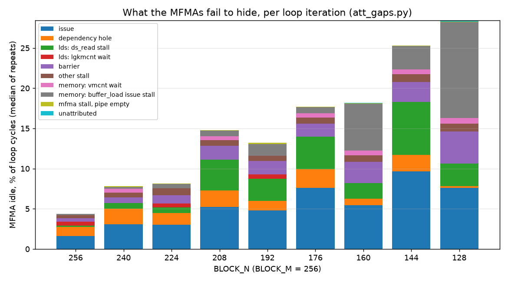

| tile | cycles / iter | MFMA idle | issue | dependency hole | ds_read stall | barrier | buffer_load issue stall (window) | vmcnt wait | lgkmcnt wait | other stall |
|---|---|---|---|---|---|---|---|---|---|---|
| 256x256 | 4283 | 187 | 69 | 48 | 8 | 19 | 7 | 0 | 20 | 16 |
| 256x240 | 4165 | 325 | 128 | 80 | 29 | 30 | 10 | 20 | 0 | 25 |
| 256x224 | 3901 | 317 | 119 | 55 | 28 | 40 | 21 | 0 | 20 | 34 |
| 256x208 | 3911 | 583 | 205 | 80 | 150 | 67 | 27 | 20 | 0 | 27 |
| 256x192 | 3544 | 472 | 169 | 43 | 96 | 60 | 51 | 0 | 19 | 25 |
| 256x176 | 3423 | 607 | 260 | 80 | 139 | 55 | 25 | 20 | 0 | 26 |
| 256x160 | 3136 | 576 | 171 | 25 | 61 | 84 | 183 | 20 | 0 | 24 |
| 256x144 | 3084 | 780 | 298 | 63 | 203 | 76 | 90 | 20 | 0 | 29 |
| 256x128 | 2856 | 808 | 218 | 6 | 80 | 114 | 341 | 20 | 0 | 28 |

- **Nothing is left unattributed** once dependency holes count: a hole is the time between an instruction's end
  and the next one's clock, which ATT records as neither stall nor issue. Almost all of it is a `v_add_u32 vN,
  offset, vM` immediately followed by `ds_read_b128 ..., vN` (8 cycles each), and 12 cycles between an
  `s_waitcnt` and the MFMA after it.
- **Every MFMA region fits its shadow.** In every tile and repeat, the non-MFMA issue cycles of each region between
  waits are under the shadow the region's MFMAs leave; no region is short of room. The idle is placement: where
  the schedule puts address arithmetic, LDS reads, waits and barriers relative to the MFMAs.
- **256x256-256x176: the schedule binds, not the window.** Cycles per iteration are fixed while the ATT clock moves
  0.2-0.3 GHz (256x208: 3898-3918 cycles at 1.46-1.61 GHz), so the limit is in cycles. The window ceiling at the
  median ATT clock is 100% for all of them (88-93% for the two repeats at 1.72-1.73 GHz), 4-18 points above the
  measured loop; `buffer_load` issue stalls are 3-11% of the idle. The idle is issue (35-43%), `ds_read` stalls
  (up to 26%), dependency holes (9-26%) and barriers (9-13%).
- **The 16-column band is the sawtooth.** Against the next narrower tile, 256x208, 256x176 and 256x144 have 54-123
  more cycles of `ds_read` stall (11-12 cycles on each of the A reads at offsets such as 17664 and 34528) and
  37-57 more of dependency holes. 256x240 shows the holes (80 against 55) but not the `ds_read` stalls.
- **256x160 and 256x128: the window binds.** The loop moves 59.5-62 B/ns per CU in all six traces, at clocks from
  1.64 to 1.83 GHz, against the model's 59.6. The window model at each trace's own clock predicts the loop within
  3.2 points for both tiles (the loop at or slightly above it), including 256x128's spread: 76.3% at 1.64 GHz, 71.7% at 1.75 and 70.4% at 1.83 GHz
  (efficiency x clock = 1.25-1.29 in all three). `buffer_load` issue stalls are 32% and 42% of the idle.
- **256x144** is between: 52-57 B/ns, 4-11 points under the window at its ATT clock, with both the band's
  `ds_read` stalls (203) and window stalls (90).
- **Barriers:** arrival skew across a CU's four waves is 15-45 cycles, and SIMD 1 or 3 arrives last in 85-100% of
  barriers on every tile. Barrier stalls grow from 19 to 114 cycles per iteration as more waves wait on loads.
- **Waits:** the only stalling waits are the loop-top `s_waitcnt vmcnt(N) lgkmcnt(0)` or `lgkmcnt(7)`, 20 cycles
  once per iteration, with the awaited `buffer_load` issued 1800-2650 cycles (86-154 MFMAs) earlier and the
  awaited `ds_read` 268-490 cycles (11-29 MFMAs) earlier. No load arrives late in any tile.

### 19.5 What it means

- **The TCP-window theory holds only from 256x160 down, at these clocks.** 256x256 reaches 95.6% (a schedule
  ceiling, the window does not bind at 1.3-1.5 GHz); between 256x240 and 256x176 the loop loses a further 3.4-13
  points to the schedule while the window allows ~100% at the ATT clock. At 256x160 and 256x128 the loop sits exactly at
  ~60 B/ns per CU, the window.
- **At the back-to-back clock the window would bind earlier.** At 1.82-1.84 GHz its ceiling for 256x208-256x176 is
  83-91%, about the schedule ceiling measured under ATT (82-87%). That the chip-wide efficiency back to back
  matches the ATT launch's within 1-2 points suggests the loop runs about as efficiently at the higher clock, but
  the trace does not see that clock, and ATT at the power-capped clock (a pinned clock) would settle it.
- **The 256x128 discrepancy (59-73% on 4096x2048, §4 and §16; 81-84% on 4096x4096 in tcpL_report.md):** on this
  shape the loop is the window at ~60 B/ns per CU, so its efficiency is set by the clock: 70-76% at 1.64-1.83 GHz.
  The tcpL traces ran at 1.42 GHz (launch 10, where the window allows 87%) or on launch 1 with the memory system
  otherwise idle; §4's 64% was the v2.2 stack.
- **What the schedule could win back** (for 256x240-256x176, where it binds): the dependency holes (43-80 cycles
  per iteration, 1.2-2.3%; hoist the `v_add` address computation away from its `ds_read`, which 256x256 pays too:
  48 cycles), the band's `ds_read` stalls (up to 150 cycles at 256x208, ~4%), and the post-wait hole before the
  first MFMA. None of these change what the window allows at 256x160 and below.

### 19.6 Traces to investigate

[report.md](results/tile_n/report.md) ("Traces to investigate") lists every tile with the location of its three
traces (`v9_tile/tmp/tile_n/att_r{1,2,3}/sweep_att/<tile>_<shape>/ui_output_*`, wave files `se{0,2,3}_sm{0-3}_sl0_wv0.json`),
the rules each trips, the median repeat's idle split and its hot spots by code index. The ones that stand out:

- **256x208** (`att_r2/.../256x208_4096x3328x8192/ui_output_agent_*_dispatch_62`): 15 points under the window at
  1.46 GHz and under the narrower 256x192; 150 cycles per iteration of `ds_read` stall on the A reads (code indices
  808-809, 1037; 11-12 cycles each), 80 of dependency holes, 67 of barriers.
- **256x176 and 256x144** (`dispatch_64`, `dispatch_68`): the same band `ds_read` stalls (139 and 203 cycles per
  iteration; 256x144's at code indices 539, 673, 850), 256x176 17 points under the window at 1.44-1.46 GHz.
- **256x240 and 256x224** (`dispatch_60`): 8-10 points under the window; the hot spots are the loop-top wait (code
  index 658 / 604, 20 cycles) and four `v_add` + `ds_read` address holes (e.g. 732, 798, 990, 1052 in 256x240).
  256x240 repeat 1 (`att_r1`, 1.62 GHz) has 87 cycles of `buffer_load` issue stall where repeats 2-3 have 8-10.
- **256x256** (`dispatch_58`): of its 187 idle cycles per iteration, 48 are four address holes (code indices 707,
  774, 967, 1030) and 20 the `lgkmcnt(7)` wait at 634 with the 12-cycle hole after it (635).
- **256x128** (`dispatch_70`): repeats spread 5.9 points with the ATT clock (window-bound, above); the hot spots are
  `buffer_load` issue stalls (code indices 773, 532, 540, 765, 719: 23-54 cycles each per iteration).

### 19.7 Caveats

- ATT is one launch on CU 0 of three shader engines, at a clock 0.1-0.5 GHz under the back-to-back one, and the
  clock moves between repeats. Since the window is fixed in ns, the window-bound tiles' ATT efficiency depends on
  that clock (256x128: 70-76%).
- The ATT clock is the trace window's average (it spans a little more than the kernel).
- Without a pinned clock, the efficiency against BN includes the power-cap feedback (less efficient tiles clock
  higher, 1.74 to 1.90 GHz back to back).
- Plugin off throughout: 256x256's loop is 95.6% here against 96% with amdgcnas (§16.4); the plugin changes the
  schedule, which binds for most of these tiles.
- **Open:** §18.5 traced the same plugin-off kernels lower: 256x256 90.5% and 256x192 82.4% on one ATT run each,
  against 95.5-95.8% and 86.2-87.9% here over three (same GPU, same instruction counts). Not investigated; the
  ATT clocks of §18.5 were not recorded.
