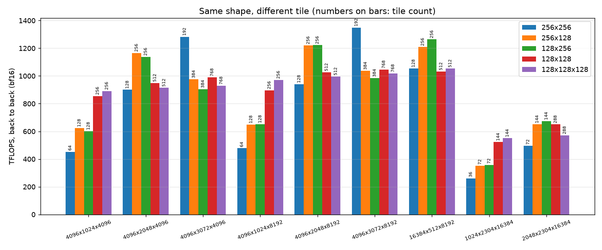
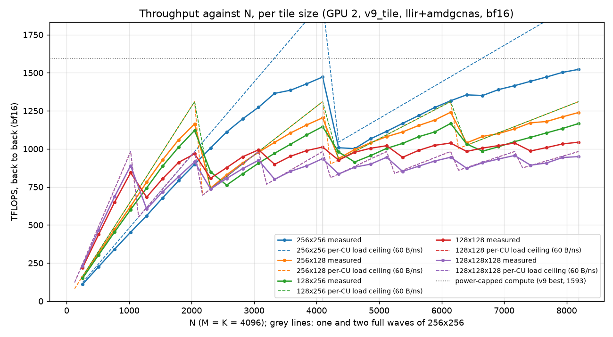
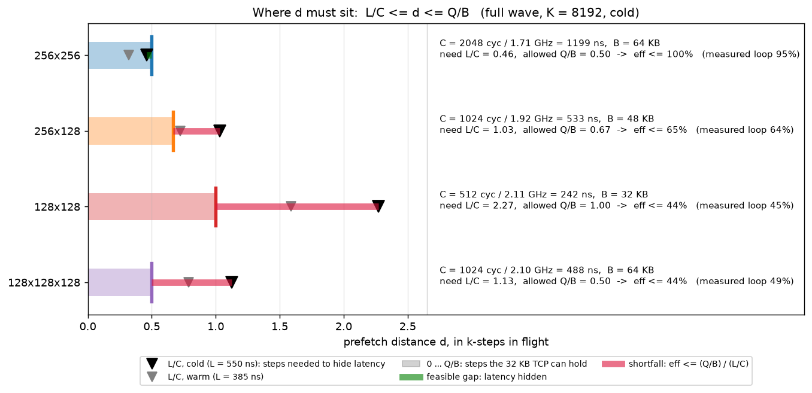
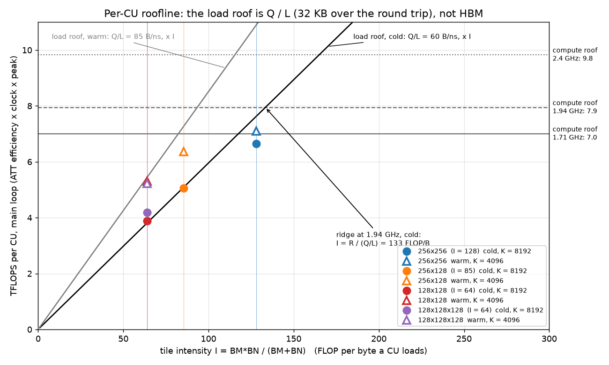
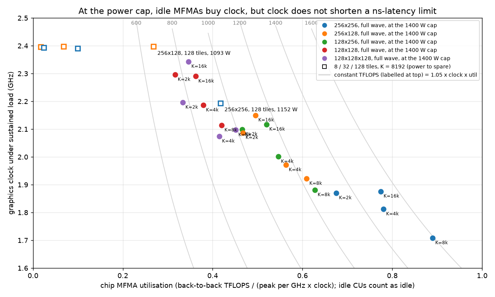
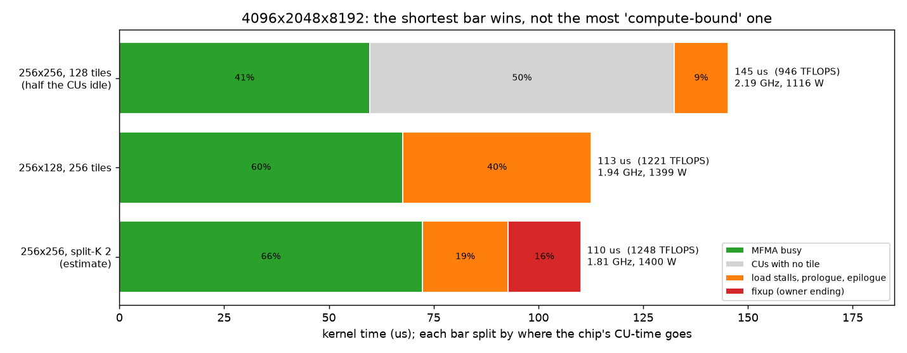
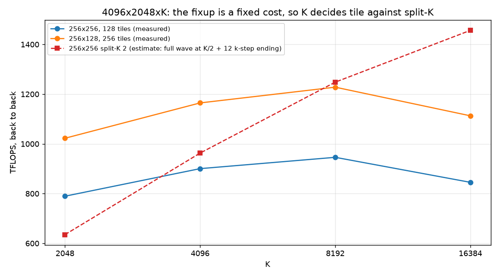

# v9_tile worklog: tile sizes on the v9 base

v9_tile is [v9_beyond_hotloop](../v9_beyond_hotloop/README.md) with the tile size as a parameter
(`bench.py --version 9t --tile 256x128`, or `V9_TILE=256x128`). Everything here runs on GPU 2 with
Triton `gfx950-tutorial-v2.2` and the shipping `llir+amdgcnas` stack ([env.sh](env.sh)).

The question: when is a smaller tile than 256x256 worth it, before stream-K enters the picture?
This round has no stream-K; shapes with M or N of 256 or less are left for later.

**Summary.**

- **Where it wins.** A smaller tile wins wherever 256x256 leaves about half the CUs or more idle:
  - 256x128 / 128x256 by 20-38%;
  - 128x128x128 by up to 2.1x (1024x2304x16384: 261 to 550 TFLOPS).

  It loses (-23%) where 256x256 already fills ~75% of the CUs.
- **What limits small tiles.** Not registers, quadrants or MFMA scheduling. It is a per-CU
  ceiling of ~60 bytes per ns of global loads (32 KB in the TCP over a ~550 ns round trip):
  - The waves stall issuing `buffer_load`s into a full TCP, not waiting for data.
  - The ceiling is the same with 8 CUs busy at 2.4 GHz as with 256 CUs at 1.9 GHz.
  - At a full wave, loop MFMA efficiency falls from ~96% (256x256) to 59-70% (256x128) and
    39-52% (128x128). A higher clock under the same 1400 W cap wins part of it back.
- **What doesn't help.**
  - A deeper pipeline helps only 128x128x64 (`BLOCK_K = 128`, +4-6%).
  - Two regions instead of four quadrants is slower.
- **A one-line model picks the tile** on all 9 measured shapes:
  `busy CUs x 60 B/ns x BM*BN/(BM+BN)`, capped at the power-limited peak.
- **Interaction with stream-K.** At 128 tiles, halving the tile matches stream-K with no fixup;
  at 36-72 tiles, stream-K's split still wins. The fixup's latency costs grow 1.5-2.3x in k-steps
  for smaller tiles while its bandwidth costs shrink (§8).
- **Where the latency comes from.** The L2 hit rate is already at its geometric limit (~81-83%),
  and the remaining misses dominate the latency. With the inputs warm in the MALL, per-CU
  bandwidth rises 30-45%: 256x128's loop goes from 59% to 89%, 128x128's from 44% to 66% (§9).
- **A shared-plugin bug the tiles exposed.** The `amdgcnas` loop-invariant hoist could corrupt a
  live register (§2). It is fixed, and v9-v13's output is unchanged.

## 1. Predictions (written before any measurement)

### Constants from the repo

| constant | value | source |
|---|---|---|
| FP16/BF16 `v_mfma_f32_16x16x32` | 16 cycles | [v8 README §4.6](../v8_sliceMN/README.md), [process_json.py](../../../../../scripts/process_json.py) |
| TCP processing of one `buffer_load_to_lds_dwordx4` (1 KB per wave) | 16 cycles, so at most 64 B/clk per CU | [v8 README §4.3-4.4](../v8_sliceMN/README.md) |
| bytes in flight per CU | 32 KB (the TCP), plus a ~12-entry queue | [memory_bandwidth_model.md](../../../../../docs/memory_bandwidth_model.md) |
| conflict-free `ds_read_b128` | one per wave every 16 cycles with 4 waves | [v3 README](../v3_lds/README.md) |
| v9 k-step under load | 2048 MFMA cycles, 1.34 us at 1608 TFLOPS, so about 1.53 GHz | v9 README §4 |

### Per tile, per CU, per k-step, at 100% MFMA

Four waves in a 2x2 grid; each wave owns a (BM/2)x(BN/2) quadrant's (BM/4)x(BN/4) sub-tile in
each of the four regions.

| | 256x256x64 (v9) | 256x128x64 | 128x256x64 | 128x128x64 | 128x128x128 |
|---|---|---|---|---|---|
| MFMAs per wave per k-step | 128 | 64 | 64 | 32 | 64 |
| MFMA cycles per k-step | 2048 | 1024 | 1024 | 512 | 1024 |
| MFMAs per region per wave | 32 | 16 | 16 | 8 | 16 |
| global bytes per k-step, `(BM+BN)*BK*2` | 64 KB | 48 KB | 48 KB | 32 KB | 64 KB |
| `buffer_load` x4 per wave per k-step | 16 | 12 | 12 | 8 | 16 |
| global bytes needed per clock | 32 B/clk | 48 B/clk | 48 B/clk | 64 B/clk | 64 B/clk |
| **TCP processing busy** (64 B/clk peak) | **50%** | **75%** | **75%** | **100%** | **100%** |
| latency 32 KB in flight can hide | 1024 cyc (0.67 us) | 683 cyc (0.45 us) | 683 cyc (0.45 us) | 512 cyc (0.33 us) | 512 cyc (0.33 us) |
| `ds_read_b128` per wave per k-step | 32 | 24 | 24 | 16 | 32 |
| LDS read issue busy (16 cyc each) | 25% | 37.5% | 37.5% | 50% | 50% |
| accumulator registers per lane | 256 | 128 | 128 | 64 | 64 |
| LDS, 2 buffers + padding | 132 KB | 99 KB | 99 KB | 66 KB | 132 KB |
| intensity at the L2 boundary, `H(BM,BN)/e` | 128 FLOP/B | 85 FLOP/B | 85 FLOP/B | 64 FLOP/B | 64 FLOP/B |
| L2-to-CU bandwidth at full chip (256 CUs, 1.53 GHz) | 12.5 TB/s | 18.8 TB/s | 18.8 TB/s | 25.1 TB/s | 25.1 TB/s |

What the table predicts:

- **256x128 and 128x256** keep the four-region structure with 16 MFMAs per region, half of v9's.
  The TCP runs 75% busy and the latency budget falls to two thirds of v9's. v9 already loses
  ~1.5 pp at K = 16384 when HBM latency rises (v8 README §4.5), so expect a few points less
  MFMA efficiency than v9, falling faster with K. Registers stop mattering: 128 accumulators
  instead of 256.
- **128x128** (either BK) needs the TCP 100% busy at 100% MFMA. It cannot reach v9's efficiency
  with 4 waves on one CU however it is scheduled; a realistic ceiling is the TCP's sustained
  rate, so expect well under 90% MFMA efficiency. `BLOCK_K = 128` fixes the 8-MFMA regions (back
  to 16) but not the bytes per FLOP. More LDS stages cannot help: the 32 KB in-flight cap, not
  the number of buffers, sets the latency budget.
- **L2.** The full-chip L2-to-CU demand rises from 12.5 to 18.8 and 25 TB/s. Expect lower
  L2 hit rates and more power, so a lower clock even at equal MFMA efficiency.

How these held up (§4-§7):

- **256x128 / 128x256: too optimistic.** The loop fell to 59-70%, not "a few points" below v9.
  The binding limit is bytes in flight over the round trip (60 B/ns per CU), which this table
  only approximated with a cycle budget.
- **128x128: right.** Measured 39-52%, against "well under 90%".
- **More LDS stages: right, with one exception.** They don't help, except at 128x128x64, where
  two buffers are shorter than the round trip.
- **L2 and power: wrong.**
  - L2 hit rates rose for the smaller tiles (78-83% against 75-81%).
  - The smaller tiles ran at a *higher* clock under the same 1400 W cap: their MFMA pipes idle
    more.

### Break-even (existing data, to be redone on GPU 2)

[wave_quant.csv](../v9_beyond_hotloop/images/wave_quant.csv) (M = K = 4096, v9, an earlier GPU):
128 tiles take 77.6 us (885 TFLOPS) and 256 tiles 100.1 us (1372 TFLOPS), so half the CUs give
64.5% of the full-chip throughput. A smaller tile that brings a shape to 256 tiles wins if its
full-wave throughput beats the 256x256 kernel's throughput at the original tile count:

| shape (K = 4096) | 256x256 tiles | 256x256 TFLOPS | smaller tile | its tiles | it must beat |
|---|---|---|---|---|---|
| 4096x2048 | 128 | 885 | 256x128 | 256 | 64.5% of 1372 |
| 4096x1024 | 64 | 477 | 128x128 | 256 | 35% of 1372 |

## 2. Build and gate

- `matmul_kernel.py` is v9's kernel with its layouts built at compile time from the block sizes
  (`gluon.constexpr_function`s). `half_tile_load_layout` / `half_tile_shared_layout` build the
  global-load and padded shared layouts of a [rows, BK] half-tile from the rows (warps take rows
  1 and 2, the lanes the top three row bits, the registers the rest) and reproduce v9's bases at
  128 rows. The C-store layout keeps 8 values per lane along N with
  `min(64, cols / 8)` lanes across. `GROUP_SIZE_M` minimises `GM * BM + ceil(P / GM) * BN` (v9's
  rule with the tile sizes; ties to the smaller GM), and `V9_TILE_GM` overrides it.
- **Gate:** at 256x256 the generated assembly is identical to v9's (only a comment's whitespace
  differs): 448 VGPRs, 256 AGPRs, 0 spills; 4096x4096x8192 bf16 `do_bench` 1442 TFLOPS against
  v9's 1437 in the same session.
- **Correctness:** [results/check_tiles.md](results/check_tiles.md): 3 tiles x 8 shapes x
  {bf16, fp16} x {bias, none}, padded and ([check_tiles_nopad.md](results/check_tiles_nopad.md))
  contiguous, against an fp32 torch reference with C pre-filled with NaN. 0 failures, after the
  fix below.

### An amdgcnas bug the smaller tiles exposed

The first run failed every bias case at 256x128 and 128x256 (half of C wrong in 8-row bands,
none unwritten), and nothing else. No plugins and `llirSched` alone were correct; disabling
amdgcnas passes one at a time pinned it on the loop-invariant hoist (`licm`).

`licm` renames a hoisted instruction's output to a register that is free in the loop. The free
set comes from liveness, and liveness got `v_cmp_eq_u32_e32 vcc, 0, v25` wrong: `compute_def_use`
took the first register of any instruction as its destination, and since `vcc` is not a tracked
register, that was the source `v25`. So liveness believed the epilogue overwrote v25 before
reading it, v25 (set before the loop, read after it) looked dead across the loop, and `licm`
put an LDS address in it. The bias path is what made the allocator keep that value in a register
across the loop at these tiles.

Fix ([plugins/amdgcnas/amdgcnas_ext.py](../../../../../plugins/amdgcnas/amdgcnas_ext.py),
`compute_def_use`): only registers named in operand 0 are destinations. Running the old and new
plugin on the `llirSched` output of v9-v13, with and without bias, gives byte-identical assembly,
so the shipping kernels are unaffected.

### The launcher has to be as cheap as v9's

The first version built its layouts on the host and passed them in as constexpr arguments. The
kernel was identical to v9's (same assembly, same descriptor), yet it timed ~5% *faster* than v9
at 4096x4096x8192: the per-call Python work left a 41-97 us gap between dispatches (v9's are
back to back), and an idle GPU between launches runs cooler and boosts higher. The layouts are
now `gluon.constexpr_function`s evaluated inside the kernel, so the launch passes only integers,
like v9's; the gap is 0 and v9 and v9_tile at 256x256 time within 0.5% of each other (173.5-175 us).
Any comparison of launchers has to check the gaps in the kernel trace.

### Hot loop ([results/asm_check.md](results/asm_check.md), [asm_check.py](asm_check.py))

One loop iteration is two k-steps. Under `llir+amdgcnas`:

| tile | VGPRs | AGPRs | spills | MFMAs | buffer loads | ds_reads | s_waitcnt | v_accvgpr | scratch | longest non-MFMA run | MFMAs between buffer loads |
|---|---|---|---|---|---|---|---|---|---|---|---|
| 256x256 | 448 | 256 | 0 | 256 | 32 | 64 | 20 | 0 | 0 | 5 | 4-20 |
| 256x128 | 304 | 160 | 0 | 128 | 24 | 48 | 8 | 0 | 0 | 8 | 2-12 |
| 128x256 | 404 | 168 | 0 | 128 | 24 | 48 | 8 | 0 | 0 | 8 | 2-12 |

No spills, scratch or accumulator copies in any loop; the memory ops sit between MFMAs. The
llirSched model wants 4 MFMAs (64 cycles) per `buffer_load`; with 12 loads against 64 MFMAs per
k-step the smaller tiles average 5.3 but come as close as 2. 128x256's extra 100 VGPRs are outside
the loop and cost nothing at one workgroup per CU (99 KB of LDS already rules out a second).

## 3. Measuring

[sweep.py](sweep.py) runs a list of (tile, shape) points, bf16, B and C rows padded:

- `timing`: rocprofv3 kernel trace, 1000 launches over a rotating 512 MB, median of the last 100;
  `--graph` launches from a HIP graph instead.
- `clock`: the same launches back to back from a HIP graph for 3 s while a thread polls the
  device's hwmon (graphics clock, socket power) every 20 ms.
- `counters`: L2 hit rate and memory read requests (rocprofv3 `--pmc`).
- `att`: thread trace of CU 0 on one launch, reduced by `scripts/process_json.py`
  (main-loop MFMA efficiency, prologue / loop / epilogue shares). [att_stalls.py](att_stalls.py)
  splits a loop iteration's stall cycles by instruction class.

[report.py](report.py) merges them. Two traps found on the way:

- **Isolated launches.** From Python a launch takes ~135 us, so any kernel shorter than that
  leaves the GPU idle between launches (`gap_us` in the timing CSV), and an idle GPU boosts. This
  is the repo's standard harness, so earlier tables have the same property; the back-to-back
  (`--graph`) numbers are what a stream of such GEMMs gets. Here the two agree within ~5%.
- **Clock from counters.** `GRBM_GUI_ACTIVE` / 8 XCDs agrees with `SQ_CYCLES` / 32 SEs, but counter
  collection serialises dispatches, so the counter run's clock (up to 2.9 GHz on short kernels,
  past the part's 2.4 GHz limit) and cycle counts do not describe the timed run. The clock below
  is hwmon's during back-to-back launches. e2e MFMA util = back-to-back TFLOPS / (1.048576 TFLOP
  per GHz x clock): the whole kernel in time.

## 4. Measurement A: one full wave per tile

Exactly 256 tiles per tile size, so every CU has one tile: 256x256 on 4096x4096, 256x128 on
4096x2048, 128x256 on 2048x4096. CSVs: [a_timing.csv](results/a_timing.csv),
[a_timing_graph.csv](results/a_timing_graph.csv), [a_clock.csv](results/a_clock.csv),
[a_att.csv](results/a_att.csv), [a_counters.csv](results/a_counters.csv).

| tile | M x N x K | TFLOPS isolated | TFLOPS back to back | vs 256x256 same K | clock GHz | power W | e2e MFMA util | ATT loop MFMA eff | prologue / epilogue | L2 hit | B/ns per CU |
|---|---|---|---|---|---|---|---|---|---|---|---|
| v9 | 4096x4096x8192 | 1582 | 1592 | | 1.72 | 1400 | 88% | | | | 49 |
| 256x256 | 4096x4096x1024 | 1121 | 1111 | | 1.98 | 1368 | 54% | 95.8% | 13.3% / 26.3% | 75.3% | 34 |
| 256x256 | 4096x4096x2048 | 1389 | 1324 | | 1.87 | 1400 | 68% | 95.5% | 7.8% / 14.4% | 77.9% | 40 |
| 256x256 | 4096x4096x4096 | 1560 | 1482 | | 1.81 | 1400 | 78% | 97.1% | 4.0% / 8.2% | 79.5% | 45 |
| 256x256 | 4096x4096x8192 | 1585 | 1593 | | 1.71 | 1400 | 89% | 95.0% | 2.0% / 4.2% | 80.3% | 49 |
| 256x256 | 4096x4096x16384 | 1507 | 1524 | | 1.88 | 1400 | 77% | 98.1% | 1.1% / 2.2% | 80.8% | 46 |
| 256x128 | 4096x2048x1024 | 813 | 830 | 75% | 2.10 | 1323 | 38% | 61.1% | 13.5% / 21.4% | 78.8% | 38 |
| 256x128 | 4096x2048x2048 | 1036 | 1023 | 77% | 2.09 | 1386 | 47% | 62.9% | 7.6% / 11.3% | 80.9% | 47 |
| 256x128 | 4096x2048x4096 | 1197 | 1165 | 79% | 1.97 | 1397 | 56% | 59.2% | 3.7% / 5.8% | 82.0% | 53 |
| 256x128 | 4096x2048x8192 | 1230 | 1228 | 77% | 1.92 | 1397 | 61% | 64.3% | 2.1% / 3.2% | 82.7% | 56 |
| 256x128 | 4096x2048x16384 | 1106 | 1117 | 73% | 2.15 | 1393 | 50% | 67.5% | 1.1% / 1.7% | 83.0% | 51 |
| 128x256 | 2048x4096x1024 | 841 | 844 | 76% | 2.11 | 1305 | 38% | 61.2% | 13.0% / 19.6% | 78.8% | 39 |
| 128x256 | 2048x4096x2048 | 1045 | 1025 | 77% | 2.10 | 1381 | 47% | 62.5% | 7.7% / 10.9% | 80.9% | 47 |
| 128x256 | 2048x4096x4096 | 1187 | 1146 | 77% | 2.00 | 1398 | 55% | 58.9% | 4.0% / 5.5% | 82.0% | 52 |
| 128x256 | 2048x4096x8192 | 1258 | 1238 | 78% | 1.88 | 1399 | 63% | 68.3% | 2.2% / 3.3% | 82.7% | 57 |
| 128x256 | 2048x4096x16384 | 1149 | 1154 | 76% | 2.12 | 1399 | 52% | 70.2% | 1.3% / 1.7% | 83.0% | 53 |

(ATT is one launch on one CU, so it moves by a few points between runs; the e2e columns are the
whole chip.)

**A smaller tile with every CU busy delivers 73-79% of 256x256's throughput** at the same K. The
two orientations are within noise of each other (B is K-contiguous like A, so they are mirror
images). The main-loop MFMA efficiency falls from ~96% to 59-70%; a higher clock (1.9-2.15 GHz
against 1.7-1.9 GHz, all at the 1400 W cap) wins part of it back, because an MFMA pipe that is
idle a third of the time burns less power per cycle.

### Why: the loads, not the MFMAs or the registers

[att_stalls.py](att_stalls.py) on the K = 8192 traces, per loop iteration (two k-steps) and wave:

| tile | cycles issued | stalled | stalled on `buffer_load` issue | on `s_barrier` | on `s_waitcnt vmcnt` |
|---|---|---|---|---|---|
| 256x256 | 4278 | 2657 (1919 of them MFMA back-pressure) | 329 | 90 | 32 |
| 256x128 | 3160 | 2159 | 870 | 246 | 32 |
| 128x256 | 2979 | 1975 | 672 | 257 | 32 |

The smaller tiles do not wait for data (`vmcnt` waits are the same 32 cycles); they wait to
*issue* loads. A `buffer_load` that cannot enter the full TCP blocks the in-order wave, MFMAs
behind it included, and the barriers then wait for the slowest wave.

Converting each run's time per k-step to bytes delivered per CU gives one number for every tile
and K: **about 50-60 bytes per ns per CU** (28-34 B/clk at the measured clocks). With fewer CUs
busy it does not rise ([a_lowload_clock.csv](results/a_lowload_clock.csv), K = 8192):

| tile | tiles | clock GHz | power W | ns per k-step | B/ns per CU | e2e MFMA util |
|---|---|---|---|---|---|---|
| 256x128 | 8 | 2.40 | 396 | 790 | 62 | 54% |
| 256x128 | 32 | 2.40 | 550 | 783 | 63 | 55% |
| 256x128 | 128 | 2.40 | 1093 | 797 | 62 | 54% |
| 256x128 | 256 | 1.94 | 1399 | 880 | 56 | 60% |
| 256x256 | 8 | 2.39 | 409 | 1107 | 59 | 77% |
| 256x256 | 32 | 2.39 | 592 | 1074 | 61 | 80% |
| 256x256 | 128 | 2.19 | 1152 | 1119 | 59 | 83% |
| 256x256 | 256 | 1.72 | 1399 | 1364 | 48 | 87% |

The time per k-step is fixed in nanoseconds, not cycles, and does not depend on how many CUs
share the memory system: a per-CU limit of roughly 60 B/ns, which is 32 KB in flight (the TCP)
over a ~550 ns round trip. A tile's ceiling follows from its bytes per FLOP:

```
MFMA efficiency <= 60 B/ns / ((BM + BN) * BK * 2 bytes / (MFMA cycles per k-step / clock))
```

| tile | needs at 1.9 GHz | ceiling | measured loop eff |
|---|---|---|---|
| 256x256 | 59 B/ns | ~100% | 95-98% |
| 256x128, 128x256 | 89 B/ns | ~67% | 59-70% |
| 128x128 (x64 or x128) | 119 B/ns | ~50% | (step 3) |

Consequences:

- **The quadrants are not the problem and a deeper pipeline is not the fix.** Registers are
  plentiful (304 / 404 VGPRs, no spills, no copies). The waves are not starved of data in flight
  (no `vmcnt` waits); the TCP is full. More LDS stages add buffers behind the same 32 KB.
- **The boost does not save 256x256 either.** At 8-128 tiles the clock reaches 2.4 GHz but
  256x256 then needs 77 B/ns, past the limit, and its utilisation falls to 77-83%. Part of the
  "half the CUs give 65% of the throughput" effect is this, not just power.
- **The levers left** are latency (a higher L2 hit rate), fewer bytes per FLOP (bigger tiles),
  or a lower clock (the power cap does that for free at full load).
- **Prologue and epilogue** are 35-40% of a wave's time at K = 1024 for every tile, but the
  smaller tiles' are shorter in cycles (4.5-4.9K + 6.5-7.7K against 5.6-6.6K + 12K), so they
  weigh the same fraction. At K = 16384 the e2e utilisation drops for all tiles while CU 0's loop
  does not: the kernel waits on its slowest CUs.

## 5. Measurement B: the same shape under each tile

CSVs `results/b_*.csv`; table by `python v9_tile/report.py b`. Back-to-back TFLOPS:



| shape | 256x256 tiles | 256x256 | 256x128 | 128x256 | best small vs 256x256 |
|---|---|---|---|---|---|
| 4096x1024x4096 | 64 | 453 | 624 | 602 | **+38%** |
| 4096x2048x4096 | 128 | 900 | 1166 | 1138 | **+30%** |
| 4096x3072x4096 | 192 | 1283 | 976 | 905 | -24% |
| 4096x1024x8192 | 64 | 478 | 649 | 652 | **+36%** |
| 4096x2048x8192 | 128 | 941 | 1221 | 1222 | **+30%** |
| 4096x3072x8192 | 192 | 1350 | 1036 | 985 | -23% |
| 16384x512x8192 | 128 | 1054 | 1209 | 1264 | **+20%** |
| 1024x2304x16384 (aiter) | 36 | 261 | 352 | 358 | **+37%** |
| 2048x2304x16384 (aiter) | 72 | 496 | 651 | 674 | **+36%** |

- **Where 256x256 leaves half the CUs or more idle, the smaller tile wins by 20-38%**, on every
  shape and K tried. Break-even on GPU 2, back to back, K = 4096: 256x256 at 128 tiles gives 900
  TFLOPS, 61% of its full-wave 1482, and 256x128 at a full wave gives 79%; at 64 tiles the bar is
  31% (453 / 1482).
- **At 192 tiles (75% of the CUs) 256x256 wins by ~24%**: halving the tile makes 384 tiles, a
  full wave plus a half-empty second one.
- The two orientations trade places by a few percent; neither is consistently better. On
  16384x512, 128x256 (a 128-row by 256-column tile: 128 row-blocks x 2 column-blocks) beats
  256x128 by 5%.
- The aiter loss shapes: 1024x2304x16384 goes from 261 to 358 TFLOPS, 2048x2304x16384 from 496
  to 674. Better, but still far from aiter's picks there (881-973 and 466-946 in
  [the aiter comparison](../../../../../experiments/aiter_256x256_loss_investigation/results/aiter_live_compare.md)):
  72 tiles still leave 72% of the CUs idle, which is stream-K's (or split-K's) job, not the tile's.
- Every point again moves 52-64 B/ns per CU, whatever the tile, shape or clock.

## 6. Measurement C: throughput against N, per tile

M = K = 4096, N = 256 to 8192 in steps of 256, back to back
([c_timing_graph.csv](results/c_timing_graph.csv)), with each tile's ceiling from the per-CU
load limit alone (60 B/ns x the tile's FLOP per byte x the average busy CUs of a non-persistent
launch):



- The per-CU load ceiling tracks every curve, including the drops when a wave spills over: it is
  the one number that predicts this kernel's throughput, for every tile.
- **Crossover:** the smaller tiles win up to N = 2304 (256x256: 144 tiles, 56% of the CUs) and
  lose from N = 2560 (160 tiles) until 256x256's first wave is full. Past one full 256x256 wave
  the curves are within a few percent of each other until 256x256 is near two full waves.
- A rule that fits A, B and C: **use the smaller tile when 256x256 would occupy at most ~55% of
  the CUs in its last (only) wave and the smaller tile's tiles fit in one wave**; otherwise keep
  256x256. With several waves, wave quantisation decides, and that is better handled by
  persistence and stream-K than by the tile.

## 7. Step 3: 128x128

Three variants, all correct ([check_tiles_128.md](results/check_tiles_128.md), 0 failures):

- `128x128`: v9's four quadrants (64x64 each), 8 MFMAs per region per wave.
- `128x128r2`: two regions per k-step, v7's N slice (whole A tile against each B half, 16
  MFMAs per region), as `v9_tile_2r` in [matmul_kernel.py](matmul_kernel.py).
- `128x128x128`: the four quadrants with `BLOCK_K = 128`, 16 MFMAs per region, 64 KB per k-step.

Loops ([asm_check.md](results/asm_check.md)): 176-260 VGPRs, no spills, scratch or AGPR copies;
LDS 66 KB at BK = 64 (two workgroups would fit, not tried: one wave per SIMD is this kernel's
design).

### Full wave (2048x2048, 256 tiles; `results/a128_*.csv`, `python v9_tile/report.py a128`)

| tile | K = 1024 | 2048 | 4096 | 8192 | 16384 | ATT loop MFMA eff (K = 8192) | B/ns per CU (K = 8192) |
|---|---|---|---|---|---|---|---|
| 256x256 (4096x4096, for scale) | 1111 | 1324 | 1482 | 1593 | 1524 | 95% | 49 |
| 128x128 | 639 | 762 | 869 | 932 | 870 | 44.8% | 57 |
| 128x128r2 | 598 | 735 | 848 | 896 | 858 | 43.7% | 55 |
| 128x128x128 | 635 | 768 | 902 | 992 | 852 | 48.6% | 61 |

Back-to-back TFLOPS. The prediction held: a ~50% ceiling from the per-CU load limit, 39-52%
measured, and the same 52-61 B/ns per CU. A full wave of 128x128 gives 58-62% of 256x256's
throughput.

Where the loop stalls (K = 8192, per iteration and wave, [att_stalls.py](att_stalls.py)):

| tile | stalled on `s_waitcnt vmcnt` | on `buffer_load` issue | on `s_barrier` |
|---|---|---|---|
| 128x128 | 699 | 204 | 294 |
| 128x128r2 | 676 | 325 | 150 |
| 128x128x128 | 32 | 882 | 341 |

- At BK = 64 the k-step is only 512 MFMA cycles, so two buffers put the data 1024 cycles ahead of
  its use, less than the ~1200-cycle round trip at 2.1 GHz: the waves wait for data (`vmcnt`).
  This is the one tile where pipeline depth matters.
- `128x128x128` is that deeper pipeline (2048 cycles of lead, same bytes per FLOP): the `vmcnt`
  waits vanish and the stall moves to the TCP (`buffer_load` issue), exactly as in 256x128. It
  buys +4 points of loop efficiency and +6% TFLOPS at K = 4096-8192, which is all the 32 KB in
  flight allows. At K = 16384 it falls back (852 against 870).
- Two regions do not help: 8 MFMAs per region was not the limit. With v7's grouping the loads
  bunch up (0-12 MFMAs between them) and it is 2-4% slower. **The quadrants stay.**

### Same shape (`results/b128_*.csv`)


| shape | 256x256 | 256x128 / 128x256 | 128x128 / 128x128x128 | best |
|---|---|---|---|---|
| 4096x1024x4096 | 453 (64 tiles) | 624 / 602 | 856 / **892** (256 tiles) | 128x128x128, 2.0x |
| 4096x1024x8192 | 478 | 649 / 652 | 897 / **971** | 128x128x128, 2.0x |
| 1024x2304x16384 | 261 (36) | 352 / 358 | 523 / **550** (144) | 128x128x128, 2.1x |
| 2048x2304x16384 | 496 (72) | 651 / **674** (144) | 650 / 572 (288) | 128x256, 1.36x |
| 4096x2048x8192 | 941 (128) | 1221 / **1222** (256) | 1027 / 996 (512) | 256x128 class, 1.30x |
| 16384x512x8192 | 1054 (128) | 1209 / **1264** (256) | 1033 / 1054 (512) | 128x256, 1.20x |
| 4096x3072x8192 | **1350** (192) | 1036 / 985 | 1047 / 1019 | 256x256 |

128x128 wins exactly where 256x128 still leaves half the chip idle, and loses where 256x128
already fills it. Throughput against N:


### One model picks the tile

Per-CU throughput is capped at ~60 B/ns times the tile's FLOP per byte, `BM * BN / (BM + BN)`
(128, 85 and 64 for 256x256, 256x128 and 128x128), and at the power-capped peak (~1590 TFLOPS
for the chip on GPU 2). A non-persistent launch of T tiles averages T / ceil(T / 256) busy CUs:

```
TFLOPS(tile) ~ min(1590, T / ceil(T / 256) x 60 B/ns x BM*BN/(BM+BN))
```

On the 9 same-shape points it picks the measured winner's tile class every time (counting the
two orientations, and the two 128x128 BKs, as one class) and predicts within ~5-15%:

| shape | predicted (256x256 / 256x128 / 128x128) | measured best of each |
|---|---|---|
| 4096x1024x4096 | 492 / 655 / 983 | 453 / 624 / 892 |
| 4096x2048x4096 | 983 / 1311 / 983 | 900 / 1166 / 949 |
| 4096x3072x4096 | 1475 / 983 / 983 | 1283 / 976 / 990 |
| 4096x1024x8192 | 492 / 655 / 983 | 478 / 652 / 971 |
| 4096x2048x8192 | 983 / 1311 / 983 | 941 / 1222 / 1027 |
| 4096x3072x8192 | 1475 / 983 / 983 | 1350 / 1036 / 1047 |
| 16384x512x8192 | 983 / 1311 / 983 | 1054 / 1264 / 1054 |
| 1024x2304x16384 | 276 / 369 / 553 | 261 / 358 / 550 |
| 2048x2304x16384 | 553 / 737 / 553 | 496 / 674 / 650 |

It over-predicts 256x256 near a full wave (power, not loads, binds there) and the two-wave
points (the second wave's CUs finish at different times). As a heuristic: **take the largest tile
whose tile count still fills the CUs best in one wave; break ties toward the bigger tile.**

## 8. Conclusions and what they mean for stream-K

### Answers to the questions this started with

- **Is a smaller tile worth it?** Yes, wherever 256x256 leaves about half the CUs or more idle:
  +20-38% for 256x128 / 128x256 and up to 2.1x for 128x128, on every shape tried. Not where
  256x256 already fills ~75% of the CUs (-23%).
- **Does the "half the CUs give ~70%" effect make it pointless?** No. On GPU 2, 256x256 at half the
  CUs gives 59-61% of its full-wave throughput; a full wave of 256x128 gives 73-79% and of
  128x128 58-62%. The smaller tile clears the bar with room to spare at 128 tiles, and 128x128
  clears the 31% bar at 64 tiles by 2x.
- **Are the quadrants still needed?** Not for registers (176-404 VGPRs), but they do no harm and
  the two-region alternative was slower. Keep them.
- **Is a longer pipeline needed?** Only for 128x128x64, where two buffers lead by less than the
  memory round trip; `BLOCK_K = 128` provides it and gains 4-6%. For every other tile the waves
  stall on the TCP being full, not on data, and more LDS buffers cannot add bytes in flight.
- **Compute-bound or memory-bound?** Every shape here is compute-bound at HBM, yet every
  smaller tile is bound by a per-CU limit: ~60 B/ns of global loads (32 KB in flight over a
  ~550 ns round trip), fixed in nanoseconds, independent of how many CUs share the memory system.
  A tile's ceiling is 60 B/ns x `BM*BN/(BM+BN)` FLOP/B: ~7.7 TFLOPS per CU for 256x256, 5.1 for
  256x128, 3.8 for 128x128. 256x256 itself hits this limit once the clock rises above ~1.9 GHz,
  which is part of why fewer CUs do not run proportionally faster.

### Recommendations for the base kernel

- Keep 256x256 as the default; add **256x128 / 128x256** and **128x128x128** (BK = 128 beats
  BK = 64 by 4-6% except at K = 16384) as alternatives, picked by the busy-CU model in §7.
- The quadrant code needs no changes beyond the generated layouts in this kernel.
- Persistence (v10-v13) was not ported; the smaller tiles' prologue and epilogue are shorter
  in cycles, so they weigh the same share of a wave as 256x256's. Its benefit should carry over.
- The levers left for the smaller tiles are on the memory side: a higher L2 hit rate shortens the
  round trip and raises the 60 B/ns directly. `GROUP_SIZE_M` was set by the footprint rule, not
  tuned; L2 hit rates were 78-83% for the smaller tiles at a full wave (256x256: 75-81%).

### Stream-K

- **Tile choice and stream-K solve the same problem and should be chosen together.** On the
  shapes both have been run on (stream-K numbers from
  [the aiter shape study](../../../../../experiments/aiter_lixun_shapes/results/summary_aisched.md),
  compared as a ratio to v9 in the same run because the harness and GPU differ):

  | shape | 256x256 tiles | stream-K / v9 | best tile here / v9 |
  |---|---|---|---|
  | 16384x512x8192 | 128 | 1.22x | 1.20x (128x256) |
  | 2048x2304x16384 | 72 | 1.95x | 1.36x (128x256) |
  | 1024x2304x16384 | 36 | 2.5-2.8x | 2.1x (128x128x128) |

  At 128 tiles and K = 8192, halving the tile matches stream-K with no fixup, workspace or
  synchronisation. At 36-72 tiles and K = 16384 the smaller tile still leaves 44-72% of the
  CUs idle and stream-K's split wins. The obvious next step is both: the smaller tile first, then
  stream-K over what is left (1024x2304 at 128x128 is 144 tiles; splitting those over 256 CUs is a
  much smaller fixup than splitting 36 tiles six ways).
- **The k-step gets shorter, but not by the tile ratio.** At a full wave a k-step takes 1.35 us
  (256x256), 0.87 us (256x128) and 0.58 us (128x128), because the smaller tiles run at lower
  efficiency. So the latency-type costs of the fixup (flag polls and barriers, 1-9 us; a pipeline
  restart) cost 1.5x and 2.3x more k-steps, not 2x and 4x, and stream-K's break-even moves to
  larger K by about that factor.
- **Partials shrink faster than the k-step.** An fp32 partial is 256, 128 or 64 KiB, while a
  k-step loads 64, 48 or 32 KB: moving one partial costs 4, 2.7 or 2 k-steps of loading at the
  same per-CU 60 B/ns. The bandwidth part of the ending gets cheaper in k-steps as the tile
  shrinks; the latency part gets dearer. The owner / reduce-scatter crossover (n ~ 8 at
  256x256) needs re-measuring: reduce-scatter slices of a 64 KiB partial at n = 16 are 4 KiB.
- **Code that assumes the four 128x128 accumulators** (lane-contiguous partials, the band C
  store, bf16 pair packing, the L2-exchange placement cap `32 / ceil(S / 8)`) has to be redone per
  tile. With smaller tiles S (leftover tiles) is larger for the same shape, so the L2 exchange's
  cap bites more often.
- **The fewer-splits point holds.** 4096x2048 needs n = 2 at 256x256 (128 tiles over 256 CUs) and
  no split at all at 256x128.

## 9. What latency is worth: warm against cold inputs

Little's law ties the three quantities together: bytes in flight = latency x bandwidth. A tile needs
`B / C` bytes per ns (bytes per k-step over compute time per k-step) and has at most `Q` = 32 KB in
flight, so it is capped at `Q / L`, where `L` is the mean time a request spends in flight. With an
80% L2 hit rate one might expect `L` to be short. The cold runs above already had 78-83% hits,
though, so the ~550 ns was measured *with* them.

`sweep.py --rotating-mb 0` reuses one set of inputs, so every launch finds A and B in the MALL
(Infinity Cache) instead of HBM ([warm_*.csv](results/)):

| tile | shape | inputs | L2 hit | loop MFMA eff | B/ns per CU | TFLOPS (back to back) |
|---|---|---|---|---|---|---|
| 128x128 | 2048x2048x1024 | cold | 78.0% | 44.3% | 63 | 639 |
| 128x128 | 2048x2048x1024 | warm | 78.0% | 66.4% | 91 | 784 |
| 128x128 | 2048x2048x4096 | cold | 80.4% | 45.0% | 63 | 869 |
| 128x128 | 2048x2048x4096 | warm | 80.4% | 66.2% | 83 | 1057 |
| 128x128x128 | 2048x2048x4096 | cold | 80.4% | 48.1% | 64 | 902 |
| 128x128x128 | 2048x2048x4096 | warm | 80.4% | 62.1% | 82 | 1046 |
| 256x128 | 4096x2048x1024 | cold | 78.8% | 61.1% | 62 | 830 |
| 256x128 | 4096x2048x1024 | warm | 78.8% | 88.7% | 87 | 983 |
| 256x128 | 4096x2048x4096 | cold | 82.0% | 59.2% | 56 | 1165 |
| 256x128 | 4096x2048x4096 | warm | 82.0% | 88.6% | 75 | 1359 |
| 256x256 | 4096x4096x4096 | cold | 79.5% | 97.1% | 56 | 1482 |
| 256x256 | 4096x4096x4096 | warm | 79.5% | 98.4% | 56 | 1591 |

(B/ns from the ATT loop cycles per k-step and the hwmon clock.)

- **The hit rate does not move; the misses get cheaper, and that is worth 30-45% of per-CU
  bandwidth.** Serving the ~20% of misses from the MALL instead of HBM lifts 256x128 from 59% to
  89% and 128x128 from 44% to 66%. 256x256 has no load limit to lift.
- **The misses dominate the mean latency.** With `Q` = 32 KB, the implied `L` falls from
  ~520 ns cold to ~360-400 ns warm. That suggests an HBM miss costs several hundred ns more
  than a MALL hit, and that even the warm mean is far above the unloaded L2 latency (77-85 ns,
  [memory_model_litmus](../../../../../experiments/memory_model_litmus/README.md)): under load the
  hits queue too.
- **Even with every miss in the MALL, 128x128 reaches 66%, not ~90%.** 90% needs ~121 B/ns at
  2.1 GHz, a mean latency under ~270 ns.
- **The L2 hit rate is already at its geometric limit.** An XCD runs 32 tiles at once, GM rows
  by 32/GM columns, and needs only that group's outer strips from beyond L2. So the best hit rate
  is `1 - (GM*BM + (32/GM)*BN) / (32*(BM+BN))`: 81.3% for 256x256 and 128x128, 83.3% for 256x128
  (GM = 4). Measured: 79.5-81%, 82-83%, 80.4-81%. Even the optimal non-power-of-two GM only
  reaches ~82%, so `GROUP_SIZE_M` tuning has nothing left to give.
- **Benchmarks: whether the inputs are in the MALL decides how good a small tile looks**
  (639 against 784 TFLOPS for the same 128x128 launch). In a model, small weights reused across
  calls may well stay in the 256 MB MALL. The cold rotating numbers in §4-§7 are the conservative
  case, and the tile choice can shift toward smaller tiles when the operands are warm.

## 10. The concepts as figures

All five figures come from [plot_concepts.py](plot_concepts.py), using the CSVs above plus
[k_timing_graph.csv](results/k_timing_graph.csv). Model constants: `Q` = 32 KB in flight per CU;
`L` = 550 ns cold and ~385 ns warm (both inferred from measured bytes per ns with that `Q`);
4096 FLOP per clock per CU.

**Where the prefetch distance must sit.** Hiding the latency needs `d >= L/C` k-steps in flight
(`C` = MFMA time per k-step); the TCP allows `d <= Q/B` (`B` = bytes per k-step). If the two
overlap, the cap is `eff <= (Q/B) / (L/C)`:



**The per-CU roofline.** The memory roof for one CU is `Q/L`, not HBM. A tile sits at
`I = BM*BN/(BM+BN)`. The ridge, `R / (Q/L)`, moves right as the clock rises and left as the
latency falls:



**Power, clock and MFMA utilisation.** At the 1400 W cap, kernels whose MFMAs idle get a higher
clock, and throughput is clock x utilisation. A ns-latency limit does not shrink with the clock,
so the smaller tiles' extra clock does not buy back their lost utilisation. With fewer tiles than
CUs the clock reaches 2.4 GHz, but half the chip is idle:



**Where the CU-time goes** on 4096x2048x8192, for 256x256 on half the chip, 256x128, and 256x256
with split-K 2. The split-K bar is estimated: a full wave of 256x256 at K/2 (measured) plus a
12 k-step owner ending from [STREAMK_VARIANTS.md](../STREAMK_VARIANTS.md):



**K decides between the tile and split-K**, because the fixup is a fixed cost (split-K estimated
as above):


